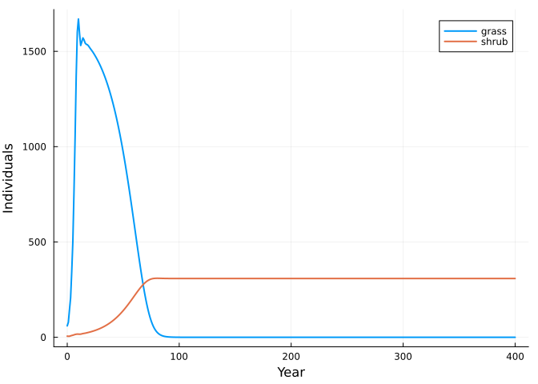
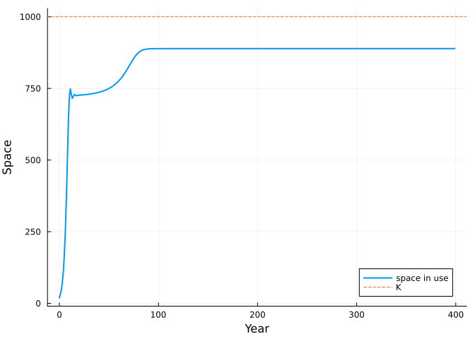
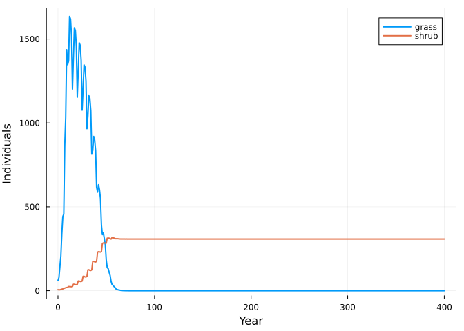

# Matrix community models by composition
Simon Frost

- [What a matrix community model is](#what-a-matrix-community-model-is)
- [Two species sharing space](#two-species-sharing-space)
- [Projection](#projection)
- [Every number is traceable](#every-number-is-traceable)
- [Composition is explicit and
  nests](#composition-is-explicit-and-nests)
- [Environments](#environments)
- [Reference](#reference)

``` julia
ENV["GKSwstype"] = "100"
using MatrixCommunityModels
using MatrixProjectionModels: lambda
using Catlab: @relation
using Plots
```

## What a matrix community model is

A matrix community model (MCM; Lytle & Tonkin 2023) is a set of
single-species matrix population models linked by one assumption: some
quantity, such as space or total biomass, is shared, and every species’
vital rates respond to how much of it is in use. Pairwise interactions
between species are not written down. They emerge from the sharing.

This package builds MCMs in three steps that mirror that description:

1.  declare each **species** as a list of named transitions between
    stages;
2.  say how much of each shared **pool** each stage occupies;
3.  **compose** the species. A pool’s total is the sum of what every
    attached species occupies, and each species sees only that total.

## Two species sharing space

A grass and a shrub compete for 1000 units of space. Seed production of
both falls linearly to zero as the space fills. Rates are numbers, or
functions of a context `ctx` holding the species’ own stage vector
(`ctx.n`), the pool totals (`ctx.pool`) and the environment of the
current step (`ctx.env`).

``` julia
K = 1000.0
crowding(ctx) = max(0.0, 1 - ctx.pool.space / K)

grass = Species(:grass, [:seedling, :adult],
                [survival(:establish, :seedling => :adult, 0.30),
                 survival(:persist, :adult => :adult, 0.50),
                 fecundity(:seed, :adult => :seedling, ctx -> 6.0 * crowding(ctx))];
                occupancy = [:space => [0.1, 1.0]])

shrub = Species(:shrub, [:seedling, :juvenile, :adult],
                [survival(:establish, :seedling => :juvenile, 0.30),
                 survival(:mature, :juvenile => :adult, 0.50),
                 survival(:persist, :adult => :adult, 0.95),
                 fecundity(:seed, :adult => :seedling, ctx -> 3.0 * crowding(ctx))];
                occupancy = [:space => [0.1, 1.0, 4.0]])

com = community(grass, shrub)
```

    OpenCommunity(grass, shrub; pools = space)

`community` joins species by pool name. The result records its state
layout and the wiring diagram it was built from: one box per species,
one junction per pool.

``` julia
species_names(com), pool_names(com)
```

    ([:grass, :shrub], [:space])

``` julia
diagram(com)
```

```@raw html
<div class="c-set">
```
Catlab.WiringDiagrams.RelationDiagrams.UntypedUnnamedRelationDiagram{Symbol, Symbol} {Box:2, Port:2, OuterPort:1, Junction:1, Name:0, VarName:0}

| Box |  name |
|----:|------:|
|   1 | grass |
|   2 | shrub |

| Port | box | junction |
|-----:|----:|---------:|
|    1 |   1 |        1 |
|    2 |   2 |        1 |

| OuterPort | outer_junction |
|----------:|---------------:|
|         1 |              1 |

| Junction | variable |
|---------:|---------:|
|        1 |    space |

```@raw html
</div>
```

## Projection

There is no environmental variation here, so the environment of each
step is `nothing`.

``` julia
sol = project(com, [:grass => [50.0, 10.0], :shrub => [5.0, 0.0, 1.0]], fill(nothing, 400))

plot(sol.t, [sum(sol[:grass]; dims = 2) sum(sol[:shrub]; dims = 2)];
     label = ["grass" "shrub"], xlabel = "Year", ylabel = "Individuals", lw = 2)
```



The grass fills the space quickly; the slower shrub then displaces it.
Nothing in the model says “shrub outcompetes grass”. The outcome follows
from the vital rates: the grass replaces itself only while less than 72%
of the space is in use, the shrub up to 89%, so the shrub keeps growing
after the grass has stopped. The pool total used at each step is kept
alongside the trajectory, and settles at that 89%:

``` julia
plot(sol.t[1:end-1], sol.pools[1:end-1, 1]; label = "space in use", xlabel = "Year",
     ylabel = "Space", lw = 2)
hline!([K]; label = "K", ls = :dash)
```



## Every number is traceable

At any state the model is an ordinary projection matrix. `lower` freezes
one species at a context and returns a `MatrixProjectionModel` from
MatrixProjectionModels.jl, with survival and fecundity kept apart, so
all the single-species tools apply.

``` julia
empty = Context([0.0, 0.0], (space = 0.0,), nothing)
full = Context([0.0, 0.0], (space = 900.0,), nothing)
lower(grass, empty).A, lower(grass, full).A
```

    ([0.0 6.0; 0.3 0.5], [0.0 0.5999999999999999; 0.3 0.5])

``` julia
lambda(lower(grass, empty)), lambda(lower(grass, full))
```

    (1.614734406395618, 0.7424428900898051)

The whole community frozen at a state is block diagonal, one block per
species:

``` julia
n = sol.u[end, :]
A = community_matrix(com, n, nothing)
```

    5×5 Matrix{Float64}:
     0.0  0.666667  0.0  0.0  0.0
     0.3  0.5       0.0  0.0  0.0
     0.0  0.0       0.0  0.0  0.333333
     0.0  0.0       0.3  0.0  0.0
     0.0  0.0       0.0  0.5  0.95

At the end of the run the frozen matrix nearly maps the state to itself,
which is what an equilibrium of the nonlinear model looks like:

``` julia
maximum(abs.(A * n .- n))
```

    7.725952286472193e-38

## Composition is explicit and nests

`community` is a convenience for the common case. The underlying
operation is `compose`, which fills the boxes of an undirected wiring
diagram. Writing the diagram by hand makes the dependency assumption a
visible object:

``` julia
d = @relation (space,) begin
    grass(space)
    shrub(space)
end
com2 = compose(d, [grass, shrub])
sol2 = project(com2, sol.u[1, :], fill(nothing, 400))
sol2.u == sol.u
```

    true

A composite is itself an open community, so it can be a box in a larger
diagram. Here a third species joins the two-species community through
the same pool. Because pool totals are sums, the result does not depend
on how the species were grouped:

``` julia
herb = Species(:herb, [:plant], [survival(:persist, :plant => :plant, 0.2),
                                 fecundity(:seed, :plant => :plant, ctx -> 2.0 * crowding(ctx))];
               occupancy = [:space => [0.5]])

nested = compose((@relation (space,) begin
                      woody(space)
                      herb(space)
                  end), [com, herb])
flat = community(grass, shrub, herb)

n0 = [50.0, 10.0, 5.0, 0.0, 1.0, 20.0]
project(nested, n0, fill(nothing, 100)).u ≈ project(flat, n0, fill(nothing, 100)).u
```

    true

## Environments

The environment is anything you like, one value per time step, handed to
every rate. A drought that halves grass survival in some years:

``` julia
grass_d = Species(:grass, [:seedling, :adult],
                  [survival(:establish, :seedling => :adult, ctx -> ctx.env.drought ? 0.15 : 0.30),
                   survival(:persist, :adult => :adult, ctx -> ctx.env.drought ? 0.25 : 0.50),
                   fecundity(:seed, :adult => :seedling, ctx -> 6.0 * crowding(ctx))];
                  occupancy = [:space => [0.1, 1.0]])

envs = [(drought = t % 5 == 0,) for t in 1:400]
sold = project(community(grass_d, shrub), sol.u[1, :], envs)
plot(sold.t, [sum(sold[:grass]; dims = 2) sum(sold[:shrub]; dims = 2)];
     label = ["grass" "shrub"], xlabel = "Year", ylabel = "Individuals", lw = 2)
```



The following vignettes rebuild published MCMs this way and check them
against the original R code.

## Reference

Lytle, D. A. & Tonkin, J. D. (2023). Matrix community models for ecology
and evolution. *npj Biodiversity* 2, 26.
<https://doi.org/10.1038/s44185-023-00031-5>
