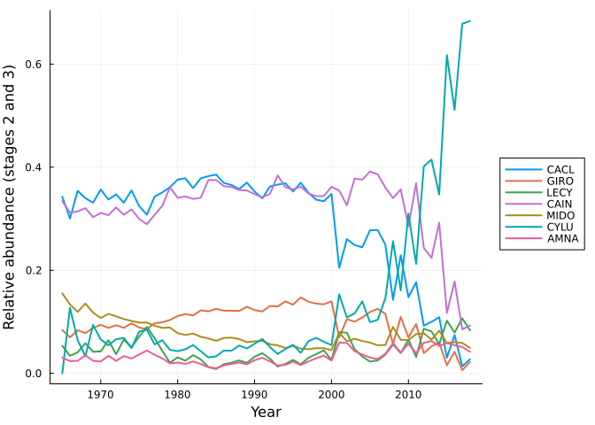
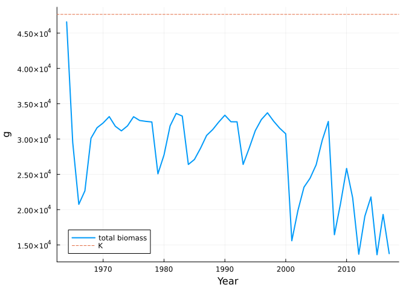
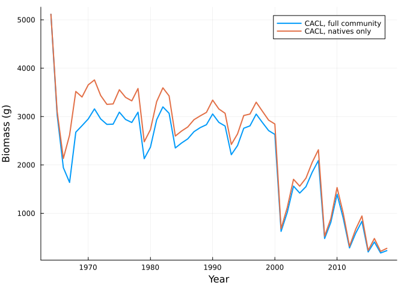

# Verde River fish: a community linked by total biomass
Simon Frost

- [The model](#the-model)
- [Projection through the 1964-2017 flow
  record](#projection-through-the-1964-2017-flow-record)
- [Agreement with the original R
  code](#agreement-with-the-original-r-code)
- [What the pool does](#what-the-pool-does)
- [Asking a new question takes one
  line](#asking-a-new-question-takes-one-line)
- [Reference](#reference)

``` julia
ENV["GKSwstype"] = "100"
using MatrixCommunityModels
using MatrixProjectionModels: lambda
using Plots, Printf
```

## The model

Rogosch et al. (2019) modelled seven fish species of the Verde River,
Arizona: three natives (*Catostomus clarkii* CACL, *Gila robusta* GIRO,
*Catostomus insignis* CAIN) and four non-natives (*Lepomis cyanellus*
LECY, *Micropterus dolomieu* MIDO, *Cyprinella lutrensis* CYLU,
*Ameiurus natalis* AMNA). Each species has three stages and its state is
biomass in grams. Survival depends on the kind of year (spring flood,
summer flood, medium flood, drought, or none of these). The species are
linked by one **dependency assumption**: the fecundity of every species
is multiplied by `max(0, 1 - B/K)`, where `B` is the total biomass of
all fish and `K` = 47,660 g.

`verde_fish_model()` builds this community from the published vital-rate
tables. In `src/models.jl` each species is a projection net from
CategoricalPopulationDynamics.jl with four named transitions;
*responses* attached to those names say how each year type reduces
growth and survival and how total biomass limits spawning; and one line
says that every stage occupies the `biomass` pool gram for gram.

``` julia
m = verde_fish_model()
fish = m.community
```

    OpenCommunity(CACL, GIRO, LECY, CAIN, MIDO, CYLU, AMNA; pools = biomass)

``` julia
transition_names(system(fish)[:CYLU])
```

    4-element Vector{Symbol}:
     :adult_growth
     :adult_stasis
     :juvenile_growth
     :spawning

## Projection through the 1964-2017 flow record

Each year’s environment is its set of year-type flags.

``` julia
m.years[1:3], m.envs[1:3]
```

    ([1964, 1965, 1966], [(SP_highflood = 0, SU_highflood = 1, medflood = 0, drought = 0, nonevent = 0), (SP_highflood = 0, SU_highflood = 0, medflood = 1, drought = 0, nonevent = 0), (SP_highflood = 1, SU_highflood = 0, medflood = 0, drought = 0, nonevent = 0)])

``` julia
sol = project(fish, m.n0, m.envs)
```

    CommunityTrajectory(54 steps, 21 states)

Rogosch et al. report relative abundance of the two older stages.
Biomass converts to numbers through the individuals-per-gram of each
stage.

``` julia
adults = reduce(hcat, [sol[sp][:, 2] .* m.density[sp][2] .+ sol[sp][:, 3] .* m.density[sp][3]
                       for sp in species_names(fish)])
rel = adults ./ sum(adults; dims = 2)
yrs = [m.years; m.years[end] + 1]
plot(yrs[2:end], rel[2:end, :]; label = permutedims(String.(species_names(fish))),
     xlabel = "Year", ylabel = "Relative abundance (stages 2 and 3)", lw = 2, legend = :outerright)
```



## Agreement with the original R code

`test/reference/fish_det_biomass.csv` was produced by the authors’ R
script, run with the same flow record and the initial biomass of the
vital-rate table (see `test/reference/R/run_fish_reference.R`). Each of
its rows is the state before that year’s update.

``` julia
ref_file = joinpath(pkgdir(MatrixCommunityModels), "test", "reference", "fish_det_biomass.csv")
ref = permutedims(reduce(hcat, [parse.(Float64, split(l, ",")[2:end]) for l in readlines(ref_file)[2:end]]))
got = sol.u[1:54, :]
(identical = count(got .== ref), of = length(ref), max_abs_difference = maximum(abs.(got .- ref)))
```

    (identical = 1134, of = 1134, max_abs_difference = 0.0)

All 1134 values (54 years, 21 states) are identical to the last bit.

## What the pool does

Total biomass, the only thing the species share, stays below `K`:

``` julia
plot(m.years, sol.pools[1:end-1, 1]; label = "total biomass", xlabel = "Year", ylabel = "g", lw = 2)
hline!([47660]; label = "K", ls = :dash)
```



Freezing a species at a year type and a biomass gives an ordinary
`MatrixProjectionModel`, so the tools of MatrixProjectionModels.jl
apply; here, its growth rate. Here each species alone in an almost empty
river, by year type:

``` julia
flags(; kw...) = merge((SP_highflood = 0, SU_highflood = 0, medflood = 0, drought = 0, nonevent = 0), kw)
types = ["spring flood" => flags(SP_highflood = 1), "summer flood" => flags(SU_highflood = 1),
         "medium flood" => flags(medflood = 1), "drought" => flags(drought = 1),
         "non-event" => flags(nonevent = 1)]
nobody = zeros(length(fish))
for sp in species_names(fish)
    lams = [lambda(matrix_model(fish, sp, nobody, env)) for (_, env) in types]
    @printf("%-5s %s\n", sp, join([@sprintf("%-13s %5.2f", first(t), l) for (t, l) in zip(types, lams)], "  "))
end
```

    CACL  spring flood   1.42  summer flood   1.30  medium flood   1.41  drought        0.59  non-event      1.30
    GIRO  spring flood   1.53  summer flood   1.37  medium flood   1.51  drought        0.67  non-event      1.37
    LECY  spring flood   1.31  summer flood   0.84  medium flood   1.31  drought        1.55  non-event      1.82
    CAIN  spring flood   1.34  summer flood   1.27  medium flood   1.34  drought        0.81  non-event      1.27
    MIDO  spring flood   1.25  summer flood   1.17  medium flood   1.25  drought        1.23  non-event      1.31
    CYLU  spring flood   1.47  summer flood   1.25  medium flood   1.47  drought        1.78  non-event      1.74
    AMNA  spring flood   1.20  summer flood   0.98  medium flood   1.20  drought        1.33  non-event      1.62

The natives (CACL, GIRO, CAIN) do best after spring floods and decline
in droughts; the non-natives do best in droughts and non-event years.
That is the autecology the model was given. Competition appears only
when the community is put together.

## Asking a new question takes one line

Because the community is a composite, changing its membership is a
matter of composing a different set of species. The natives without the
non-natives:

``` julia
natives = subcommunity(fish, :CACL, :GIRO, :CAIN)
n0 = [p for p in m.n0 if p.first in (:CACL, :GIRO, :CAIN)]
alone = project(natives, n0, m.envs)
plot(yrs, [sum(sol[:CACL]; dims = 2) sum(alone[:CACL]; dims = 2)];
     label = ["CACL, full community" "CACL, natives only"], xlabel = "Year", ylabel = "Biomass (g)", lw = 2)
```



## Reference

Rogosch, J. S., Tonkin, J. D., Lytle, D. A., Merritt, D. M., Reynolds,
L. V. & Olden, J. D. (2019). Increasing drought favors nonnative fishes
in a dryland river: evidence from a multispecies demographic model.
*Ecosphere* 10, e02681. Code and data:
<https://doi.org/10.5281/zenodo.1309024> (MIT licence).
