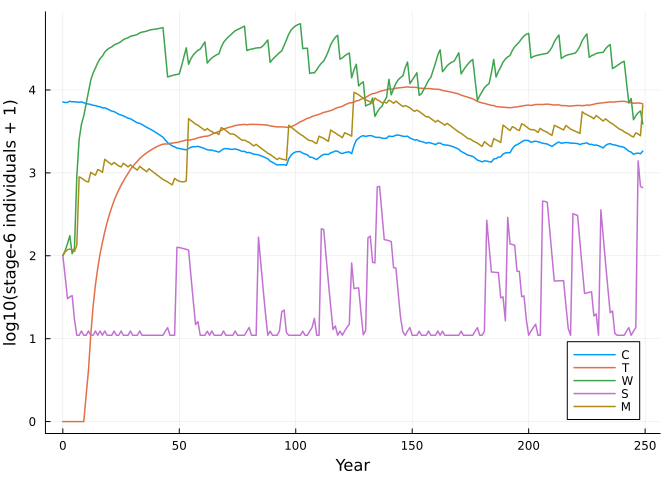
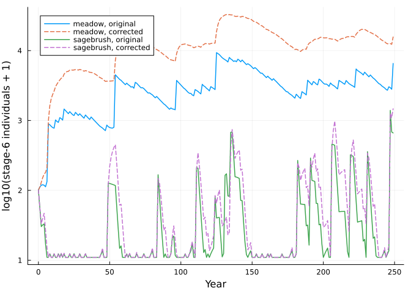
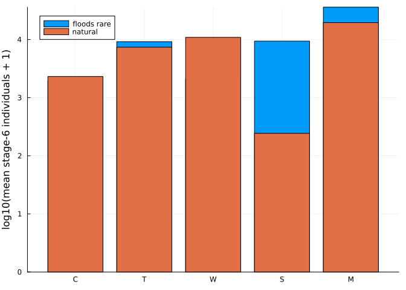

# Riparian plant guilds: a community linked by space
Simon Frost

- [The model](#the-model)
- [Agreement with the original R
  code](#agreement-with-the-original-r-code)
- [What the wiring shows](#what-the-wiring-shows)
- [Flow regimes](#flow-regimes)
- [Reference](#reference)

``` julia
ENV["GKSwstype"] = "100"
using MatrixCommunityModels
using Plots, Random, Statistics
```

## The model

Lytle et al. (2017) modelled five riparian plant guilds on the Yampa
River, each with six stages: cottonwood (`C`, hydroriparian tree),
tamarisk (`T`, xeroriparian shrub), willow (`W`, hydroriparian shrub),
sagebrush (`S`, desert shrub) and meadow (`M`). Floods and droughts kill
a stage-specific fraction of each guild. The **dependency assumption**
is that seedlings can only establish on free space: the space occupied
by all guilds after the year’s mortality is subtracted from the total
area `K`, and each guild’s recruitment is proportional to what is left.

This differs from the fish model in two ways that the package has to
express:

- recruitment does not depend on how many adults there are (one tree can
  seed all free space), so it is an additive `recruitment` term rather
  than a matrix entry;
- the space a guild occupies depends on the year, because it is counted
  after mortality, so its `occupancy` is a function of the state and the
  environment.

``` julia
m = riparian_model()
m.community
```

    OpenCommunity(C, T, W, S, M; pools = space, willow_adults)

Each year’s environment is derived from one row of the 1916-1998 flow
record at Maybell: whether there was a flood or drought, and the
seed-release overlap and drawdown survival terms for cottonwood and
tamarisk.

``` julia
m.envs[1]
```

    (year = 1916, flood = 1.0, drought = 0.0, nonflood = 0.0, cprop = 0.9210526315789473, tprop = 0.26785714285714285, decline = 0.6634536565168259, tdecline = 0.9063376969418638)

## Agreement with the original R code

The published script draws a random year from the record at each step.
The reference trajectory `rip_seed_traj.csv` was produced by that script
with a fixed seed, and records which year was drawn, so the same
sequence can be replayed here.

``` julia
ref_file = joinpath(pkgdir(MatrixCommunityModels), "test", "reference", "rip_seed_traj.csv")
ref = permutedims(reduce(hcat, [parse.(Float64, split(l, ",")) for l in readlines(ref_file)[2:end]]))
drawn = Int.(ref[1:249, 2])
sol = project(m.community, m.n0, m.envs[drawn])
N = ref[:, 5:34]
(identical = count(sol.u .== N), of = length(N),
 max_relative_difference = maximum(abs.(sol.u .- N) ./ max.(abs.(N), 1.0)))
```

    (identical = 7496, of = 7500, max_relative_difference = 3.9221753509148656e-16)

Thirty states over 250 years agree to within a few parts in 10^16.

``` julia
guilds = species_names(m.community)
mature = reduce(hcat, [sol[g][:, 6] for g in guilds])
plot(sol.t, log10.(mature .+ 1); label = permutedims(String.(guilds)), xlabel = "Year",
     ylabel = "log10(stage-6 individuals + 1)", lw = 1.5)
```



## What the wiring shows

The original community has two pools, not one:

``` julia
pool_names(m.community)
```

    2-element Vector{Symbol}:
     :space
     :willow_adults

`space` is the dependency assumption. `willow_adults` is there because
the published script assigns the willow guild’s recruitment to the
meadow guild, so meadow seedlings appear only when willow adults are
present. In a script this is one variable name on one line; here a guild
cannot see another guild except through a pool, so reproducing the
behaviour required adding a wire, and the wire is visible.

The script also drops the stage-5 sagebrush and meadow individuals that
do not mature, while still counting their space.
`riparian_model(corrected = true)` removes both behaviours:

``` julia
c = riparian_model(corrected = true)
pool_names(c.community)
```

    1-element Vector{Symbol}:
     :space

``` julia
corr = project(c.community, c.n0, c.envs[drawn])
plot(sol.t, log10.([sol[:M][:, 6] corr[:M][:, 6] sol[:S][:, 6] corr[:S][:, 6]] .+ 1);
     label = ["meadow, original" "meadow, corrected" "sagebrush, original" "sagebrush, corrected"],
     xlabel = "Year", ylabel = "log10(stage-6 individuals + 1)", lw = 1.5, ls = [:solid :dash :solid :dash])
```



Both variants are kept: the original as a regression target, the
corrected one as the model the paper describes.

## Flow regimes

Projecting under a different flow regime only needs a different sequence
of environments. Here the corrected model is run with years drawn at
random from the whole record (floods in 57% of years) and with floods
made rare (10% of years), comparing the mean number of stage-6
individuals of each guild after a 100-year burn-in. This is a single
random sequence per regime, for illustration.

``` julia
rng = Xoshiro(1)
floods = [e for e in c.envs if e.flood == 1]
others = [e for e in c.envs if e.flood == 0]
natural = [rand(rng, c.envs) for _ in 1:300]
fewer_floods = [rand(rng) < 0.1 ? rand(rng, floods) : rand(rng, others) for _ in 1:300]

function mean_mature(envs)
    s = project(c.community, c.n0, envs)
    [mean(s[g][101:end, 6]) for g in guilds]
end
a, b = mean_mature(natural), mean_mature(fewer_floods)
bar(repeat(String.(guilds); outer = 2), log10.([a; b] .+ 1);
    group = repeat(["natural", "floods rare"]; inner = 5), ylabel = "log10(mean stage-6 individuals + 1)")
```



## Reference

Lytle, D. A., Merritt, D. M., Tonkin, J. D., Olden, J. D. & Reynolds, L.
V. (2017). Linking river flow regimes to riparian plant guilds: a
community-wide modeling approach. *Ecological Applications* 27,
1338-1350. Code and data: <https://doi.org/10.6084/m9.figshare.4652608>
