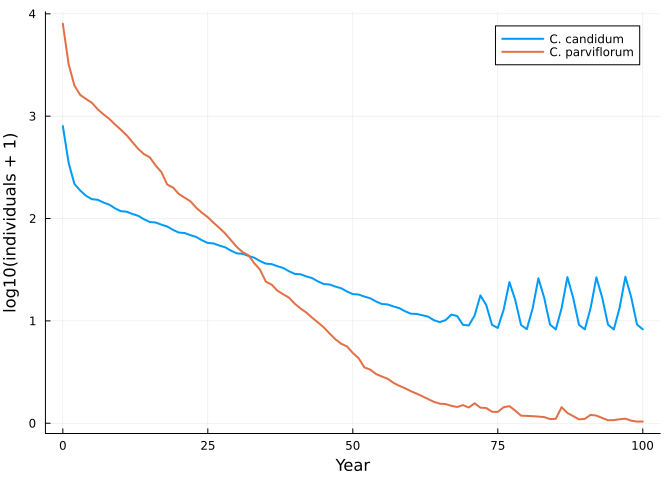
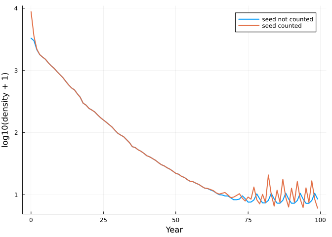

# Two orchids: reproducing an adapt3 community projection
Simon Frost

- [The model](#the-model)
- [Projection](#projection)
- [Agreement with adapt3](#agreement-with-adapt3)
- [Changing the dependency
  assumption](#changing-the-dependency-assumption)
- [Reference](#reference)

``` julia
ENV["GKSwstype"] = "100"
using MatrixCommunityModels
using Plots
```

## The model

The R package adapt3 (Shefferson 2026) projects several matrix
population models against a common density. Its community-projection
vignette uses two lady’s slipper orchids, *Cypripedium candidum* and *C.
parviflorum*, each with nine stages (dormant seed `SD`, protocorm `P1`,
seedling `SL`, dormant adult `D`, and five sizes of flowering adult) and
one matrix per study year, estimated from field data with the R package
lefko3.

In adapt3 the community is specified by four parallel lists: matrices,
start vectors, density frames keyed by matrix element, and equivalence
frames. Here the same information is three statements about each
species:

- its transitions cycle through the annual matrices (the environment of
  step `t` is the year counter);
- reproduction into `SD` and `P1` is multiplied by Ricker terms,
  `0.5 exp(-N)` and `1.2 exp(-2N)`, where `N` is the total of the
  `density` pool;
- every stage except dormant seed occupies the `density` pool with
  weight one (adapt3’s equivalence frame).

``` julia
m = cypripedium_model()
m.community
```

    OpenCommunity(candidum, parviflorum; pools = density)

The estimated matrices are shipped as data (`data/cypripedium`), since
estimating them needs the R workflow. Each species is a net with three
named transitions; the two kinds of production read the pool, through
`RickerDensity` from MatrixProjectionModels.jl:

``` julia
transition_names(system(m.community)[:candidum])
```

    3-element Vector{Symbol}:
     :life_cycle
     :protocorm_production
     :seed_production

## Projection

``` julia
sol = project(m.community, m.n0, m.envs)
totals = [sum(sol[:candidum]; dims = 2) sum(sol[:parviflorum]; dims = 2)]
plot(sol.t, log10.(totals .+ 1); label = ["C. candidum" "C. parviflorum"], xlabel = "Year",
     ylabel = "log10(individuals + 1)", lw = 2)
```



With these Ricker terms recruitment is almost completely suppressed
while any appreciable number of plants is present (`exp(-N)` with `N` in
the hundreds), so both populations decline, and *C. parviflorum* shows
brief bursts of recruitment when the community becomes very small.

## Agreement with adapt3

The reference files were produced by `project3()` in adapt3 2.0.9 from
the vignette’s own objects (`test/reference/R/run_adapt3_reference.R`).
They hold the size of each population and the aggregate density at each
time.

``` julia
function reference(tag)
    file = joinpath(pkgdir(MatrixCommunityModels), "test", "reference", "adapt3_$(tag)_N.csv")
    permutedims(reduce(hcat, [parse.(Float64, split(l, ",")[2:4]) for l in readlines(file)[2:end]]))
end
ref = reference("continuous")
(max_scaled_difference = maximum(abs.(totals .- ref[:, 1:2]) ./ max.(ref[:, 1:2], 1.0)),
 density_matches = sol.pools[1:100, 1] ≈ ref[1:100, 3])
```

    (max_scaled_difference = 8.268022275869569e-16, density_matches = true)

The vignette itself floors the stage vectors to whole individuals each
step (`integeronly = TRUE`). That is a threshold applied after the
projection:

``` julia
mi = cypripedium_model(integeronly = true)
soli = project(mi.community, mi.n0, mi.envs)
totalsi = [sum(soli[:candidum]; dims = 2) sum(soli[:parviflorum]; dims = 2)]
totalsi == reference("vignette")[:, 1:2]
```

    true

``` julia
Int.(totalsi[1:12, :])'
```

    2×12 adjoint(::Matrix{Int64}) with eltype Int64:
      800   347   213   180   157   143   138   128  120  108  100   95
     8000  3215  1987  1608  1464  1344  1158  1028  928  815  723  635

These are the numbers printed in the adapt3 vignette. *C. candidum* is
extinct from year 30 and *C. parviflorum* from year 69.

## Changing the dependency assumption

Because the weights are part of each species, the effect of an
assumption can be seen by changing it in one place. If dormant seed
counted toward density:

``` julia
ma = cypripedium_model(equivalence = false)
sola = project(ma.community, ma.n0, ma.envs)
plot(sol.t[1:end-1], log10.([sol.pools[1:end-1, 1] sola.pools[1:end-1, 1]] .+ 1);
     label = ["seed not counted" "seed counted"], xlabel = "Year", ylabel = "log10(density + 1)", lw = 2)
```



## Reference

Shefferson, R. P. (2026). adapt3: Adaptive dynamics and community
projection in the R programming language. *Methods in Ecology and
Evolution* 17, 1719-1725. <https://doi.org/10.1111/2041-210x.70298>
