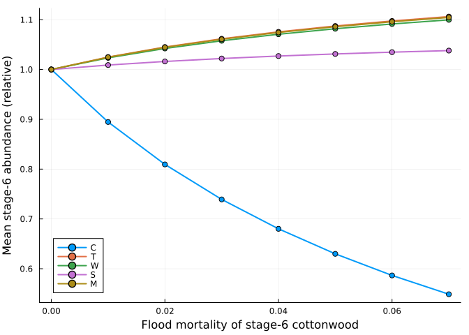
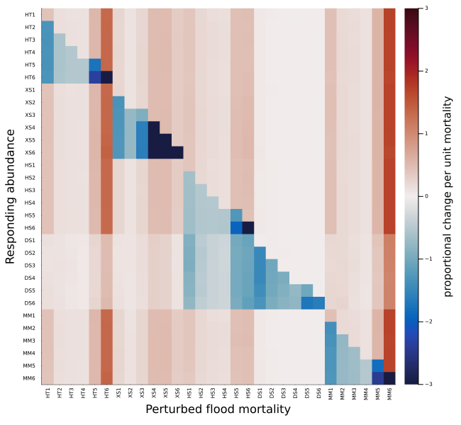
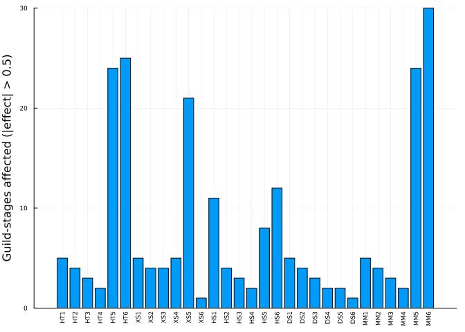
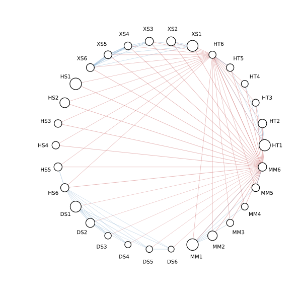

# Revealing interactions: cross-species sensitivity analysis
Simon Frost

- [Interactions as an output](#interactions-as-an-output)
- [One perturbation](#one-perturbation)
- [The full matrix](#the-full-matrix)
- [Which stages matter most](#which-stages-matter-most)
- [The network](#the-network)
- [A note on R²](#a-note-on-r²)
- [Reference](#reference)

``` julia
ENV["GKSwstype"] = "100"
using MatrixCommunityModels
using Plots, Random, Statistics
```

## Interactions as an output

A matrix community model contains no interaction coefficients. Lytle &
Tonkin (2023) recover interactions afterwards: change one vital rate of
one species and stage a little, project the community, and see how the
average abundance of every species and stage responds. Doing this for
every vital rate gives a matrix of net effects, which they summarise as
a network (their Figs. 2 and 3).

This vignette does that for the riparian guild model of the previous
vignette, in its corrected form, perturbing the flood mortality of each
of the 30 guild-stages.

## One perturbation

`abundance_sensitivity` takes a function that builds the model with the
vital rate set to a given value, the values to try, and the
environments. `with_rate` makes a copy of the guild parameters with one
entry changed.

The flow regime is a random draw of years from the record. The same 20
sequences of 300 years are used for every value of the vital rate, so
that differences between runs are due to the vital rate and not to the
luck of the draw. The first 100 years are discarded.

``` julia
base = riparian_model(corrected = true)
rng = Xoshiro(1)
sequences = [[rand(rng, base.envs) for _ in 1:300] for _ in 1:20]

function flood_mortality_sensitivity(guild, stage; envs = r -> sequences[r])
    v0 = RIPARIAN_GUILDS[guild].S[stage]
    values = collect(range(max(0, v0 - 0.05), min(1, v0 + 0.05); step = 0.01))
    build(v) = riparian_model(corrected = true, guilds = with_rate(RIPARIAN_GUILDS, guild, :S, stage, v))
    return abundance_sensitivity(build, values, envs; burnin = 100, replicates = 20), values
end

s, values = flood_mortality_sensitivity(:C, 6)
```

    ((slope = [2.8941063716726275e6, 27196.205681559768, 2105.455876929926, 1646.043604229914, 4501.0333011967095, -15915.091859500668, 1.969616545530645e6, 52826.05724552152, 14679.43775403232, 6850.827415677398  …  372.7810906690909, 230.6590467113406, 379.4552298321292, 145.77485342139963, 4.480971214369054e6, 141077.97103077153, 2356.0381137984723, 1518.4201102228083, 6612.51117427275, 25639.221689448957], r2 = [0.9717311055129279, 0.9710200664502038, 0.9709392250167993, 0.97082066655274, 0.9708003164064941, 0.9706925649639362, 0.9716241514835594, 0.9710846942092096, 0.970949281606067, 0.9708609492387071  …  0.9731463538561256, 0.9731971559946676, 0.9728544662141038, 0.9692801046060228, 0.971636988565778, 0.9707272373605086, 0.9705353436822334, 0.9706850578605656, 0.9705445669957481, 0.9696693119531941], means = [2.0510122977463552e6 19190.51110059933 … 4653.482648724525 17561.953159658784; 2.098966811424761e6 19643.412957252818 … 4764.307129655869 17994.475076211842; … ; 2.240470991118772e6 20972.779170096965 … 5087.254061803725 19246.031069491335; 2.2579751849963004e6 21135.958286870202 … 5126.790114443041 19398.086000516945]), [0.0, 0.01, 0.02, 0.03, 0.04, 0.05, 0.06, 0.07])

The response of mature (stage 6) individuals of each guild to the flood
mortality of mature cottonwood:

``` julia
guilds = [:C, :T, :W, :S, :M]
mature = 6:6:30
plot(values, s.means[:, mature] ./ s.means[1:1, mature]; label = permutedims(String.(guilds)),
     xlabel = "Flood mortality of stage-6 cottonwood", ylabel = "Mean stage-6 abundance (relative)",
     marker = :circle, lw = 2)
```



Killing more mature cottonwood in floods reduces cottonwood and lets
every other guild increase: competition, although the model has no
competition coefficient.

``` julia
(slope = round.(s.slope[mature]; digits = 1), r2 = round.(s.r2[mature]; digits = 3))
```

    (slope = [-15915.1, 10007.8, 16308.0, 145.8, 25639.2], r2 = [0.971, 0.97, 0.97, 0.969, 0.97])

## The full matrix

``` julia
labels = [string(g, i) for g in ("HT", "XS", "HS", "DS", "MM") for i in 1:6]
slope = zeros(30, 30)
r2 = zeros(30, 30)
for (a, g) in enumerate(guilds), i in 1:6
    res, _ = flood_mortality_sensitivity(g, i)
    slope[:, (a - 1) * 6 + i] = res.slope
    r2[:, (a - 1) * 6 + i] = res.r2
end
```

Column `j` holds the effect of the flood mortality of guild-stage `j` on
the mean abundance of every guild-stage (rows). To compare stages whose
abundances differ by orders of magnitude, each row is divided by that
stage’s mean abundance in the unperturbed model, giving the proportional
change in abundance per unit of mortality. (Guild labels follow the
paper: HT cottonwood, XS tamarisk, HS willow, DS sagebrush, MM meadow.)

``` julia
baseline = mean(mean_abundance(base.community, base.n0, q; burnin = 100) for q in sequences)
effect = slope ./ baseline
heatmap(labels, labels, clamp.(effect, -3, 3); yflip = true, color = :balance, clims = (-3, 3),
        xrotation = 90, xticks = (0.5:1:29.5, labels), yticks = (0.5:1:29.5, labels), tickfontsize = 5,
        xlabel = "Perturbed flood mortality", ylabel = "Responding abundance", size = (650, 600),
        colorbar_title = "proportional change per unit mortality")
```



Red cells are positive effects (the responding stage gains when the
perturbed stage suffers more in floods) and blue cells negative. The
diagonal blocks are within-guild effects. Two features stand out:

``` julia
(positive = count(effect .> 0), negative = count(effect .< 0),
 negative_within_guild = count(effect[i, j] < 0 for i in 1:30, j in 1:30 if (i - 1) ÷ 6 == (j - 1) ÷ 6))
```

    (positive = 776, negative = 124, negative_within_guild = 88)

Most effects between guilds are positive, that is, competitive. The
clearest exception is sagebrush (DS), which declines when willow (HS)
suffers more in floods, a net positive effect of willow on sagebrush
that no one put into the model. And the effect of a stage’s mortality on
its own abundance is not always negative:

``` julia
[labels[k] => round(effect[k, k]; digits = 2) for k in (1, 6, 13, 18)]
```

    4-element Vector{Pair{String, Float64}}:
     "HT1" => 0.43
     "HT6" => -7.79
     "HS1" => 0.4
     "HS6" => -3.52

More flood mortality of seedlings (stage 1) *increases* the average
number of seedlings of that guild, because the space freed is
recolonised by new seedlings and recruitment in this model does not
depend on the number of adults.

## Which stages matter most

Counting, for each perturbed stage, how many guild-stages change by more
than half their abundance per unit of mortality gives a simple measure
of influence:

``` julia
influence = vec(sum(abs.(effect) .> 0.5; dims = 1))
bar(labels, influence; xrotation = 90, legend = false, xticks = (0.5:1:29.5, labels), tickfontsize = 6,
    ylabel = "Guild-stages affected (|effect| > 0.5)")
```



The older stages of cottonwood (HT5, HT6) and meadow (MM5, MM6), and
stage-5 tamarisk, affect almost the whole community. Lytle & Tonkin
single out mature cottonwood (HT6) as a keystone of this system. Their
analysis used the original model, so the two are not directly
comparable, but the same stage emerges here.

## The network

The matrix can be drawn as a directed network: an arrow from the
perturbed stage to each stage it strongly affects.

``` julia
θ = range(0, 2π; length = 31)[1:30]
x, y = cos.(θ), sin.(θ)
p = plot(; aspect_ratio = 1, axis = false, grid = false, legend = false, size = (600, 600),
         xlims = (-1.3, 1.3), ylims = (-1.3, 1.3))
for j in 1:30, i in 1:30
    (i != j && abs(effect[i, j]) > 1) || continue
    plot!(p, [x[j], x[i]], [y[j], y[i]]; color = effect[i, j] > 0 ? :firebrick : :steelblue,
          alpha = 0.35, lw = min(abs(effect[i, j]), 6) / 2)
end
scatter!(p, x, y; ms = 3 .+ 1.5 .* log10.(baseline .+ 1), color = :white, markerstrokecolor = :black)
annotate!(p, [(1.12 * x[k], 1.12 * y[k], text(labels[k], 7)) for k in 1:30])
p
```



Red links are positive effects, blue negative; node size reflects mean
abundance.

## A note on R²

The paper keeps only relationships with R² above 0.3. Here every
relationship has an R² close to one:

``` julia
quantile(vec(r2), [0.05, 0.5, 0.95])
```

    3-element Vector{Float64}:
     0.9709487787766036
     0.9999048761747208
     0.9999949280840726

That is a consequence of using the same flow sequences for every value
of the vital rate. If each run draws its own sequence, as in the
original analysis, sampling noise is added to every point and R² falls,
most for the weakest effects:

``` julia
rng2 = Xoshiro(2)
noisy, _ = flood_mortality_sensitivity(:C, 6; envs = r -> [rand(rng2, base.envs) for _ in 1:300])
(common_sequences = round.(s.r2[mature]; digits = 2), independent_sequences = round.(noisy.r2[mature]; digits = 2),
 slope_common = round.(s.slope[mature]; digits = 1), slope_independent = round.(noisy.slope[mature]; digits = 1))
```

    (common_sequences = [0.97, 0.97, 0.97, 0.97, 0.97], independent_sequences = [0.96, 0.5, 0.54, 0.01, 0.48], slope_common = [-15915.1, 10007.8, 16308.0, 145.8, 25639.2], slope_independent = [-16458.1, 8335.0, 26528.6, 93.4, 29739.2])

With common sequences the R² filter is not needed to separate signal
from noise, and far fewer replicates are required; the size of the
effect is the more useful criterion.

## Reference

Lytle, D. A. & Tonkin, J. D. (2023). Matrix community models for ecology
and evolution. *npj Biodiversity* 2, 26.

Tonkin, J. D., Merritt, D. M., Olden, J. D., Reynolds, L. V. & Lytle, D.
A. (2018). Flow regime alteration degrades ecological networks in
riparian ecosystems. *Nature Ecology & Evolution* 2, 86-93.
