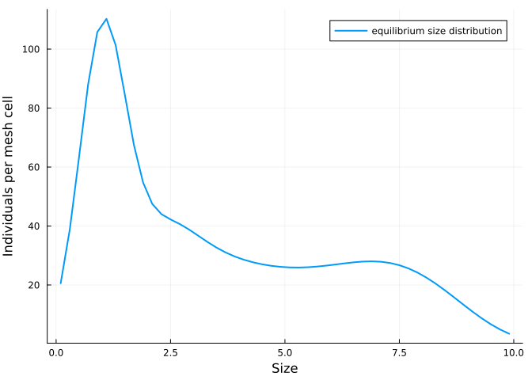
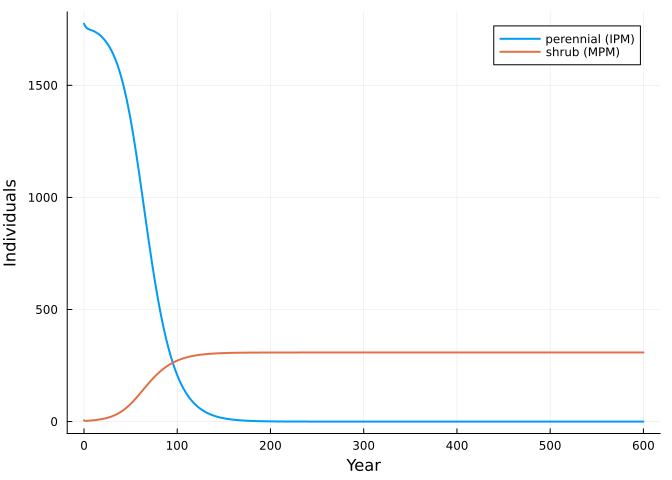

# Composing an integral projection model with a matrix model
Simon Frost

- [Beyond matrices](#beyond-matrices)
- [A size-structured perennial](#a-size-structured-perennial)
- [Adding a stage-structured
  competitor](#adding-a-stage-structured-competitor)
- [Predicting the outcome without
  simulating](#predicting-the-outcome-without-simulating)
- [The mesh does not matter](#the-mesh-does-not-matter)
- [Reference](#reference)

``` julia
ENV["GKSwstype"] = "100"
using MatrixCommunityModels
using IntegralProjectionModels: ContinuousDomain, meshpoints, materialize, PKernel, FKernel,
                                LinearSurvival, NormalGrowth, FecundityRate
using Plots
```

## Beyond matrices

Lytle & Tonkin (2023) note that a matrix structure “is not strictly
required” for a community model: any population model with density
dependence could be linked through the same dependency assumption. An
integral projection model (IPM) describes a population structured by a
continuous trait such as size. Once discretised on a mesh it is a
projection matrix, so it can be a box in the same wiring diagram as a
stage-structured species. All it needs is a statement of how much of the
pool an individual of each size occupies.

## A size-structured perennial

The kernels come from IntegralProjectionModels.jl: survival increases
with size, growth is normally distributed around a linear function of
size, and seed production increases exponentially with size.

``` julia
function perennial_kernels(mesh)
    domain = ContinuousDomain(0.0, 10.0, mesh)
    P = materialize(PKernel(LinearSurvival(-0.5, 0.4), NormalGrowth(1.2, 0.85, 0.7), domain))
    F = materialize(FKernel(FecundityRate(-1.0, 0.5, 1.0, 0.5, 0.2), domain))
    return P, F, meshpoints(domain)
end
P, F, z = perennial_kernels(50)
size(P), size(F)
```

    ((50, 50), (50, 50))

`matrix_net` turns the two kernel matrices into a projection net with
two named transitions, one mesh cell per stage. Recruitment is limited
by space, a response on the `recruitment` transition, and an individual
of size `z` occupies `0.02 z²` units of space.

``` julia
K = 1000.0
crowding(ctx) = max(0.0, 1 - ctx.pool.space / K)

function perennial(mesh)
    P, F, z = perennial_kernels(mesh)
    net = matrix_net([Symbol(:z, i) for i in 1:mesh], :survival_growth => P, :recruitment => F)
    species(:perennial, births(respond(net, :recruitment => crowding), :recruitment); occupies = [:space => 0.02 .* z .^ 2])
end
ipm = perennial(50)
```

    OpenCommunity(perennial; pools = space)

On its own the perennial grows to an equilibrium that fills about two
thirds of the space:

``` julia
n0 = zeros(50)
n0[z .< 2] .= 2.0
alone = ipm
eq = equilibrium(alone, n0, nothing)
(converged = eq.converged, individuals = sum(eq.n), space = pool_totals(alone, eq.n, nothing).space)
```

    (converged = true, individuals = 1774.6585917775658, space = 676.7432286069879)

``` julia
plot(z, eq.n; xlabel = "Size", ylabel = "Individuals per mesh cell", label = "equilibrium size distribution", lw = 2)
```



## Adding a stage-structured competitor

The shrub is the three-stage matrix model of the introduction. The two
species are composed exactly as two matrix models would be.

``` julia
shrub_life = ValuedProjectionNet([:seedling, :juvenile, :adult],
    :establishing => [(:seedling => :juvenile) => 0.30], :maturing => [(:juvenile => :adult) => 0.50],
    :persisting => [(:adult => :adult) => 0.95], :seeding => [(:adult => :seedling) => 3.0])
shrub = species(:shrub, births(respond(shrub_life, :seeding => crowding), :seeding);
                occupies = [:space => [0.1, 1.0, 4.0]])

com = community(ipm, shrub)
sol = project(com, [eq.n; 5.0; 0.0; 1.0], fill(nothing, 600))
plot(sol.t, [sum(sol[:perennial]; dims = 2) sum(sol[:shrub]; dims = 2)];
     label = ["perennial (IPM)" "shrub (MPM)"], xlabel = "Year", ylabel = "Individuals", lw = 2)
```



The shrub invades the established perennial and slowly replaces it.

## Predicting the outcome without simulating

Each species alone settles at the level of crowding at which it just
replaces itself. The other species can invade if its growth rate at that
level of crowding exceeds one.

``` julia
shrub_alone = shrub
seq = equilibrium(shrub_alone, [5.0, 0.0, 1.0], nothing)
(shrub_into_perennial = invasion_growth_rate(shrub, alone, eq.n, nothing),
 perennial_into_shrub = invasion_growth_rate(ipm, shrub_alone, seq.n, nothing))
```

    (shrub_into_perennial = 1.0757099780692048, perennial_into_shrub = 0.9473116713958115)

The shrub can invade the perennial’s equilibrium but the perennial
cannot invade the shrub’s, which is the replacement seen in the
projection.

## The mesh does not matter

The pool total is an integral over the size distribution, so a finer
mesh changes the number of states but not the model:

``` julia
for mesh in (50, 100, 200)
    sp = perennial(mesh)
    zz = perennial_kernels(mesh)[3]
    start = zeros(mesh)
    start[zz .< 2] .= 20 / count(zz .< 2)
    e = equilibrium(sp, start, nothing)
    println("mesh ", mesh, ": individuals ", round(sum(e.n); digits = 1), ", space ",
            round(pool_totals(sp, e.n, nothing).space; digits = 1),
            ", shrub invasion rate ", round(invasion_growth_rate(shrub, sp, e.n, nothing); digits = 4))
end
```

    mesh 50: individuals 1774.7, space 676.7, shrub invasion rate 1.0757
    mesh 100: individuals 1774.2, space 676.3, shrub invasion rate 1.0758
    mesh 200: individuals 1774.1, space 676.2, shrub invasion rate 1.0759

## Reference

Lytle, D. A. & Tonkin, J. D. (2023). Matrix community models for ecology
and evolution. *npj Biodiversity* 2, 26.
