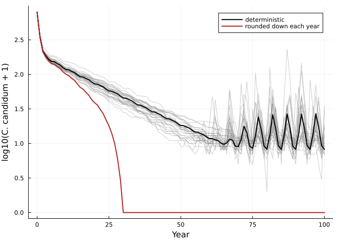

# Equilibria, invasion and chance
Simon Frost

- [The sensitivity of an equilibrium, without a
  sweep](#the-sensitivity-of-an-equilibrium-without-a-sweep)
- [Who persists? Invasion rates in a fluctuating
  environment](#who-persists-invasion-rates-in-a-fluctuating-environment)
- [Chance: whole individuals](#chance-whole-individuals)
- [Reference](#reference)

``` julia
ENV["GKSwstype"] = "100"
using MatrixCommunityModels
using LinearAlgebra, Plots, Printf, Random, Statistics
```

Lytle & Tonkin (2023) close with “a call for more theory and more
analysis tools”, noting that communities of more than two species have
so far been analysed only by simulation. Because a composed community
here is an explicit map from one year’s state to the next, some
questions can be answered more directly. This vignette shows three.

## The sensitivity of an equilibrium, without a sweep

The regression recipe of the sensitivity vignette runs the model at many
values of a vital rate. In a constant environment with a stable
equilibrium `n*`, the same derivative follows from the model’s Jacobian
`J` at `n*`:

$$\frac{d n^*}{d\theta} = (I - J)^{-1} \frac{\partial f}{\partial \theta}$$

where `f` is one time step. `equilibrium_sensitivity` does this. For a
shrub alone in 1000 units of space, with seed production `f` per adult:

``` julia
K = 1000.0
crowding(ctx) = max(0.0, 1 - ctx.pool.space / K)
function shrub(f)
    life = ValuedProjectionNet([:seedling, :juvenile, :adult],
        :establishing => [(:seedling => :juvenile) => 0.30], :maturing => [(:juvenile => :adult) => 0.50],
        :persisting => [(:adult => :adult) => 0.95], :seeding => [(:adult => :seedling) => f])
    species(:shrub, births(respond(life, :seeding => crowding), :seeding); occupies = [:space => [0.1, 1.0, 4.0]])
end
build(f) = (community = shrub(f), n0 = [5.0, 0.0, 1.0])

direct = equilibrium_sensitivity(build, 3.0, nothing)
(equilibrium = round.(direct.n; digits = 2), derivative = round.(direct.dn; digits = 3))
```

    (equilibrium = [71.68, 21.51, 215.05], derivative = [2.987, 0.896, 8.961])

This species replaces itself when the free fraction of space is
`1/(3f)`, so the space in use at equilibrium is `K(1 - 1/(3f))` and its
derivative with respect to `f` is `K/(3f²)`, which is 37.04 at `f = 3`:

``` julia
dot([0.1, 1.0, 4.0], direct.dn), K / (3 * 3.0^2)
```

    (37.03703704248879, 37.03703703703704)

The regression recipe gives the same answer from eleven long
projections:

``` julia
sweep = abundance_sensitivity(build, collect(2.95:0.01:3.05), fill(nothing, 4000); burnin = 3500)
round.(sweep.slope; digits = 3)
```

    3-element Vector{Float64}:
     2.987
     0.896
     8.962

The direct method needs a constant environment and a smooth step at the
equilibrium. In a fluctuating environment, or where a threshold is
active, the regression recipe is the one to use.

## Who persists? Invasion rates in a fluctuating environment

Lytle & Tonkin remark that if the Verde River fish model is projected
far enough “all fish species eventually go extinct except one”,
typically the species with the highest single-species stochastic growth
rate. Invasion analysis asks the sharper question: can a species
increase from rarity in the community formed by the others, under the
actual sequence of year types?

`stochastic_invasion_rate` projects the resident community, then follows
a rare invader whose vital rates see the residents’ pool totals and each
year’s environment. Here the 1964-2017 flow record is repeated ten
times.

``` julia
m = verde_fish_model()
envs = repeat(m.envs, 10)
fish = [subcommunity(m.community, s) for s in species_names(m.community)]
name(sp) = only(species_names(sp))

# growth in an empty river: the resident is a community with nobody in it
nobody = first(fish)
empty_rate = [stochastic_invasion_rate(sp, nobody, zeros(3), envs) for sp in fish]

# growth when rare in the community of the other six
invasion_rate = map(fish) do sp
    residents = subcommunity(m.community, (s for s in species_names(m.community) if s != name(sp))...)
    n0 = [p for p in m.n0 if p.first != name(sp)]
    stochastic_invasion_rate(sp, residents, n0, envs; burnin = 108)
end

for (sp, e, r) in zip(fish, empty_rate, invasion_rate)
    @printf("%-5s  empty river %.3f   invading the other six %.3f\n", name(sp), e, r)
end
```

    CACL   empty river 1.250   invading the other six 0.961
    GIRO   empty river 1.334   invading the other six 0.981
    LECY   empty river 1.370   invading the other six 0.990
    CAIN   empty river 1.238   invading the other six 0.985
    MIDO   empty river 1.242   invading the other six 0.983
    CYLU   empty river 1.511   invading the other six 1.012
    AMNA   empty river 1.280   invading the other six 1.003

Every species grows in an empty river. Only two, the non-native red
shiner (CYLU) and yellow bullhead (AMNA), have an invasion rate above
one. The long projection agrees:

``` julia
long = project(m.community, m.n0, envs)
[s => round(sum(long[s][end, :]); digits = 1) for s in species_names(m.community)]
```

    7-element Vector{Pair{Symbol, Float64}}:
     :CACL => 0.0
     :GIRO => 0.0
     :LECY => 9.4
     :CAIN => 8.4
     :MIDO => 1.0
     :CYLU => 28092.0
     :AMNA => 8025.1

After 540 years the biomass is almost entirely those two species. The
invasion rates give this answer from properties of each species and the
community it meets, which is also what makes them useful for asking what
would have to change for a native species to persist.

## Chance: whole individuals

Deterministic projection tracks fractions of individuals. The adapt3
orchid example handles this by rounding each stage down to a whole
number every year. An alternative is demographic stochasticity: each
individual survives and moves with the probabilities in its column of
the survival matrix, and births are Poisson. Passing a random number
generator to `project` does this.

``` julia
c = cypripedium_model()
rng = Xoshiro(1)
runs = [project(c.community, c.n0, c.envs; rng) for _ in 1:200]
total(sol, sp) = vec(sum(sol[sp]; dims = 2))

floored = project(cypripedium_model(integeronly = true).community, c.n0, c.envs)
smooth = project(c.community, c.n0, c.envs)

p = plot(; xlabel = "Year", ylabel = "log10(C. candidum + 1)", legend = :topright)
for sol in runs[1:30]
    plot!(p, sol.t, log10.(total(sol, :candidum) .+ 1); color = :grey, alpha = 0.4, label = "")
end
plot!(p, smooth.t, log10.(total(smooth, :candidum) .+ 1); lw = 2, color = :black, label = "deterministic")
plot!(p, floored.t, log10.(total(floored, :candidum) .+ 1); lw = 2, color = :firebrick, label = "rounded down each year")
p
```



``` julia
extinct(sol, sp) = something(findfirst(==(0), total(sol, sp)), 102) - 1
(rounded_down = (candidum = extinct(floored, :candidum), parviflorum = extinct(floored, :parviflorum)),
 candidum_extinct_by_100 = count(extinct(s, :candidum) <= 100 for s in runs),
 parviflorum_extinct_by_100 = count(extinct(s, :parviflorum) <= 100 for s in runs),
 parviflorum_median_extinction_year = median(extinct(s, :parviflorum) for s in runs))
```

    (rounded_down = (candidum = 30, parviflorum = 69), candidum_extinct_by_100 = 0, parviflorum_extinct_by_100 = 196, parviflorum_median_extinction_year = 62.0)

Rounding down every year removes a fraction of an individual from every
stage every year, which is a steady extra mortality, and drives *C.
candidum* extinct in year 30. With individuals treated as whole but
chance allowed to go either way, *C. candidum* is still present after
100 years in every one of 200 runs. The two treatments of the same model
give opposite conclusions about that species, so the choice is not a
detail.

Demographic stochasticity requires the survival matrix to contain
probabilities (columns summing to at most one), which the package
checks. The fish model, whose state is biomass and whose transitions
include growth in mass, is correctly refused:

``` julia
try
    project(m.community, round.(state_vector(m.community, m.n0...)), m.envs[1:2]; rng)
catch err
    println(first(split(sprint(showerror, err), ";")))
end
```

    ArgumentError: survival matrix of :CACL has a column summing to 5.423611111111111

## Reference

Lytle, D. A. & Tonkin, J. D. (2023). Matrix community models for ecology
and evolution. *npj Biodiversity* 2, 26.
