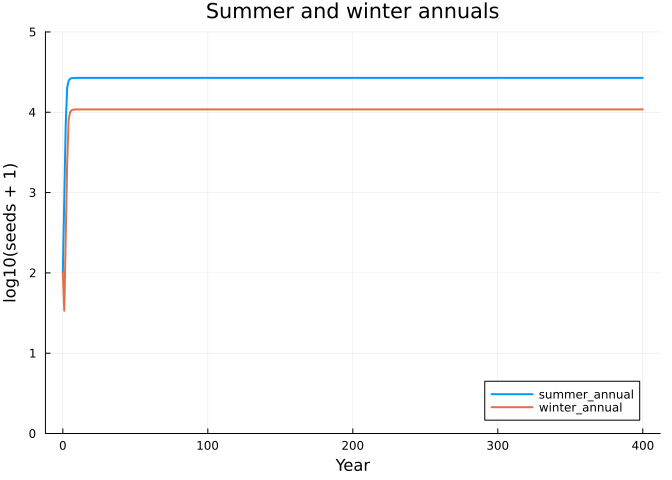
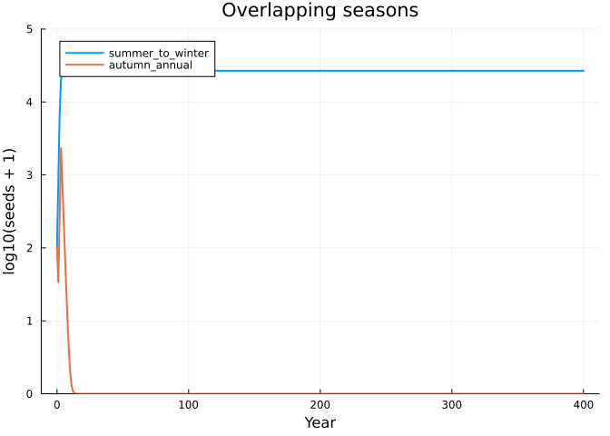
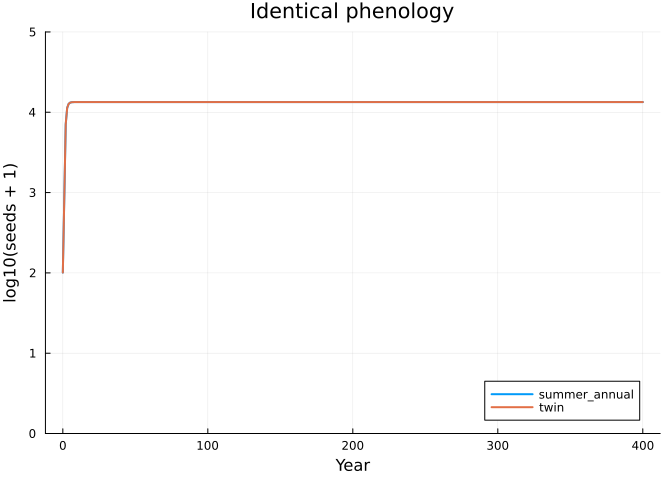
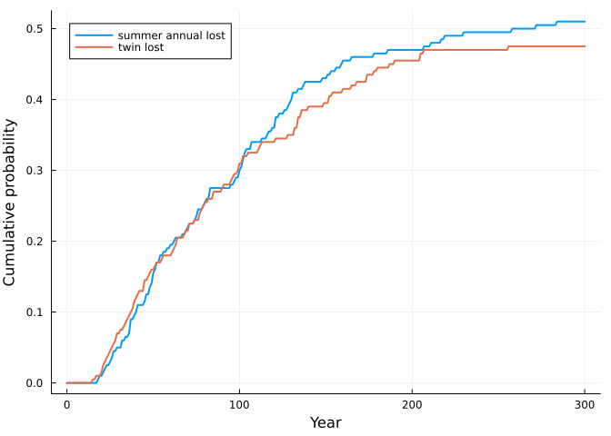

# Seasons: phenology, coexistence and drift
Simon Frost

- [Seasons are environments](#seasons-are-environments)
- [Annual plants competing for space by
  lottery](#annual-plants-competing-for-space-by-lottery)
- [The same growth rate when alone](#the-same-growth-rate-when-alone)
- [Three pairs, three outcomes](#three-pairs-three-outcomes)
- [Drift](#drift)
- [Reference](#reference)

``` julia
ENV["GKSwstype"] = "100"
using MatrixCommunityModels
using LinearAlgebra, Plots, Random
```

## Seasons are environments

The published matrix community models take one step per year. Nothing in
the composition requires that: the environment of a step can be a
season, and a year is then a cycle of steps. This vignette uses four
seasons (1 spring, 2 summer, 3 autumn, 4 winter) to ask a question an
annual model cannot: how does the *timing* of germination and seed set
decide who shares a habitat?

## Annual plants competing for space by lottery

Each species is an annual with a seed bank. In its germination season
half of its seeds try to germinate; in its seeding season each plant
produces 20 seeds and dies. A spring flood kills 90% of standing plants.

Space is limited within a season, so two pools are needed. `space` is
the area held by plants. `demand` is the number of seeds trying to
germinate this season, across all species. If demand exceeds the free
space, each germinating seed establishes with probability
`free space / demand`: a lottery in which every seed has the same
chance.

``` julia
function annual(name; germinate, seed, K = 1000.0, flood = 1, seeds_per_plant = 20.0, g = 0.5)
    life = ValuedProjectionNet([:seed, :plant],
        :dormancy => [(:seed => :seed) => 0.9],
        :germination => [(:seed => :plant) => g],
        :growth => [(:plant => :plant) => 0.9],
        :seed_set => [(:plant => :seed) => seeds_per_plant])
    during(season) = ctx -> ctx.env == season ? 1.0 : 0.0
    establishment(ctx) = min(1.0, max(K - ctx.pool.space, 0.0) / max(ctx.pool.demand, 1e-12))
    plant = respond(life,
        :dormancy => ctx -> ctx.env == germinate ? 1 - g : 1.0,          # germinating seeds leave the seed bank
        :germination => during(germinate), :germination => establishment, # the lottery for free space
        :seed_set => during(seed),
        :growth => ctx -> ctx.env == seed ? 0.0 : (ctx.env == flood ? 0.1 / 0.9 : 1.0))   # plants die after seeding; floods kill
    species(name, births(plant, :seed_set);
            occupies = [:space => [:plant => 1.0], :demand => (n, env) -> env == germinate ? g * n[:seed] : 0.0])
end

seasons = [1, 2, 3, 4]
envs = repeat(seasons, 400)       # 400 years
```

    1600-element Vector{Int64}:
     1
     2
     3
     4
     1
     2
     3
     4
     1
     2
     ⋮
     4
     1
     2
     3
     4
     1
     2
     3
     4

## The same growth rate when alone

`periodic_matrix` multiplies a species’ seasonal matrices over one cycle
with the pools held fixed. With the habitat empty, its dominant
eigenvalue is the annual growth rate of the species when rare. A summer
annual (germinates in summer, seeds in autumn) and a winter annual
(germinates in winter, seeds in spring) have different seasonal matrices
but the same annual growth rate here:

``` julia
summer = annual(:summer_annual; germinate = 2, seed = 3)
winter = annual(:winter_annual; germinate = 4, seed = 1)
empty = (space = 0.0, demand = 0.0)
annual_rate(sp) = maximum(abs, eigvals(periodic_matrix(sp, empty, seasons)))
annual_rate(summer), annual_rate(winter)
```

    (8.42805, 8.428049999999999)

## Three pairs, three outcomes

The function below composes a pair, projects it for 400 years, and
computes each species’ annual invasion rate into the other.

``` julia
function compete(a, b)
    sol = project(community(a, b), [100.0, 0.0, 100.0, 0.0], envs)
    rate(x, y) = stochastic_invasion_rate(x, y, [100.0, 0.0], envs; burnin = 800)^4
    (sol = sol, invasion = (rate(a, b), rate(b, a)))
end

seedbank(sol, sp) = sol[sp][1:4:end, 1]      # seeds at the start of each year

function show_pair(a, b, title)
    r = compete(a, b)
    println(title, ": annual invasion rates ", round.(r.invasion; digits = 3))
    plot(0:400, log10.([seedbank(r.sol, only(species_names(a))) seedbank(r.sol, only(species_names(b)))] .+ 1);
         label = [String(only(species_names(a))) String(only(species_names(b)))], xlabel = "Year", ylabel = "log10(seeds + 1)",
         title = title, lw = 2, ylims = (0, 5))
end
```

    show_pair (generic function with 1 method)

**Complementary timing.** The summer annual holds space from summer to
autumn, the winter annual from winter to spring. Each can invade the
other and they coexist.

``` julia
show_pair(summer, winter, "Summer and winter annuals")
```

    Summer and winter annuals: annual invasion rates (8.428, 8.428)



**Overlapping timing.** A species that germinates in autumn, while the
summer-germinating species still holds the space, cannot establish:

``` julia
late_summer = annual(:summer_to_winter; germinate = 2, seed = 4)
autumn = annual(:autumn_annual; germinate = 3, seed = 1)
show_pair(late_summer, autumn, "Overlapping seasons")
```

    Overlapping seasons: annual invasion rates (8.428, 0.328)



**Identical timing.** Two species with the same phenology draw from the
same lottery. Each has an invasion rate of exactly one: neither is
excluded and neither can increase. The deterministic model keeps them at
their starting ratio for ever.

``` julia
twin = annual(:twin; germinate = 2, seed = 3)
show_pair(summer, twin, "Identical phenology")
```

    Identical phenology: annual invasion rates (1.0, 1.0)



None of the three outcomes was specified. The species have the same
vital rates and the same growth rate alone; only the season in which
they use the shared space differs.

## Drift

An invasion rate of exactly one means the deterministic model has
nothing to say about which of two identical species persists. With whole
individuals it is settled by chance. `ensemble` runs replicate
projections with demographic stochasticity, here in a small habitat of
30 units of space.

``` julia
small(name; kw...) = annual(name; K = 30.0, kw...)
pair = community(small(:summer_annual; germinate = 2, seed = 3), small(:twin; germinate = 2, seed = 3))
ens = ensemble(pair, [20.0, 0.0, 20.0, 0.0], repeat(seasons, 300); replicates = 200, rng = Xoshiro(1))
```

    CommunityEnsemble(200 replicates, 1200 steps, 4 states)

``` julia
years = ens.t[1:4:end] ./ 4
plot(years, [quasi_extinction(ens, :summer_annual)[1:4:end] quasi_extinction(ens, :twin)[1:4:end]];
     label = ["summer annual lost" "twin lost"], xlabel = "Year", ylabel = "Cumulative probability", lw = 2,
     legend = :topleft)
```



``` julia
final(sp) = abundance(ens, sp)[:, end]
(summer_annual_lost = count(==(0), final(:summer_annual)), twin_lost = count(==(0), final(:twin)),
 both_present = count((final(:summer_annual) .> 0) .& (final(:twin) .> 0)), replicates = 200)
```

    (summer_annual_lost = 102, twin_lost = 95, both_present = 3, replicates = 200)

The same ensemble for the complementary pair, in the same small habitat:

``` julia
pair2 = community(small(:summer_annual; germinate = 2, seed = 3), small(:winter_annual; germinate = 4, seed = 1))
ens2 = ensemble(pair2, [20.0, 0.0, 20.0, 0.0], repeat(seasons, 300); replicates = 200, rng = Xoshiro(1))
final2(sp) = abundance(ens2, sp)[:, end]
(summer_annual_lost = count(==(0), final2(:summer_annual)), winter_annual_lost = count(==(0), final2(:winter_annual)),
 both_present = count((final2(:summer_annual) .> 0) .& (final2(:winter_annual) .> 0)), replicates = 200)
```

    (summer_annual_lost = 0, winter_annual_lost = 0, both_present = 200, replicates = 200)

With identical phenology one of the two species is lost in nearly every
replicate within 300 years, each about equally often. With complementary
phenology both are still present in every replicate: each species
recovers from low numbers because it can invade, which is what an
invasion rate above one means.

## Reference

Lytle, D. A. & Tonkin, J. D. (2023). Matrix community models for ecology
and evolution. *npj Biodiversity* 2, 26.
