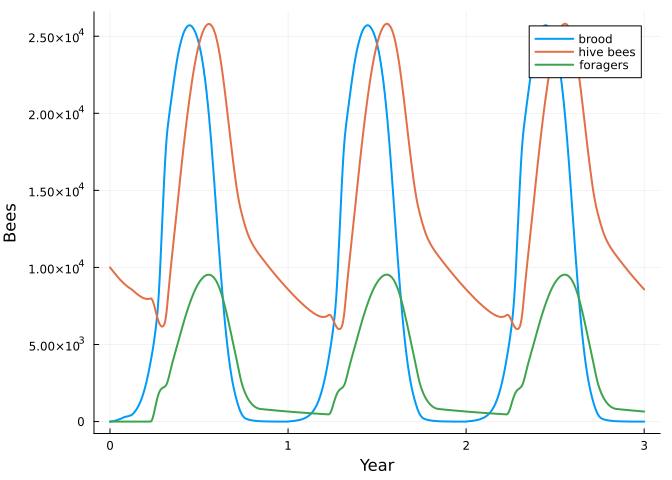
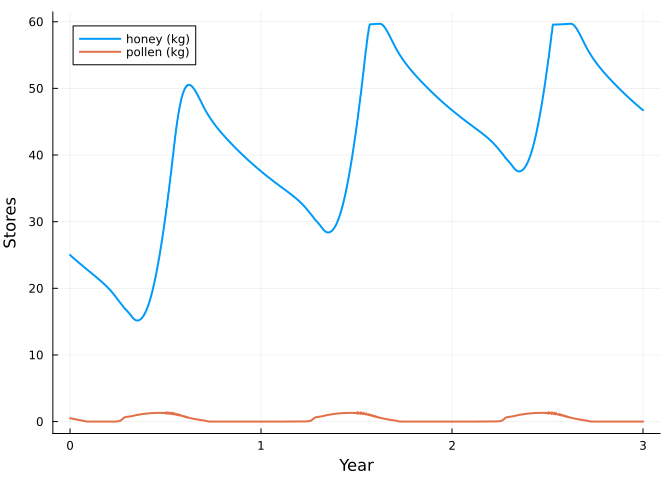

# Bees 1: a honey bee colony from modules
Simon Frost

- [A life cycle is a net](#a-life-cycle-is-a-net)
- [Stage durations](#stage-durations)
- [Responses](#responses)
- [Stores are another module](#stores-are-another-module)
- [A year in the life of the colony](#a-year-in-the-life-of-the-colony)
- [Freezing the colony](#freezing-the-colony)
- [What is provisional](#what-is-provisional)
- [References](#references)

``` julia
ENV["GKSwstype"] = "100"
using MatrixCommunityModels
using Plots
```

This is the first of four vignettes that build a community of honey
bees, *Varroa* mites, deformed wing virus and bumblebees. Each step adds
one thing, and each thing is a small, named piece: a life-cycle net, a
stage duration, a stratum, a response, or a pool. Nothing is a
hand-written simulation loop.

## A life cycle is a net

A honey bee worker is an egg for 3 days, a larva for 5 and a capped pupa
for 12; she then works in the hive and later forages. The life cycle is
a `ValuedProjectionNet` from CategoricalPopulationDynamics.jl: stages,
and named transitions with a value each.

``` julia
p = HONEYBEE_PARAMETERS
life = ValuedProjectionNet([:egg, :larva, :pupa, :hive, :forager],
    :hatching   => [(:egg => :larva) => p.egg_survival],
    :capping    => [(:larva => :pupa) => p.larva_survival],
    :emerging   => [(:pupa => :hive) => p.pupa_survival],
    :hive_life  => [(:hive => :hive) => 1 - p.hive_mortality],
    :recruiting => [(:hive => :forager) => 1 - p.hive_mortality],
    :foraging   => [(:forager => :forager) => 1.0])
to_matrix(life)
```

    5×5 Matrix{Float64}:
     0.0   0.0   0.0    0.0    0.0
     0.97  0.0   0.0    0.0    0.0
     0.0   0.99  0.0    0.0    0.0
     0.0   0.0   0.999  0.996  0.0
     0.0   0.0   0.0    0.996  1.0

## Stage durations

`expand_stages` gives each brood stage its duration in days. The names
stay readable, and the old names remain usable as totals.

``` julia
daily = expand_stages(ResponsiveProjectionNet(life), :egg => 3, :larva => 5, :pupa => 12;
                      ageing = Dict(:egg => p.egg_survival, :larva => p.larva_survival, :pupa => p.pupa_survival))
stage_names(daily)
```

    22-element Vector{Symbol}:
     :egg1
     :egg2
     :egg3
     :larva1
     :larva2
     :larva3
     :larva4
     :larva5
     :pupa1
     :pupa2
     ⋮
     :pupa6
     :pupa7
     :pupa8
     :pupa9
     :pupa10
     :pupa11
     :pupa12
     :hive
     :forager

``` julia
transition_names(daily)
```

    9-element Vector{Symbol}:
     :capping
     :egg_ageing
     :emerging
     :foraging
     :hatching
     :hive_life
     :larva_ageing
     :pupa_ageing
     :recruiting

## Responses

The values above describe a bee in ideal conditions. What actually
happens depends on the colony and the season, and each dependence is a
*response* attached to a named transition: a function of a context `ctx`
(the colony’s own stages `ctx.n`, any shared pools `ctx.pool`, and the
day `ctx.env`) that scales the transition. For example, foragers die
faster on days when they can fly:

``` julia
flying(ctx) = flight_index(day_of_year(ctx.env))
example = respond(daily, :foraging => ctx -> 1 - p.hive_mortality - p.forager_mortality * flying(ctx))
winter, summer = context(example, zeros(22), NamedTuple(), 15), context(example, zeros(22), NamedTuple(), 200)
to_matrix(example, winter)[22, 22], to_matrix(example, summer)[22, 22]
```

    (0.996, 0.896)

`honeybee()` attaches the full set, each taken from a published colony
model:

| Transition | Response | Source |
|----|----|----|
| eggs laid (an inflow) | queen’s seasonal laying rate, capped by the brood the adults can tend | HoPoMo; BEEHAVE |
| `larva_ageing` | larvae are lost when pollen or nurses are short | HoPoMo |
| `recruiting`, `hive_life` | hive bees become foragers, inhibited by foragers, faster when food is short; only on flying days while there is brood | Khoury et al. 2011, 2013 |
| `foraging` | extra mortality on flying days | Russell et al. 2013 |
| `hive_life`, `foraging` | starvation, and failure of very small colonies | Russell et al. 2013 |

The condition “while there is brood” is what produces winter bees:
workers that emerge after brood rearing has stopped are never recruited
to foraging, and so live for months.

## Stores are another module

The colony’s honey and pollen are two more entries of its state, with
their own transitions (`honey_kept`, `pollen_kept`: what is left after
the day’s consumption) and inflows (what the foragers bring in). They
are written as a separate net and merged into the bees with `⊕`.

Drones are a third module: a second life cycle (`drone_egg`,
`drone_larva`, `drone_pupa`, `drone`, lasting 3, 7 and 14 days as brood)
on its own stages, merged in the same way. From late April to late
August the queen lays one drone egg for every 25 worker eggs. Drones eat
and need nursing but do no work; they are here because of what the next
vignette adds.

``` julia
colony = honeybee()
stage_names(colony, :honeybee)[[1, 4, 9, 21, 22, 23, 26, 33, 47, 48, 49]]
```

    11-element Vector{Symbol}:
     :egg1
     :larva1
     :pupa1
     :hive
     :forager
     :drone_egg1
     :drone_larva1
     :drone_pupa1
     :drone
     :honey
     :pollen

``` julia
transition_names(system(colony)[:honeybee])
```

    18-element Vector{Symbol}:
     :capping
     :drone_capping
     :drone_egg_ageing
     :drone_emerging
     :drone_hatching
     :drone_larva_ageing
     :drone_life
     :drone_pupa_ageing
     :egg_ageing
     :emerging
     :foraging
     :hatching
     :hive_life
     :honey_kept
     :larva_ageing
     :pollen_kept
     :pupa_ageing
     :recruiting

## A year in the life of the colony

The time step is a day and the environment of each step is the day
number. The colony starts on 1 January with 10,000 workers and 25 kg of
honey (the BEEHAVE default).

``` julia
sol = project(colony, honeybee_state(colony), 1:(365 * 3))
days = sol.t ./ 365
adults = stage_total(sol, :honeybee, [:hive, :forager])
plot(days, [stage_total(sol, :honeybee, [:egg, :larva, :pupa]) stage_total(sol, :honeybee, :hive) stage_total(sol, :honeybee, :forager)];
     label = ["brood" "hive bees" "foragers"], xlabel = "Year", ylabel = "Bees", lw = 2)
```



``` julia
second = 366:731
(peak_adults = round(Int, maximum(adults[second])), on_day = argmax(adults[second]),
 winter_cluster = round(Int, adults[731]),
 reared_per_year = round(Int, sum(stage_total(sol, :honeybee, :pupa12)[second])))
```

    (peak_adults = 35338, on_day = 203, winter_cluster = 9228, reared_per_year = 135062)

Published colonies peak at 40,000 to 60,000 adults in July, overwinter
with roughly 10,000 and rear 120,000 to 150,000 workers a year (Seeley;
Russell et al. 2013). The model’s peak is a little below that range; the
other two are within it.

``` julia
plot(days, [stage_total(sol, :honeybee, :honey) ./ 1000 stage_total(sol, :honeybee, :pollen) ./ 1000];
     label = ["honey (kg)" "pollen (kg)"], xlabel = "Year", ylabel = "Stores", lw = 2)
```



## Freezing the colony

On any day the colony is an ordinary matrix model. `frozen_net` returns
it as a net with that day’s values, so each number can be traced to its
transition.

``` julia
june = 365 + 160
net = frozen_net(colony, :honeybee, sol.u[june + 1, :], june)
(recruiting = transition_matrix(net, :recruiting)[22, 21], foraging = transition_matrix(net, :foraging)[22, 22],
 hive_life = transition_matrix(net, :hive_life)[21, 21])
```

    (recruiting = 0.04240223802017676, foraging = 0.896, hive_life = 0.9535977619798232)

In June a hive bee has about a 4% chance per day of becoming a forager,
and a forager about a 10% chance per day of dying.

## What is provisional

The honey budget needed one adjustment to balance: 0.14 g of honey per
nectar forager per day, against 0.1 g per forager of any kind in Khoury
et al. (2013) and Russell et al. (2013). The share of foragers
collecting pollen, and the use of brood as the cue for recruitment, are
modelling choices rather than published values. The climate behind
`flight_index` is illustrative. `HONEYBEE_PARAMETERS` and the comments
in `src/bees.jl` list every value with its source.

## References

Khoury, D. S., Myerscough, M. R. & Barron, A. B. (2011). *PLoS ONE* 6,
e18491; (2013) *PLoS ONE* 8, e59084. Russell, S., Barron, A. B. &
Harris, D. (2013). *Ecological Modelling* 265, 158-169. Schmickl, T. &
Crailsheim, K. (2007). HoPoMo. *Ecological Modelling* 204, 219-245.
Becher, M. A. et al. (2014). BEEHAVE. *Journal of Applied Ecology* 51,
470-482.
