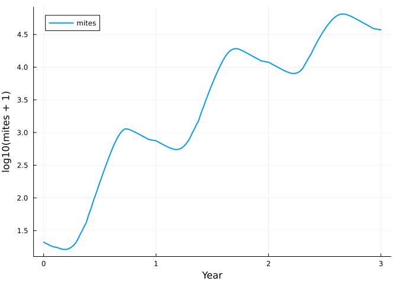
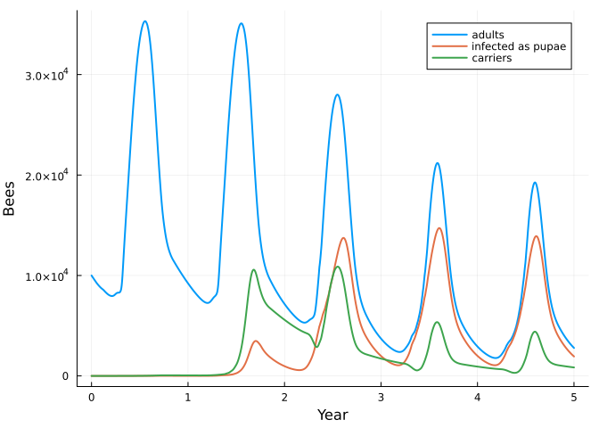
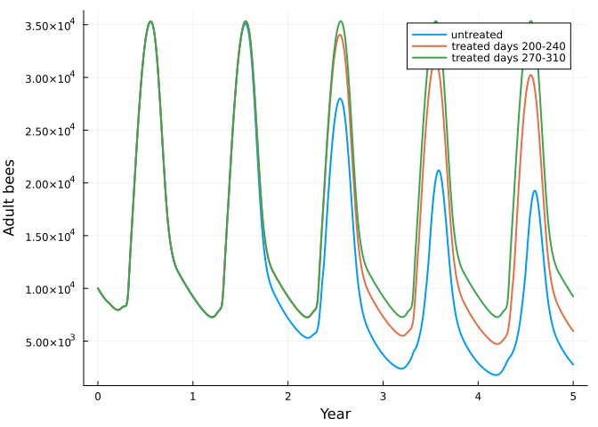

# Bees 2: Varroa mites and deformed wing virus
Simon Frost

- [Mites are a three-stage net](#mites-are-a-three-stage-net)
- [Bees and mites meet through
  pools](#bees-and-mites-meet-through-pools)
- [The virus is a stratum](#the-virus-is-a-stratum)
- [Treatment, and its timing](#treatment-and-its-timing)
- [Where the numbers come from](#where-the-numbers-come-from)
- [References](#references)

``` julia
ENV["GKSwstype"] = "100"
using MatrixCommunityModels
using Plots
```

The [previous vignette](10_honeybee_colony.md)
built a honey bee colony. This one adds the mite *Varroa destructor* as
a second species, and then deformed wing virus (DWV) as a second
*stratum* of both species.

## Mites are a three-stage net

A mite is on an adult bee (`phoretic`) or in a brood cell, where it
stays until the bee emerges and then leaves with its daughters: 12 days
in a worker `cell`, 15 in a `drone_cell`. Drone cells are where mites do
best. A mite there leaves 2.91 daughters, against 1.01 in a worker cell,
and fewer mites are lost when the bee emerges.

``` julia
q = VARROA_PARAMETERS
mite_life = ValuedProjectionNet([:phoretic, :cell, :drone_cell],
    :waiting         => [(:phoretic => :phoretic) => 1.0],
    :invading        => [(:phoretic => :cell) => 1.0],
    :leaving         => [(:cell => :phoretic) => 1 - q.emergence_loss],
    :daughters       => [(:cell => :phoretic) => q.offspring * (1 - q.emergence_loss)],
    :invading_drone  => [(:phoretic => :drone_cell) => 1.0],
    :leaving_drone   => [(:drone_cell => :phoretic) => 1 - q.drone_emergence_loss],
    :daughters_drone => [(:drone_cell => :phoretic) => q.drone_offspring * (1 - q.drone_emergence_loss)])
length(stage_names(expand_stages(mite_life, :cell => 12, :drone_cell => 15)))
```

    28

`varroa()` is this net with responses. The important ones are on the two
`invading` transitions. The rate at which phoretic mites enter cells is
0.56 × worker cells about to be capped / grams of adult bees, plus 6.49
× drone cells / grams of adult bees (Boot et al. 1995; Calis et
al. 1999): a drone cell attracts almost twelve times as strongly as a
worker cell. A cell takes at most four mites, and mites sharing a cell
leave fewer daughters each (factors of 1, 0.91, 0.86 and 0.60 for one to
four mites in a worker cell; Martin 1998). Mites on bees die at 0.006 a
day while the colony has brood and at 0.002 a day while it has none.

## Bees and mites meet through pools

The mite never refers to the bee, or the bee to the mite. The bee
reports a few numbers as pools, and the mite reads them.

``` julia
c = community(honeybee(), varroa())
pool_names(c)
```

    7-element Vector{Symbol}:
     :adult_bees
     :brood
     :capping
     :emerging
     :drone_capping
     :drone_emerging
     :phoretic

`capping` and `drone_capping` are the worker and drone larvae about to
be capped, `emerging` and `drone_emerging` the pupae about to emerge,
`adult_bees` the adult workers, `brood` all the brood, and `phoretic`
the mites on adults.

``` julia
sol = project(c, honeybee_state(c; mites = 20), 1:(365 * 3))
years = sol.t ./ 365
mites = abundance(sol, :varroa)
adults(s) = stage_total(s, :honeybee, [:hive, :forager])
plot(years, log10.(mites .+ 1); label = "mites", xlabel = "Year", ylabel = "log10(mites + 1)", lw = 2)
```



``` julia
(growth_per_day = round(log(mites[211] / mites[151]) / 60; digits = 4), fold_in_first_year = round(mites[366] / 20; digits = 1))
```

    (growth_per_day = 0.0311, fold_in_first_year = 37.3)

Drone brood is a small part of the brood, about one cell in forty, but
it carries the mite population. The same colony without drones:

``` julia
w = community(honeybee(drones = false), varroa(drones = false))
mites_w = abundance(project(w, honeybee_state(w; mites = 20), 1:(365 * 3)), :varroa)
(growth_per_day = round(log(mites_w[211] / mites_w[151]) / 60; digits = 4), fold_in_first_year = round(mites_w[366] / 20; digits = 1))
```

    (growth_per_day = 0.0181, fold_in_first_year = 8.4)

``` julia
share = stage_total(sol, :varroa, :drone_cell)[180] / mites[180]
round(share; digits = 2)       # of all mites, in drone cells on day 180
```

    0.19

Nothing here was tuned. In the field, mite numbers grow by 0.105 to
0.236 a week while there is brood, which is 0.015 to 0.034 a day (Harris
et al. 2003: ten years of their own colonies in Louisiana, and the
studies they review). Both versions of this model fall in that range,
the one with drones near the top of it. Martin (1998) reports a 12-fold
increase a year for his model, which includes drone brood; this one
gives three times that with drones and somewhat less without. It behaves
like BEEHAVE, whose rules it follows: BEEHAVE runs started with 20 mites
are reported to peak near 24,000 in the fourth summer. Here the mites
get there about a year sooner.

The weight of drone brood is less certain than the growth rate. Removing
drone brood in BEEHAVE cuts mite numbers by 90% in a year, where bee
experts and field studies put the effect at 50 to 67% (Schödl et
al. 2022). So these rules may send too many mites through drone cells,
even though the growth they give is within what has been measured.

In this model mites alone do not harm the bees, following BEEHAVE, in
which all damage comes through viruses:

``` julia
alone = project(honeybee(), honeybee_state(honeybee()), 1:(365 * 3))
maximum(abs.(adults(sol) .- adults(alone)))
```

    0.0

## The virus is a stratum

DWV divides bees and mites by infection. That is a stratification of
each life cycle, not a new model: every stage and transition is
replicated, and a *coupling* says which transitions can cross from one
stratum to another. Bees have three strata: `healthy`, `carrier`
(infected as an adult) and `infected` (infected as a pupa).

``` julia
healthy_only = honeybee()
with_virus = honeybee(virus = true)
length(stage_names(healthy_only, :honeybee)), length(stage_names(with_virus, :honeybee))
```

    (49, 143)

``` julia
filter(t -> occursin("_to_", String(t)), transition_names(system(with_virus)[:honeybee]))
```

    5-element Vector{Symbol}:
     :capping_healthy_to_infected
     :drone_larva_ageing_healthy_to_infected
     :foraging_healthy_to_carrier
     :hive_life_healthy_to_carrier
     :recruiting_healthy_to_carrier

A larva becomes `infected` when its cell is closed, if a mite carrying
the virus has entered it. A fifth of infected pupae die, and the adults
they become die three times as fast in the hive. An in-hive bee becomes
a `carrier` when a mite with the virus takes it as a host. Carriers live
as long as healthy bees (for this virus; BEEHAVE), but a mite feeding on
one picks the virus up. (Adults can also become carriers by mouth, used
in the last vignette.)

Mites have two strata, `clean` and `viral`. A clean mite becomes viral
in a cell whose pupa is infected, or by taking a bee with the virus as
its host. A mite takes a new host when it leaves a cell, or when its
host dies or becomes a forager, and the chance that the new host has the
virus is the fraction of in-hive bees that do. A viral mite stays viral;
its daughters are viral if the pupa in their cell was infected and
lived.

``` julia
filter(t -> occursin("_to_", String(t)), transition_names(system(varroa(virus = true))[:varroa]))
```

    9-element Vector{Symbol}:
     :daughters_clean_to_viral
     :daughters_drone_clean_to_viral
     :daughters_drone_viral_to_clean
     :daughters_viral_to_clean
     :invading_clean_to_viral
     :invading_drone_clean_to_viral
     :leaving_clean_to_viral
     :leaving_drone_clean_to_viral
     :waiting_clean_to_viral

``` julia
function colony(; treatment = day -> 0.0, years = 5)
    c = community(honeybee(virus = true), varroa(virus = true, treatment = treatment))
    project(c, honeybee_state(c; mites = 20, viral = 0.1), 1:(365 * years))
end
untreated = colony()
infected(s) = stage_total(s, :honeybee, [:hive_infected, :forager_infected])
carriers(s) = stage_total(s, :honeybee, [:hive_carrier, :forager_carrier])
plot(untreated.t ./ 365, [adults(untreated) infected(untreated) carriers(untreated)];
     label = ["adults" "infected as pupae" "carriers"], xlabel = "Year", ylabel = "Bees", lw = 2)
```



For a year little happens. Carriers come first: by the second winter
most bees carry the virus without harm. From the second autumn, when
mites are numerous and brood is scarce, a growing share of the bees that
will form the winter cluster are infected as pupae. They die early, and
the colony goes into each following winter with a few thousand bees and
more mites than bees.

``` julia
winters = 365 .* (1:5) .+ 1
[(year = y, adults = round(Int, adults(untreated)[w]), mites_per_100_bees = round(100 * stage_total(untreated, :varroa, :phoretic)[w] / adults(untreated)[w]; digits = 1),
  infected = round(infected(untreated)[w] / adults(untreated)[w]; digits = 2),
  carriers = round(carriers(untreated)[w] / adults(untreated)[w]; digits = 2)) for (y, w) in enumerate(winters)]
```

    5-element Vector{@NamedTuple{year::Int64, adults::Int64, mites_per_100_bees::Float64, infected::Float64, carriers::Float64}}:
     (year = 1, adults = 9218, mites_per_100_bees = 7.7, infected = 0.0, carriers = 0.01)
     (year = 2, adults = 7165, mites_per_100_bees = 128.8, infected = 0.14, carriers = 0.78)
     (year = 3, adults = 3714, mites_per_100_bees = 561.8, infected = 0.53, carriers = 0.46)
     (year = 4, adults = 2923, mites_per_100_bees = 789.9, infected = 0.68, carriers = 0.32)
     (year = 5, adults = 2785, mites_per_100_bees = 789.7, infected = 0.7, carriers = 0.3)

A colony of fewer than about 4,000 bees is usually taken not to survive
the winter (BEEHAVE; Kielmanowicz et al. 2015), so this colony is
effectively lost in its third winter. Field studies put the autumn load
of colonies that died at about 15 mites per 100 bees against 3 in
survivors (Genersch et al. 2010).

## Treatment, and its timing

A treatment is an extra mortality of phoretic mites over a window of
days. Two windows of 40 days, each year:

``` julia
late = colony(treatment = day -> 270 <= day < 310 ? 0.115 : 0.0)
early = colony(treatment = day -> 200 <= day < 240 ? 0.115 : 0.0)
plot(untreated.t ./ 365, [adults(untreated) adults(early) adults(late)];
     label = ["untreated" "treated days 200-240" "treated days 270-310"], xlabel = "Year", ylabel = "Adult bees", lw = 2)
```



``` julia
[(treatment = name, winter_5_adults = round(Int, adults(s)[winters[5]]), mites = round(Int, abundance(s, :varroa)[winters[5]]))
 for (name, s) in (("none", untreated), ("days 200-240", early), ("days 270-310", late))]
```

    3-element Vector{@NamedTuple{treatment::String, winter_5_adults::Int64, mites::Int64}}:
     (treatment = "none", winter_5_adults = 2785, mites = 21989)
     (treatment = "days 200-240", winter_5_adults = 5946, mites = 4116)
     (treatment = "days 270-310", winter_5_adults = 9229, mites = 0)

Treating in October, when there is almost no brood for the mites to hide
in, removes nearly all of them and keeps the colony healthy. The same
treatment in late July and August kills only the mites on adults at the
time; those in cells survive it, the population recovers, and the colony
dwindles, more slowly than without treatment. (Field advice is to treat
before the winter bees are reared; in this model the absence of brood
matters more, which may reflect its lack of mites arriving from other
colonies.)

## Where the numbers come from

The mite and virus parameters are those of Martin (1998, 2001), checked
against the parameter list and program code of BEEHAVE (Becher et
al. 2014), which cite them:

- daughters per mite, 1.01 in a worker cell and 2.91 in a drone cell;
- mites lost at emergence, 30% and 20%;
- the factors for mites sharing a cell, and the limit of four mites to a
  cell;
- mite mortality of 0.006 a day with brood and 0.002 without;
- transmission from mite to pupa of 0.89, death of a fifth of infected
  pupae, and adult mortality of 0.012 a day after infection as a pupa;
- a treatment killing 11.5% of phoretic mites a day for 40 days.

The drone parameters of the colony (one drone egg to 25 worker eggs from
day 115 to 240, development times, survival) are BEEHAVE’s too. All are
listed in `VARROA_PARAMETERS` and `HONEYBEE_PARAMETERS`. Martin’s papers
themselves were not read. Of Schödl et al. (2022) only the abstract was
read, and the figure of 24,000 mites is from a beekeeping article
describing BEEHAVE runs, not from a paper.

The rules follow BEEHAVE’s, in expectation: BEEHAVE draws whole mites
and whole bees at random, and this model moves the expected numbers,
taking mites to be spread over cells at random. Two simplifications
remain. Mites that take a host are counted without allowing for crowding
in the cell they left. And when brood dies in its cell the mites are
held there until the bee would have emerged, where BEEHAVE releases them
at once.

## References

Martin, S. J. (1998). *Ecological Modelling* 109, 267-281; (2001)
*Journal of Applied Ecology* 38, 1082-1093. Becher, M. A. et al. (2014).
*Journal of Applied Ecology* 51, 470-482. Genersch, E. et al. (2010).
*Apidologie* 41, 332-352. Harris, J. W. et al. (2003). *Environmental
Entomology* 32, 1305-1312. Schödl, I. et al. (2022). *Ecology and
Evolution* 12, e9456.
