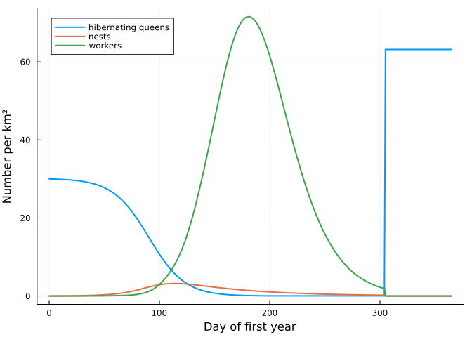
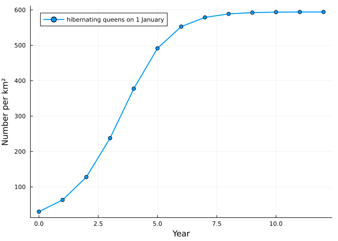

# Bees 3: a bumblebee population
Simon Frost

- [Three modules](#three-modules)
- [A season](#a-season)
- [Nest sites](#nest-sites)
- [Adding the virus: one more module](#adding-the-virus-one-more-module)
- [What is provisional](#what-is-provisional)
- [References](#references)

``` julia
ENV["GKSwstype"] = "100"
using MatrixCommunityModels
using Plots
```

Bumblebees live differently from honey bees. A colony lasts one season:
a queen who hibernated alone founds it in spring, it rears workers, then
males and new queens, and then dies; only the new queens overwinter.
What persists from year to year is the *population* of colonies, so that
is what this model follows, in numbers per square kilometre.

## Three modules

The life cycle is assembled from three nets that share a list of stages:
what queens do, what the colony rears, and how long adults live.

``` julia
p = BUMBLEBEE_PARAMETERS
stay = 1 - p.queen_mortality
stages = [:hibernating, :searching, :founding, :growing, :reproducing, :ending,
          :worker_brood, :worker, :male_brood, :male, :gyne_brood, :new_queen]

queens = ValuedProjectionNet(stages,
    :dormancy => [(:hibernating => :hibernating) => 1.0],
    :waiting => [(:new_queen => :new_queen) => 1.0],
    :overwintering => [(:new_queen => :hibernating) => 1.0],
    :emergence => [(:hibernating => :searching) => p.winter_survival],
    :searching => [(:searching => :searching) => 1 - p.nest_finding - p.search_mortality],
    :nesting => [(:searching => :founding) => p.nest_finding],
    :first_workers => [(:founding => :growing) => 1.0],
    :colony_cycle => [(:growing => :growing) => stay * (1 - p.switch), (:growing => :reproducing) => stay * p.switch,
                      (:reproducing => :reproducing) => stay * (1 - p.ending), (:reproducing => :ending) => stay * p.ending,
                      (:ending => :ending) => stay])

rearing = ValuedProjectionNet(stages,
    :first_brood => [(:founding => :worker) => p.first_workers],
    :worker_eggs => [(:growing => :worker_brood) => p.eggs],
    :sexual_eggs => [(:reproducing => :gyne_brood) => p.gyne_fraction * p.eggs,
                     (:reproducing => :male_brood) => (1 - p.gyne_fraction) * p.eggs],
    :eclosion => [(:worker_brood => :worker) => p.brood_survival, (:male_brood => :male) => p.brood_survival,
                  (:gyne_brood => :new_queen) => p.brood_survival * p.gyne_survival])

adults = ValuedProjectionNet(stages,
    :worker_life => [(:worker => :worker) => 1.0], :male_life => [(:male => :male) => 1 - p.male_mortality])

life = queens ⊕ rearing ⊕ adults
transition_names(life)
```

    14-element Vector{Symbol}:
     :dormancy
     :emergence
     :colony_cycle
     :male_life
     :first_brood
     :first_workers
     :waiting
     :worker_life
     :nesting
     :eclosion
     :searching
     :sexual_eggs
     :worker_eggs
     :overwintering

Founding a nest takes four weeks, and worker, male and gyne brood take
22, 26 and 30 days to develop:

``` julia
daily = expand_stages(ResponsiveProjectionNet(life), :founding => 28, :worker_brood => 22, :male_brood => 26, :gyne_brood => 30)
length(stage_names(daily))
```

    114

`bumblebee()` is this net with its responses:

| Transition | Response | Source |
|----|----|----|
| `emergence`, `dormancy` | queens emerge around day 91 (SD 28) | Bumble-BEEHAVE |
| `nesting` | only where a nest site is free | Knight et al. 2005 (about 30 nests per km²) |
| `worker_eggs`, `sexual_eggs` | eggs per colony rise with workers per colony, to the power 0.54 | Cresswell 2017 |
| brood ageing | larvae are lost when pollen or nectar is short; gyne larvae first | Bumble-BEEHAVE (Liebig’s minimum) |
| `worker_life`, founding | foragers die faster when nectar is hard to find | proposed |
| `waiting`, `overwintering` | new queens stay dormant until day 305, then join the hibernating queens | Bumble-BEEHAVE |
| everything else | all bees not dormant die on day 305 | Bumble-BEEHAVE |

Colonies are pooled: a response sees the total number of workers and of
colonies, so “workers per colony” is an average over colonies of
different ages.

## A season

``` julia
bb = bumblebee()
sol = project(bb, honeybee_state(bb; queens = 30), 1:(365 * 3))
day = sol.t[1:366]
nests = stage_total(sol, :bumblebee, [:founding, :growing, :reproducing, :ending])
plot(day, [stage_total(sol, :bumblebee, :hibernating)[1:366] nests[1:366] stage_total(sol, :bumblebee, :worker)[1:366]];
     label = ["hibernating queens" "nests" "workers"], xlabel = "Day of first year", ylabel = "Number per km²", lw = 2)
```



``` julia
first_year = 1:365
total(stage) = sum(stage_total(sol, :bumblebee, stage)[first_year])
founded = total(:founding28)
(established = round(founded / 30; digits = 3),
 workers_per_colony = round(total(:worker_brood22) / founded + p.first_workers; digits = 1),
 gynes_per_colony = round(total(:gyne_brood30) / founded; digits = 1),
 males_per_colony = round(total(:male_brood26) / founded; digits = 1))
```

    (established = 0.105, workers_per_colony = 82.1, gynes_per_colony = 22.3, males_per_colony = 27.8)

Published values for *Bombus terrestris*: about 0.12 of hibernating
queens establish a colony; a colony rears 76 to 86 workers, 19 to 25 new
queens and 22 to 30 males (Becher et al. 2018, simulated and empirical).
The egg-laying rate, the rate of switching to reproduction and the
duration of the reproductive phase were set to land in those ranges.

## Nest sites

With forage unlimited, the population grows until nest sites run out.

``` julia
long = project(bb, honeybee_state(bb; queens = 30), 1:(365 * 12))
start_of_year = 365 .* (0:12) .+ 1
plot(0:12, stage_total(long, :bumblebee, :hibernating)[start_of_year]; marker = :circle, lw = 2,
     label = "hibernating queens on 1 January", xlabel = "Year", ylabel = "Number per km²")
```



``` julia
maximum(stage_total(long, :bumblebee, [:founding, :growing, :reproducing, :ending]))
```

    25.476473653391672

## Adding the virus: one more module

Bumblebees have no *Varroa*. They can pick DWV up at flowers that
infected honey bees have visited, and the evidence on what it does to
them is mixed (the next vignette). In the model, infection is a fourth
module: one more stage and two transitions, merged in with `⊕`.

``` julia
sick = bumblebee(virus = true)
setdiff(stage_names(sick, :bumblebee), stage_names(bb, :bumblebee)),
setdiff(transition_names(system(sick)[:bumblebee]), transition_names(system(bb)[:bumblebee]))
```

    ([:infected_worker], [:infected_life, :infection])

Without honey bees there is no source of virus, so this population
behaves exactly like the one above. The next vignette puts the two
species on the same flowers.

## What is provisional

Larval starvation rates, the extra sensitivity of gyne larvae, and the
effect of nectar shortage on forager mortality are assumptions. Pooling
colonies loses the large differences between colonies seen in the field
(in Crone & Williams 2016 only about a quarter of colonies produced any
queens). `BUMBLEBEE_PARAMETERS` and the comments in `src/bees.jl` list
every value with its source.

## References

Becher, M. A. et al. (2018). Bumble-BEEHAVE. *Journal of Applied
Ecology* 55, 2790-2801. Cresswell, J. E. (2017). *Ecological Entomology*
42, 221-229. Crone, E. E. & Williams, N. M. (2016). *Ecology Letters*
19, 460-468. Banks, H. T. et al. (2017). *Ecological Modelling* 351,
14-23. Knight, M. E. et al. (2005). *Molecular Ecology* 14, 1811-1820.
