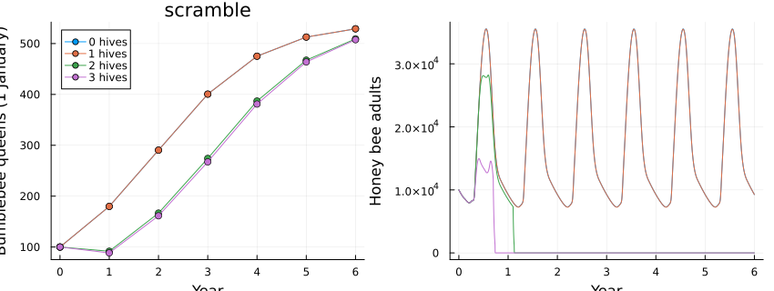
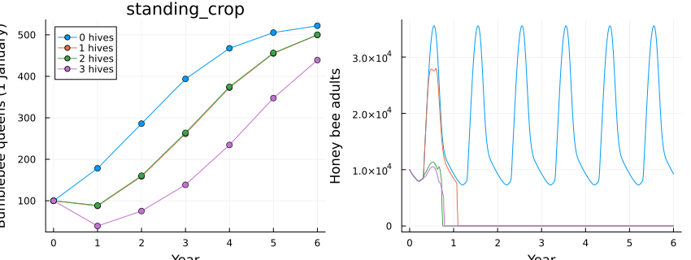
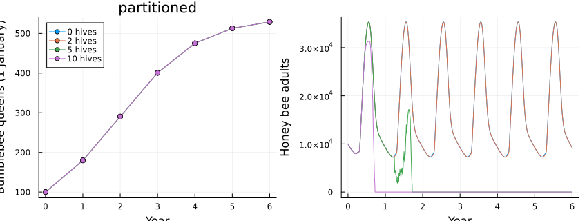
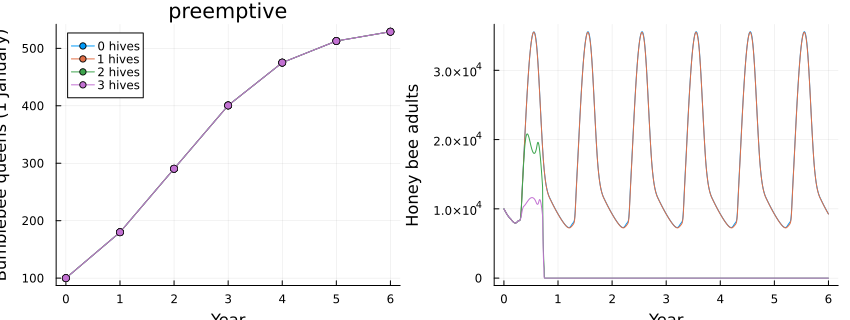
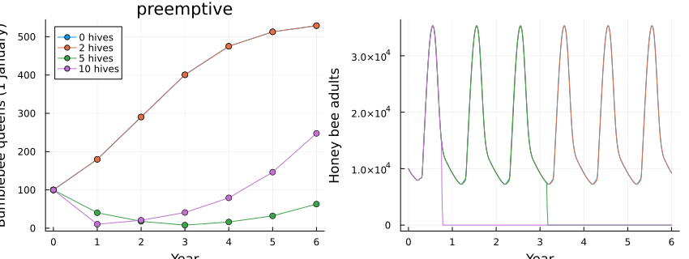
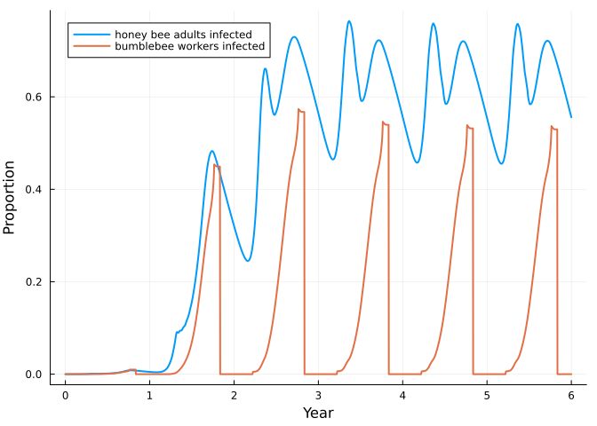

# Bees 4: honey bees and bumblebees on the same flowers
Simon Frost

- [Demand and supply are pools](#demand-and-supply-are-pools)
- [Four ways to compete](#four-ways-to-compete)
- [When the flowers stop](#when-the-flowers-stop)
- [Virus on flowers](#virus-on-flowers)
- [What is provisional](#what-is-provisional)
- [References](#references)

``` julia
ENV["GKSwstype"] = "100"
using MatrixCommunityModels
using Plots
```

The previous three vignettes built a honey bee colony with *Varroa* and
deformed wing virus, and a bumblebee population. Neither refers to the
other. This vignette joins them through two kinds of pool: what the
flowers offer, and what infected foragers leave on them. Because the
link is a pool and not a line of code inside either species, it can be
swapped: four different ideas of competition are four different
couplings of the same two models.

## Demand and supply are pools

Each species reports how much nectar and pollen its foragers would
collect today (the pools `hb_nectar`, `hb_pollen`, `bb_nectar`,
`bb_pollen`) and receives the fraction of that demand the flowers can
meet. `floral_competition` supplies the rule; the supply itself is a
function of the day of the year, in grams per square kilometre per day.

``` julia
function landscape(mode; hives = 1, years = 6, virus = false, treated = true, kw...)
    forage = floral_competition(mode; hives = hives, kw...)
    flowers = virus ? flower_transmission(hives = hives) : nothing
    treatment = treated ? (day -> 270 <= day < 310 ? 0.115 : 0.0) : (day -> 0.0)
    c = community(honeybee(virus = virus, forage = forage, flowers = flowers),
                  varroa(virus = virus, treatment = treatment),
                  bumblebee(virus = virus, forage = forage, flowers = flowers), forage.species...)
    n0 = honeybee_state(c; mites = virus ? 100 : 0, viral = virus ? 0.1 : 0.0, queens = 100)
    return c, project(c, n0, 1:(365 * years))
end

c, alone = landscape(:scramble; hives = 0)
species_names(c), pool_names(c)
```

    ([:honeybee, :varroa, :bumblebee], [:adult_bees, :capping, :emerging, :hb_nectar, :hb_pollen, :bb_nectar, :bb_pollen, :phoretic])

`hives` is the number of honey bee colonies per square kilometre, each
like the one modelled. One colony takes far more than the whole
bumblebee population:

``` julia
day = 365 + 190
totals = pool_totals(c, alone.u[day + 1, :], day)
(honey_bee_colony = (nectar = round(totals.hb_nectar), pollen = round(totals.hb_pollen)),
 bumblebees = (nectar = round(totals.bb_nectar), pollen = round(totals.bb_pollen)))
```

    (honey_bee_colony = (nectar = 0.0, pollen = 0.0), bumblebees = (nectar = 49.0, pollen = 17.0))

(With `hives = 0` the colony’s demand is reported as zero; multiply by
one for a single colony.)

``` julia
_, one = landscape(:scramble; hives = 1)
totals_one = pool_totals(landscape(:scramble; hives = 1)[1], one.u[day + 1, :], day)
round(totals_one.hb_nectar / totals_one.bb_nectar; digits = 1)
```

    36.7

That ratio is why competition between the two is so asymmetric:
bumblebees cannot deplete a landscape that feeds honey bees, but honey
bees can deplete one that feeds bumblebees.

## Four ways to compete

``` julia
queens(sol) = stage_total(sol, :bumblebee, :hibernating)[365 .* (0:6) .+ 1]
workers(sol) = stage_total(sol, :honeybee, [:hive, :forager])

function compare(mode, densities; kw...)
    runs = [landscape(mode; hives = h, kw...)[2] for h in densities]
    p1 = plot(0:6, reduce(hcat, queens.(runs)); label = permutedims(["$h hives" for h in densities]), marker = :circle,
              xlabel = "Year", ylabel = "Bumblebee queens (1 January)", title = String(mode), legend = :topleft)
    p2 = plot(runs[1].t ./ 365, reduce(hcat, workers.(runs)); label = "", xlabel = "Year", ylabel = "Honey bee adults")
    plot(p1, p2; layout = (1, 2), size = (850, 320))
end
densities = [0, 1, 2, 3]
```

    4-element Vector{Int64}:
     0
     1
     2
     3

**Scramble.** Everyone gets the same fraction of what they ask for:
`min(1, supply / total demand)`.

``` julia
compare(:scramble, densities)
```



**Standing crop.** The supply is a stock that flowers refill each day
and from which half of what is not taken carries over. Heavy use today
leaves less tomorrow. This adds a `flowers` species to the community.

``` julia
compare(:standing_crop, densities)
```



**Partitioned.** Half of the supply is open to both; the rest is split
into flowers only honey bees use and flowers only bumblebees use.

``` julia
compare(:partitioned, densities)
```



**Pre-emptive.** Honey bees, which recruit nestmates to rich patches,
take what they want first; bumblebees get what is left, plus a refuge of
deep flowers that honey bees cannot use. With a refuge of 20%, and with
none:

``` julia
compare(:preemptive, densities)
```



``` julia
compare(:preemptive, densities; refuge = 0.0)
```



The four couplings tell different stories from the same two species:

``` julia
final(mode; kw...) = [round(queens(landscape(mode; hives = h, kw...)[2])[end]; digits = 0) for h in densities]
(hives = densities, scramble = final(:scramble), standing_crop = final(:standing_crop),
 partitioned = final(:partitioned), preemptive = final(:preemptive), preemptive_no_refuge = final(:preemptive; refuge = 0.0))
```

    (hives = [0, 1, 2, 3], scramble = [529.0, 529.0, 509.0, 508.0], standing_crop = [522.0, 500.0, 500.0, 439.0], partitioned = [529.0, 529.0, 529.0, 529.0], preemptive = [529.0, 529.0, 529.0, 529.0], preemptive_no_refuge = [529.0, 363.0, 171.0, 10.0])

Three things stand out. Where bumblebees have any flowers of their own,
a partition or a refuge, honey bees do them no harm in this model,
because their demand is so small that a small exclusive share covers it.
Where everything is shared, bumblebees are set back only once the hives
are themselves short of forage, and then the hives suffer first:
identical colonies all run out of honey together and die within a year
or two, after which the bumblebees recover almost completely. Where
honey bees take first and there is no refuge, bumblebees decline in step
with the number of hives and are nearly driven out at three.

These are consequences of the couplings, not findings about real
landscapes. The field evidence is mixed in the same way: reviews find
negative effects on wild bees in about half of studies, concentrated
where floral resources are scarce.

## When the flowers stop

Bumblebees keep no stores, so *when* forage is available matters more to
them than to honey bees. Ending the season’s forage two months early,
with one hive:

``` julia
supply(finish) = (nectar = floral_supply(3000.0; finish = finish), pollen = floral_supply(400.0; finish = finish))
_, usual = landscape(:scramble; hives = 1, supply(280)...)
_, short = landscape(:scramble; hives = 1, supply(220)...)
(bumblebee_queens = (usual = round(queens(usual)[end]), short_season = round(queens(short)[end])),
 honey_bee_peak = (usual = round(maximum(workers(usual)[(365 * 5):end])), short_season = round(maximum(workers(short)[(365 * 5):end]))))
```

    (bumblebee_queens = (usual = 529.0, short_season = 468.0), honey_bee_peak = (usual = 35507.0, short_season = 35221.0))

The hive, which lives on its stores, is unaffected. The bumblebee
population ends lower: colonies founded by late-emerging queens are
still rearing brood when the forage stops.

## Virus on flowers

The second kind of pool carries the virus. Infected honey bee foragers
report their flower visits to `infectious_visits`; the fraction of
flowers contaminated is `1 - exp(-visits / flowers)`, so more flowers
dilute it; and a bumblebee worker is infected with a daily probability
that rises with contamination. Bumblebees have no mites, do not (by
default) pass the virus on, and are not harmed by it unless
`infected_hazard` is raised.

``` julia
cv, spill = landscape(:scramble; hives = 1, virus = true, treated = false)
bb_prev = stage_total(spill, :bumblebee, :infected_worker) ./
          max.(stage_total(spill, :bumblebee, [:worker, :infected_worker]), 1e-9)
hb_prev = stage_total(spill, :honeybee, [:hive_infected, :forager_infected]) ./ max.(workers(spill), 1.0)
plot(spill.t ./ 365, [hb_prev bb_prev]; label = ["honey bee adults infected" "bumblebee workers infected"],
     xlabel = "Year", ylabel = "Proportion", lw = 2)
```



``` julia
summer = 365 .* (0:5) .+ 200
[(year = y, honey_bees = round(hb_prev[d]; digits = 2), bumblebees = round(bb_prev[d]; digits = 2)) for (y, d) in enumerate(summer)]
```

    6-element Vector{@NamedTuple{year::Int64, honey_bees::Float64, bumblebees::Float64}}:
     (year = 1, honey_bees = 0.0, bumblebees = 0.0)
     (year = 2, honey_bees = 0.21, bumblebees = 0.11)
     (year = 3, honey_bees = 0.6, bumblebees = 0.24)
     (year = 4, honey_bees = 0.6, bumblebees = 0.21)
     (year = 5, honey_bees = 0.59, bumblebees = 0.21)
     (year = 6, honey_bees = 0.59, bumblebees = 0.21)

Bumblebee prevalence follows the hive’s, with no route of its own: when
the hive is treated for mites, the virus all but disappears from both.

``` julia
_, treated = landscape(:scramble; hives = 1, virus = true, treated = true)
maximum(stage_total(treated, :bumblebee, :infected_worker) ./
        max.(stage_total(treated, :bumblebee, [:worker, :infected_worker]), 1e-9))
```

    0.009940926669910682

In a field survey, DWV was found in 36% of honey bees and 11% of
bumblebees at the same sites, and was far more prevalent in both where
*Varroa* was present (Fürst et al. 2014; Manley et al. 2019). The
acquisition rate here was chosen to give a ratio of that order; it is
not measured.

## What is provisional

Everything about the couplings is a modelling choice: the supply (3 kg
of sugar and 0.4 kg of pollen per square kilometre per day), the
conversion from honey gained to sugar removed, the carry-over of the
standing crop, the overlap and refuge fractions, and the transmission
parameters. The evidence on competition and on DWV in bumblebees used to
frame them comes from review summaries, not from the primary papers.
What the vignette shows is that the alternatives can be stated, swapped
and compared without touching either species’ model.

## References

Fürst, M. A. et al. (2014). *Nature* 506, 364-366. Manley, R. et
al. (2019). *Ecology Letters* 22, 1306-1315. Mallinger, R. E.,
Gaines-Day, H. R. & Gratton, C. (2017). *PLoS ONE* 12, e0189268. Lytle,
D. A. & Tonkin, J. D. (2023). *npj Biodiversity* 2, 26.
