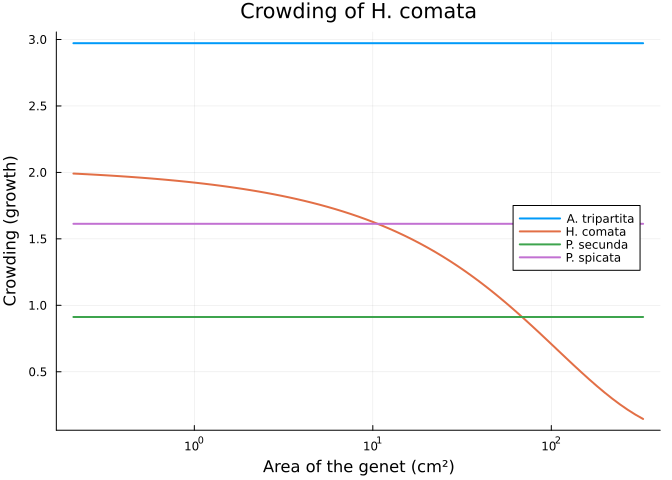
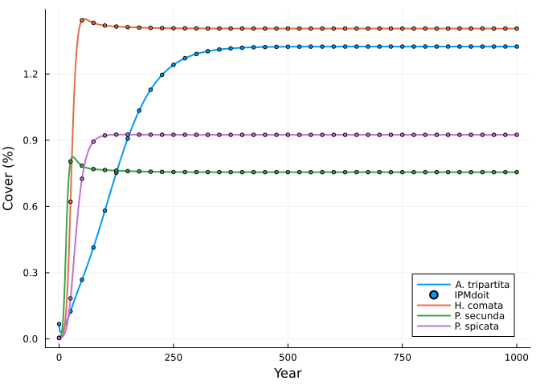
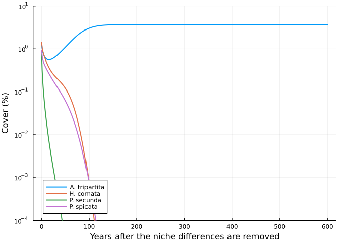
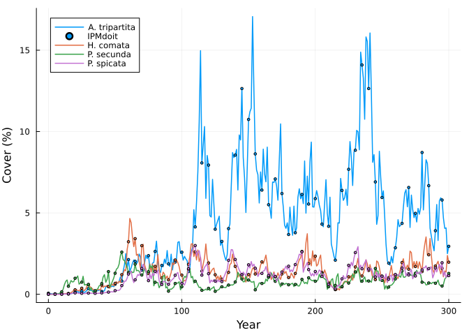

# Four perennials of the sagebrush steppe: coexistence through crowding
Simon Frost

- [A shrub and three grasses](#a-shrub-and-three-grasses)
- [Crowding](#crowding)
- [The life cycle as a net](#the-life-cycle-as-a-net)
- [Each species alone](#each-species-alone)
- [The four together](#the-four-together)
- [Does each species invade when
  rare?](#does-each-species-invade-when-rare)
- [Removing the niche differences](#removing-the-niche-differences)
- [Where the niche differences lie](#where-the-niche-differences-lie)
- [Years that differ](#years-that-differ)
  - [Exclusion when years differ](#exclusion-when-years-differ)
- [The comparison with IPMdoit and the
  papers](#the-comparison-with-ipmdoit-and-the-papers)
- [What is measured and what is
  assumed](#what-is-measured-and-what-is-assumed)
- [References](#references)

``` julia
ENV["GKSwstype"] = "100"
using MatrixCommunityModels
using LinearAlgebra, Printf
using Plots
BLAS.set_num_threads(1)      # eigenvalues of matrices this small are found fastest on one thread
```

## A shrub and three grasses

In the first half of the twentieth century every plant in a set of
permanent quadrats of one square metre at the U.S. Sheep Experiment
Station near Dubois, Idaho, was mapped each summer; the fits used here
have effects for 22 of those years. Four species make up most of the
plant cover: the shrub *Artemisia tripartita* (threetip sagebrush,
`artr`) and the bunchgrasses *Hesperostipa comata* (needle-and-thread,
`heco`), *Poa secunda* (Sandberg bluegrass, `pose`) and *Pseudoroegneria
spicata* (bluebunch wheatgrass, `pssp`). From the maps one can follow
each genet (a plant and its clonal parts) from year to year and record
its area, whether it survived, how much it grew, and which other plants
grew around it.

Adler, Ellner & Levine (2010) fitted the growth, survival and
recruitment of the four species to these maps, with each rate depending
on how *crowded* a genet was by its neighbours of each species, and put
the fits together as an integral projection model (IPM) of the
community. They asked whether the species coexist, and why. Chu & Adler
(2015) refitted the model and compared it with four other grassland
communities.

This vignette rebuilds the model and checks it against the R code of the
authors’ group. The papers themselves could not be read (see the end);
the model, its parameters and its numerical scheme are those of the R
package IPMdoit (Tredennick & Adler), whose Idaho example runs it.

In the model a species never refers to another species. A genet is
crowded by the cover of each species around it, and a species’ recruits
depend on the cover of each species. The four covers are therefore four
pools: each species adds its basal area to its own pool, and reads all
four, each with its own coefficients.

## Crowding

The crowding of a genet by species $j$ adds up the areas of the genets
of $j$ around it, each weighted by $\exp(-\alpha_j d^2)$ at distance
$d$. In the IPM the positions of the genets are not tracked, and
crowding is replaced by its expected value.

- *Other species.* Genets of another species are scattered at random and
  may overlap the focal genet, so the expected crowding is
  $\pi C_j / \alpha_j$, where $C_j$ is the cover of species $j$ as a
  share of the ground. It depends only on the pool.
- *Its own species.* Genets of one species do not overlap. A conspecific
  of radius $\rho$ is at least $r + \rho$ away from a focal genet of
  radius $r$, so crowding by its own species is smaller for a large
  genet and depends on the sizes of its conspecifics, not only on their
  cover. It is computed from the species’ own state.

`sagebrush_crowding` returns both, for genets of each size. Here is the
crowding felt by needle-and-thread genets at the equilibrium of the four
species, which is computed below. The reference files in
`test/reference` hold that equilibrium as IPMdoit reached it, and other
runs of IPMdoit (`test/reference/R/run_sagebrush_reference.R`).

``` julia
reference(file) = [split(l, ",") for l in readlines(joinpath(pkgdir(MatrixCommunityModels), "test", "reference", file))[2:end]]
number(x) = parse(Float64, x)
kinds = (:artr, :heco, :pose, :pssp)
codes = Dict("ARTR" => :artr, "HECO" => :heco, "POSE" => :pose, "PSSP" => :pssp)
names = Dict(:artr => "A. tripartita", :heco => "H. comata", :pose => "P. secunda", :pssp => "P. spicata")
states = reference("sagebrush_state.csv")
saved(run, k) = [number(r[4]) for r in states if r[1] == run && codes[r[2]] == k]
saved_state(c, run) = state_vector(c, (k => saved(run, k) for k in species_names(c))...)
cover(c, n, env = nothing) = [getproperty(pool_totals(c, n, env), Symbol(k, :_cover)) for k in kinds]

four = sagebrush_community()
together = saved_state(four, "community")
pools = pool_totals(four, together, nothing)
W = sagebrush_crowding(:heco, saved("community", :heco), pools)
area = exp.(meshpoints(sagebrush_stage(:heco)))
plot(area, W.growth; xscale = :log10, lw = 2, xlabel = "Area of the genet (cm²)", ylabel = "Crowding (growth)",
     label = permutedims([names[k] for k in kinds]), legend = :right, title = "Crowding of H. comata")
```



Crowding by its own species falls as a genet grows, because its
conspecifics must stand further away; crowding by the other species does
not depend on its size. The coefficients that turn crowding into an
effect on each vital rate:

``` julia
function show_matrix(label, rows)
    println(label)
    println("            ", join(rpad.(String.(kinds), 11)))
    for (k, row) in zip(kinds, rows)
        println(rpad("  " * String(k), 12), join([@sprintf("%-11.4g", x) for x in row]))
    end
end
show_matrix("growth: effect of crowding by the column species on the row species", [SAGEBRUSH_PARAMETERS[k].growth.crowding for k in kinds])
show_matrix("survival (logit scale)", [SAGEBRUSH_PARAMETERS[k].survival.crowding for k in kinds])
show_matrix("recruitment: effect of the square root of percent cover", [SAGEBRUSH_PARAMETERS[k].recruitment.crowding for k in kinds])
```

    growth: effect of crowding by the column species on the row species
                artr       heco       pose       pssp       
      artr      -0.02751   0.01272    0.01676    0.003194   
      heco      -4.474e-05 -0.0285    0.008406   -0.002836  
      pose      5.357e-05  0.003124   -0.08411   -0.004286  
      pssp      -0.0003398 -0.002687  -0.0005262 -0.04507   
    survival (logit scale)
                artr       heco       pose       pssp       
      artr      -0.02357   -0.02006   0.03139    0.01581    
      heco      -0.0004985 -1.022     -0.005008  0.01251    
      pose      0.0001499  0.0005666  -0.9085    0.01207    
      pssp      0.0008776  -0.001318  0.02468    -0.1545    
    recruitment: effect of the square root of percent cover
                artr       heco       pose       pssp       
      artr      -0.4084    -0.5915    -0.4426    -0.2884    
      heco      -0.03108   -1.723     -0.2683    -0.3503    
      pose      -0.05736   -0.1888    -2.272     -0.1254    
      pssp      -0.01905   -0.308     -0.2088    -1.933     

In recruitment, and in the survival of the three grasses, each species
is far more sensitive to its own species than to the others. That is a
niche difference, in the sense of Chesson (2000): each species limits
itself more than it limits the others. (Within a row of the growth and
survival tables the coefficients multiply crowding measured on different
spatial scales, one for each neighbour species, so they are not directly
comparable; those of recruitment all multiply the square root of a
percent cover.) A few coefficients are positive (facilitation); IPMdoit
keeps them, and Chu & Adler (2015) set them to zero in their final fits.

## The life cycle as a net

A species has a single stage, `plant`, carrying the logarithm of the
genet’s area in cm², on the mesh of IPMdoit: from log 0.2 to 1.1 times
the logarithm of the largest genet seen, in 75 cells for the shrub and
needle-and-thread and 50 for the other two grasses. `sagebrush_plant`
builds it in this form (abridged from `src/sagebrush.jl`):

``` julia
life = kernel_net(plant,
    :growing    => responsive(growing),                   # survival × growth, rebuilt each year
    :recruiting => (y, x) -> exp(x) * recruit_size(y))      # recruits in proportion to area
net = births(respond(life, :recruiting => recruiting), :recruiting)
species(kind, net; occupies = [own_cover => trait_weights(plant, u -> exp(u) / 10_000)],
        reads = other_covers)
```

- `growing` holds the genets that survive and grow. Survival is logistic
  in log area and crowding; next year’s log area is normal, with a mean
  linear in log area and crowding and a variance that changes with the
  mean. Crowding depends on the pools and on the species’ own state, so
  the kernel is rebuilt each year (`responsive`).
- `recruiting` holds the recruits. A species with percent cover $C$ has
  $C \exp(a + \sum_j b_j \sqrt{C_j})$ recruits per m², shared among its
  genets in proportion to their area. Recruits have a log area drawn
  from a normal distribution truncated at log 0.2.
- The species adds its basal area, as a share of the m², to its cover
  pool.

The environment of a step is `nothing` for the mean year (the year
effects of the fits set to zero) or a year from 1 to 22, the years of
the data, for that year’s fitted effects.

``` julia
(species = species_names(four), pools = pool_names(four), states = length(four),
 stages_of_artr = stage_names(four, :artr)[[1, 2, end]])
```

    (species = [:artr, :heco, :pose, :pssp], pools = [:artr_cover, :heco_cover, :pose_cover, :pssp_cover], states = 250, stages_of_artr = [:plant1, :plant2, :plant75])

## Each species alone

Alone, a species settles where its frozen matrix has a growth rate of
one. Its matrix depends on its own state through its cover and through
the crowding by conspecifics, which scales with its numbers when the
shape of the size distribution is fixed. `equilibrium`, given the pool
and a range of covers, finds that cover and the stable size distribution
there without iterating the dynamics.

``` julia
runs = reference("sagebrush_runs.csv")
run_rows(name) = [(year = parse(Int, r[2]), cover = number.(r[3:6])) for r in runs if r[1] == name]
alone = Dict(k => sagebrush_plant(k) for k in kinds)
settled_alone = Dict(k => equilibrium(alone[k], Symbol(k, :_cover) => (0.001, 0.2), sagebrush_state(k), nothing) for k in kinds)
println("species          cover alone (%)   IPMdoit, year 1500   difference")
for (j, k) in enumerate(kinds)
    theirs = last(run_rows("alone_" * uppercase(String(k)))).cover[j]
    @printf("%-15s  %15.4f   %18.4f   %10.1e\n", names[k], 100 * settled_alone[k].total, 100 * theirs,
            abs(settled_alone[k].total / theirs - 1))
end
```

    species          cover alone (%)   IPMdoit, year 1500   difference
    A. tripartita             3.6860               3.6860      1.5e-07
    H. comata                 1.7502               1.7502      5.9e-08
    P. secunda                0.9273               0.9273      8.1e-08
    P. spicata                1.2924               1.2924      1.5e-06

## The four together

The community is started as IPMdoit’s Idaho example starts it, with
0.001 genets per m² for each unit of log area in every cell, and run
through 1000 mean years.

``` julia
start = state_vector(four, (k => sagebrush_state(k) for k in kinds)...)
sol = project(four, start, fill(nothing, 1000))
covers = reduce(vcat, permutedims(cover(four, row)) for row in eachrow(sol.u))
ref = run_rows("community")
plot(; xlabel = "Year", ylabel = "Cover (%)", legend = :bottomright)
for (j, k) in enumerate(kinds)
    plot!(0:1000, 100 .* covers[:, j]; lw = 2, color = j, label = names[k])
    shown = [r for r in ref if r.year <= 1000 && r.year % 25 == 0]
    scatter!([r.year for r in shown], [100 * r.cover[j] for r in shown]; ms = 2.5, color = j, label = j == 1 ? "IPMdoit" : "")
end
plot!()
```



``` julia
apart = maximum(maximum(abs.(cover(four, sol.u[r.year + 1, :]) ./ r.cover .- 1)) for r in ref if r.year <= 1000)
(largest_relative_difference_from_IPMdoit = apart,)
```

    (largest_relative_difference_from_IPMdoit = 1.188674036978199e-6,)

The grasses settle within a century; the shrub takes several. The state
that IPMdoit reaches after 1500 years is an equilibrium of this model
too:

``` julia
moved = maximum(abs, advance(four, together, nothing) .- together) / maximum(together)
println("a year moves IPMdoit's equilibrium by ", @sprintf("%.1e", moved), " of its largest cell")
for (j, k) in enumerate(kinds)
    @printf("%-14s  cover %.4f%% together, %.4f%% alone\n", names[k], 100 * cover(four, together)[j], 100 * settled_alone[k].total)
end
```

    a year moves IPMdoit's equilibrium by 3.9e-08 of its largest cell
    A. tripartita   cover 1.3244% together, 3.6860% alone
    H. comata       cover 1.4060% together, 1.7502% alone
    P. secunda      cover 0.7550% together, 0.9273% alone
    P. spicata      cover 0.9244% together, 1.2924% alone

Each species holds less cover with the others than alone, the shrub much
less.

## Does each species invade when rare?

The species coexist if each, when rare, increases in the community of
the other three. `invasion_growth_rate` freezes the invader at zero
abundance in the pools of the residents, at their equilibrium, and
returns the growth rate of its matrix. A rare invader crowds nobody,
including itself, and its recruits per unit of cover are those of the
recruitment function at zero cover of its own species.

The residents’ equilibria are those reached by IPMdoit (1500 years from
a low start); a year in this model moves each of them by less than one
part in a million.

``` julia
invasion = reference("sagebrush_invasion.csv")
function invader_rate(k, niche; label = niche === true ? "niche" : "none")
    others = Tuple(x for x in kinds if x != k)
    resident = sagebrush_community(; niche_differences = niche, kinds = others)
    n = saved_state(resident, "residents_" * label * "_without_" * uppercase(String(k)))
    moved = maximum(abs, advance(resident, n, nothing) .- n) / maximum(n)
    return invasion_growth_rate(sagebrush_plant(k; niche_differences = niche), resident, n, nothing), moved
end
println("invader            growth rate when rare   IPMdoit       residents moved by")
rates_with = Dict{Symbol, Float64}()
for r in invasion
    r[1] == "niche" || continue
    k = codes[r[2]]
    rate, residents_moved = invader_rate(k, true)
    rates_with[k] = rate
    @printf("%-18s  %20.6f   %10.6f   %.0e\n", names[k], rate, number(r[3]), residents_moved)
end
```

    invader            growth rate when rare   IPMdoit       residents moved by
    A. tripartita                   1.030879     1.030879   4e-08
    H. comata                       1.267234     1.267234   6e-08
    P. secunda                      1.495015     1.495015   5e-08
    P. spicata                      1.186688     1.186688   1e-08

Every species increases when rare, so the four coexist. The rates
differ: the shrub, which dominates the cover, increases by 3% a year
when rare, and *P. secunda* by half.

## Removing the niche differences

Adler et al. (2010) asked what holds the species together by removing
the niche differences from the model: if each species were limited by
the others as much as by itself, would they still coexist? With
`niche_differences = false` each species is affected by the cover of
every species as by its own. In recruitment, which reads the covers
directly, the coefficient of each neighbour species becomes the species’
coefficient on itself. In growth and survival the crowding by species
$j$ is measured on its own spatial scale $\alpha_j$, so the coefficient
of $j$ becomes the species’ own coefficient times $\alpha_j / \alpha_i$:
a unit of cover of any species, scattered at random, then crowds a genet
as a unit of its own species’ cover would.

``` julia
println("invader            growth rate when rare   IPMdoit")
for r in invasion
    r[1] == "none" || continue
    k = codes[r[2]]
    @printf("%-18s  %20.6f   %10.6f\n", names[k], first(invader_rate(k, false)), number(r[3]))
end
```

    invader            growth rate when rare   IPMdoit
    A. tripartita                   0.971580     0.971580
    H. comata                       0.791831     0.791831
    P. secunda                      0.516821     0.516821
    P. spicata                      0.846289     0.846289

No species increases when rare. Without its niche differences the
community is not held together. The shrub excludes the three grasses;
among the grasses alone, needle-and-thread excludes the other two, and
the shrub cannot then invade it. Started at the equilibrium of the full
model, the community without niche differences loses its grasses:

``` julia
flat = sagebrush_community(; niche_differences = false)
decline = project(flat, together, fill(nothing, 600))
lost = reduce(vcat, permutedims(cover(flat, row)) for row in eachrow(decline.u))
plot(0:600, 100 .* lost; lw = 2, yscale = :log10, ylims = (1e-4, 10), xlabel = "Years after the niche differences are removed",
     ylabel = "Cover (%)", label = permutedims([names[k] for k in kinds]), legend = :bottomleft)
```



``` julia
for (j, k) in enumerate(kinds[2:end])
    year = findfirst(<(0.01 * lost[1, j + 1]), lost[:, j + 1])
    println(names[k], " falls below a hundredth of its cover after ", year === nothing ? "more than 600" : year - 1, " years")
end
```

    H. comata falls below a hundredth of its cover after 80 years
    P. secunda falls below a hundredth of its cover after 16 years
    P. spicata falls below a hundredth of its cover after 78 years

These are mean years. Adler et al. (2010) give three to four centuries
for the exclusion, and their simulations are taken to draw a year at
random each step, as IPMdoit does; the same experiment with drawn years
is run at the end of the section “Years that differ”.

## Where the niche differences lie

Removing the niche differences from some vital rates and not others
shows which carry them. `niche_differences` can list the vital rates
that keep theirs. The residents are found here by iterating from their
equilibrium in the full model.

``` julia
function invasion_rates(niche)
    map(kinds) do k
        others = Tuple(x for x in kinds if x != k)
        resident = sagebrush_community(; niche_differences = niche, kinds = others)
        n0 = saved_state(resident, "residents_niche_without_" * uppercase(String(k)))
        eq = equilibrium(resident, n0, nothing; tol = 1e-9, maxiter = 5000)
        eq.converged || @warn "residents without $k did not settle"
        invasion_growth_rate(sagebrush_plant(k; niche_differences = niche), resident, eq.n, nothing)
    end
end
recruitment_only = invasion_rates((:recruitment,))          # niche differences kept in recruitment only
growth_and_survival = invasion_rates((:growth, :survival))  # kept in growth and survival only
println("invader            all kept   recruitment only   growth and survival only")
for (j, k) in enumerate(kinds)
    @printf("%-18s  %8.4f   %16.4f   %24.4f\n", names[k], rates_with[k], recruitment_only[j], growth_and_survival[j])
end
```

    invader            all kept   recruitment only   growth and survival only
    A. tripartita         1.0309             0.9612                     1.0638
    H. comata             1.2672             0.8455                     1.0141
    P. secunda            1.4950             1.1884                     0.9343
    P. spicata            1.1867             1.0684                     0.9809

Neither stage holds the community on its own. With niche differences in
recruitment only, the shrub and needle-and-thread can no longer invade;
with them in growth and survival only, the two smaller grasses cannot.
The shrub depends most on its niche differences in growth and survival,
and *P. secunda* on those in recruitment, where its coefficient on
itself (-2.27) is at least twelve times its coefficients on the others.

## Years that differ

The fitted models include an effect of each of the 22 years of the data
on growth, survival and recruitment. Drawing a year at random for each
step gives a fluctuating environment. The R script drew a sequence of
600 years, which is used here too:

``` julia
years = [parse(Int, r[2]) for r in reference("sagebrush_years.csv")]
wild = project(four, start, years[1:300])
wild_covers = reduce(vcat, permutedims(cover(four, row)) for row in eachrow(wild.u))
ref = run_rows("community_years")
plot(; xlabel = "Year", ylabel = "Cover (%)", legend = :topleft)
for (j, k) in enumerate(kinds)
    plot!(0:300, 100 .* wild_covers[:, j]; lw = 1.5, color = j, label = names[k])
    scatter!([r.year for r in ref[1:5:end]], [100 * r.cover[j] for r in ref[1:5:end]]; ms = 2, color = j, label = j == 1 ? "IPMdoit" : "")
end
plot!()
```



``` julia
(largest_relative_difference_from_IPMdoit = maximum(maximum(abs.(cover(four, wild.u[r.year + 1, :]) ./ r.cover .- 1)) for r in ref),
 mean_cover_after_year_100 = round.(100 .* vec(sum(wild_covers[102:end, :]; dims = 1)) ./ 200; digits = 2))
```

    (largest_relative_difference_from_IPMdoit = 1.4028002803812e-6, mean_cover_after_year_100 = [6.23, 1.53, 0.8, 1.43])

The covers swing from year to year, and the shrub, with the largest year
effects on recruitment, holds on average about five times its cover at
the equilibrium of the mean year. A model run in the mean year is
therefore not a model of the average year.

The growth rate of a rare invader in a fluctuating environment is the
long-run average of its growth from year to year
(`stochastic_invasion_rate`, which returns the geometric mean of the
yearly growth factors). The residents start at their mean-year
equilibrium and run through the 600 years; the first 100 are left out.
The last column is the logarithm of the growth rate in the mean year as
a share of that in fluctuating years.

``` julia
stochastic = reference("sagebrush_stochastic_invasion.csv")
println("invader            fluctuating years   IPMdoit     mean year   share of log growth rate in the mean year")
for r in stochastic
    k = codes[r[1]]
    others = Tuple(x for x in kinds if x != k)
    resident = sagebrush_community(; kinds = others)
    n0 = saved_state(resident, "residents_niche_without_" * r[1])
    rate = stochastic_invasion_rate(sagebrush_plant(k), resident, n0, years; burnin = 100)
    @printf("%-18s  %17.6f   %8.6f   %9.4f   %6.0f%%\n", names[k], rate, number(r[4]), rates_with[k],
            100 * log(rates_with[k]) / log(rate))
end
```

    invader            fluctuating years   IPMdoit     mean year   share of log growth rate in the mean year
    A. tripartita                1.092135   1.092135      1.0309       35%
    H. comata                    1.309995   1.309995      1.2672       88%
    P. secunda                   1.521909   1.521909      1.4950       96%
    P. spicata                   1.245614   1.245614      1.1867       78%

Fluctuations raise the growth rate of every invader. For the grasses
most of the growth when rare is already there in the mean year, so it
comes from mechanisms that do not need fluctuations; for the shrub, most
of it comes with the fluctuations. This comparison is a rough one: the
residents also differ between the two settings, and it is not the
partition of Adler et al. (2010), which could not be read.

### Exclusion when years differ

Without niche differences the grasses fell to a hundredth of their cover
in 16 to 80 mean years, where Adler et al. (2010) report three to four
centuries. Their simulations are taken to draw the years, so the
experiment is repeated here with a year drawn at random from the 22 for
each step. The community starts, as before, at the mean-year equilibrium
of the full model. A grass counts as excluded in the first year its
cover is below a hundredth of its starting cover (the definition used
above); the first year below a ten-thousandth is given as a stricter
one. There are 40 sequences of years, drawn with `Xoshiro(seed)` for
seeds 1 to 40.

``` julia
using Random, Statistics
# the first year each grass is below a share (1e-2, then 1e-4) of its starting cover
function exclusion_years(envs)
    n = copy(together)
    c0 = cover(flat, n)
    when = zeros(Int, 3, 2)
    for (t, env) in enumerate(envs)
        n = advance(flat, n, env)
        c = cover(flat, n)
        for j in 1:3, (s, share) in enumerate((1e-2, 1e-4))
            when[j, s] == 0 && c[j + 1] < share * c0[j + 1] && (when[j, s] = t)
        end
        all(>(0), when) && break
    end
    return when
end
in_mean_years = exclusion_years(fill(nothing, 600))
drawn = [exclusion_years(rand(Xoshiro(seed), 1:22, 1500)) for seed in 1:40]
println("                 below a hundredth                 below a ten-thousandth")
println("grass            mean years   drawn: median (range)   mean years   drawn: median (range)")
for (j, k) in enumerate(kinds[2:end])
    print(rpad(names[k], 17))
    for s in 1:2
        times = [d[j, s] for d in drawn]
        all(>(0), times) || error("a grass outlasted 1500 drawn years")
        @printf("%10d   %9.1f (%d to %d)%s", in_mean_years[j, s], median(times), extrema(times)..., s == 1 ? "     " : "")
    end
    println()
end
later = count(d -> any(d[:, 1] .> in_mean_years[:, 1]), drawn)
println("sequences in which some grass lasts longer than in mean years: ", later, " of ", length(drawn))
```

                     below a hundredth                 below a ten-thousandth
    grass            mean years   drawn: median (range)   mean years   drawn: median (range)
    H. comata                80        35.0 (13 to 119)            109        50.0 (21 to 137)
    P. secunda               16        11.0 (5 to 25)             46        25.0 (10 to 52)
    P. spicata               78        36.5 (17 to 81)            115        56.0 (25 to 124)
    sequences in which some grass lasts longer than in mean years: 8 of 40

Years that differ do not delay the exclusion: they bring it forward, by
about half. The median time to a hundredth of the starting cover is 35
years for needle-and-thread, 11 for *P. secunda* and 36.5 for *P.
spicata*. In 8 of the 40 sequences some grass lasts longer than in the
mean year, and the longest time here is 119 years. IPMdoit, run on the
same 200 sequences (seeds 1 to 200, a check outside this vignette),
gives the same year of exclusion for every grass and sequence as this
package, with medians of 39, 11 and 41 years; in one sequence of the 200
needle-and-thread lasts 905 years, and in the others none lasts beyond
270. Started instead from the state of the full model after the 300
drawn years of the figure above, and measured against that starting
cover, the grasses go sooner still (medians 25, 5 and 30 years over the
same 200 sequences, also a check outside this vignette). A likely reason
is the shrub. In drawn years it holds on average several times its cover
in the mean year (above), and without niche differences each grass is
limited by the shrub’s cover as much as by its own.

Fluctuating years therefore do not close the gap with the three to four
centuries of Adler et al. (2010); they widen it.

## The comparison with IPMdoit and the papers

| Check | Agreement |
|----|----|
| Recruitment coefficients against Chu & Adler (2015, Appendix H), 16 values | equal to the four decimals printed |
| Kernel entries, four species, with and without niche differences, mean year and year 3 | absolute difference below 1e-8 |
| Growth rates of the frozen kernels | relative difference below 1e-7 |
| Crowding by other species | equal to rounding |
| Crowding by the species’ own genets | within 1e-5 of the largest value; the difference is the error of R’s `integrate` at its default tolerance |
| Community over 30 mean years; over 20 drawn years | relative difference in cover below 4e-7 |
| Community over 1000 mean years; over 300 drawn years | relative difference in cover below 2e-6 |
| Each species alone, cover at equilibrium | relative difference below 2e-6 |
| IPMdoit’s equilibria of four and of three species, stepped once here | moved by less than 1e-7 of the largest cell |
| Invasion growth rates, with and without niche differences | relative difference below 1e-6 |
| Stochastic invasion growth rates over 500 years | equal to the six decimals printed |
| Each species invades when rare (Adler et al. 2010, abstract) | yes, growth rates 1.03 to 1.50 |
| Without niche differences the weaker competitors are lost (Adler et al. 2010, abstract) | yes, every invader declines |
| Exclusion takes 300 to 400 years (Adler et al. 2010, abstract) | no: the grasses fall to a hundredth of their cover in 16 to 80 mean years, and sooner when years are drawn at random (medians 11 to 36.5 years over 40 sequences; one sequence in 200 keeps a grass for 905 years) |
| Exclusion without niche differences, 200 sequences of drawn years | the same year of exclusion as IPMdoit for every grass and sequence |
| Stabilisation comes mostly from recruitment (Chu & Adler 2015, abstract) | in part: recruitment holds the two smaller grasses, growth and survival the shrub |

The conspecific crowding is an integral that IPMdoit computes with R’s
`integrate`, whose default relative tolerance is 1.2e-4. This package
integrates the same spline of the cumulative cover piece by piece with
eight-point Gauss-Legendre rules. For the genet where the two differ
most (*P. spicata*, cell 33, growth) R gives 0.273079826 at its default
tolerance and 0.273076048 at a tolerance of 1e-13; this package gives
0.273076048. The small differences in the runs come from there.

## What is measured and what is assumed

| Quantity | Source |
|----|----|
| Growth, survival and recruitment, as functions of size, crowding and cover, with year effects | fitted to the Idaho maps (Chu & Adler 2015 and their group); the fits shipped with IPMdoit |
| Recruitment coefficients | as published by Chu & Adler (2015, Appendix H) |
| Growth and survival coefficients | IPMdoit’s fit, which keeps positive coefficients; Chu & Adler (2015) set these to zero, so their published values differ slightly (for example -0.0240 against -0.0275 for the shrub on itself in growth) |
| Spatial scales of crowding (`alpha`) | IPMdoit, by neighbour species |
| Size of recruits | mean and variance of the log area of the recruits in IPMdoit’s data files |
| Mesh: log 0.2 to 1.1 times the log of the largest genet, 75 or 50 cells | IPMdoit |
| Expected crowding: overlap with other species, no overlap within a species | IPMdoit (`crowd_overlap`, `WrijG`, `WrijS`) |
| The mean year: year effects set to zero, recruitment intercept at its posterior mean | assumed here; IPMdoit draws a year at random each step |
| Removal of niche differences, with the coefficients rescaled by `alpha` in growth and survival | assumed here; the procedure of the papers could not be read |
| Exclusion: the first year below a hundredth (or a ten-thousandth) of the starting cover | assumed here; the definition of the paper could not be read |
| Starting state | IPMdoit’s Idaho example |

The model and its sources part in these ways:

- The papers could not be read, so the results here are compared with
  their abstracts only. The model is IPMdoit’s, which was written by the
  same group five years after the first paper and follows Chu & Adler
  (2015). It is not known whether it is the model of Adler et al. (2010)
  in every detail.
- IPMdoit’s example does not run as it stands. To run it, the reference
  script passes the cover and population vectors that `crowd_overlap`
  needs, multiplies the kernel by the mesh width (which `make_K_matrix`
  leaves out and `make_K_matrix_ss` includes), and writes the recruits
  per unit of cover without dividing by the species’ cover, so that an
  invader with no cover has recruits. These are the only changes.
- Removing niche differences by copying a species’ own coefficient onto
  its neighbours, without rescaling, makes the shrub’s neighbours crowd
  much more than the shrub: its spatial scale is twelve times wider in
  survival. Done that way, a rare needle-and-thread has a growth rate of
  0.008. The rescaling used here avoids that, but is a choice.
- The grasses vanish within a century without their niche differences,
  not in the three to four centuries of Adler et al. (2010). Drawing the
  years at random, as their simulations are taken to do, does not close
  the gap: it brings the exclusion forward, to a median of 11 to 36.5
  years. The difference must lie elsewhere, and what follows cannot be
  checked without the paper. Their procedure for removing niche
  differences is not known here; the result depends on it (see the
  rescaling above). Their definition of exclusion and their starting
  state may differ. Their fits were made in 2010, while IPMdoit’s follow
  Chu & Adler (2015). Their exclusion times may also come from another
  model: the paper’s keywords list an individual-based model as well as
  an integral projection model, and in a model of discrete plants a rare
  grass need not decline as its expected cover does in an IPM.
- Genets that grow past the end of the mesh are lost, as in IPMdoit.
- The observed covers at Dubois were not compared with the model.

IPMdoit was read in full: its R functions, its Idaho example and the
scripts that read the parameters. The data and scripts of Chu & Adler
(2015) on Dryad could not be downloaded: Dryad refused automated access.
Of Chu & Adler (2015), Appendix H (the coefficients) and the abstract
were read. Of Adler et al. (2010), only the abstract and its keywords.
Both papers are behind the publisher’s paywall. A further search in
November 2026 found no open copy of Adler et al. (2010) or its
supplement: the publisher refused automated access, Semantic Scholar
lists the paper as closed, and the repository records of Utah State
University and Princeton link only to the publisher.

## References

Adler, P. B., Ellner, S. P. & Levine, J. M. (2010). Coexistence of
perennial plants: an embarrassment of niches. *Ecology Letters* 13,
1019-1029. <https://doi.org/10.1111/j.1461-0248.2010.01496.x>

Chesson, P. (2000). Mechanisms of maintenance of species diversity.
*Annual Review of Ecology and Systematics* 31, 343-366.

Chu, C. & Adler, P. B. (2015). Large niche differences emerge at the
recruitment stage to stabilize grassland coexistence. *Ecological
Monographs* 85, 373-392. <https://doi.org/10.1890/14-1741.1>

Chu, C. & Adler, P. B. (2015). Data from: Large niche differences emerge
at the recruitment stage to stabilize grassland coexistence. Dryad
(CC0). <https://doi.org/10.5061/dryad.37n6f>

Ellner, S. P. & Rees, M. (2006). Integral projection models for species
with complex demography. *The American Naturalist* 167, 410-428.

Tredennick, A. T. & Adler, P. B. (2015). IPMdoit: in-house R package for
multi-species integral projection models, commit 94124a4. MIT licence.
<https://github.com/atredennick/IPMdoit>
