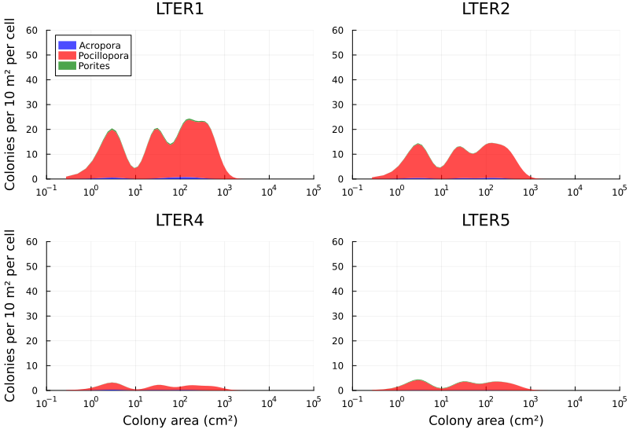
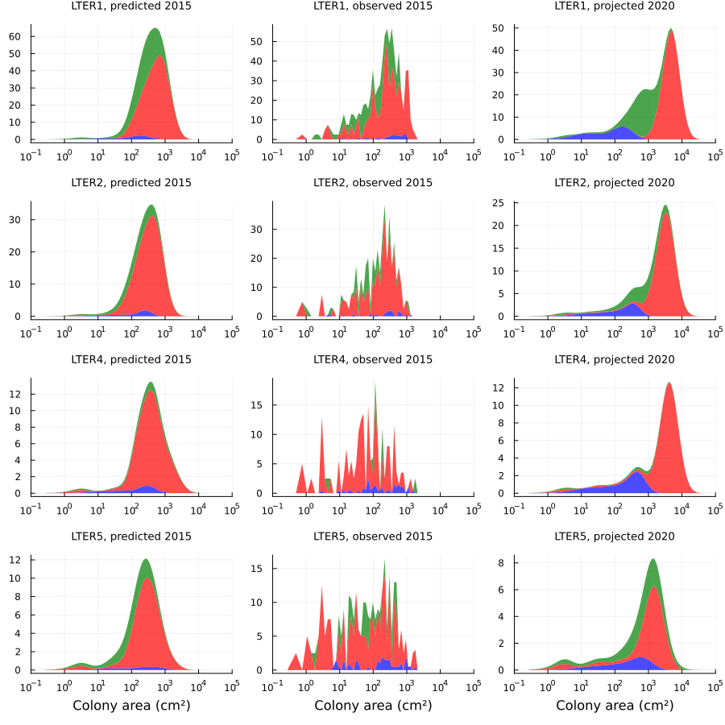
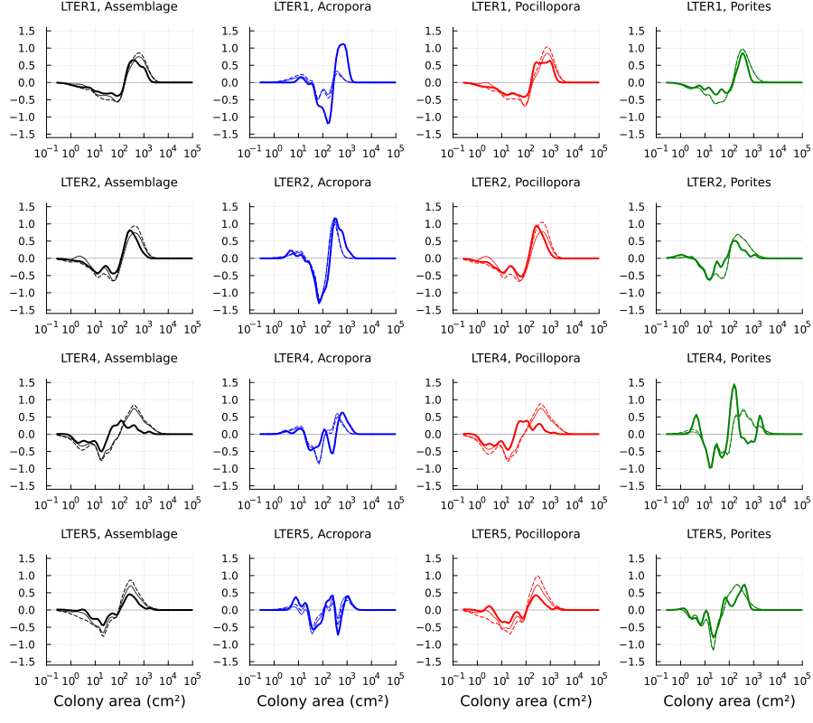
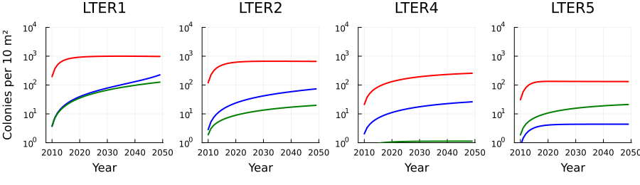

# Corals of Mo’orea: an open community recovering by recruitment
Simon Frost

- [Three genera after a disaster](#three-genera-after-a-disaster)
- [Size and the kernels](#size-and-the-kernels)
- [Recruitment and its reading](#recruitment-and-its-reading)
- [The genera as nets](#the-genera-as-nets)
- [Recovery from an empty reef](#recovery-from-an-empty-reef)
- [Elasticities](#elasticities)
- [The check against the authors’ R
  code](#the-check-against-the-authors-r-code)
- [From the observed assemblages](#from-the-observed-assemblages)
  - [Densities and sizes in 2015 (Figs. S5 to
    S8)](#densities-and-sizes-in-2015-figs-s5-to-s8)
- [Forty years from empty reef](#forty-years-from-empty-reef)
- [The comparison with the authors’ code and the
  paper](#the-comparison-with-the-authors-code-and-the-paper)
- [What is measured and what is
  assumed](#what-is-measured-and-what-is-assumed)
- [Where the model and its sources
  part](#where-the-model-and-its-sources-part)
- [Sources](#sources)
- [References](#references)

``` julia
ENV["GKSwstype"] = "100"
using MatrixCommunityModels
using LinearAlgebra, Printf
using Plots
BLAS.set_num_threads(1)
```

## Three genera after a disaster

Between 2006 and 2010 an outbreak of the crown-of-thorns seastar,
followed by Cyclone Oli, reduced the coral cover of the fore reefs of
Mo’orea, French Polynesia, from more than 40% to less than 1%. Kayal et
al. (2018) followed the recovery on four reefs of the Mo’orea Coral Reef
Long Term Ecological Research site (LTER 1 and 2 on the north shore,
LTER 4 on the east, LTER 5 on the west). They counted recruits, and
tagged and remeasured colonies of the three genera that build most of
the reef: *Acropora*, *Pocillopora* and *Porites*. From these data they
built an integral projection model (IPM) for each genus on each reef.
Colonies are structured by size, and recruits arrive from the plankton
in numbers set by local crowding, so each population is open.

The genera interact only through recruitment. In Mo’orea, recruitment of
*Pocillopora* falls as the coral assemblage grows, whatever its
composition; that of *Acropora* rises with the abundance of *Acropora*;
that of *Porites* barely changes (Kayal et al. 2015). Survival and
growth depend on size alone. In this package each genus is a projection
net, and the quantities recruitment reads are pools.

This vignette rebuilds the model from the paper’s Appendix S3 and Table
S1. It checks the model against the authors’ own kernel functions, run
in R, and against the simulations the paper publishes in its figures.

## Size and the kernels

Size is $z = \log_{10}(S + 1)$, with $S$ the surface area of a colony’s
living tissue in cm², on $[0, 7]$ in 100 cells (Appendix S3). From one
year to the next a colony of size $z$ survives with probability
$\mathrm{logit}^{-1}(s_0 + s_z z)$. If it survives, its new size is
normal with mean $G_0 + G_z z$ and standard deviation $G_{SD}$. The
parameters differ by genus and reef (Table S1):

``` julia
taxa = (:acropora, :pocillopora, :porites)
reefs = (:lter1, :lter2, :lter4, :lter5)
label = Dict(:acropora => "Acropora", :pocillopora => "Pocillopora", :porites => "Porites")
println("reef    genus          s0      sz      G0      Gz     GSD      R0       Rγ")
for r in reefs, t in taxa
    p = CORAL_PARAMETERS[r][t]
    @printf("%-6s  %-12s %6.3f  %6.3f  %6.3f  %6.3f  %6.3f  %6.3f  %7.3f\n", r, label[t], p.survival.intercept,
            p.survival.slope, p.growth.intercept, p.growth.slope, p.growth.sd, p.recruitment.intercept, p.recruitment.slope)
end
```

    reef    genus          s0      sz      G0      Gz     GSD      R0       Rγ
    lter1   Acropora      2.688   0.219   1.542   0.341   0.245   0.966    0.040
    lter1   Pocillopora   2.400   0.308   1.023   0.748   0.153   2.688   -0.002
    lter1   Porites       0.758   1.865   1.082   0.637   0.254   0.978    0.003
    lter2   Acropora      1.085   0.821   1.168   0.555   0.157   0.852    0.040
    lter2   Pocillopora   2.234   0.154   0.934   0.765   0.160   2.475   -0.002
    lter2   Porites      -0.171   1.240   0.644   0.808   0.300   0.673    0.003
    lter4   Acropora     -0.350   1.327   1.057   0.617   0.173   0.707    0.040
    lter4   Pocillopora   0.850   0.699   1.093   0.733   0.163   1.724   -0.002
    lter4   Porites      -1.417   1.047   1.075   0.634   0.321   0.139    0.003
    lter5   Acropora      2.455  -0.451   1.008   0.667   0.199   0.280    0.040
    lter5   Pocillopora   2.651  -0.564   1.102   0.686   0.184   1.889   -0.002
    lter5   Porites       0.685   0.759   0.689   0.798   0.273   0.669    0.003

## Recruitment and its reading

Each year $r$ recruits arrive, with sizes normal with mean 0.6 and
standard deviation 0.2 (about 3 cm² of tissue, 2 cm across). The paper
writes the number as

$$\log r = R_0 + R_\gamma\,\gamma ,$$

where the crowding $\gamma$ is the number of colonies of the genus
itself for *Acropora* and *Porites*, and the summed sizes $z$ of the
colonies of all three genera for *Pocillopora* (Appendix S3, equations
iii to v). $R_0$ comes from the recruits counted in 2011-2012 and
$R_\gamma$ from an earlier study. Recruitment is capped at 348 colonies
per 10 m² a year, and a model step is a year on 10 m² of reef.

The units of this equation are not stated. The authors’ R script uses
the natural logarithm, and its density and summed sizes are per 10 m²,
the area of a model iteration. This is the package’s default
(`reading = :as_written`), since it is what the authors’ code does. Read
that way, the model does not give the published simulations: *Acropora*
and *Porites* end up with several times the share of the assemblage that
the paper shows. A reading that does reproduce them is offered as
`reading = :calibrated`, and the comparisons with the published figures
below use it:

- the logarithm is to base 10;
- $R_0$ is for the 25 m² plots in which recruits were counted, so that
  the recruits per 10 m² are $0.4 \times 10^{R_0 + R_\gamma \gamma}$;
- $\gamma$ is per m².

This reading was found by trying the natural and base-10 logarithm with
recruits and crowding per m², per 10 m² and per 25 m², against the
figures below. It is a reconstruction, not something the paper states.
`coral_recruits` gives the number of recruits in either reading:

``` julia
for t in taxa
    @printf("%-12s  at γ = 0: calibrated %6.1f, as written %5.1f recruits per 10 m² (LTER 1)\n", label[t],
            coral_recruits(t, 0.0; reading = :calibrated), coral_recruits(t, 0.0))
end
```

    Acropora      at γ = 0: calibrated    3.7, as written   2.6 recruits per 10 m² (LTER 1)
    Pocillopora   at γ = 0: calibrated  195.0, as written  14.7 recruits per 10 m² (LTER 1)
    Porites       at γ = 0: calibrated    3.8, as written   2.7 recruits per 10 m² (LTER 1)

## The genera as nets

`coral` builds one genus on one reef. It is written in this form
(abridged from `src/corals.jl`):

``` julia
colony = coral_stage()                                   # z on [0, 7], 100 cells
life = kernel_net(colony, :growing => (y, x) -> survival(x) * growth(y, x))
net = inflow(life, (cell => ctx -> share[i] * recruits(ctx) for (i, cell) in enumerate(stage_names(colony)))...)
species(taxon, net; occupies = [:<taxon>_colonies => trait_weights(colony, z -> 1.0),
                                :<taxon>_log_size => trait_weights(colony, z -> z)],
        reads = ...)                                     # Pocillopora reads the other two log-size pools
```

The recruits are inflows: they do not come from the colonies of the net,
so the net has no births. `share[i]` is the probability that a recruit
lands in cell `i`. The genus adds its colonies and their summed sizes to
two pools. *Acropora* and *Porites* read their own colonies.
*Pocillopora* reads the summed sizes of all three. `coral_community`
composes the three genera:

``` julia
c = coral_community(:lter1; reading = :calibrated)
(species = species_names(c), pools = pool_names(c), states = length(c))
```

    (species = [:acropora, :pocillopora, :porites], pools = [:acropora_colonies, :acropora_log_size, :pocillopora_colonies, :pocillopora_log_size, :porites_log_size, :porites_colonies], states = 300)

## Recovery from an empty reef

The paper’s first simulations start from empty reef and let it fill by
recruitment alone. The first recruits arrive in the first step (2010),
so 2013, “after 3 years of reef recovery”, is the fourth step and 2015
the sixth. (Four cohorts are visible in the published size distributions
for 2013, and with four steps the elasticities to survival and growth
match those published; see below.)

``` julia
function recovery(reef; reading = :calibrated, steps = 6)
    c = coral_community(reef; reading)
    return c, project(c, zeros(length(c)), fill(nothing, steps))
end
z = meshpoints(coral_stage())
area = 10 .^ z .- 1
panels = map(reefs) do r
    c, sol = recovery(r)
    p = plot(; xscale = :log10, xlims = (0.1, 1e5), ylims = (0, 60), title = uppercase(String(r)), legend = r === :lter1 ? :topleft : false,
             xlabel = r in (:lter4, :lter5) ? "Colony area (cm²)" : "", ylabel = r in (:lter1, :lter4) ? "Colonies per 10 m² per cell" : "")
    stacked = zeros(length(z))
    for (t, colour) in zip(taxa, (:blue, :red, :green))
        lower = copy(stacked)
        stacked .+= sol[t][5, :]
        plot!(p, area[2:end], stacked[2:end]; fillrange = lower[2:end], color = colour, alpha = 0.7, lw = 0, label = label[t])
    end
    p
end
plot(panels...; layout = (2, 2), size = (800, 560))
```



These are the predicted assemblages of 2013, drawn as in Fig. 3a-d of
the paper: colonies in each mesh cell, stacked by genus. *Pocillopora*
dominates everywhere, as published. The cohorts are clearer here than in
the paper, where the youngest cohorts are smaller (see “Where the model
and its sources part”).

The paper prints the share of each genus in the summed sizes of the
assemblage on each panel of Fig. 3 (2013) and Fig. S4 (2015). Fig. S2
gives the colonies per 10 m² of each genus in 2013, read here from the
bar chart to the nearest few colonies.

``` julia
shares(c, n) = (p = pool_totals(c, n, nothing); x = [getproperty(p, Symbol(t, :_log_size)) for t in taxa]; 100 .* x ./ sum(x))
colonies(c, n) = (p = pool_totals(c, n, nothing); [getproperty(p, Symbol(t, :_colonies)) for t in taxa])
fig3 = Dict(:lter1 => [3, 96, 2], :lter2 => [2, 97, 1], :lter4 => [6, 93, 1], :lter5 => [2, 95, 3])
figS4 = Dict(:lter1 => [4, 93, 3], :lter2 => [3, 96, 1], :lter4 => [6, 93, 0], :lter5 => [2, 94, 4])
figS2 = Dict(:lter1 => [24, 612, 14], :lter2 => [16, 428, 4], :lter4 => [8, 82, 4], :lter5 => [4, 128, 8])
fmt(v) = join([@sprintf("%3.0f", x) for x in v], " ")
println("            share 2013 (%)            share 2015 (%)            colonies 2013 (per 10 m²)")
println("reef        here        paper         here        paper         here             paper (Fig. S2)")
for r in reefs
    c, sol = recovery(r)
    @printf("%-6s  %s   %s     %s   %s     %s   %s\n", r, fmt(shares(c, sol.u[5, :])), fmt(fig3[r]),
            fmt(shares(c, sol.u[7, :])), fmt(figS4[r]), join([@sprintf("%4.0f", x) for x in colonies(c, sol.u[5, :])], " "), fmt(figS2[r]))
end
```

                share 2013 (%)            share 2015 (%)            colonies 2013 (per 10 m²)
    reef        here        paper         here        paper         here             paper (Fig. S2)
    lter1     2  96   2     3  96   2       2  96   2     4  93   3       14  615   13    24 612  14
    lter2     2  97   1     2  97   1       2  97   1     3  96   1       10  385    5    16 428   4
    lter4     6  93   1     6  93   1       6  93   1     6  93   0        5   64    1     8  82   4
    lter5     2  94   4     2  95   3       2  93   4     2  94   4        3  100    5     4 128   8

Every share of 2013 is within a percentage point of the published one
(allowing for the rounding of both), and every share of 2015 within
three. The colonies of *Pocillopora* are within a quarter of Fig. S2.
Read as written, the same model gives this:

``` julia
println("reef    share 2013 as written (%)   colonies 2013 as written")
for r in reefs
    c, sol = recovery(r; reading = :as_written)
    @printf("%-6s  %s                 %s\n", r, fmt(shares(c, sol.u[5, :])), join([@sprintf("%5.1f", x) for x in colonies(c, sol.u[5, :])], " "))
end
```

    reef    share 2013 as written (%)   colonies 2013 as written
    lter1    16  72  12                  11.6  50.1   9.5
    lter2    16  77   7                   9.0  39.8   5.0
    lter4    21  74   5                   5.9  16.8   1.8
    lter5    14  71  15                   4.8  21.2   5.8

*Pocillopora* holds 19 to 24 percentage points less of the assemblage
than published, and its colonies number in the tens, not the hundreds of
Fig. S2.

## Elasticities

Table S2 of the paper lists the elasticity of each population’s
predicted change in summed size over 2010-2013 to each parameter. Its R
script (section 4) computes the elasticity of the ratio of the summed
size in the last year to that in the first, `surf[[6]]/surf[[1]]` for
five years. Here the ratio is that of the fourth step to the first, and
the derivatives are central differences. Shown for LTER 1:

``` julia
function surface_ratio(reef, taxon, field, which, factor; reading = :calibrated)
    P = CORAL_PARAMETERS
    sizes = NamedTuple{taxa}(Tuple(t === taxon && field === :recruit_size ?
        (which === :mean ? (0.6 * factor, 0.2) : (0.6, 0.2 * factor)) : (0.6, 0.2) for t in taxa))
    pars = P
    if field !== :recruit_size
        p = P[reef][taxon]
        rate = merge(getproperty(p, field), NamedTuple{(which,)}((getproperty(getproperty(p, field), which) * factor,)))
        pars = merge(P, NamedTuple{(reef,)}((merge(P[reef], NamedTuple{(taxon,)}((merge(p, NamedTuple{(field,)}((rate,))),))),)))
    end
    c = coral_community(reef; parameters = pars, recruit_size = sizes, reading)
    u = project(c, zeros(length(c)), fill(nothing, 4)).u
    s(n) = getproperty(pool_totals(c, n, nothing), Symbol(taxon, :_log_size))
    return s(u[end, :]) / s(u[2, :])
end
elasticity(args...; kw...) = abs((surface_ratio(args..., 1 + 1e-4; kw...) - surface_ratio(args..., 1 - 1e-4; kw...)) /
                                 (2e-4 * surface_ratio(args..., 1.0; kw...)))
items = [(:survival, :intercept), (:survival, :slope), (:growth, :intercept), (:growth, :slope), (:growth, :sd),
         (:recruitment, :intercept), (:recruitment, :slope), (:recruit_size, :mean), (:recruit_size, :sd)]
table_s2 = [0.24 0.31 0.11; 0.02 0.05 0.19; 0.82 0.78 0.82; 0.24 0.79 0.57; 0.00 0.00 0.00;
            0.44 1.56 0.02; 0.29 0.28 0.01; 0.78 0.99 0.61; 0.02 0.01 0.02]      # Table S2, LTER 1
println("parameter                    here (Acr Poc Por)    Table S2 (Acr Poc Por)")
for (i, (f, w)) in enumerate(items)
    e = [elasticity(:lter1, t, f, w) for t in taxa]
    @printf("%-12s %-10s      %5.2f %5.2f %5.2f        %5.2f %5.2f %5.2f\n", f, w, e..., table_s2[i, :]...)
end
```

    parameter                    here (Acr Poc Por)    Table S2 (Acr Poc Por)
    survival     intercept        0.25  0.28  0.11         0.24  0.31  0.11
    survival     slope            0.02  0.04  0.19         0.02  0.05  0.19
    growth       intercept        0.87  0.76  0.82         0.82  0.78  0.82
    growth       slope            0.26  0.68  0.57         0.24  0.79  0.57
    growth       sd               0.00  0.00  0.00         0.00  0.00  0.00
    recruitment  intercept        0.09  0.48  0.01         0.44  1.56  0.02
    recruitment  slope            0.04  0.08  0.00         0.29  0.28  0.01
    recruit_size mean             0.83  0.78  0.61         0.78  0.99  0.61
    recruit_size sd               0.01  0.01  0.02         0.02  0.01  0.02

Survival, growth and the size of recruits match Table S2 closely, here
and on the other three reefs (a check outside this vignette). The
elasticities to the intercept and slope of recruitment do not: they are
three to seven times smaller here, and smaller still for *Pocillopora*
when read as written. None of the 54 combinations of logarithm and units
tried (natural or base 10; $R_0$, and the crowding of each kind, per m²,
10 m² or 25 m²) reproduces them (a check outside this vignette). The
published model is more sensitive to recruitment than this one.

## The check against the authors’ R code

The authors’ script (Kayal 2017) is a template. It fits its models to a
data file it does not name, and its recruitment functions call objects
that do not exist, so it does not run as it stands.
`test/reference/R/run_coral_reference.R` reads the script at run time.
It evaluates only its survival, growth, kernel and recruit-size
functions, with the values of Table S1, and writes the recruitment of
Appendix S3 in both readings. The kernels and 40 years of recovery on
every reef, in both readings, agree with this package to rounding:

``` julia
reference(file) = [split(l, ",") for l in readlines(joinpath(pkgdir(MatrixCommunityModels), "test", "reference", file))[2:end]]
codes = Dict("Acr" => :acropora, "Poc" => :pocillopora, "Por" => :porites)
reef_of = Dict("1" => :lter1, "2" => :lter2, "4" => :lter4, "5" => :lter5)
rows = reference("coral_runs.csv")
worst = 0.0
for reading in (:calibrated, :as_written), (code, r) in reef_of
    c, sol = recovery(r; reading, steps = 40)
    for row in rows
        (row[1] == String(reading) && row[2] == code) || continue
        p = pool_totals(c, sol.u[parse(Int, row[3]) + 1, :], nothing)
        theirs = parse(Float64, row[5])
        theirs > 0 && (global worst = max(worst, abs(getproperty(p, Symbol(codes[row[4]], :_colonies)) / theirs - 1)))
    end
end
(largest_relative_difference_in_colonies = worst,)
```

    (largest_relative_difference_in_colonies = 7.327471962526033e-15,)

## From the observed assemblages

The runs from empty reef left out the colonies that survived the
disturbances, chiefly *Porites*. So the paper restarted its model from
the assemblages observed in the field. It ran from those of 2013 to
predict 2015 (Fig. 4a-d), and from those of 2015 to project to 2020
(Fig. 4i-l). In these updated runs the recruits of *Acropora* are
larger, with mean size 1.2 and standard deviation 0.4 (Appendix S3).

The observed colonies are those mapped every year since 2013 by the
Mo’orea Coral Reef LTER in four permanent transects, 5 m by 1 m, on each
fore reef. They are in the Environmental Data Initiative package
knb-lter-mcr.4009 (revision 5, CC BY 4.0). Mapping each colony’s
position shows that *Acropora* was recorded along the whole of each
transect, but *Pocillopora* and *Porites* only in its first metre. So
each reef has 20 m² of *Acropora* and 4 m² of the other two. Scaled this
way to colonies per 10 m², the counts match the observed bars of Fig.
S2a: for LTER 1 in 2013, 20.5, 722.5 and 330.0 colonies against bars of
about 20, 720 and 330. A colony’s area comes from its length, width and
height, as in Appendix S2 of the paper: a sphere for *Pocillopora*, a
cylinder for the other two. Its size is z = log10(S + 1), binned onto
the model’s mesh. `coral_observed_state` returns the state of one reef
in one year, in colonies per 10 m² in each cell. The shares of the
summed sizes it gives can be compared with those the paper prints for
the observed assemblages:

``` julia
c0 = coral_community(:lter1)
observed(r, year) = state_vector(c0, coral_observed_state(r, year))
fig3obs = Dict(:lter1 => [2, 67, 30], :lter2 => [3, 78, 19], :lter4 => [5, 78, 17], :lter5 => [4, 75, 21])
fig4obs = Dict(:lter1 => [3, 68, 29], :lter2 => [4, 75, 20], :lter4 => [11, 83, 6], :lter5 => [9, 70, 21])
f1(v) = join([@sprintf("%5.1f", x) for x in v], " ")
println("        observed 2013 (%)        Fig. 3e-h    observed 2015 (%)        Fig. 4e-h    colonies per 10 m², 2015")
for r in reefs
    @printf("%-6s  %s   %s    %s   %s    %s\n", r, f1(shares(c0, observed(r, 2013))), fmt(fig3obs[r]),
            f1(shares(c0, observed(r, 2015))), fmt(fig4obs[r]), f1(colonies(c0, observed(r, 2015))))
end
```

            observed 2013 (%)        Fig. 3e-h    observed 2015 (%)        Fig. 4e-h    colonies per 10 m², 2015
    lter1     2.4  67.5  30.0     2  67  30      3.3  68.2  28.5     3  68  29     25.0 537.5 257.5
    lter2     3.1  78.4  18.5     3  78  19      4.0  75.9  20.1     4  75  20     16.0 320.0  95.0
    lter4     5.1  76.4  18.5     5  78  17     11.7  78.8   9.6    11  83   6     20.5 175.0  17.5
    lter5     4.2  74.5  21.3     4  75  21      9.5  70.5  20.1     9  70  21     24.0 217.5  57.5

Every share of 2013 is within 1.6 points of the printed one. Those of
2015 are within a point, except on LTER 4, where the data give
*Pocillopora* 4 points less and *Porites* 4 more. The data used here are
revision 5 of the package (2022). The paper (2018) used an earlier
revision, which could not be compared. This agreement also confirms how
the shares the paper prints are computed: they are shares of the summed
sizes z, not of summed area. Summed area gives shares up to 18 points
away.

The runs start from these states, with both readings of recruitment:

``` julia
fig4pred = Dict(:lter1 => [3, 67, 30], :lter2 => [4, 82, 14], :lter4 => [5, 87, 7], :lter5 => [3, 77, 20])
fig4proj = Dict(:lter1 => [27, 50, 24], :lter2 => [11, 74, 15], :lter4 => [14, 84, 2], :lter5 => [8, 63, 29])
size4 = (acropora = (1.2, 0.4), pocillopora = (0.6, 0.2), porites = (0.6, 0.2))
function updated(r; reading = :as_written)
    c = coral_community(r; reading, recruit_size = size4)
    to2015 = project(c, coral_observed_state(r, 2013), fill(nothing, 2))
    to2020 = project(c, coral_observed_state(r, 2015), fill(nothing, 5))
    return c, to2015, to2020
end
acropora_recruits(c, sol, r, reading) =
    maximum(coral_recruits(:acropora, pool_totals(c, n, nothing).acropora_colonies; reef = r, reading) for n in eachrow(sol.u))
for reading in (:as_written, :calibrated)
    println("reading $reading")
    println("        2015 from 2013 (%)       Fig. 4a-d    2020 from 2015 (%)       Fig. 4i-l    most Acropora recruits, 2015-2020")
    for r in reefs
        c, a, b = updated(r; reading)
        @printf("%-6s  %s   %s    %s   %s    %6.1f\n", r, f1(shares(c, a.u[end, :])), fmt(fig4pred[r]),
                f1(shares(c, b.u[end, :])), fmt(fig4proj[r]), acropora_recruits(c, b, r, reading))
    end
end
```

    reading as_written
            2015 from 2013 (%)       Fig. 4a-d    2020 from 2015 (%)       Fig. 4i-l    most Acropora recruits, 2015-2020
    lter1     2.4  67.9  29.7     3  67  30      7.2  63.5  29.3    27  50  24     158.3
    lter2     3.5  82.0  14.5     4  82  14      7.7  74.0  18.4    11  74  15      11.7
    lter4     5.4  86.1   8.5     5  87   7     14.9  82.2   2.9    14  84   2       9.2
    lter5     3.9  75.2  21.0     3  77  20     11.9  54.8  33.3     8  63  29       3.5
    reading calibrated
            2015 from 2013 (%)       Fig. 4a-d    2020 from 2015 (%)       Fig. 4i-l    most Acropora recruits, 2015-2020
    lter1     2.1  70.0  28.0     3  67  30      3.0  72.6  24.4    27  50  24       5.5
    lter2     2.9  84.1  13.0     4  82  14      3.9  83.6  12.5    11  74  15       3.7
    lter4     4.8  87.3   8.0     5  87   7      9.4  88.3   2.3    14  84   2       2.6
    lter5     3.0  78.0  19.0     3  77  20      5.5  70.0  24.4     8  63  29       1.0

Read as written, the model predicts the composition of 2015 from that of
2013 within 1.8 points of Fig. 4a-d on every reef. The calibrated
reading is within 3 points. The order is the reverse of the runs from
empty reef, where only the calibrated reading came near the paper. In
the runs from 2015 to 2020, the reading as written gives the east reef
(LTER 4) within 2 points of Fig. 4k and LTER 2 within 3.4 of Fig. 4j. It
gives LTER 5 *Pocillopora* 8 points less than Fig. 4l. Neither reading
gives the north-shore *Acropora* of Fig. 4i: 27% of the assemblage in
2020, against 7% as written and 3% calibrated. The paper says that
*Acropora* recruitment on the north shore reached the cap of 348
recruits a year in these projections (Appendix S3). Here it stays below
it in both readings. As written it is highest on LTER 1: the *Acropora*
projected there for 2020 would bring 158 recruits the following year,
and the number is still rising with the density of *Acropora*.
Calibrated, it never exceeds 6.

``` julia
panels = []
for r in reefs
    c, a, b = updated(r)
    for (state, title) in ((a.u[end, :], "predicted 2015"), (observed(r, 2015), "observed 2015"), (b.u[end, :], "projected 2020"))
        s = species_states(c, state)
        p = plot(; xscale = :log10, xlims = (0.1, 1e5), legend = false, titlefontsize = 9,
                 title = "$(uppercase(String(r))), $title", xlabel = r === :lter5 ? "Colony area (cm²)" : "")
        stacked = zeros(length(z))
        for (t, colour) in zip(taxa, (:blue, :red, :green))
            lower = copy(stacked)
            stacked .+= s[t]
            plot!(p, area[2:end], stacked[2:end]; fillrange = lower[2:end], color = colour, alpha = 0.7, lw = 0)
        end
        push!(panels, p)
    end
end
plot(panels...; layout = (4, 3), size = (900, 900))
```



These are the assemblages of Fig. 4, drawn as before, with the reading
as written. Each row is a reef. The columns are the prediction for 2015
from 2013, the observation of 2015, and the projection to 2020 from
2015, in colonies per 10 m² in each cell, stacked by genus (*Acropora*
blue, *Pocillopora* red, *Porites* green). The observed panels show the
raw counts binned onto the mesh, so they are spikier than the paper’s,
whose observed distributions are smoothed.

Tables S3 and S4 of the paper give the elasticities of each population’s
summed size in 2015, and in 2020, to each parameter. The starting state
is observed, so these equal the elasticities of the ratio the script
computes. For LTER 1, as written:

``` julia
function final_size(r, taxon, field, which, factor; start, steps, reading = :as_written)
    P = CORAL_PARAMETERS
    sizes = size4
    if field === :recruit_size
        m, s = size4[taxon]
        sizes = merge(size4, NamedTuple{(taxon,)}(((which === :mean ? (m * factor, s) : (m, s * factor)),)))
    end
    pars = P
    if field !== :recruit_size
        p = P[r][taxon]
        rate = merge(getproperty(p, field), NamedTuple{(which,)}((getproperty(getproperty(p, field), which) * factor,)))
        pars = merge(P, NamedTuple{(r,)}((merge(P[r], NamedTuple{(taxon,)}((merge(p, NamedTuple{(field,)}((rate,))),))),)))
    end
    c = coral_community(r; parameters = pars, recruit_size = sizes, reading)
    u = project(c, coral_observed_state(r, start), fill(nothing, steps)).u
    return getproperty(pool_totals(c, u[end, :], nothing), Symbol(taxon, :_log_size))
end
updated_elasticity(args...; kw...) = abs((final_size(args..., 1 + 1e-4; kw...) - final_size(args..., 1 - 1e-4; kw...)) /
                                         (2e-4 * final_size(args..., 1.0; kw...)))
table_s3 = [0.17 0.22 0.03; 0.03 0.06 0.10; 0.68 0.67 0.74; 0.29 0.98 0.83; 0.00 0.00 0.00;
            0.82 0.05 0.05; 0.53 0.03 0.03; 0.28 0.00 0.02; 0.00 0.00 0.00]      # Table S3, LTER 1
table_s4 = [0.50 0.41 0.04; 0.08 0.15 0.14; 0.49 0.91 0.97; 0.17 2.08 1.45; 0.00 0.00 0.00;
            3.70 0.13 0.16; 4.35 0.10 0.08; 0.58 0.00 0.03; 0.03 0.00 0.00]      # Table S4, LTER 1
println("                        2013-2015: here   Table S3            2015-2020: here   Table S4")
for (i, (f, w)) in enumerate(items)
    e3 = [updated_elasticity(:lter1, t, f, w; start = 2013, steps = 2) for t in taxa]
    e4 = [updated_elasticity(:lter1, t, f, w; start = 2015, steps = 5) for t in taxa]
    f2(v) = join([@sprintf("%5.2f", x) for x in v], " ")
    @printf("%-12s %-9s  %s  %s    %s  %s\n", f, w, f2(e3), f2(table_s3[i, :]), f2(e4), f2(table_s4[i, :]))
end
```

                            2013-2015: here   Table S3            2015-2020: here   Table S4
    survival     intercept   0.18  0.23  0.03   0.17  0.22  0.03     0.70  0.42  0.03   0.50  0.41  0.04
    survival     slope       0.03  0.06  0.11   0.03  0.06  0.10     0.12  0.16  0.13   0.08  0.15  0.14
    growth       intercept   0.76  0.67  0.75   0.68  0.67  0.74     0.76  0.93  0.98   0.49  0.91  0.97
    growth       slope       0.34  0.98  0.83   0.29  0.98  0.83     0.33  2.13  1.48   0.17  2.08  1.45
    growth       sd          0.00  0.00  0.00   0.00  0.00  0.00     0.00  0.00  0.00   0.00  0.00  0.00
    recruitment  intercept   0.33  0.00  0.02   0.82  0.05  0.05     1.96  0.00  0.06   3.70  0.13  0.16
    recruitment  slope       0.31  0.00  0.02   0.53  0.03  0.03     3.19  0.00  0.05   4.35  0.10  0.08
    recruit_size mean        0.18  0.00  0.01   0.28  0.00  0.02     0.34  0.00  0.02   0.58  0.00  0.03
    recruit_size sd          0.00  0.00  0.00   0.00  0.00  0.00     0.02  0.00  0.00   0.03  0.00  0.00

Survival, growth and recruit size are again close to the paper. They are
within 0.11 of Table S3, and within 0.06 of Table S4 for *Pocillopora*
and *Porites*. *Acropora* in Table S4 is the exception: its growth
intercept is 0.76 against 0.49. The elasticities to recruitment come
nearer than in Table S2. Those of *Acropora* are 1.4 to 2.5 times
smaller than published, not three to seven. In 2015-2020 the slope of
*Acropora* recruitment is, as published, the largest elasticity of all:
the feedback of *Acropora* on its own recruitment drives the projection.
*Pocillopora*’s elasticities to recruitment are near zero here (below
0.01), against 0.03 to 0.13 published. On the other reefs (a check
outside this vignette), survival and growth stay within 0.1 of Table S3,
and within 0.8 of Table S4.

### Densities and sizes in 2015 (Figs. S5 to S8)

The Supporting Information compares the prediction for 2015 from 2013
with the observation in four more figures. Fig. S5 sets the predicted
abundance of each genus on each reef, in colonies and in summed sizes z
per 10 m², against the observed mean and its 95% confidence interval,
and prints a z-score on each bar: the distance between prediction and
observation in standard errors of the observed mean. Fig. S7 plots the
same predictions, and the observations of 2015, against the observations
of 2013. Fig. S6 compares the predicted and observed size distributions
of 2015, each scaled to one, and prints the Kolmogorov-Smirnov distance
D between them. Fig. S8 shows how those distributions changed from 2013
to 2015, predicted and observed. Fig. S8 prints no numbers.

The observed means and standard errors come from the four transects of
each reef. `coral_observed_transects` gives the colonies and the summed
sizes of each transect, scaled to 10 m². With n = 4 and a t-quantile on
3 degrees of freedom, they reproduce the bars of Fig. S5: LTER 1
*Pocillopora* in 2015, for instance, has a mean of 537.5 colonies per 10
m² with a 95% interval of 375 to 700. The bar of Fig. S5a runs from
about 375 to 695.

``` julia
using Statistics
standard_error(x) = std(x) / sqrt(length(x))
figS5a = Dict(:lter1 => [4.9, 2.6, 1.8], :lter2 => [6.5, 1.9, -0.4], :lter4 => [-0.9, 0.2, 0.7], :lter5 => [-4.7, -1.2, -1.2])
figS5b = Dict(:lter1 => [2.3, 4.1, 3.3], :lter2 => [3.1, 2.7, 0.0], :lter4 => [-1.1, 2.2, 1.9], :lter5 => [-4.3, -0.2, -0.9])
function predicted2015(r, reading)
    c = coral_community(r; reading, recruit_size = size4)
    return c, project(c, coral_observed_state(r, 2013), fill(nothing, 2)).u[end, :]
end
# z-scores of Fig. S5, here: (predicted - observed mean) / standard error, by genus, for colonies and summed sizes
function zscore(r, reading, what)
    c, u = predicted2015(r, reading)
    p, o = pool_totals(c, u, nothing), coral_observed_transects(r, 2015)
    return [(getproperty(p, Symbol(t, :_, what)) - mean(getproperty(o[t], what))) / standard_error(getproperty(o[t], what)) for t in taxa]
end
Z = Dict((r, reading, what) => zscore(r, reading, what) for r in reefs, reading in (:as_written, :calibrated), what in (:colonies, :log_size))
for (what, fig, title) in ((:colonies, figS5a, "colonies per 10 m², 2015; z-scores of Fig. S5a"),
                          (:log_size, figS5b, "summed z per 10 m², 2015; z-scores of Fig. S5b"))
    println(title)
    println("reef   genus           observed (se)    paper  as written  calibrated")
    for r in reefs, (i, t) in enumerate(taxa)
        o = getproperty(coral_observed_transects(r, 2015)[t], what)
        @printf("%-6s %-12s  %7.1f (%5.1f)  %6.1f  %9.1f  %10.1f\n", r, label[t], mean(o), standard_error(o),
                fig[r][i], Z[(r, :as_written, what)][i], Z[(r, :calibrated, what)][i])
    end
end
inside(v) = count(x -> abs(x) <= 3.182, v)          # the prediction within the 95% interval (t, 3 degrees of freedom)
published = reduce(vcat, [what === :colonies ? figS5a[r] : figS5b[r] for r in reefs, what in (:colonies, :log_size)])
@printf("Fig. S5:    %d of 24 predictions inside the observed 95%% interval\n", inside(published))
for reading in (:as_written, :calibrated)
    here = reduce(vcat, [Z[(r, reading, what)] for r in reefs, what in (:colonies, :log_size)])
    @printf("%-10s  %d of 24 inside; largest difference from Fig. S5 %.1f\n", reading, inside(here), maximum(abs.(here .- published)))
end
```

    colonies per 10 m², 2015; z-scores of Fig. S5a
    reef   genus           observed (se)    paper  as written  calibrated
    lter1  Acropora         25.0 (  3.7)     4.9        1.9         0.7
    lter1  Pocillopora     537.5 ( 51.2)     2.6        2.3         5.2
    lter1  Porites         257.5 ( 43.1)     1.8        1.6         1.5
    lter2  Acropora         16.0 (  1.6)     6.5        3.2         1.8
    lter2  Pocillopora     320.0 ( 68.1)     1.9        1.3         3.3
    lter2  Porites          95.0 ( 32.0)    -0.4       -0.4        -0.4
    lter4  Acropora         20.5 (  6.6)    -0.9       -1.1        -1.3
    lter4  Pocillopora     175.0 ( 26.3)     0.2       -0.2         0.8
    lter4  Porites          17.5 (  2.5)     0.7        0.2        -0.2
    lter5  Acropora         24.0 (  3.7)    -4.7       -4.3        -4.8
    lter5  Pocillopora     217.5 ( 44.8)    -1.2       -1.9        -0.9
    lter5  Porites          57.5 ( 14.9)    -1.2       -0.8        -0.9
    summed z per 10 m², 2015; z-scores of Fig. S5b
    reef   genus           observed (se)    paper  as written  calibrated
    lter1  Acropora         61.9 (  7.9)     2.3        0.2        -0.6
    lter1  Pocillopora    1264.2 (129.0)     4.1        4.0         5.2
    lter1  Porites         528.1 ( 73.2)     3.3        3.4         3.4
    lter2  Acropora         36.4 (  3.6)     3.1        2.0         1.1
    lter2  Pocillopora     685.0 (143.1)     2.7        2.3         3.3
    lter2  Porites         181.1 ( 64.6)     0.0       -0.0        -0.0
    lter4  Acropora         44.9 ( 12.9)    -1.1       -1.3        -1.5
    lter4  Pocillopora     303.5 ( 51.7)     2.2        2.6         3.2
    lter4  Porites          37.0 (  7.3)     1.9        0.9         0.8
    lter5  Acropora         50.5 (  8.3)    -4.3       -4.1        -4.4
    lter5  Pocillopora     375.2 ( 81.9)    -0.2       -0.6        -0.1
    lter5  Porites         107.3 ( 29.3)    -0.9       -0.6        -0.6
    Fig. S5:    18 of 24 predictions inside the observed 95% interval
    as_written  19 of 24 inside; largest difference from Fig. S5 3.3
    calibrated  17 of 24 inside; largest difference from Fig. S5 4.7

The published predictions themselves can be recovered from the printed
z-scores, as the observed mean plus z standard errors: for instance 43
colonies of *Acropora* per 10 m² on LTER 1, the orange dot of Figs. S5a
and S7a. Fig. S7 shows whether each population was predicted to grow or
shrink from 2013 to 2015, by the side of the diagonal it falls on. Here
are the predictions that grow or shrink where the paper’s do not:

``` julia
for (what, fig) in ((:colonies, figS5a), (:log_size, figS5b))
    for reading in (:as_written, :calibrated)
        differ = String[]
        for r in reefs, (i, t) in enumerate(taxa)
            o13, o15 = getproperty(coral_observed_transects(r, 2013)[t], what), getproperty(coral_observed_transects(r, 2015)[t], what)
            paper = mean(o15) + fig[r][i] * standard_error(o15)
            here = getproperty(pool_totals(predicted2015(r, reading)..., nothing), Symbol(t, :_, what))
            sign(here - mean(o13)) == sign(paper - mean(o13)) ||
                push!(differ, @sprintf("%s %s (2013 %.0f, paper %.0f, here %.0f)", r, label[t], mean(o13), paper, here))
        end
        @printf("%s, %s: %d of 12 change as in Fig. S7\n", what, reading, 12 - length(differ))
        foreach(d -> println("    not ", d), differ)
    end
end
```

    colonies, as_written: 10 of 12 change as in Fig. S7
        not lter1 Porites (2013 330, paper 335, here 328)
        not lter5 Acropora (2013 7, paper 6, here 8)
    colonies, calibrated: 9 of 12 change as in Fig. S7
        not lter1 Pocillopora (2013 722, paper 671, here 802)
        not lter1 Porites (2013 330, paper 335, here 323)
        not lter2 Pocillopora (2013 472, paper 449, here 546)
    log_size, as_written: 12 of 12 change as in Fig. S7
    log_size, calibrated: 11 of 12 change as in Fig. S7
        not lter5 Acropora (2013 15, paper 15, here 14)

Read as written, the model’s z-scores are within 3.3 of Fig. S5a and
within 2.1 of Fig. S5b, and the largest differences are those of
*Acropora* on the north shore. There the paper predicts 43 colonies per
10 m² on LTER 1 and 27 on LTER 2, against 32 and 21 here; the observed
means of 2015 are 25 and 16. Elsewhere the z-scores mostly agree to a
few tenths. Both models over-predict *Pocillopora* and *Porites* on LTER
1 and under-predict *Acropora* on LTER 5. As written, 19 of the 24
predictions fall inside the observed 95% interval, against 18 published;
calibrated, 17, because the calibrated reading over-predicts the
*Pocillopora* of the north shore more than the paper does. The direction
of change agrees with Fig. S7 in all but a few cases, listed above. As
written, these are populations that the paper predicts barely change.
Calibrated, the north-shore *Pocillopora* also grows where the paper’s
shrinks. So the mismatch is the one found before: the published model’s
*Acropora* responds more strongly to its own density than in either
reading.

The size distributions of Fig. S6 and their changes (Fig. S8) are
compared through the Kolmogorov-Smirnov distance between the predicted
and observed distributions of 2015, and through the change in the mean
size z from 2013 to 2015. The observed distributions here are the binned
counts, not smoothed; the assemblage pools the three genera by colonies
per 10 m².

``` julia
figS6 = Dict(:lter1 => [0.07, 0.58, 0.25, 0.21], :lter2 => [0.05, 0.43, 0.19, 0.26],
             :lter4 => [0.35, 0.22, 0.50, 0.68], :lter5 => [0.18, 0.15, 0.27, 0.16])   # D: assemblage, Acr, Poc, Por
ks(a, b) = maximum(abs.(cumsum(a) ./ sum(a) .- cumsum(b) ./ sum(b)))
mean_size(w) = sum(w .* z) / sum(w)
groups(s) = (sum(s[t] for t in taxa), (s[t] for t in taxa)...)
D = Dict{Tuple{Symbol, Symbol}, Vector{Float64}}()
shift = Dict{Tuple{Symbol, Symbol}, Vector{Float64}}()
for r in reefs
    o13, o15 = groups(Dict(coral_observed_state(r, 2013))), groups(Dict(coral_observed_state(r, 2015)))
    shift[(r, :observed)] = [mean_size(b) - mean_size(a) for (a, b) in zip(o13, o15)]
    for reading in (:as_written, :calibrated)
        c, u = predicted2015(r, reading)
        p = groups(species_states(c, u))
        D[(r, reading)] = [ks(x, y) for (x, y) in zip(p, o15)]
        shift[(r, reading)] = [mean_size(b) - mean_size(a) for (a, b) in zip(o13, p)]
    end
end
f2(v) = join([@sprintf("%4.2f", x) for x in v], " ")
f3(v) = join([@sprintf("%5.2f", x) for x in v], " ")
println("D, 2015: assemblage, Acropora, Pocillopora, Porites")
println("reef    Fig. S6               as written            calibrated")
for r in reefs
    @printf("%-6s  %s   %s   %s\n", r, f2(figS6[r]), f2(D[(r, :as_written)]), f2(D[(r, :calibrated)]))
end
println("\nchange in mean z, 2013 to 2015: assemblage, Acropora, Pocillopora, Porites")
println("reef    observed                 as written               calibrated")
for r in reefs
    @printf("%-6s  %s   %s   %s\n", r, f3(shift[(r, :observed)]), f3(shift[(r, :as_written)]), f3(shift[(r, :calibrated)]))
end
```

    D, 2015: assemblage, Acropora, Pocillopora, Porites
    reef    Fig. S6               as written            calibrated
    lter1   0.07 0.58 0.25 0.21   0.22 0.50 0.29 0.26   0.16 0.47 0.17 0.27
    lter2   0.05 0.43 0.19 0.26   0.24 0.28 0.26 0.24   0.14 0.25 0.14 0.25
    lter4   0.35 0.22 0.50 0.68   0.54 0.17 0.61 0.51   0.45 0.15 0.49 0.55
    lter5   0.18 0.15 0.27 0.16   0.36 0.09 0.45 0.21   0.21 0.19 0.24 0.22

    change in mean z, 2013 to 2015: assemblage, Acropora, Pocillopora, Porites
    reef    observed                 as written               calibrated
    lter1    0.61  0.38  0.70  0.44    0.94 -0.11  1.06  0.77    0.75 -0.03  0.76  0.79
    lter2    0.59  0.36  0.66  0.33    0.92  0.13  1.03  0.58    0.62  0.20  0.64  0.60
    lter4    0.42  0.21  0.44  0.29    1.14  0.08  1.29  0.60    0.98  0.16  1.08  0.69
    lter5    0.35  0.02  0.30  0.50    0.89  0.04  1.01  0.66    0.65  0.23  0.66  0.67

For the three genera, the distances here are within 0.18 of Fig. S6 in
both readings. They pick out the same poor fits as the paper: *Acropora*
on LTER 1, and *Pocillopora* and *Porites* on LTER 4, have the three
largest distances in the paper and in both readings. For the assemblage
they do not agree. The paper’s distances are 0.07 and 0.05 on the north
shore, although its *Pocillopora* and *Porites*, which make up nearly
all the colonies, are each 0.19 to 0.26 away and both predicted too
large. Here the assemblage is about as far from the observation as its
two main genera are. How the paper pooled the assemblage is not stated.

The changes in mean size have the pattern of Fig. S8. The model grows
*Pocillopora* and *Porites* more than observed on every reef (as
written; calibrated on all but *Pocillopora* of LTER 2), most of all
*Pocillopora* on LTER 4, as in Fig. S8k. On LTER 1 the observed
*Acropora* grew, but the predicted *Acropora* does not. In Fig. S8e the
predicted change is also much weaker than the observed one. The figure
below draws the changes as Fig. S8 does: the predicted distribution of
2015 minus the observed one of 2013, against the observed change. Each
is a density in z scaled to one, and the observed counts are smoothed
with a normal kernel of standard deviation 0.1 in z for this figure
only.

``` julia
smooth(w) = [sum(w .* exp.(-((z .- x) ./ 0.1) .^ 2 ./ 2)) for x in z]
scaled(w) = w ./ (sum(w) * step_size(coral_stage()))
panels = []
for r in reefs
    o13, o15 = groups(Dict(coral_observed_state(r, 2013))), groups(Dict(coral_observed_state(r, 2015)))
    pw, pc = groups(species_states(predicted2015(r, :as_written)...)), groups(species_states(predicted2015(r, :calibrated)...))
    for (k, (name, colour)) in enumerate(zip(("Assemblage", "Acropora", "Pocillopora", "Porites"), (:black, :blue, :red, :green)))
        base = scaled(smooth(o13[k]))
        p = plot(; xscale = :log10, xlims = (0.1, 1e5), ylims = (-1.6, 1.6), legend = false, titlefontsize = 9,
                 title = "$(uppercase(String(r))), $name", xlabel = r === :lter5 ? "Colony area (cm²)" : "")
        hline!(p, [0]; color = :grey, lw = 0.5)
        plot!(p, area[2:end], (scaled(smooth(o15[k])) .- base)[2:end]; color = colour, lw = 2)
        plot!(p, area[2:end], (scaled(pw[k]) .- base)[2:end]; color = colour, ls = :dash)
        plot!(p, area[2:end], (scaled(pc[k]) .- base)[2:end]; color = colour, ls = :dot)
        push!(panels, p)
    end
end
plot(panels...; layout = (4, 4), size = (900, 800))
```



Solid lines are the observed change, dashed the prediction as written
and dotted the calibrated one. The y-axis is per unit z, which above a
few cm² is a decade of area; the paper does not say how its densities
are scaled, so the heights are comparable with Fig. S8’s only roughly.
The curves have the shapes of Fig. S8, panel by panel, including the
large observed swing of LTER 1 *Acropora* that neither prediction
follows. The jagged observed curves of LTER 4 *Porites* rest on 15
colonies in 2013 and 7 in 2015.

## Forty years from empty reef

Back to the runs from empty reef: the projection below continues them
for 40 years (*Acropora* blue, *Pocillopora* red, *Porites* green).
Recruitment of *Acropora* rises with its own density, with nothing to
stop it but the cap.

``` julia
plot(; layout = (1, 4), size = (900, 260), legend = false)
for (j, r) in enumerate(reefs)
    c, sol = recovery(r; steps = 40)
    p = reduce(vcat, permutedims(colonies(c, row)) for row in eachrow(sol.u))
    for (k, colour) in enumerate((:blue, :red, :green))
        plot!(2009 .+ (0:40), p[:, k]; subplot = j, color = colour, lw = 2, yscale = :log10, ylims = (1, 1e4),
              title = uppercase(String(r)), xlabel = "Year", ylabel = j == 1 ? "Colonies per 10 m²" : "")
    end
end
plot!()
```



``` julia
for r in reefs
    c, sol = recovery(r; steps = 40)
    capped = findfirst(row -> coral_recruits(:acropora, pool_totals(c, row, nothing).acropora_colonies; reef = r, reading = :calibrated) >= CORAL_RECRUITMENT_CAP,
                       collect(eachrow(sol.u)))
    @printf("%-6s Acropora recruitment reaches the cap of 348 in %s; colonies in 2049: %s\n", r,
            capped === nothing ? "none of these years" : string(2009 + capped - 1), fmt(colonies(c, sol.u[end, :])))
end
```

    lter1  Acropora recruitment reaches the cap of 348 in none of these years; colonies in 2049: 225 977 126
    lter2  Acropora recruitment reaches the cap of 348 in none of these years; colonies in 2049:  73 660  20
    lter4  Acropora recruitment reaches the cap of 348 in none of these years; colonies in 2049:  26 256   1
    lter5  Acropora recruitment reaches the cap of 348 in none of these years; colonies in 2049:   4 132  21

*Pocillopora* levels off within a decade, held by its own density
dependence. *Acropora* keeps increasing on the north shore (LTER 1 and
2) and the east (LTER 4), fastest at LTER 1, but from an empty reef it
does not reach the cap within 40 years. Nor does it in the runs from the
assemblages observed in 2015, by 2020 (above). Kayal et al. (2018)
report that north-shore *Acropora* did reach it in those runs. Without
the cap the positive feedback of *Acropora* on its own recruitment has
no limit; the cap is part of the model, not of the reef.

## The comparison with the authors’ code and the paper

| Check | Agreement |
|----|----|
| Survival-growth kernels against the authors’ `P_z1z` functions, 12 populations | absolute difference below 1e-12 |
| Recovery from empty reef, 40 years, four reefs, both readings, against the R reference | relative difference below 1e-14 |
| Share of each genus in the summed sizes in 2013 (Fig. 3a-d), 12 values | within 1 percentage point |
| Share of each genus in 2015 (Fig. S4a-d), 12 values | within 3 percentage points |
| Colonies of *Pocillopora* per 10 m² in 2013 (Fig. S2a, read from the figure) | within 22% |
| Colonies of *Acropora* and *Porites* in 2013 (Fig. S2a; published values 4 to 24) | within 10 colonies, mostly fewer |
| Elasticities to survival, growth and recruit size (Table S2, LTER 1) | within 0.05, except *Pocillopora* growth slope and recruit mean size (0.68 against 0.79; 0.78 against 0.99) |
| Elasticities to the intercept and slope of recruitment (Table S2) | no: three to seven times smaller |
| Shape of the size distributions in 2013 (Fig. 3a-d) | in part: the cohorts are where published, but the youngest are too large |
| Observed shares of the summed sizes, 2013 (Fig. 3e-h) and 2015 (Fig. 4e-h), from the MCR LTER data | 2013 within 1.6 points; 2015 within 1 point, except LTER 4 (4.2) |
| Runs from the observed assemblages, both readings, against the R reference | relative difference below 1e-14 |
| Shares predicted for 2015 from 2013 (Fig. 4a-d) | as written within 1.8 points; calibrated within 3 |
| Shares projected for 2020 from 2015 (Fig. 4i-l) | in part: as written LTER 4 within 1.8 and LTER 2 within 3.4, LTER 5 within 8.3; north-shore *Acropora* 7% (as written) or 3% (calibrated) against 27% |
| The recruitment cap reached only by north-shore *Acropora*, by 2020 (Appendix S3) | no: highest *Acropora* recruitment 158 (as written) or 6 (calibrated) |
| Elasticities from the observed assemblages, LTER 1, as written (Tables S3, S4): survival, growth, recruit size | within 0.11 (S3); within 0.06 for *Pocillopora* and *Porites*, 0.28 for *Acropora* (S4) |
| Elasticities to recruitment, same runs | in part: *Acropora* 1.4 to 2.5 times smaller; *Pocillopora* near zero against 0.03 to 0.13 |
| z-scores of the predicted 2015 abundances against the observed (Fig. S5), 24 values | as written within 3.3 (colonies) and 2.1 (summed sizes), the largest for north-shore *Acropora*; calibrated within 4.7 |
| Direction of change 2013-2015 of the predicted abundances (Fig. S7) | in part: as written 22 of 24 as published, calibrated 20 of 24 |
| Kolmogorov-Smirnov distances between predicted and observed size distributions, 2015 (Fig. S6) | for the genera within 0.18 in both readings, with the same three worst fits; not for the assemblage |
| Change in size distributions 2013-2015 (Fig. S8, no numbers printed) | the same pattern: *Pocillopora* and *Porites* grow more than observed, north-shore *Acropora* less |

## What is measured and what is assumed

| Quantity | Source |
|----|----|
| Survival and growth by size, by genus and reef | fitted to colonies tagged in 2011-2013 (Table S1) |
| Recruitment intercept $R_0$, by genus and reef | fitted to recruits counted in 2011-2012 (Table S1) |
| Recruitment slope $R_\gamma$, by genus | from Kayal et al. (2015), not read here (Table S1) |
| What recruitment responds to: own density, or summed sizes of the assemblage | Appendix S3 |
| Size of recruits, mean 0.6 and sd 0.2 | Appendix S3 (the paper’s initial runs; 1.2 and 0.4 for *Acropora* in its later runs, available as `recruit_size`) |
| Cap of 348 recruits per 10 m² a year | Appendix S3 |
| Mesh: $z$ on $[0, 7]$ in 100 cells | Appendix S3 |
| Base-10 logarithm, $R_0$ per 25 m², $\gamma$ per m² | calibrated here against Fig. 3, Fig. S2 and Fig. S4; not stated in the paper |
| Start: empty reef, first recruits in the first step | the paper’s initial runs; the step count chosen to match Fig. 3 and Table S2 |
| Start of the updated runs: colonies observed in 2013 and 2015 | MCR LTER mapped corals (EDI knb-lter-mcr.4009.5), sizes from Appendix S2 |
| Areas mapped: 20 m² of *Acropora*, 4 m² of *Pocillopora* and *Porites* per reef | read from the colonies’ positions in the data; reproduces Fig. S2a |
| *Acropora* recruits of mean 1.2 and sd 0.4 in the updated runs | Appendix S3 |

## Where the model and its sources part

- The units of the recruitment equation are a reconstruction. The
  package’s default follows the authors’ script; the calibrated reading
  used for the comparisons here reproduces the published shares of the
  assemblage (Fig. 3, Fig. S4) and, roughly, the densities (Fig. S2). It
  does not reproduce the shape of the published size distributions: in
  Fig. 3a the youngest cohorts of *Pocillopora* are about a fifth of the
  oldest, while here they are about as large. Nor does it reproduce the
  elasticities to recruitment of Table S2, which are three to seven
  times larger than here. Both point to a stronger density dependence of
  *Pocillopora* recruitment in the published model than in any reading
  tried. A reading with stronger density dependence (crowding per 10 m²)
  matches the cohort shapes better and the shares and densities worse.
  The paper’s own code, which would settle the question, is not
  published in runnable form.
- The authors’ R script, read as written, does not run (see above), and
  in its recruitment of *Pocillopora* it reads
  `m.parPoc["recr.Intercep"]`, a misspelt name that gives `NA` in R. The
  script uses the natural logarithm, which the published figures rule
  out.
- The crowding of *Pocillopora* is the sum of the sizes $z$ (logarithms
  of area) of the colonies, as Appendix S3 writes it and Fig. S2b labels
  it (“sum log-sizes”), not their summed area.
- From the assemblages observed in 2013 and 2015, the reading as written
  is the nearer to the paper’s predictions for 2015 (Fig. 4a-d), while
  from empty reef the calibrated one is. No single reading reproduces
  both sets of runs. Neither reproduces the surge of north-shore
  *Acropora* by 2020 (Fig. 4i) or its recruitment reaching the cap. The
  published model again behaves as if recruitment, here that of
  *Acropora*, responded more strongly than in either reading.
- The observed states come from revision 5 of the MCR LTER data (2022).
  Their shares match those printed for 2013 and 2015 except on LTER 4 in
  2015, perhaps because the paper used an earlier revision. The same
  revision gives the observed means and standard errors behind the
  z-scores of Fig. S5 compared here; those of the paper may differ
  slightly.
- The distances between the size distributions of the whole assemblage
  in Fig. S6 (0.05 to 0.35) are not reproduced (0.14 to 0.54 here),
  although those of the three genera are; how the paper pooled the
  genera is not stated.
- Values read from the figures (Fig. S2) are approximate, to a few
  colonies.

## Sources

Read in full: the paper (the authors’ accepted manuscript on
eScholarship, which carries the DOI 10.1111/ele.13153) and its
Supporting Information (Appendices S1 to S3, Figs. S1 to S11, Tables S1
to S4), and the authors’ R script (GitHub, commit af547a8, no licence).
The publisher’s pages refused automated access, so the version of record
itself was not read. Two DOIs carry this paper’s title and authors:
10.1111/ele.13153 (*Ecology Letters* 21(12), 1790-1799, online 11
September 2018) and 10.1111/ele.13203 (22(4), 605-615, online 3 February
2019). Crossref and PubMed list both, with the same abstract and no
notice linking them. The eScholarship record, the MCR LTER bibliography
and HAL give the first, which is cited here. Kayal et al. (2015), the
source of the recruitment slopes, was not read. The observed colonies
are from the MCR LTER data package knb-lter-mcr.4009, revision 5,
released under CC BY 4.0 (Moorea Coral Reef LTER et al. 2022). Only the
colonies of 2013 and 2015 on the fore reefs, binned onto the model’s
mesh, are included in the package
(`data/corals/mcr_lter_observed_colonies.csv`), and totalled by transect
(`data/corals/mcr_lter_observed_transects.csv`);
`data/corals/LICENSE.txt` gives the changes made. The parameters are the
published values of Table S1, typed into
`data/corals/kayal2018_table_s1.csv`; no file of the authors is included
in this package.

## References

Kayal, M., Lenihan, H. S., Brooks, A. J., Holbrook, S. J., Schmitt, R.
J. & Kendall, B. E. (2018). Predicting coral community recovery using
multi-species population dynamics models. *Ecology Letters* 21,
1790-1799. <https://doi.org/10.1111/ele.13153>

Kayal, M. (2017). R code for constructing a multi-species,
open-population integral projection model of coral assemblage dynamics.
GitHub repository MohsenKayal/Coral-assemblage-IPM.
<https://doi.org/10.5281/zenodo.573772>

Kayal, M., Vercelloni, J., Wand, M. P. & Adjeroud, M. (2015). Searching
for the best bet in life-strategy: a quantitative approach to individual
performance and population dynamics in reef-building corals. *Ecological
Complexity* 23, 73-84.

Lenihan, H. S. & Kayal, M. (2015). MCR LTER: Coral Reefs: Long-term
coral population and community dynamics: annual island wide coral
demography survey 2011 to present. Environmental Data Initiative.
<https://doi.org/10.6073/pasta/98855475790bfb012066f9dc802ecc31>

Moorea Coral Reef LTER, Lenihan, H., Ake, H. & Winslow, E. (2022). MCR
LTER: Coral Reef: Long-Term Coral Population and Community Dynamics:
Annual Island Wide Coral Demography Survey 2011 ongoing. Version 5.
Environmental Data Initiative. Licensed under CC BY 4.0
(<https://creativecommons.org/licenses/by/4.0/>).
<https://doi.org/10.6073/pasta/322a76c6f197bfac60c91d66a3e96fb5>

Ellner, S. P., Childs, D. Z. & Rees, M. (2016). *Data-driven Modelling
of Structured Populations: A Practical Guide to the Integral Projection
Model*. Springer.
