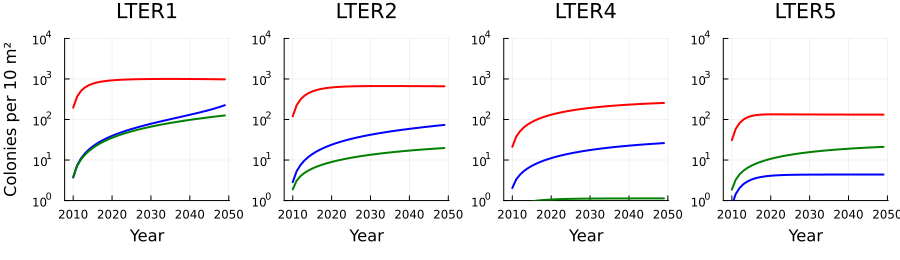

# Corals of Mo’orea: an open community recovering by recruitment
Simon Frost

- [Three genera after a disaster](#three-genera-after-a-disaster)
- [Size and the kernels](#size-and-the-kernels)
- [Recruitment and its reading](#recruitment-and-its-reading)
- [The genera as nets](#the-genera-as-nets)
- [Recovery from an empty reef](#recovery-from-an-empty-reef)
- [Elasticities](#elasticities)
- [The check against the authors’ R
  code](#the-check-against-the-authors-r-code)
- [After 2015](#after-2015)
- [The comparison with the authors’ code and the
  paper](#the-comparison-with-the-authors-code-and-the-paper)
- [What is measured and what is
  assumed](#what-is-measured-and-what-is-assumed)
- [Where the model and its sources
  part](#where-the-model-and-its-sources-part)
- [Sources](#sources)
- [References](#references)

``` julia
ENV["GKSwstype"] = "100"
using MatrixCommunityModels
using LinearAlgebra, Printf
using Plots
BLAS.set_num_threads(1)
```

## Three genera after a disaster

Between 2006 and 2010 an outbreak of the crown-of-thorns seastar,
followed by Cyclone Oli, reduced the coral cover of the fore reefs of
Mo’orea, French Polynesia, from more than 40% to less than 1%. Kayal et
al. (2018) followed the recovery on four reefs of the Mo’orea Coral Reef
Long Term Ecological Research site (LTER 1 and 2 on the north shore,
LTER 4 on the east, LTER 5 on the west). They counted recruits, and
tagged and remeasured colonies of the three genera that build most of
the reef: *Acropora*, *Pocillopora* and *Porites*. From these data they
built an integral projection model (IPM) for each genus on each reef.
Colonies are structured by size, and recruits arrive from the plankton
in numbers set by local crowding, so each population is open.

The genera interact only through recruitment. In Mo’orea, recruitment of
*Pocillopora* falls as the coral assemblage grows, whatever its
composition; that of *Acropora* rises with the abundance of *Acropora*;
that of *Porites* barely changes (Kayal et al. 2015). Survival and
growth depend on size alone. In this package each genus is a projection
net, and the quantities recruitment reads are pools.

This vignette rebuilds the model from the paper’s Appendix S3 and Table
S1. It checks the model against the authors’ own kernel functions, run
in R, and against the simulations the paper publishes in its figures.

## Size and the kernels

Size is $z = \log_{10}(S + 1)$, with $S$ the surface area of a colony’s
living tissue in cm², on $[0, 7]$ in 100 cells (Appendix S3). From one
year to the next a colony of size $z$ survives with probability
$\mathrm{logit}^{-1}(s_0 + s_z z)$. If it survives, its new size is
normal with mean $G_0 + G_z z$ and standard deviation $G_{SD}$. The
parameters differ by genus and reef (Table S1):

``` julia
taxa = (:acropora, :pocillopora, :porites)
reefs = (:lter1, :lter2, :lter4, :lter5)
label = Dict(:acropora => "Acropora", :pocillopora => "Pocillopora", :porites => "Porites")
println("reef    genus          s0      sz      G0      Gz     GSD      R0       Rγ")
for r in reefs, t in taxa
    p = CORAL_PARAMETERS[r][t]
    @printf("%-6s  %-12s %6.3f  %6.3f  %6.3f  %6.3f  %6.3f  %6.3f  %7.3f\n", r, label[t], p.survival.intercept,
            p.survival.slope, p.growth.intercept, p.growth.slope, p.growth.sd, p.recruitment.intercept, p.recruitment.slope)
end
```

    reef    genus          s0      sz      G0      Gz     GSD      R0       Rγ
    lter1   Acropora      2.688   0.219   1.542   0.341   0.245   0.966    0.040
    lter1   Pocillopora   2.400   0.308   1.023   0.748   0.153   2.688   -0.002
    lter1   Porites       0.758   1.865   1.082   0.637   0.254   0.978    0.003
    lter2   Acropora      1.085   0.821   1.168   0.555   0.157   0.852    0.040
    lter2   Pocillopora   2.234   0.154   0.934   0.765   0.160   2.475   -0.002
    lter2   Porites      -0.171   1.240   0.644   0.808   0.300   0.673    0.003
    lter4   Acropora     -0.350   1.327   1.057   0.617   0.173   0.707    0.040
    lter4   Pocillopora   0.850   0.699   1.093   0.733   0.163   1.724   -0.002
    lter4   Porites      -1.417   1.047   1.075   0.634   0.321   0.139    0.003
    lter5   Acropora      2.455  -0.451   1.008   0.667   0.199   0.280    0.040
    lter5   Pocillopora   2.651  -0.564   1.102   0.686   0.184   1.889   -0.002
    lter5   Porites       0.685   0.759   0.689   0.798   0.273   0.669    0.003

## Recruitment and its reading

Each year $r$ recruits arrive, with sizes normal with mean 0.6 and
standard deviation 0.2 (about 1 cm across). The paper writes the number
as

$$\log r = R_0 + R_\gamma\,\gamma ,$$

where the crowding $\gamma$ is the number of colonies of the genus
itself for *Acropora* and *Porites*, and the summed sizes $z$ of the
colonies of all three genera for *Pocillopora* (Appendix S3, equations
iii to v). $R_0$ comes from the recruits counted in 2011-2012 and
$R_\gamma$ from an earlier study. Recruitment is capped at 348 colonies
per 10 m² a year, and a model step is a year on 10 m² of reef.

The units of this equation are not stated. The authors’ R script uses
the natural logarithm, and its density and summed sizes are per 10 m²,
the area of a model iteration. Read that way (`reading = :as_written`),
the model does not give the published simulations: *Acropora* and
*Porites* end up with several times the share of the assemblage that the
paper shows. A reading that does reproduce them is the default
(`reading = :calibrated`):

- the logarithm is to base 10;
- $R_0$ is for the 25 m² plots in which recruits were counted, so that
  the recruits per 10 m² are $0.4 \times 10^{R_0 + R_\gamma \gamma}$;
- $\gamma$ is per m².

This reading was found by trying the natural and base-10 logarithm with
recruits and crowding per m², per 10 m² and per 25 m², against the
figures below. It is a reconstruction, not something the paper states.
`coral_recruits` gives the number of recruits in either reading:

``` julia
for t in taxa
    @printf("%-12s  at γ = 0: calibrated %6.1f, as written %5.1f recruits per 10 m² (LTER 1)\n", label[t],
            coral_recruits(t, 0.0), coral_recruits(t, 0.0; reading = :as_written))
end
```

    Acropora      at γ = 0: calibrated    3.7, as written   2.6 recruits per 10 m² (LTER 1)
    Pocillopora   at γ = 0: calibrated  195.0, as written  14.7 recruits per 10 m² (LTER 1)
    Porites       at γ = 0: calibrated    3.8, as written   2.7 recruits per 10 m² (LTER 1)

## The genera as nets

`coral` builds one genus on one reef. It is written in this form
(abridged from `src/corals.jl`):

``` julia
colony = coral_stage()                                   # z on [0, 7], 100 cells
life = kernel_net(colony, :growing => (y, x) -> survival(x) * growth(y, x))
net = inflow(life, (cell => ctx -> share[i] * recruits(ctx) for (i, cell) in enumerate(stage_names(colony)))...)
species(taxon, net; occupies = [:<taxon>_colonies => trait_weights(colony, z -> 1.0),
                                :<taxon>_log_size => trait_weights(colony, z -> z)],
        reads = ...)                                     # Pocillopora reads the other two log-size pools
```

The recruits are inflows: they do not come from the colonies of the net,
so the net has no births. `share[i]` is the probability that a recruit
lands in cell `i`. The genus adds its colonies and their summed sizes to
two pools. *Acropora* and *Porites* read their own colonies.
*Pocillopora* reads the summed sizes of all three. `coral_community`
composes the three genera:

``` julia
c = coral_community(:lter1)
(species = species_names(c), pools = pool_names(c), states = length(c))
```

    (species = [:acropora, :pocillopora, :porites], pools = [:acropora_colonies, :acropora_log_size, :pocillopora_colonies, :pocillopora_log_size, :porites_log_size, :porites_colonies], states = 300)

## Recovery from an empty reef

The paper’s first simulations start from empty reef and let it fill by
recruitment alone. The first recruits arrive in the first step (2010),
so 2013, “after 3 years of reef recovery”, is the fourth step and 2015
the sixth. (Four cohorts are visible in the published size distributions
for 2013, and with four steps the elasticities to survival and growth
match those published; see below.)

``` julia
function recovery(reef; reading = :calibrated, steps = 6)
    c = coral_community(reef; reading)
    return c, project(c, zeros(length(c)), fill(nothing, steps))
end
z = meshpoints(coral_stage())
area = 10 .^ z .- 1
panels = map(reefs) do r
    c, sol = recovery(r)
    p = plot(; xscale = :log10, xlims = (0.1, 1e5), ylims = (0, 60), title = uppercase(String(r)), legend = r === :lter1 ? :topleft : false,
             xlabel = r in (:lter4, :lter5) ? "Colony area (cm²)" : "", ylabel = r in (:lter1, :lter4) ? "Colonies per 10 m² per cell" : "")
    stacked = zeros(length(z))
    for (t, colour) in zip(taxa, (:blue, :red, :green))
        lower = copy(stacked)
        stacked .+= sol[t][5, :]
        plot!(p, area[2:end], stacked[2:end]; fillrange = lower[2:end], color = colour, alpha = 0.7, lw = 0, label = label[t])
    end
    p
end
plot(panels...; layout = (2, 2), size = (800, 560))
```


These are the predicted assemblages of 2013, drawn as in Fig. 3a-d of
the paper: colonies in each mesh cell, stacked by genus. *Pocillopora*
dominates everywhere, as published. The cohorts are clearer here than in
the paper, where the youngest cohorts are smaller (see “Where the model
and its sources part”).

The paper prints the share of each genus in the summed sizes of the
assemblage on each panel of Fig. 3 (2013) and Fig. S4 (2015). Fig. S2
gives the colonies per 10 m² of each genus in 2013, read here from the
bar chart to the nearest few colonies.

``` julia
shares(c, n) = (p = pool_totals(c, n, nothing); x = [getproperty(p, Symbol(t, :_log_size)) for t in taxa]; 100 .* x ./ sum(x))
colonies(c, n) = (p = pool_totals(c, n, nothing); [getproperty(p, Symbol(t, :_colonies)) for t in taxa])
fig3 = Dict(:lter1 => [3, 96, 2], :lter2 => [2, 97, 1], :lter4 => [6, 93, 1], :lter5 => [2, 95, 3])
figS4 = Dict(:lter1 => [4, 93, 3], :lter2 => [3, 96, 1], :lter4 => [6, 93, 0], :lter5 => [2, 94, 4])
figS2 = Dict(:lter1 => [24, 612, 14], :lter2 => [16, 428, 4], :lter4 => [8, 82, 4], :lter5 => [4, 128, 8])
fmt(v) = join([@sprintf("%3.0f", x) for x in v], " ")
println("            share 2013 (%)            share 2015 (%)            colonies 2013 (per 10 m²)")
println("reef        here        paper         here        paper         here             paper (Fig. S2)")
for r in reefs
    c, sol = recovery(r)
    @printf("%-6s  %s   %s     %s   %s     %s   %s\n", r, fmt(shares(c, sol.u[5, :])), fmt(fig3[r]),
            fmt(shares(c, sol.u[7, :])), fmt(figS4[r]), join([@sprintf("%4.0f", x) for x in colonies(c, sol.u[5, :])], " "), fmt(figS2[r]))
end
```

                share 2013 (%)            share 2015 (%)            colonies 2013 (per 10 m²)
    reef        here        paper         here        paper         here             paper (Fig. S2)
    lter1     2  96   2     3  96   2       2  96   2     4  93   3       14  615   13    24 612  14
    lter2     2  97   1     2  97   1       2  97   1     3  96   1       10  385    5    16 428   4
    lter4     6  93   1     6  93   1       6  93   1     6  93   0        5   64    1     8  82   4
    lter5     2  94   4     2  95   3       2  93   4     2  94   4        3  100    5     4 128   8

Every share of 2013 is within a percentage point of the published one
(allowing for the rounding of both), and every share of 2015 within
three. The colonies of *Pocillopora* are within a quarter of Fig. S2.
Read as written, the same model gives this:

``` julia
println("reef    share 2013 as written (%)   colonies 2013 as written")
for r in reefs
    c, sol = recovery(r; reading = :as_written)
    @printf("%-6s  %s                 %s\n", r, fmt(shares(c, sol.u[5, :])), join([@sprintf("%5.1f", x) for x in colonies(c, sol.u[5, :])], " "))
end
```

    reef    share 2013 as written (%)   colonies 2013 as written
    lter1    16  72  12                  11.6  50.1   9.5
    lter2    16  77   7                   9.0  39.8   5.0
    lter4    21  74   5                   5.9  16.8   1.8
    lter5    14  71  15                   4.8  21.2   5.8

*Pocillopora* holds 19 to 24 percentage points less of the assemblage
than published, and its colonies number in the tens, not the hundreds of
Fig. S2.

## Elasticities

Table S2 of the paper lists the elasticity of each population’s
predicted change in summed size over 2010-2013 to each parameter. Its R
script (section 4) computes the elasticity of the ratio of the summed
size in the last year to that in the first, `surf[[6]]/surf[[1]]` for
five years. Here the ratio is that of the fourth step to the first, and
the derivatives are central differences. Shown for LTER 1:

``` julia
function surface_ratio(reef, taxon, field, which, factor; reading = :calibrated)
    P = CORAL_PARAMETERS
    sizes = NamedTuple{taxa}(Tuple(t === taxon && field === :recruit_size ?
        (which === :mean ? (0.6 * factor, 0.2) : (0.6, 0.2 * factor)) : (0.6, 0.2) for t in taxa))
    pars = P
    if field !== :recruit_size
        p = P[reef][taxon]
        rate = merge(getproperty(p, field), NamedTuple{(which,)}((getproperty(getproperty(p, field), which) * factor,)))
        pars = merge(P, NamedTuple{(reef,)}((merge(P[reef], NamedTuple{(taxon,)}((merge(p, NamedTuple{(field,)}((rate,))),))),)))
    end
    c = coral_community(reef; parameters = pars, recruit_size = sizes, reading)
    u = project(c, zeros(length(c)), fill(nothing, 4)).u
    s(n) = getproperty(pool_totals(c, n, nothing), Symbol(taxon, :_log_size))
    return s(u[end, :]) / s(u[2, :])
end
elasticity(args...; kw...) = abs((surface_ratio(args..., 1 + 1e-4; kw...) - surface_ratio(args..., 1 - 1e-4; kw...)) /
                                 (2e-4 * surface_ratio(args..., 1.0; kw...)))
items = [(:survival, :intercept), (:survival, :slope), (:growth, :intercept), (:growth, :slope), (:growth, :sd),
         (:recruitment, :intercept), (:recruitment, :slope), (:recruit_size, :mean), (:recruit_size, :sd)]
table_s2 = [0.24 0.31 0.11; 0.02 0.05 0.19; 0.82 0.78 0.82; 0.24 0.79 0.57; 0.00 0.00 0.00;
            0.44 1.56 0.02; 0.29 0.28 0.01; 0.78 0.99 0.61; 0.02 0.01 0.02]      # Table S2, LTER 1
println("parameter                    here (Acr Poc Por)    Table S2 (Acr Poc Por)")
for (i, (f, w)) in enumerate(items)
    e = [elasticity(:lter1, t, f, w) for t in taxa]
    @printf("%-12s %-10s      %5.2f %5.2f %5.2f        %5.2f %5.2f %5.2f\n", f, w, e..., table_s2[i, :]...)
end
```

    parameter                    here (Acr Poc Por)    Table S2 (Acr Poc Por)
    survival     intercept        0.25  0.28  0.11         0.24  0.31  0.11
    survival     slope            0.02  0.04  0.19         0.02  0.05  0.19
    growth       intercept        0.87  0.76  0.82         0.82  0.78  0.82
    growth       slope            0.26  0.68  0.57         0.24  0.79  0.57
    growth       sd               0.00  0.00  0.00         0.00  0.00  0.00
    recruitment  intercept        0.09  0.48  0.01         0.44  1.56  0.02
    recruitment  slope            0.04  0.08  0.00         0.29  0.28  0.01
    recruit_size mean             0.83  0.78  0.61         0.78  0.99  0.61
    recruit_size sd               0.01  0.01  0.02         0.02  0.01  0.02

Survival, growth and the size of recruits match Table S2 closely, here
and on the other three reefs (a check outside this vignette). The
elasticities to the intercept and slope of recruitment do not: they are
three to seven times smaller here, and smaller still for *Pocillopora*
when read as written. None of the 54 combinations of logarithm and units
tried (natural or base 10; $R_0$, and the crowding of each kind, per m²,
10 m² or 25 m²) reproduces them (a check outside this vignette). The
published model is more sensitive to recruitment than this one.

## The check against the authors’ R code

The authors’ script (Kayal 2017) is a template. It fits its models to a
data file it does not name, and its recruitment functions call objects
that do not exist, so it does not run as it stands.
`test/reference/R/run_coral_reference.R` reads the script at run time.
It evaluates only its survival, growth, kernel and recruit-size
functions, with the values of Table S1, and writes the recruitment of
Appendix S3 in both readings. The kernels and 40 years of recovery on
every reef, in both readings, agree with this package to rounding:

``` julia
reference(file) = [split(l, ",") for l in readlines(joinpath(pkgdir(MatrixCommunityModels), "test", "reference", file))[2:end]]
codes = Dict("Acr" => :acropora, "Poc" => :pocillopora, "Por" => :porites)
reef_of = Dict("1" => :lter1, "2" => :lter2, "4" => :lter4, "5" => :lter5)
rows = reference("coral_runs.csv")
worst = 0.0
for reading in (:calibrated, :as_written), (code, r) in reef_of
    c, sol = recovery(r; reading, steps = 40)
    for row in rows
        (row[1] == String(reading) && row[2] == code) || continue
        p = pool_totals(c, sol.u[parse(Int, row[3]) + 1, :], nothing)
        theirs = parse(Float64, row[5])
        theirs > 0 && (global worst = max(worst, abs(getproperty(p, Symbol(codes[row[4]], :_colonies)) / theirs - 1)))
    end
end
(largest_relative_difference_in_colonies = worst,)
```

    (largest_relative_difference_in_colonies = 7.327471962526033e-15,)

## After 2015

The paper projects to 2020 from the assemblages observed in 2015. Those
data are not used here, so the projection below continues the recovery
from empty reef, for 40 years (*Acropora* blue, *Pocillopora* red,
*Porites* green). Recruitment of *Acropora* rises with its own density,
with nothing to stop it but the cap.

``` julia
plot(; layout = (1, 4), size = (900, 260), legend = false)
for (j, r) in enumerate(reefs)
    c, sol = recovery(r; steps = 40)
    p = reduce(vcat, permutedims(colonies(c, row)) for row in eachrow(sol.u))
    for (k, colour) in enumerate((:blue, :red, :green))
        plot!(2009 .+ (0:40), p[:, k]; subplot = j, color = colour, lw = 2, yscale = :log10, ylims = (1, 1e4),
              title = uppercase(String(r)), xlabel = "Year", ylabel = j == 1 ? "Colonies per 10 m²" : "")
    end
end
plot!()
```



``` julia
for r in reefs
    c, sol = recovery(r; steps = 40)
    capped = findfirst(row -> coral_recruits(:acropora, pool_totals(c, row, nothing).acropora_colonies; reef = r) >= CORAL_RECRUITMENT_CAP,
                       collect(eachrow(sol.u)))
    @printf("%-6s Acropora recruitment reaches the cap of 348 in %s; colonies in 2049: %s\n", r,
            capped === nothing ? "none of these years" : string(2009 + capped - 1), fmt(colonies(c, sol.u[end, :])))
end
```

    lter1  Acropora recruitment reaches the cap of 348 in none of these years; colonies in 2049: 225 977 126
    lter2  Acropora recruitment reaches the cap of 348 in none of these years; colonies in 2049:  73 660  20
    lter4  Acropora recruitment reaches the cap of 348 in none of these years; colonies in 2049:  26 256   1
    lter5  Acropora recruitment reaches the cap of 348 in none of these years; colonies in 2049:   4 132  21

*Pocillopora* levels off within a decade, held by its own density
dependence. *Acropora* keeps increasing on the north shore (LTER 1 and
2) and the east (LTER 4), fastest at LTER 1, but from an empty reef it
does not reach the cap within 40 years. Kayal et al. (2018) report that
only *Acropora* on the north shore reached the cap, in their projections
to 2020; those started from the larger *Acropora* populations observed
in 2015 and with larger *Acropora* recruits (1.2 rather than 0.6), and
cannot be repeated here. Without the cap the positive feedback of
*Acropora* on its own recruitment has no limit; the cap is part of the
model, not of the reef.

## The comparison with the authors’ code and the paper

| Check | Agreement |
|----|----|
| Survival-growth kernels against the authors’ `P_z1z` functions, 12 populations | absolute difference below 1e-12 |
| Recovery from empty reef, 40 years, four reefs, both readings, against the R reference | relative difference below 1e-14 |
| Share of each genus in the summed sizes in 2013 (Fig. 3a-d), 12 values | within 1 percentage point |
| Share of each genus in 2015 (Fig. S4a-d), 12 values | within 3 percentage points |
| Colonies of *Pocillopora* per 10 m² in 2013 (Fig. S2a, read from the figure) | within 22% |
| Colonies of *Acropora* and *Porites* in 2013 (Fig. S2a; published values 4 to 24) | within 10 colonies, mostly fewer |
| Elasticities to survival, growth and recruit size (Table S2, LTER 1) | within 0.05, except *Pocillopora* growth slope and recruit mean size (0.68 against 0.79; 0.78 against 0.99) |
| Elasticities to the intercept and slope of recruitment (Table S2) | no: three to seven times smaller |
| Shape of the size distributions in 2013 (Fig. 3a-d) | in part: the cohorts are where published, but the youngest are too large |
| The recruitment cap reached only by north-shore *Acropora*, by 2020 (Appendix S3) | not tested: those runs start from data not used here |

## What is measured and what is assumed

| Quantity | Source |
|----|----|
| Survival and growth by size, by genus and reef | fitted to colonies tagged in 2011-2013 (Table S1) |
| Recruitment intercept $R_0$, by genus and reef | fitted to recruits counted in 2011-2012 (Table S1) |
| Recruitment slope $R_\gamma$, by genus | from Kayal et al. (2015), not read here (Table S1) |
| What recruitment responds to: own density, or summed sizes of the assemblage | Appendix S3 |
| Size of recruits, mean 0.6 and sd 0.2 | Appendix S3 (the paper’s initial runs; 1.2 and 0.4 for *Acropora* in its later runs, available as `recruit_size`) |
| Cap of 348 recruits per 10 m² a year | Appendix S3 |
| Mesh: $z$ on $[0, 7]$ in 100 cells | Appendix S3 |
| Base-10 logarithm, $R_0$ per 25 m², $\gamma$ per m² | calibrated here against Fig. 3, Fig. S2 and Fig. S4; not stated in the paper |
| Start: empty reef, first recruits in the first step | the paper’s initial runs; the step count chosen to match Fig. 3 and Table S2 |

## Where the model and its sources part

- The units of the recruitment equation are a reconstruction. The
  default reading reproduces the published shares of the assemblage
  (Fig. 3, Fig. S4) and, roughly, the densities (Fig. S2). It does not
  reproduce the shape of the published size distributions: in Fig. 3a
  the youngest cohorts of *Pocillopora* are about a fifth of the oldest,
  while here they are about as large. Nor does it reproduce the
  elasticities to recruitment of Table S2, which are three to seven
  times larger than here. Both point to a stronger density dependence of
  *Pocillopora* recruitment in the published model than in any reading
  tried. A reading with stronger density dependence (crowding per 10 m²)
  matches the cohort shapes better and the shares and densities worse.
  The paper’s own code, which would settle the question, is not
  published in runnable form.
- The authors’ R script, read as written, does not run (see above), and
  in its recruitment of *Pocillopora* it reads
  `m.parPoc["recr.Intercep"]`, a misspelt name that gives `NA` in R. The
  script uses the natural logarithm, which the published figures rule
  out.
- The crowding of *Pocillopora* is the sum of the sizes $z$ (logarithms
  of area) of the colonies, as Appendix S3 writes it and Fig. S2b labels
  it (“sum log-sizes”), not their summed area.
- The paper’s updated runs start from the assemblages observed in 2013
  and 2015 (MCR LTER data on the Environmental Data Initiative). Those
  data were not used, so Fig. 4, Fig. S5 to S8, Tables S3 and S4 and the
  projections to 2020 are not reproduced.
- Values read from the figures (Fig. S2) are approximate, to a few
  colonies.

## Sources

Read in full: the paper (the authors’ accepted manuscript on
eScholarship, which carries the DOI 10.1111/ele.13153) and its
Supporting Information (Appendices S1 to S3, Figs. S1 to S11, Tables S1
to S4), and the authors’ R script (GitHub, commit af547a8, no licence).
The publisher’s pages refused automated access, so the version of record
itself was not read. Two DOIs carry this paper’s title and authors:
10.1111/ele.13153 (*Ecology Letters* 21(12), 1790-1799, online 11
September 2018) and 10.1111/ele.13203 (22(4), 605-615, online 3 February
2019). Crossref and PubMed list both, with the same abstract and no
notice linking them. The eScholarship record, the MCR LTER bibliography
and HAL give the first, which is cited here. Kayal et al. (2015), the
source of the recruitment slopes, was not read. The parameters are the
published values of Table S1, typed into
`data/corals/kayal2018_table_s1.csv`; no file of the authors is included
in this package.

## References

Kayal, M., Lenihan, H. S., Brooks, A. J., Holbrook, S. J., Schmitt, R.
J. & Kendall, B. E. (2018). Predicting coral community recovery using
multi-species population dynamics models. *Ecology Letters* 21,
1790-1799. <https://doi.org/10.1111/ele.13153>

Kayal, M. (2017). R code for constructing a multi-species,
open-population integral projection model of coral assemblage dynamics.
GitHub repository MohsenKayal/Coral-assemblage-IPM.
<https://doi.org/10.5281/zenodo.573772>

Kayal, M., Vercelloni, J., Wand, M. P. & Adjeroud, M. (2015). Searching
for the best bet in life-strategy: a quantitative approach to individual
performance and population dynamics in reef-building corals. *Ecological
Complexity* 23, 73-84.

Lenihan, H. S. & Kayal, M. (2015). MCR LTER: Coral Reefs: Long-term
coral population and community dynamics: annual island wide coral
demography survey 2011 to present. Environmental Data Initiative.
<https://doi.org/10.6073/pasta/98855475790bfb012066f9dc802ecc31>

Ellner, S. P., Childs, D. Z. & Rees, M. (2016). *Data-driven Modelling
of Structured Populations: A Practical Guide to the Integral Projection
Model*. Springer.
