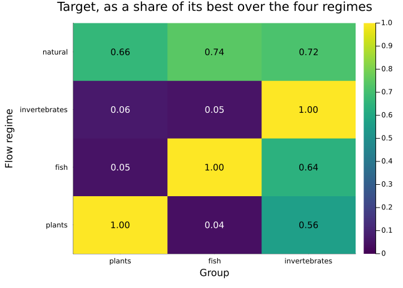
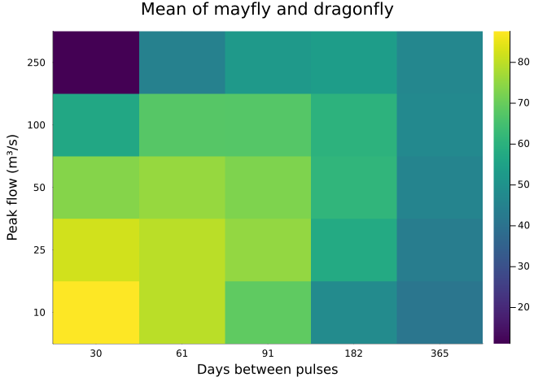

# Designing flows for a whole river: plants, fish and invertebrates
Simon Frost

- [Three groups, one river](#three-groups-one-river)
- [The invertebrates](#the-invertebrates)
- [The four flow regimes](#the-four-flow-regimes)
- [Agreement with the authors’ code](#agreement-with-the-authors-code)
- [The trade-offs](#the-trade-offs)
- [Searching for designed flows](#searching-for-designed-flows)
- [A carrying capacity carried
  forward](#a-carrying-capacity-carried-forward)
- [What is measured and what is
  assumed](#what-is-measured-and-what-is-assumed)
- [References](#references)

``` julia
ENV["GKSwstype"] = "100"
using MatrixCommunityModels
using Printf, Random, Statistics
using Plots
```

## Three groups, one river

Below a dam, river managers can design the flow regime: how often to
release floods, how large, and when. Tonkin et al. (2021) asked what
flows designed for one group of organisms do to the others. They took
three existing models, each driven by flow:

- riparian plants: the five guilds of Lytle et al. (2017), linked by
  space ([vignette 3](03_riparian_guilds.md));
  the target is cottonwood;
- fish: the seven species of the Verde River of Rogosch et al. (2019),
  linked by biomass ([vignette 2](02_verde_fish.md));
  the target is the three native species;
- aquatic invertebrates: three taxa modelled by McMullen et al. (2017);
  the target is the two with winged adults that feed birds and bats, a
  mayfly (*Fallceon*) and a dragonfly (*Progomphus*), and not the third,
  an ostracod.

For each group they designed the regime that maximises its target, and
ran all three groups under each designed regime and under the natural
regime of the upper Verde River. This vignette adds the invertebrates to
the package and repeats the comparison.

The invertebrates are not stage-structured. Each is one population with
logistic growth in continuous time, a carrying capacity that a flood
resets, and a mortality that a flood causes; the three do not interact.
They are written here as nets with a single stage and a time step of a
day.

## The invertebrates

Between floods a population grows as `dN/dt = r N (1 − N/K(t))`. A flood
of peak flow `Q` (m³/s) kills all but `exp(−h Q)` of it and moves the
carrying capacity towards `Kd` by the flood effect
`Qf(Q) = (Q − 5) / (100 + Q − 5)`; afterwards the carrying capacity
relaxes back towards its baseline `Kb` at rate `g`. For the mayfly and
dragonfly `Kd > Kb`: floods open habitat. For the ostracod `Kd < Kb`.
The values are those of the authors’ code:

``` julia
FLOW_INVERTEBRATES
```

    (mayfly = (r = 0.23, h = 0.02, g = 0.01, Kd = 100.0, Kb = 40.0), dragonfly = (r = 0.08, h = 0.01, g = 0.01, Kd = 100.0, Kb = 40.0), ostracod = (r = 0.16, h = 0.05, g = 0.01, Kd = 40.0, Kb = 100.0), Qmin = 5.0, a = 100.0)

The authors solve each interval between floods in closed form, with a
numerical integral of the carrying capacity. Here `flood_invertebrate`
steps a day at a time. The logistic equation is a Bernoulli equation, so
each day has an exact solution,
`1/N(t) = exp(−r)/N(t−1) + ∫ r/K(y) exp(−r(t−y)) dy` over the day, and
stepping day by day gives the same numbers. That day’s value is the
response of the net’s one transition, `living`; on the day of a flood
the value is the flood’s survival.

The environment of each day says how many days have passed since the
last flood, the flood’s peak flow, and the carrying capacity of each
taxon just before that flood (`invertebrate_flows`). The three taxa
share no pool:

``` julia
bugs = flow_invertebrates()
(species = species_names(bugs), pools = pool_names(bugs))
```

    (species = [:mayfly, :dragonfly, :ostracod], pools = Symbol[])

## The four flow regimes

The designed regimes are those of the paper:

- plants: a spring flood every sixth year, preceded by a drought year;
- fish: a spring flood every year;
- invertebrates: four pulses of 50 m³/s a year, too small to count as a
  flood for plants or fish, so that every year is a year without events
  for them;
- natural: the upper Verde River near Paulden, 1964-2008, repeated. For
  the invertebrates this is a spring peak and an autumn peak each year,
  the means of the seasonal maxima.

`tonkin_scenario` gives the environments of each regime for the three
groups: 200 years for plants and fish, 30 years of days for the
invertebrates. The invertebrate models were parameterised on the Bill
Williams River; as in the authors’ code, Verde flows are scaled by 0.35
to that river.

``` julia
regimes = Dict(s => tonkin_scenario(s) for s in TONKIN_SCENARIOS)
inv = Dict(s => project(bugs, regimes[s].invertebrate_n0, regimes[s].invertebrates) for s in TONKIN_SCENARIOS)
years = (0:365 * 30) ./ 365
plots = [plot(years, [inv[s][x][:, 1] for x in (:mayfly, :dragonfly, :ostracod)]; title = string(s),
              label = s === :plants ? ["mayfly" "dragonfly" "ostracod"] : "", ylims = (0, 100),
              xlabel = "Year", ylabel = "% of greatest K", lw = 0.8) for s in TONKIN_SCENARIOS]
plot(plots...; layout = (2, 2), size = (850, 600))
```


## Agreement with the authors’ code

The authors’ scripts (GitHub `jdtonkin/flow-tradeoffs`, MIT) select each
regime by commented-out blocks.
`test/reference/R/run_flow_tradeoffs_reference.R` runs each script once
per regime, with the regime injected, and writes what it computes. The
fish script draws the initial adult biomass of each species at random in
each of its 100 iterations, without a seed; the driver sets a seed and
writes the draws, which are replayed here.

``` julia
refdir = joinpath(pkgdir(MatrixCommunityModels), "test", "reference")
csv(f) = [split(l, ",") for l in readlines(joinpath(refdir, f))[2:end]]
code = Dict(:plants => "RIP_OPT", :fish => "FSH_OPT", :invertebrates => "INV_OPT", :natural => "NAT")
taxon = Dict("Mayfly" => :mayfly, "Dragonfly" => :dragonfly, "Ostracod" => :ostracod)
rip = riparian_model()
fish = verde_fish_model()
# space held by a guild's stages above seedlings, as % of K, in cottonwood-seedling units
nonseedling(sol, g) = [100 * 350 * sum(sol[g][k, s] / RIPARIAN_GUILDS[g].den[s] for s in 2:6) / rip.K for k in 1:200]
function fish_means(s)
    acc = zeros(200, 7)
    starts = [r for r in csv("flow_fish_initial.csv") if r[1] == code[s]]
    for r in starts
        n0 = [Symbol(sp) => [0.0, 0.0, parse(Float64, r[2 + j])] for (j, sp) in enumerate(VERDE_SPECIES)]
        f = project(fish.community, n0, regimes[s].fish[1:199])
        for (j, sp) in enumerate(VERDE_SPECIES)
            acc[:, j] .+= f[Symbol(sp)][:, 2] .+ f[Symbol(sp)][:, 3]
        end
    end
    return acc ./ length(starts)
end
plants = Dict(s => project(rip.community, regimes[s].riparian_n0, regimes[s].riparian[1:199]) for s in TONKIN_SCENARIOS)
fishes = Dict(s => fish_means(s) for s in TONKIN_SCENARIOS)
for s in TONKIN_SCENARIOS
    bug = maximum(maximum(abs(inv[s][taxon[r[1]]][parse(Int, r[3]) + 1, 1] - parse(Float64, r[5]))
                  for r in csv("flow_inverts.csv") if r[2] == code[s] && r[1] == t) for t in keys(taxon))
    R = [r for r in csv("flow_riparian.csv") if r[1] == code[s]]
    plant = maximum(maximum(abs.(nonseedling(plants[s], g) .- [parse(Float64, r[2 + j]) for r in R]) ./
                            max.([parse(Float64, r[2 + j]) for r in R], 1e-3)) for (j, g) in enumerate((:C, :T, :W, :S, :M)))
    M = permutedims(reduce(hcat, [parse.(Float64, r[3:9]) for r in csv("flow_fish_mean.csv") if r[1] == code[s]]))
    @printf("%-14s invertebrates %.1e (absolute)   plants %.1e   fish %.1e (relative)\n", s, bug, plant,
            maximum(abs.(fishes[s] .- M) ./ max.(M, 1e-6)))
end
```

    plants         invertebrates 3.9e-12 (absolute)   plants 5.5e-16   fish 0.0e+00 (relative)
    fish           invertebrates 1.1e-12 (absolute)   plants 5.1e-16   fish 0.0e+00 (relative)
    invertebrates  invertebrates 1.8e-13 (absolute)   plants 4.9e-16   fish 0.0e+00 (relative)
    natural        invertebrates 6.0e-13 (absolute)   plants 4.7e-16   fish 0.0e+00 (relative)

The invertebrates agree to within the error of R’s numerical integration
(the reference keeps every thirtieth day), the plants to rounding, and
the fish exactly.

## The trade-offs

The targets are those of the authors’ code: the space held by cottonwood
above the seedling stage, as a percentage of the total, averaged over
years 11 to 200; the biomass of the three native fishes above the
juvenile stage, as a percentage of the carrying capacity, averaged over
the 100 starts and over years 11 to 200; and the mean of the mayfly and
the dragonfly over the last 20 of 30 years.

``` julia
target(s) = (plants = mean(nonseedling(plants[s], :C)[11:200]),
             fish = mean(100 .* (fishes[s][11:200, 1] .+ fishes[s][11:200, 2] .+ fishes[s][11:200, 4]) ./ 47660),
             invertebrates = mean((inv[s][:mayfly][3652:end, 1] .+ inv[s][:dragonfly][3652:end, 1]) ./ 2))
T = Dict(s => target(s) for s in TONKIN_SCENARIOS)
R = Dict(r[1] => parse.(Float64, r[2:4]) for r in csv("flow_targets.csv"))
println(rpad("regime", 15), rpad("plants", 10), rpad("fish", 10), "invertebrates   (R: plants, fish, invertebrates)")
for s in TONKIN_SCENARIOS
    t = T[s]
    @printf("%-14s %6.2f    %6.2f    %6.2f          (%.2f, %.2f, %.2f)\n", s, t.plants, t.fish, t.invertebrates, R[code[s]]...)
end
```

    regime         plants    fish      invertebrates   (R: plants, fish, invertebrates)
    plants          49.33      2.65     40.87          (49.33, 2.65, 40.87)
    fish             2.34     70.94     46.58          (2.34, 70.94, 46.58)
    invertebrates    3.19      3.51     72.87          (3.19, 3.51, 72.87)
    natural         32.76     52.77     52.21          (32.76, 52.77, 52.21)

Each designed regime does best for its own group, and each costs another
group dearly. Tonkin et al. report the natural regime’s targets as
fractions of the designed regime’s, and the losses of the groups that
are not targeted as fractions of their value under the natural regime:

``` julia
nat = T[:natural]
ratios = [("plants: natural / plant regime", nat.plants / T[:plants].plants, 66),
          ("fish: natural / fish regime", nat.fish / T[:fish].fish, 77),
          ("invertebrates: natural / invertebrate regime", nat.invertebrates / T[:invertebrates].invertebrates, 72),
          ("cottonwood under the fish regime / natural", T[:fish].plants / nat.plants, 7),
          ("native fish under the plant regime / natural", T[:plants].fish / nat.fish, 5),
          ("cottonwood under the invertebrate regime / natural", T[:invertebrates].plants / nat.plants, 10),
          ("native fish under the invertebrate regime / natural", T[:invertebrates].fish / nat.fish, 6)]
for (what, x, published) in ratios
    @printf("%-52s %5.1f%%  (published %d%%)\n", what, 100x, published)
end
```

    plants: natural / plant regime                        66.4%  (published 66%)
    fish: natural / fish regime                           74.4%  (published 77%)
    invertebrates: natural / invertebrate regime          71.6%  (published 72%)
    cottonwood under the fish regime / natural             7.2%  (published 7%)
    native fish under the plant regime / natural           5.0%  (published 5%)
    cottonwood under the invertebrate regime / natural     9.7%  (published 10%)
    native fish under the invertebrate regime / natural    6.6%  (published 6%)

The ratios agree with the paper except for fish under the natural
regime, 74% against 77%. Fish results depend on the random starting
biomass, which the authors’ code draws without a seed; the paper’s runs
used other draws.

``` julia
groups = [:plants, :fish, :invertebrates]
share = [getproperty(T[s], g) / maximum(getproperty(T[x], g) for x in TONKIN_SCENARIOS) for s in TONKIN_SCENARIOS, g in groups]
heatmap(string.(groups), collect(string.(TONKIN_SCENARIOS)), share; c = :viridis, clims = (0, 1),
        xlabel = "Group", ylabel = "Flow regime", title = "Target, as a share of its best over the four regimes")
annotate!([(j - 0.5, i - 0.5, text(@sprintf("%.2f", share[i, j]), 10, share[i, j] > 0.5 ? :black : :white))
           for i in 1:4, j in 1:3][:])
```



## Searching for designed flows

Tonkin et al. searched flow regimes for each group by changing the
frequency of events. For the invertebrates their code projects ten years
of floods every 91, 121, 182, 365 or 730 days (365/4, 365/3, 365/2, 365
and 730, cut to whole days), with floods of 1000 m³/s for the mayfly and
dragonfly and 30 m³/s for the ostracod, and compares the arithmetic and
geometric mean abundance after the first year:

``` julia
gm(x) = exp(sum(log.(x[x .> 0])) / length(x))
found = csv("flow_findopt.csv")
for (name, x, Q) in (("Dragonfly", :dragonfly, 1000), ("Mayfly", :mayfly, 1000), ("Ostracod", :ostracod, 30))
    for (k, every) in enumerate((365 / 4, 365 / 3, 365 / 2, 365, 730))
        envs = invertebrate_flows(pulses(every, Q, 3650)...)
        n = project(flood_invertebrate(x), [50.0], envs)[x][367:end, 1]
        r = only(r for r in found if r[1] == name && r[2] == "freq$k")
        @printf("%-9s every %3d days: mean %6.2f (R %6.2f), geometric mean %9.3g (R %9.3g)\n",
                name, floor(Int, every), mean(n), parse(Float64, r[3]), gm(n), parse(Float64, r[4]))
    end
end
```

    Dragonfly every  91 days: mean   0.00 (R   0.00), geometric mean  4.73e-28 (R  4.73e-28)
    Dragonfly every 121 days: mean   0.05 (R   0.05), geometric mean  0.000162 (R  0.000162)
    Dragonfly every 182 days: mean  16.50 (R  16.50), geometric mean      1.42 (R      1.42)
    Dragonfly every 365 days: mean  30.16 (R  30.16), geometric mean      7.54 (R      7.54)
    Dragonfly every 730 days: mean  35.82 (R  35.82), geometric mean        19 (R        19)
    Mayfly    every  91 days: mean   2.37 (R   2.37), geometric mean   0.00198 (R   0.00198)
    Mayfly    every 121 days: mean  16.88 (R  16.88), geometric mean    0.0369 (R    0.0369)
    Mayfly    every 182 days: mean  28.86 (R  28.86), geometric mean     0.391 (R     0.391)
    Mayfly    every 365 days: mean  36.25 (R  36.25), geometric mean      4.06 (R      4.06)
    Mayfly    every 730 days: mean  38.51 (R  38.51), geometric mean      14.5 (R      14.5)
    Ostracod  every  91 days: mean  61.82 (R  61.82), geometric mean      58.8 (R      58.8)
    Ostracod  every 121 days: mean  71.46 (R  71.46), geometric mean      68.6 (R      68.6)
    Ostracod  every 182 days: mean  83.99 (R  83.99), geometric mean      81.8 (R      81.8)
    Ostracod  every 365 days: mean  94.13 (R  94.13), geometric mean      92.9 (R      92.9)
    Ostracod  every 730 days: mean  97.47 (R  97.47), geometric mean      96.9 (R      96.9)

Large floods every 91 days nearly wipe out the targets, and rarer floods
suit them better. The prescription the authors chose instead, four
pulses a year, is of 50 m³/s. The search can be widened to magnitude and
frequency together, for the mean of the two targets over the last 20 of
30 years:

``` julia
everys = [30, 61, 91, 182, 365]
sizes = [10, 25, 50, 100, 250]
grid = [begin
            envs = invertebrate_flows(pulses(e, q, 365 * 30)...)
            sol = project(bugs, [50.0, 50, 50], envs)
            mean((sol[:mayfly][3652:end, 1] .+ sol[:dragonfly][3652:end, 1]) ./ 2)
        end for q in sizes, e in everys]
heatmap(string.(everys), string.(sizes), grid; xlabel = "Days between pulses", ylabel = "Peak flow (m³/s)",
        title = "Mean of mayfly and dragonfly", c = :viridis)
```



``` julia
best = argmax(grid)
(best_every = everys[best[2]], best_peak = sizes[best[1]], value = round(grid[best]; digits = 1),
 prescription = round(T[:invertebrates].invertebrates; digits = 1))
```

    (best_every = 30, best_peak = 10, value = 87.6, prescription = 72.9)

On this grid the targets keep improving towards smaller and more
frequent pulses, and the best value lies at its edge, above that of the
prescription. The authors’ code explores frequency at one magnitude per
taxon; how the prescription’s 50 m³/s was chosen is not in the code or
in the preprint’s main text.

For the plants and fish the authors’ code lists trial regimes (spring
floods in a quarter, a third or half of years, floods every tenth year,
droughts), from which the prescriptions were chosen. As an illustration,
a spring flood every `k` years, with a drought in the year before it for
plants, gives:

``` julia
function every_k(k; drought_before = true)
    flood = [mod(y, k) == 0 ? 1 : 0 for y in 1:200]
    drought = [drought_before && k > 1 && mod(y + 1, k) == 0 ? 1 : 0 for y in 1:200]
    plant_envs = [(year = y, flood = Float64(flood[y]), drought = Float64(drought[y]),
                   nonflood = flood[y] + drought[y] == 1 ? 0.0 : 1.0, cprop = 0.9, tprop = 0.4, decline = 1.0, tdecline = 1.0)
                  for y in 1:199]
    fish_envs = [(SP_highflood = flood[y], SU_highflood = 0, medflood = 0, drought = drought[y],
                  nonevent = 1 - flood[y] - drought[y]) for y in 1:199]
    c = mean(nonseedling(project(rip.community, regimes[:plants].riparian_n0, plant_envs), :C)[11:200])
    rng = Xoshiro(k)
    natives = mean(begin
                       f = project(fish.community, tonkin_fish_start(rng), fish_envs)
                       mean(100 .* sum(f[sp][11:200, 2] .+ f[sp][11:200, 3] for sp in (:CACL, :GIRO, :CAIN)) ./ 47660)
                   end for _ in 1:20)
    return (k = k, cottonwood = round(c; digits = 1), native_fish = round(natives; digits = 1))
end
[every_k(k) for k in (1, 2, 3, 4, 6, 8, 10)]
```

    7-element Vector{@NamedTuple{k::Int64, cottonwood::Float64, native_fish::Float64}}:
     (k = 1, cottonwood = 2.3, native_fish = 71.2)
     (k = 2, cottonwood = 47.1, native_fish = 0.6)
     (k = 3, cottonwood = 50.7, native_fish = 1.8)
     (k = 4, cottonwood = 47.5, native_fish = 2.0)
     (k = 6, cottonwood = 49.3, native_fish = 2.4)
     (k = 8, cottonwood = 48.1, native_fish = 3.0)
     (k = 10, cottonwood = 47.1, native_fish = 2.9)

Here the fish start from 20 draws of the authors’ random initial
biomass, made with `tonkin_fish_start`. Native fish need floods often
and suffer from droughts, so they do best with a flood every year
(`k = 1`, which has no drought) and collapse otherwise. Cottonwood fails
with a flood every year, when willow takes over, and holds about half of
the space with floods every two to ten years and a drought before each;
on cottonwood alone a flood every third year does slightly better than
every sixth. The authors’ comment on their choice of six years is that
it “keeps cot high, tam low, and eradicates DS”, so it weighed tamarisk
and sagebrush (DS) too.

## A carrying capacity carried forward

The authors’ invertebrate code carries the carrying capacity from one
flood to the next as `Kpre + (K0 − Kpre) exp(−g t)`, which relaxes
towards the value before the flood rather than towards the baseline,
while within the interval the population grows under a carrying capacity
that relaxes towards the baseline (a comment notes that the code “works
from kpre rather than kb”). Under frequent floods the carried value
climbs towards `Kd`, so each flood starts from a higher carrying
capacity than the population last saw.
`tonkin_scenario(...; corrected = true)` carries forward the carrying
capacity the population grew under:

``` julia
for s in TONKIN_SCENARIOS
    c = tonkin_scenario(s; corrected = true)
    sol = project(bugs, c.invertebrate_n0, c.invertebrates)
    @printf("%-14s target %5.1f as coded, %5.1f corrected\n", s, T[s].invertebrates,
            mean((sol[:mayfly][3652:end, 1] .+ sol[:dragonfly][3652:end, 1]) ./ 2))
end
```

    plants         target  40.9 as coded,  40.9 corrected
    fish           target  46.6 as coded,  45.6 corrected
    invertebrates  target  72.9 as coded,  52.8 corrected
    natural        target  52.2 as coded,  47.3 corrected

The choice matters most for the invertebrate prescription, whose
frequent pulses ratchet the carried carrying capacity up: corrected, its
target falls from 72.9 to 52.8. It is still the best of the four regimes
for the invertebrates, but by a much smaller margin (the natural regime
gives 47.3 when corrected). This is a question for the authors.

## What is measured and what is assumed

| Quantity | Value | Source |
|----|----|----|
| Riparian guilds: vital rates, K | as in vignette 3 | Lytle et al. 2017 |
| Riparian: seed release overlap for cottonwood and tamarisk | 0.9 and 0.4, every year; no drawdown decline | the authors’ code (simplified from Lytle et al. 2017) |
| Riparian: starting area | 3978 m² for every stage of every guild | the authors’ code |
| Fish: vital rates, year-type mortalities, K | as in vignette 2 | Rogosch et al. 2019 |
| Fish: starting adult biomass | negative binomial draws, 100 per regime | the authors’ code |
| Invertebrates: r, h, g, Kd, Kb; Qmin, a | `FLOW_INVERTEBRATES` | the authors’ code, after McMullen et al. 2017 |
| Verde to Bill Williams River flows | × 0.35 | the authors’ code |
| Natural regime | Verde at Paulden 1964-2008 (year types); mean spring and autumn peaks 1134 and 459 cfs (invertebrates) | the authors’ code and data |
| Designed regimes | as listed above | Tonkin et al. 2021 and the authors’ code |

What differs between sources, or from what was expected:

- The brief for this vignette described the invertebrates as
  stage-structured; the models of McMullen et al. as coded by Tonkin et
  al. are unstructured logistic populations, and are written here as
  one-stage nets.
- The carrying capacity carried from flood to flood relaxes towards its
  value before the flood, not the baseline; kept as coded, with a
  corrected variant, which lowers the invertebrate target of the
  invertebrate prescription from 72.9 to 52.8.
- The riparian model of this comparison holds seed-release overlap fixed
  and has no drawdown decline, unlike the model of Lytle et al. (2017)
  in vignette 3; the same community is used, with these terms set in the
  environment.
- Sagebrush and meadow keep the behaviours of the original riparian
  script described in vignette 3 (the meadow takes the willow’s
  recruitment).
- Native fish under the natural regime are at 74% of the fish
  prescription here and 77% in the paper, presumably because the random
  starting biomass differs.
- A wider search finds better invertebrate flows than the prescription
  (smaller, more frequent pulses), and on cottonwood alone floods every
  third year do slightly better than every sixth.

The paper was read in full as its bioRxiv preprint (version of 20 June
2020, CC BY-NC-ND), not as published, and its WebPanel 1 (detailed
methods) was not read. McMullen et al. (2017) could not be accessed (the
publisher refused access); the invertebrate models and parameters are
taken from the authors’ code alone. The code of
`jdtonkin/flow-tradeoffs` was read in full for the scripts used.

## References

Lytle, D. A., Merritt, D. M., Tonkin, J. D., Olden, J. D. & Reynolds, L.
V. (2017). Linking river flow regimes to riparian plant guilds: a
community-wide modeling approach. *Ecological Applications* 27,
1338-1350.

McMullen, L. E., De Leenheer, P., Tonkin, J. D. & Lytle, D. A. (2017).
High mortality and enhanced recovery: modelling the countervailing
effects of disturbance on population dynamics. *Ecology Letters* 20,
1566-1575. <https://doi.org/10.1111/ele.12866>

Rogosch, J. S., Tonkin, J. D., Lytle, D. A., Merritt, D. M., Reynolds,
L. V. & Olden, J. D. (2019). Increasing drought favors nonnative fishes
in a dryland river: evidence from a multispecies demographic model.
*Ecosphere* 10, e02681.

Tonkin, J. D., Olden, J. D., Merritt, D. M., Reynolds, L. V., Rogosch,
J. S. & Lytle, D. A. (2021). Designing flow regimes to support entire
river ecosystems. *Frontiers in Ecology and the Environment* 19,
326-333. <https://doi.org/10.1002/fee.2348>. Code and data:
<https://github.com/jdtonkin/flow-tradeoffs> (MIT).
