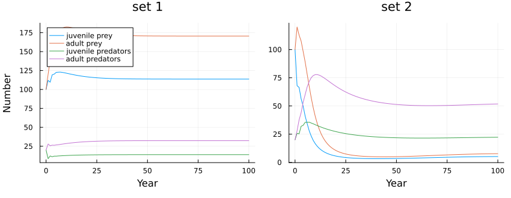
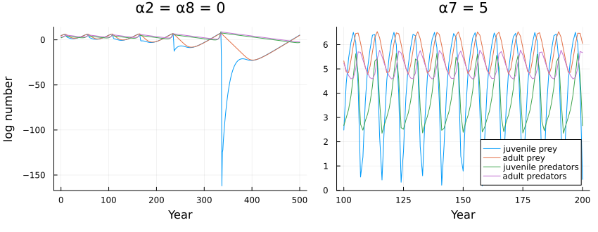
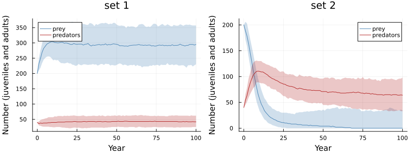

# A predator and its prey, each with juveniles and adults
Simon Frost

- [The model](#the-model)
- [Two species and two pools](#two-species-and-two-pools)
- [Agreement with the authors’ difference
  equations](#agreement-with-the-authors-difference-equations)
- [A stable fixed point](#a-stable-fixed-point)
- [Without density dependence within species, and with high
  fecundity](#without-density-dependence-within-species-and-with-high-fecundity)
- [Demographic stochasticity](#demographic-stochasticity)
- [What is measured and what is
  assumed](#what-is-measured-and-what-is-assumed)
- [Reference](#reference)

``` julia
ENV["GKSwstype"] = "100"
using MatrixCommunityModels
using LinearAlgebra, Printf, Random, Statistics
using Plots
```

## The model

Barraquand & Gimenez (2019) built an integrated community model: a
predator-prey matrix model fitted at once to counts, capture-recapture
histories and records of reproduction, in a Bayesian framework (JAGS).
Its core is a deterministic nonlinear matrix model with two species and
two stages each, which this vignette rebuilds and runs. The fitting is
not done here.

The census is taken each year just before breeding, so the juveniles
counted are last year’s young that survived their first year, and they
breed as adults the year after. With juvenile and adult prey `nVJ`,
`nVA` and juvenile and adult predators `nPJ`, `nPA`, the projection
matrix is

$$\mathbf A(\mathbf n) = \begin{pmatrix}
0 & \tfrac12 f_V(n_V^A)\,\phi_V^J(n_P^A) & 0 & 0\\
\phi_V^A & \phi_V^A & 0 & 0\\
0 & 0 & 0 & \tfrac12 f_P(n_V^J)\,\phi_P^J(n_P^A)\\
0 & 0 & \phi_P^A & \phi_P^A
\end{pmatrix}$$

with

- newborn predator survival `ϕPJ(n) = 1 / (1 + exp(-(α1 + α2 n)))`,
  falling with adult predators (crowding among predators);
- newborn prey survival `ϕVJ(n) = 1 / (1 + exp(-(α3 + α4 n)))`, falling
  with adult predators (predation);
- predator fecundity `fP(n) = exp(α5 + α6 n)`, rising with juvenile prey
  (food);
- prey fecundity `fV(n) = exp(α7 + α8 n)`, falling with adult prey
  (crowding among prey);

and constant adult survival `ϕVA` and `ϕPA`. The factor one half counts
female offspring.

## Two species and two pools

Each species is a net with three transitions, `reproduction`,
`maturation` and `adult_survival`. The responses on `reproduction` carry
the four density dependencies. Two depend on the species’ own adults;
the other two need the other species, so they read a pool: the prey
reads `adult_predators`, which the predator fills, and the predator
reads `juvenile_prey`, which the prey fills.

``` julia
m = predator_prey()
(species = species_names(m.community), pools = pool_names(m.community),
 transitions = transition_names(system(m.community)[:prey]))
```

    (species = [:prey, :predator], pools = [:juvenile_prey, :adult_predators], transitions = [:adult_survival, :maturation, :reproduction])

The parameters are the first set of the paper’s Table 5:

``` julia
BARRAQUAND_GIMENEZ_2019
```

    (alpha = (0.5, -0.01, 0.5, -0.025, 0.0, 0.004, 2.0, -0.005), adult_survival = (prey = 0.6, predator = 0.7), n0 = (prey = [100.0, 100.0], predator = [20.0, 20.0]))

## Agreement with the authors’ difference equations

The authors’ code (GitHub `oliviergimenez/predator_prey_icm`, GPL-3)
includes the deterministic difference equations of their Appendix A. The
package is MIT licensed, so none of that code is used here: the model
above is written from the paper’s equations and Table 5. The scripts
were run in R as they stand (only their plots dropped and their number
of years set) by `test/reference/R/run_predator_prey_reference.R`, and
their trajectories are compared with this model’s:

``` julia
ref = joinpath(pkgdir(MatrixCommunityModels), "test", "reference", "predprey_trajectories.csv")
rows = [split(l, ",") for l in readlines(ref)[2:end]]
A, B = BARRAQUAND_GIMENEZ_2019, BARRAQUAND_GIMENEZ_2019_SET2
with7(p, a7) = merge(p, (alpha = Base.setindex(p.alpha, a7, 7),))
runs = ["set1_table5" => A, "set1_appendix" => with7(A, 1.75), "set2" => B,
        "set1_high" => with7(A, 5.0), "set2_high" => with7(B, 4.7),
        "no_intra" => merge(A, (alpha = (0.5, 0.0, 0.5, -0.025, 0.0, 0.004, 1.75, 0.0),))]
reference(label) = permutedims(reduce(hcat, [parse.(Float64, r[3:6]) for r in rows if r[1] == label]))
project_set(p, years) = (mm = predator_prey(p); project(mm.community, mm.n0, fill(nothing, years)))
for (label, p) in runs
    R = reference(label)
    sol = project_set(p, size(R, 1) - 1)
    @printf("%-14s %3d years  largest relative difference %.1e\n", label, size(R, 1) - 1,
            maximum(abs.(sol.u .- R) ./ max.(abs.(R), 1.0)))
end
```

    set1_table5     99 years  largest relative difference 5.0e-16
    set1_appendix   99 years  largest relative difference 2.0e-16
    set2            99 years  largest relative difference 0.0e+00
    set1_high      499 years  largest relative difference 7.7e-14
    set2_high      499 years  largest relative difference 2.4e-13
    no_intra        99 years  largest relative difference 4.0e-16

`set1_table5` is the first parameter set as in Table 5. The script of
Appendix A for that set (`set1_appendix`) has `α7 = 1.75` where the
table has 2; the simulation scripts of the paper’s numerical experiment
use 2. `set2` is the second set (`α5 = 0.5`, `α6 = 0.01`, `α7 = 1.5`).
The runs with increased fecundity (`_high`) use `α7 = 5` and `4.7`; the
text of Appendix A says `exp(5)` and `exp(4.5)`. `no_intra` drops the
two density dependencies within species (`α2 = α8 = 0`). The differences
are rounding: the long runs with large oscillations reach 1e-13.

## A stable fixed point

With either parameter set the model settles to a stable equilibrium
(Appendix A):

``` julia
for (name, p) in ("set 1" => A, "set 2" => B)
    mm = predator_prey(p)
    e = equilibrium(mm.community, state_vector(mm.community, mm.n0...), nothing)
    λ = maximum(abs.(eigvals(jacobian(mm.community, e.n, nothing))))
    println(name, ": prey ", round.(e.n[1:2]; digits = 1), ", predators ", round.(e.n[3:4]; digits = 1),
            "; largest |eigenvalue| of the Jacobian ", round(λ; digits = 3))
end
```

    set 1: prey [113.7, 170.5], predators [13.9, 32.4]; largest |eigenvalue| of the Jacobian 0.883
    set 2: prey [5.0, 7.5], predators [22.4, 52.2]; largest |eigenvalue| of the Jacobian 0.962

The second set couples the species more strongly: more predators, far
fewer prey, and a slower approach to equilibrium. The paper’s Fig.
A.1(A) shows the first set with about 100 juvenile and 150 adult prey at
equilibrium: the values of its Appendix A script, with `α7 = 1.75`,
rather than those of Table 5 shown here.

``` julia
labels = ["juvenile prey" "adult prey" "juvenile predators" "adult predators"]
p1 = plot(0:100, project_set(A, 100).u; label = labels, title = "set 1", xlabel = "Year", ylabel = "Number")
p2 = plot(0:100, project_set(B, 100).u; label = "", title = "set 2", xlabel = "Year")
plot(p1, p2; layout = (1, 2), size = (850, 330))
```



## Without density dependence within species, and with high fecundity

The authors kept density dependence within each species so that the
model persists: without it the interaction alone gives diverging
oscillations (their Fig. A.2). With high prey fecundity the fixed point
gives way to sustained oscillations (their Fig. A.3).

``` julia
s0 = project_set(runs[6].second, 500)
s1 = project_set(runs[4].second, 500)
p3 = plot(0:500, log.(s0.u); label = "", title = "α2 = α8 = 0", xlabel = "Year", ylabel = "log number")
p4 = plot(100:200, log.(s1.u[101:201, :]); label = labels, title = "α7 = 5", xlabel = "Year", legend = :bottomright)
plot(p3, p4; layout = (1, 2), size = (850, 330))
```



## Demographic stochasticity

The ICM’s process model is the same matrix model with whole individuals:
adults survive binomially (juveniles and adults alike, with the adult
survival), and juveniles are a Poisson number with the deterministic
mean. Because reproduction is marked as births and the other transitions
are survival probabilities, this is what `project` does with an `rng`:

``` julia
function band(p; years = 100, replicates = 500)
    mm = predator_prey(p)
    ens = ensemble(mm.community, state_vector(mm.community, mm.n0...), fill(nothing, years); replicates, rng = Xoshiro(2019))
    prey, pred = abundance(ens, :prey), abundance(ens, :predator)
    q(x) = [quantile(x[:, t], [0.05, 0.5, 0.95]) for t in axes(x, 2)]
    return q(prey), q(pred), mean(prey[:, end] .== 0), mean(pred[:, end] .== 0)
end
figs = map([("set 1", A), ("set 2", B)]) do (name, p)
    prey, pred, _, _ = band(p)
    plt = plot(; title = name, xlabel = "Year", ylabel = "Number (juveniles and adults)")
    for (x, col, lab) in ((prey, :steelblue, "prey"), (pred, :firebrick, "predators"))
        plot!(plt, 0:100, getindex.(x, 2); ribbon = (getindex.(x, 2) .- getindex.(x, 1), getindex.(x, 3) .- getindex.(x, 2)),
              color = col, fillalpha = 0.25, label = lab)
    end
    plt
end
plot(figs...; layout = (1, 2), size = (850, 330))
```



Medians and 90% bands of 500 runs. The first set fluctuates about its
fixed point, as in their Fig. A.1(B). Under the second set the prey,
about 13 animals at equilibrium, are often lost:

``` julia
for (name, p) in ("set 1" => A, "set 2" => B)
    mm = predator_prey(p)
    ens = ensemble(mm.community, state_vector(mm.community, mm.n0...), fill(nothing, 100); replicates = 500, rng = Xoshiro(2019))
    prey, pred = abundance(ens, :prey), abundance(ens, :predator)
    println(name, ": share of runs that have lost the prey by year 10, 30 and 100: ",
            [mean(prey[:, t + 1] .== 0) for t in (10, 30, 100)], "; the predators by year 100: ", mean(pred[:, end] .== 0))
end
```

    set 1: share of runs that have lost the prey by year 10, 30 and 100: [0.0, 0.0, 0.0]; the predators by year 100: 0.0
    set 2: share of runs that have lost the prey by year 10, 30 and 100: [0.0, 0.1, 0.672]; the predators by year 100: 0.0

The paper shows a single stochastic run of the second set (its Fig.
A.1(D)), in which the prey persist at low numbers for 100 years; it
reports extinction only at high fecundity. Its fits use simulations of
10 or 30 years.

## What is measured and what is assumed

| Quantity | Value | Source |
|----|----|----|
| Model: two species, juveniles and adults, pre-breeding census |  | Barraquand & Gimenez 2019, Eq. 1 |
| α1 to α8, adult survival 0.6 (prey) and 0.7 (predators), initial numbers | Table 5 | chosen by the authors to mimic slow-lived birds and mammals; not estimated from data |
| Second parameter set | α5 = 0.5, α6 = 0.01, α7 = 1.5 | Appendices A and B |
| Increased fecundity | α7 = 5 and 4.7 | the authors’ scripts (the text gives exp(5) and exp(4.5)) |

The model is a simulation model with invented but plausible values; the
paper’s question is whether its parameters can be recovered from data.
Not done here:

- the statistical part of the ICM: counts with observation error, the
  Cormack-Jolly-Seber model of capture-recapture, and the Poisson model
  of fecundity surveys, fitted by MCMC in JAGS to simulated data in four
  scenarios of data availability;
- the post-breeding version of the model and the saturating predator
  fecundity of Appendices D and E.

Mismatches between sources: the Appendix A script for the first set uses
`α7 = 1.75`, not the 2 of Table 5 (the numerical experiment uses 2), and
Fig. A.1(A) shows the 1.75 run; the second set at high fecundity uses
`α7 = 4.7` in the script and `exp(4.5)` in the text. Both are reproduced
as scripted.

The paper was read in full (text extracted from its PDF, with the
matrix, the functions and Table 5 checked on the rendered pages). Of the
authors’ code (GPL-3), the scripts of
`difference_equations/predator_prey/pre_breeding` were read and run, and
the simulation scripts of `numerical_experiment` were read for their
parameter values. No code was copied.

## Reference

Barraquand, F. & Gimenez, O. (2019). Integrating multiple data sources
to fit matrix population models for interacting species. *Ecological
Modelling* 411, 108713.
<https://doi.org/10.1016/j.ecolmodel.2019.06.001>. Code:
<https://github.com/oliviergimenez/predator_prey_icm> (GPL-3).
