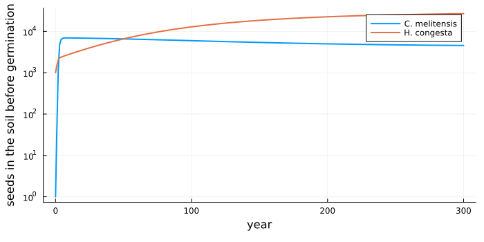
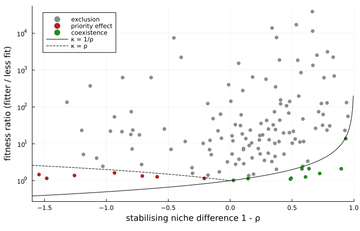

# Annual plants with a seed bank: niche and fitness differences
Simon Frost

- [Eighteen annuals on serpentine](#eighteen-annuals-on-serpentine)
- [Two stages](#two-stages)
- [The data](#the-data)
- [One pair: a star thistle and a
  tarweed](#one-pair-a-star-thistle-and-a-tarweed)
- [Niche and fitness differences](#niche-and-fitness-differences)
- [Simulated outcomes](#simulated-outcomes)
- [All eighteen together: competitive
  ranks](#all-eighteen-together-competitive-ranks)
- [What matches and what does not](#what-matches-and-what-does-not)
- [References](#references)

``` julia
ENV["GKSwstype"] = "100"
using MatrixCommunityModels
using LinearAlgebra, Printf, Statistics
using Plots
```

## Eighteen annuals on serpentine

Godoy, Kraft & Levine (2014) sowed 18 annual plants of the serpentine
grassland of the Sedgwick Reserve, California, as focal plants into a
density gradient of each species, itself included, and measured their
germination, the survival of their seed in the soil, and the seed they
set with and without neighbours. From these they built a model of each
pair of species competing for a season, and used the coexistence theory
of Chesson (2012) to split each pair’s difference into a stabilising
niche difference and an average fitness difference. They asked whether
close relatives differ less in either. This vignette builds their model
from its two stages, reproduces its niche and fitness differences and
predicted outcomes for every pair, checks them by simulation, and says
where the result departs from what the paper prints.

The model counts `N`, the seeds of species `i` in the soil before
germination in year `t` (Godoy et al. 2014, eqns. 1 and 2, after Chesson
1990 and Levine & HilleRisLambers 2009):

$$N_{i,t+1} = (1 - g_i) s_i N_{i,t} + g_i N_{i,t} \frac{\lambda_i}{1 + \sum_j \alpha_{ij} g_j N_{j,t}}.$$

A share `g` of the seeds germinates; the rest stay in the soil and
survive the year with probability `s`. A germinant sets `λ` seeds
without neighbours, fewer when crowded by the germinants `g_j N_j` of
each species, each weighted by its interaction coefficient `α_ij`, the
per capita effect of a germinant of `j` on the seed set of `i`.

## Two stages

The model has one number per species, but it hides two kinds of seed:
those that stay dormant, which only survive, and those that germinate,
which compete and set seed. Counted just after germination, each species
has two stages, `seeds` (the `(1 - g) N` dormant seeds) and `plants`
(the `g N` germinants). In a year a dormant seed survives with
probability `s`, and a germinant sets `λ / (1 + crowding)` seeds; next
autumn every seed in the soil, old or new, germinates with probability
`g`. The sum of the two stages is the paper’s `N`, year by year.
Crowding then reads the `plants` stage of every species directly: it is
a pool.

`annual_plant` builds one species:

``` julia
plant = annual_plant(:a; g = 0.1, s = 0.5, lambda = 100, alpha = [:a => 0.2])
net = system(plant)[:a]
println(transition_names(net))
to_matrix(net, context(net, [45.0, 5.0], (a_crowding = 1.0,), nothing))
```

    [:seed_production, :seed_survival]

    2×2 Matrix{Float64}:
     0.45  45.0
     0.05   5.0

Two transitions, `seed_survival` and `seed_production`, each with an
entry to either stage, and seed production divided by `1 + a_crowding`.
The matrix has rank one: dormant seeds and germinants differ only in
what they bring to the next autumn’s seed pool, `s` or
`λ / (1 + crowding)` seeds each, and that pool is then split in the same
shares. Its one non-zero eigenvalue, `(1 - g) s + g λ / (1 + crowding)`,
is the paper’s per capita growth rate.

Each species adds its germinants, weighted by `α_ij`, to the crowding
pool `<i>_crowding` of every species `i` it competes with, itself
included. Composing species joins their pools.

## The data

The authors deposited the vital rates and interaction coefficients on
figshare (CC0), and `ANNUAL_PLANTS_GODOY_2014` reads them from
`data/annual_plants`:

``` julia
p = ANNUAL_PLANTS_GODOY_2014
η = annual_plant_eta(p)
println("code  species                      λ          g       s      η")
for (k, code) in enumerate(p.codes)
    @printf("%-5s %-27s %9.2f  %6.4f  %5.3f  %8.2f\n", code, p.names[k], p.lambda[k], p.g[k], p.s[k], η[k])
end
```

    code  species                      λ          g       s      η
    aghe  Agoseris heterophylla          765.92  0.0820  0.560    129.36
    agre  Agoseris retrorsa             1946.15  0.0820  0.560    328.69
    amme  Amsinckia menziesii            290.58  0.0473  0.712     42.81
    anar  Anagallis arvensis             932.01  0.0022  0.152      2.39
    ceme  Centaurea melitensis         10962.99  0.0359  0.291    547.27
    clpu  Clarkia purpurea               755.72  0.0045  0.237      4.44
    erbo  Erodium botrys                 271.46  0.0029  0.397      1.32
    erci  Erodium cicutarium             279.56  0.0109  1.000    279.56
    eupe  Euphorbia peplus              1069.35  0.0297  0.194     39.07
    geca  Geranium carolinianum           50.75  0.0458  0.134      2.67
    heco  Hemizonia congesta            1044.83  0.0154  1.000   1044.83
    laca  Lasthenia californica         3884.27  0.0043  0.258     22.45
    lopu  Lotus purshianus               482.09  0.0253  0.386     19.56
    lowr  Lotus wrangelianus            1457.58  0.0851  0.263    163.23
    mepo  Medicago polymorpha            271.97  0.0275  0.548     16.01
    naat  Navarretia atractyloides      2817.50  0.0046  0.114     14.63
    pler  Plantago erecta               1367.18  0.1153  0.622    350.26
    saca  Salvia columbariae            3303.36  0.0766  0.339    368.47

`η = λ g / (1 - (1 - g) s)` is the seed produced per seed lost from the
soil, to death or germination, without competitors; every species
persists alone. The paper’s Appendix S2, Table 3 prints the same rates.
The germination fractions agree with it to the three decimals printed
and the seed survivals to the two printed, but not the seed set:

``` julia
λ3 = [784.8, 1946.32, 289.91, 1146.23, 14606.58, 835.17, 295.73, 341.23, 1092.95, 60.92, 991.28, 3689.6,
      481.63, 1484.84, 287.72, 2814.96, 1393.34, 3234.13]
for k in sortperm(abs.(p.lambda .- λ3) ./ λ3; rev = true)[1:5]
    @printf("%-5s data %9.2f, Table 3 %9.2f (%+.1f%%)\n", p.codes[k], p.lambda[k], λ3[k], 100 * (p.lambda[k] / λ3[k] - 1))
end
```

    ceme  data  10962.99, Table 3  14606.58 (-24.9%)
    anar  data    932.01, Table 3   1146.23 (-18.7%)
    erci  data    279.56, Table 3    341.23 (-18.1%)
    geca  data     50.75, Table 3     60.92 (-16.7%)
    clpu  data    755.72, Table 3    835.17 (-9.5%)

Only `AGRE`, `AMME` and `LOPU` agree within one seed. The deposit is the
authors’ own, posted three years after the paper; it may be a later fit.
Everything below uses it.

Of the 324 interaction coefficients, 66 are missing (“little confidence
in the estimate”, says the deposit). The paper filled a missing
coefficient with the product `r_i e_j` of the responding species’ common
competitive response and the other’s common competitive effect, fitted
to all the data at once (Appendix S4), whose values it prints (Appendix
S2, Table 2). `annual_plant_alphas` does the same:

``` julia
A = annual_plant_alphas(p)
println("missing: ", count(isnan, p.alpha), "; on the diagonal: ", count(isnan, diag(p.alpha)))
@printf("ANAR on AGHE, alpha[1, 4], filled with r_AGHE e_ANAR = %.3f × %.3f = %.5f\n",
        p.response[1], p.effect[4], A[1, 4])
```

    missing: 66; on the diagonal: 0
    ANAR on AGHE, alpha[1, 4], filled with r_AGHE e_ANAR = 0.368 × 0.057 = 0.02098

## One pair: a star thistle and a tarweed

*Centaurea melitensis* (`ceme`) and *Hemizonia congesta* (`heco`) are
both Asteraceae. `annual_plant_community` composes the two with their
coefficients:

``` julia
c = annual_plant_community(p; codes = (:ceme, :heco))
println(c)
n0 = vcat(annual_plant_state(:ceme, 1.0), annual_plant_state(:heco, 1000.0))
sol = project(c, n0, fill(nothing, 300))
seeds(sp) = vec(sum(sol[sp]; dims = 2))
plot(sol.t, [seeds(:ceme) seeds(:heco)]; label = ["C. melitensis" "H. congesta"], yscale = :log10,
     xlabel = "year", ylabel = "seeds in the soil before germination", lw = 2, size = (700, 350))
```

    OpenCommunity(ceme, heco; pools = ceme_crowding, heco_crowding)



Starting from one seed, the star thistle invades the tarweed and the two
settle together. The equilibrium is where each species’ growth rate is
one, `1 + Σ_j α_ij P_j = η_i` for the germinants `P`, a pair of linear
equations; Newton’s method on the composed community (`periodic_point`)
finds it and its stability:

``` julia
i, j = 5, 11
P = A[[i, j], [i, j]] \ (η[[i, j]] .- 1)
e = periodic_point(c, sol.u[end, :], nothing)
@printf("germinants: linear solve %.4f, %.4f; composed nets %.4f, %.4f\n", P..., e.n[2], e.n[4])
@printf("largest multiplier %.4f\n", maximum(abs.(e.multipliers)))
```

    germinants: linear solve 154.7638, 452.0666; composed nets 154.7638, 452.0666
    largest multiplier 0.9894

## Niche and fitness differences

For this model, Godoy & Levine (2014) showed that the niche overlap of
species `i` and `j` is

$$\rho = \sqrt{\frac{\alpha_{ij}\alpha_{ji}}{\alpha_{jj}\alpha_{ii}}},$$

the stabilising niche difference `1 - ρ`, and the average fitness ratio

$$\frac{\kappa_j}{\kappa_i} = \frac{\eta_j - 1}{\eta_i - 1}\sqrt{\frac{\alpha_{ij}\alpha_{ii}}{\alpha_{jj}\alpha_{ji}}}$$

(Godoy et al. 2014, eqns. 3 and 4), and that both species invade when
rare, so that they coexist, if `ρ < κ_j/κ_i < 1/ρ` (eqn. 5). That
condition is the invasion criterion itself. A species alone settles with
`(η_j - 1)/α_jj` germinants, and a rare species `i` then grows by
`(1 - g_i) s_i + g_i λ_i / (1 + α_ij (η_j - 1)/α_jj)` a year, which
exceeds one exactly when `κ_j/κ_i < 1/ρ`. The composed nets give the
same rate through `invasion_growth_rate`, with the resident at its
equilibrium:

``` julia
alone(k) = (m = findfirst(==(k), p.codes); annual_plant_state(k, (η[m] - 1) / A[m, m] / p.g[m]))
ce, he = subcommunity(c, :ceme), subcommunity(c, :heco)
pairs = annual_plant_pairs(p)
x = only(filter(x -> x.i === :ceme && x.j === :heco, pairs))
@printf("C. melitensis invading:  nets %.12f, formula %.12f\n", invasion_growth_rate(ce, he, alone(:heco), nothing), x.invasion_i)
@printf("H. congesta invading:    nets %.12f, formula %.12f\n", invasion_growth_rate(he, ce, alone(:ceme), nothing), x.invasion_j)
@printf("rho %.4f, niche difference %.4f, fitness ratio kappa_heco/kappa_ceme %.4f\n", x.rho, x.niche_difference, x.fitness_ratio)
```

    C. melitensis invading:  nets 1.736052410649, formula 1.736052410649
    H. congesta invading:    nets 1.034260520276, formula 1.034260520276
    rho 0.3911, niche difference 0.6089, fitness ratio kappa_heco/kappa_ceme 1.2614

`annual_plant_pairs` gives these for all 153 pairs. When `ρ > 1` a
species limits the other more than itself; neither can then invade the
other if their fitnesses are close enough (`1/ρ < κ_j/κ_i < ρ`), and
whichever is commoner wins, a priority effect.

``` julia
count_outcome(o) = count(x -> x.outcome === o, pairs)
println("coexistence: ", count_outcome(:coexistence), ", exclusion: ", count_outcome(:exclusion),
        ", priority effect: ", count_outcome(:priority_effect))
println("rho > 1 in ", count(x -> x.rho > 1, pairs), " pairs (",
        round(Int, 100 * count(x -> x.rho > 1, pairs) / length(pairs)), "%)")
fitter(x) = max(x.fitness_ratio, 1 / x.fitness_ratio)
println("relaxed criterion 0.9 rho < kappa_i/kappa_j: ", count(x -> 0.9x.rho < 1 / fitter(x), pairs), " pairs")
for x in filter(x -> x.outcome === :coexistence, pairs)
    @printf("  %-4s %-4s  1 - rho = %6.3f   kappa_j/kappa_i = %7.3f   filled %d\n", x.i, x.j, x.niche_difference, x.fitness_ratio, x.filled)
end
```

    coexistence: 10, exclusion: 133, priority effect: 10
    rho > 1 in 56 pairs (37%)
    relaxed criterion 0.9 rho < kappa_i/kappa_j: 11 pairs
      ceme heco  1 - rho =  0.609   kappa_j/kappa_i =   1.261   filled 0
      ceme lowr  1 - rho =  0.026   kappa_j/kappa_i =   0.980   filled 0
      ceme saca  1 - rho =  0.493   kappa_j/kappa_i =   0.856   filled 0
      erci lopu  1 - rho =  0.637   kappa_j/kappa_i =   0.472   filled 0
      erci lowr  1 - rho =  0.144   kappa_j/kappa_i =   1.133   filled 1
      eupe mepo  1 - rho =  0.486   kappa_j/kappa_i =   1.104   filled 0
      eupe naat  1 - rho =  0.724   kappa_j/kappa_i =   1.569   filled 1
      heco pler  1 - rho =  0.934   kappa_j/kappa_i =  13.847   filled 0
      heco saca  1 - rho =  0.580   kappa_j/kappa_i =   0.477   filled 0
      lopu naat  1 - rho =  0.898   kappa_j/kappa_i =   2.102   filled 0

The usual picture plots each pair’s fitness ratio, taken as at least
one, against its niche difference. Pairs between the curve `κ = 1/ρ` and
the axis coexist; pairs with `ρ > 1` (a negative niche difference)
between the dashed line `κ = ρ` and the axis have a priority effect.
Twelve pairs, with `1 - ρ` from -1.6 down to -7.1, lie off the left
edge; all are exclusions or priority effects:

``` julia
nd = [x.niche_difference for x in pairs]
fr = [fitter(x) for x in pairs]
colour = Dict(:coexistence => :forestgreen, :exclusion => :grey55, :priority_effect => :firebrick)
plt = plot(; xlabel = "stabilising niche difference 1 - ρ", ylabel = "fitness ratio (fitter / less fit)",
           yscale = :log10, legend = :topleft, size = (700, 450), xlims = (-1.6, 1))
for o in (:exclusion, :priority_effect, :coexistence)
    k = [x.outcome === o for x in pairs]
    scatter!(plt, nd[k], fr[k]; label = replace(String(o), "_" => " "), color = colour[o], ms = 4, msw = 0)
end
d = range(-1.6, 0.995; length = 400)
plot!(plt, d, 1 ./ (1 .- d); color = :black, label = "κ = 1/ρ")
plot!(plt, d[d .<= 0], (1 .- d[d .<= 0]); color = :black, ls = :dash, label = "κ = ρ")
plt
```



Godoy et al. print three summaries of this analysis, and none is
reproduced from the deposited data. They find 12 of the 153 pairs
predicted to coexist, against 10 here; 18 under the relaxed criterion,
against 11; and interspecific effects above intraspecific in 15% of
pairs, against `ρ > 1` in 37% here. Their Fig. 5 shows the phylogenetic
distances of their 12 coexisting pairs: one near 190 million years, five
near 260, three near 275 and three near 305, with a mean of 270.58. On
the dated tree of their Appendix S3, the 10 pairs here lie at 190.9
(one), 258.2 to 260.4 (five), 274.7 (one) and 308.2 (three), with a mean
of 268.8. So the 10 pairs look like 10 of their 12, and the two missing
pairs both lie near 275 million years. One candidate is *Euphorbia
peplus* and *Lotus purshianus* (274.7), the one pair that coexists under
the relaxed criterion but not under eqn. 5 here (`EUPE` invades, `LOPU`
falls short). Neither the way the paper filled pairs with two missing
coefficients, nor the seed sets of its Table 3, nor reading the
coefficient matrix transposed, gives 12; the differences most likely lie
in the coefficients, which the paper does not print.

Three things point to the deposit not being the set of coefficients
behind the 2014 paper. It was posted in March 2017 for a later paper
(Saavedra et al. 2017, which cites its version 1). In the paper the seed
set without neighbours, `λ`, is fitted in the same model as each target
species’ coefficients, and the deposited `λ` differs from Table 3. And
Kraft, Godoy & Levine (2015), on the same experiment, state that only
102 of the 153 pairs could be fitted, and plot those 102 pairs with the
same 12 coexisting (their Fig. S3). That figure has many more pairs with
large niche differences than these data do, and about a third of its
pairs at a niche difference of zero, against the 15% in the 2014 text.
These data give 97 pairs with all four coefficients, or 125 if the
coefficients estimated at zero count as fitted. Version 1 of the deposit
gives 33 coefficients as 0 and 33 as missing; the current version gives
all 66 as missing, and that is what is used here. Keeping the zeros
gives 17 coexisting pairs, not 12. Neither the raw field data nor the
fitting code is public.

## Simulated outcomes

The predicted outcomes rest on invasion when rare. To check them by
simulation, each species of each pair starts as a single seed against
the other at its equilibrium alone, and the composed community is run
for 2000 years. The rare species has invaded if it ends with more seeds
than it began with:

``` julia
function invades(i, j)
    c = annual_plant_community(p; codes = (i, j))
    n0 = vcat(annual_plant_state(i, 1.0), alone(j))
    sol = project(c, n0, fill(nothing, 2000))
    return sum(sol[i][end, :]) > 1
end
simulated = [(invades(x.i, x.j), invades(x.j, x.i)) for x in pairs]
predicted = [(x.invasion_i > 1, x.invasion_j > 1) for x in pairs]
println("pairs whose simulated invasions match the prediction: ", count(simulated .== predicted), " of ", length(pairs))
```

    pairs whose simulated invasions match the prediction: 153 of 153

Every pair behaves as predicted, including the slowest: *Erodium
cicutarium* invades *Lotus wrangelianus* at a rate of 1.00034 a year
(its seed bank barely decays, `s = 1`), and *Hemizonia congesta* fails
to invade *Agoseris retrorsa* at 0.99927. The coexisting pairs settle at
their equilibria, all stable:

``` julia
for x in filter(x -> x.outcome === :coexistence, pairs)
    i, j = findfirst(==(x.i), p.codes), findfirst(==(x.j), p.codes)
    P = A[[i, j], [i, j]] \ (η[[i, j]] .- 1)
    c = annual_plant_community(p; codes = (x.i, x.j))
    n = vcat(annual_plant_state(x.i, P[1] / p.g[i]), annual_plant_state(x.j, P[2] / p.g[j]))
    e = periodic_point(c, 1.05 .* n, nothing)
    @printf("  %-4s %-4s germinants %8.2f %8.2f   largest multiplier %.5f\n", x.i, x.j, e.n[2], e.n[4], maximum(abs.(e.multipliers)))
end
```

      ceme heco germinants   154.76   452.07   largest multiplier 0.98940
      ceme lowr germinants   227.41    34.36   largest multiplier 0.99567
      ceme saca germinants   197.14   350.53   largest multiplier 0.78402
      erci lopu germinants   207.26     5.57   largest multiplier 0.99104
      erci lowr germinants    24.62   247.81   largest multiplier 0.99967
      eupe mepo germinants    10.58   124.45   largest multiplier 0.81917
      eupe naat germinants    11.03     6.02   largest multiplier 0.59678
      heco pler germinants    46.62  2501.64   largest multiplier 0.99871
      heco saca germinants   538.82    92.85   largest multiplier 0.98803
      lopu naat germinants    16.65     6.49   largest multiplier 0.54211

## All eighteen together: competitive ranks

The paper ranked the species by competitive ability in a second way:
simulate all 18 together; the species that excludes all others takes the
top rank; run again without it; species that coexist share a rank. The
coefficients among all 18 are needed, the missing ones filled as above.
Here each round runs 20000 years from 100 seeds of each species, and the
survivors are those within a factor of 1000 of the most abundant:

``` julia
function ranks(p; years = 20000)
    left, r, out = collect(p.codes), 0, Dict{Symbol, Int}()
    while !isempty(left)
        r += 1
        c = annual_plant_community(p; codes = left)
        n0 = reduce(vcat, [annual_plant_state(k, 100.0) for k in left])
        sol = project(c, n0, fill(nothing, years))
        N = [sum(sol[k][end, :]) for k in left]
        top = left[N .> 1e-3 * maximum(N)]
        foreach(k -> out[k] = r, top)
        filter!(k -> !(k in top), left)
    end
    return [out[k] for k in p.codes]
end
mine = ranks(p)
# ranks read by eye from the paper's Fig. 2
fig2 = [4, 2, 6, 9, 3, 4, 10, 6, 5, 10, 3, 8, 7, 5, 5, 6, 1, 3]
for k in sortperm(mine)
    @printf("  %-4s %-26s here %2d   Fig. 2 %2d\n", p.codes[k], p.names[k], mine[k], fig2[k])
end
tiedrank(v) = [mean(findall(==(x), sort(v))) for x in v]
@printf("Spearman correlation of the ranks: %.3f\n", cor(tiedrank(mine), tiedrank(fig2)))
```

      heco Hemizonia congesta         here  1   Fig. 2  3
      pler Plantago erecta            here  1   Fig. 2  1
      agre Agoseris retrorsa          here  2   Fig. 2  2
      ceme Centaurea melitensis       here  3   Fig. 2  3
      saca Salvia columbariae         here  3   Fig. 2  3
      aghe Agoseris heterophylla      here  4   Fig. 2  4
      erci Erodium cicutarium         here  5   Fig. 2  6
      lowr Lotus wrangelianus         here  5   Fig. 2  5
      amme Amsinckia menziesii        here  6   Fig. 2  6
      eupe Euphorbia peplus           here  7   Fig. 2  5
      mepo Medicago polymorpha        here  7   Fig. 2  5
      lopu Lotus purshianus           here  8   Fig. 2  7
      naat Navarretia atractyloides   here  8   Fig. 2  6
      laca Lasthenia californica      here  9   Fig. 2  8
      clpu Clarkia purpurea           here 10   Fig. 2  4
      anar Anagallis arvensis         here 11   Fig. 2  9
      geca Geranium carolinianum      here 12   Fig. 2 10
      erbo Erodium botrys             here 13   Fig. 2 10
    Spearman correlation of the ranks: 0.874

The order is close to the paper’s but not the same (a rank correlation
of 0.87). Both put *Plantago erecta* first, *Agoseris retrorsa* second,
*Centaurea melitensis* and *Salvia columbariae* third and *Agoseris
heterophylla* fourth, and both put the two Geraniaceae and *Anagallis
arvensis* at the bottom. Here *Hemizonia congesta* survives the first
round with *P. erecta* (the pair coexists, with the largest niche
difference of the coexisting pairs, `1 - ρ = 0.93`), where the paper
puts it third; *Clarkia purpurea* falls from fourth to tenth; and the
order runs to 13 groups here against 10 in the figure, since fewer pairs
coexist.

## What matches and what does not

Reproduced:

- the model of eqns. 1 and 2 as two-stage nets joined by crowding pools:
  the seeds of every run agree with the paper’s one-stage recursion
  written in base R (`test/reference/R/run_annualplants_reference.R`) to
  rounding (about 1e-16), for pairs and for all 18 species;
- the niche overlaps, fitness ratios, invasion growth rates and
  predicted outcomes of all 153 pairs, against the same R code, to about
  1e-16; the invasion growth rates of the composed nets equal the
  formula;
- the predicted outcomes, by simulation of every pair from each species
  rare, and the coexistence equilibria, all stable;
- the germination fractions and seed survivals of Table 3, at its
  printed precision.

Not reproduced:

- the seed set without neighbours of Table 3, which differs from the
  deposited values by up to 25% (*Centaurea melitensis*);
- the paper’s counts: 12 coexisting pairs (10 here), 18 under the
  relaxed criterion (11), and 15% of pairs with stronger interspecific
  than intraspecific effects (37% with `ρ > 1`); the phylogenetic
  distances of the coexisting pairs suggest the 10 are among the paper’s
  12;
- the competitive ranks of Fig. 2, read by eye, which agree in outline
  only.

None of these mismatches traces to the model or its code: the equations
here and in the R reference follow eqns. 1 to 5 of the paper term by
term, and the coefficient matrix is read with rows as the responding
species, as the file name says.

The paper’s regressions on phylogenetic distance, and its permutation
and bootstrap tests, are not repeated; the phylogenetic distances quoted
above were computed from the Newick tree printed in Appendix S3, which
is not shipped. The paper was read in full as its accepted manuscript
with appendices (CSIC repository); its figures were read from the
rendered pages.

## References

Chesson, P. (1990). Geometry, heterogeneity and competition in variable
environments. *Philosophical Transactions of the Royal Society B* 330,
165-173.

Chesson, P. (2012). Species competition and predation. In *Encyclopedia
of Sustainability Science and Technology* (ed. R. A. Meyers),
pp. 10061-10085. Springer.

Godoy, O. & Levine, J. M. (2014). Phenology effects on invasion success:
insights from coupling field experiments to coexistence theory.
*Ecology* 95, 726-736. <https://doi.org/10.1890/13-1157.1>

Godoy, O., Kraft, N. J. B. & Levine, J. M. (2014). Phylogenetic
relatedness and the determinants of competitive outcomes. *Ecology
Letters* 17, 836-844. <https://doi.org/10.1111/ele.12289>

Kraft, N. J. B., Godoy, O. & Levine, J. M. (2015). Plant functional
traits and the multidimensional nature of species coexistence.
*Proceedings of the National Academy of Sciences USA* 112, 797-802.
<https://doi.org/10.1073/pnas.1413650112>

Godoy, O., Kraft, N. J. B. & Levine, J. M. (2017). Dataset Godoy et
al. 2014 Ecology Letters. figshare.
<https://doi.org/10.6084/m9.figshare.4793488.v3> (CC0)

Saavedra, S., Rohr, R. P., Bascompte, J., Godoy, O., Kraft, N. J. B. &
Levine, J. M. (2017). A structural approach for understanding
multispecies coexistence. *Ecological Monographs* 87, 470-486.
<https://doi.org/10.1002/ecm.1263>

Levine, J. M. & HilleRisLambers, J. (2009). The importance of niches for
the maintenance of species diversity. *Nature* 461, 254-257.
