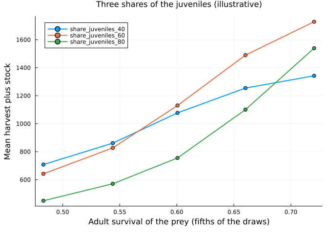
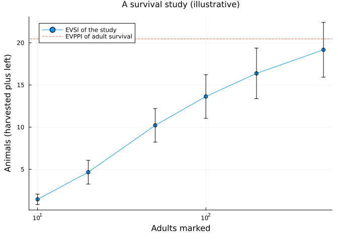

# Which stage to harvest, and how hard: a decision under uncertain vital rates
Simon Frost

- [The question](#the-question)
- [A managed community](#a-managed-community)
- [Uncertain vital rates](#uncertain-vital-rates)
- [Running the model over draws, actions and
  replicates](#running-the-model-over-draws-actions-and-replicates)
- [Payoffs and gains over no
  harvest](#payoffs-and-gains-over-no-harvest)
- [The decision under several rules](#the-decision-under-several-rules)
- [What is it worth to know the
  rates?](#what-is-it-worth-to-know-the-rates)
- [A study of adult survival](#a-study-of-adult-survival)
- [What the verbs did](#what-the-verbs-did)
- [What is measured and what is
  assumed](#what-is-measured-and-what-is-assumed)
- [Reference](#reference)

``` julia
ENV["GKSwstype"] = "100"
using MatrixCommunityModels
using DecisionAnalysis
using Printf, Random, Statistics
using Plots
```

## The question

A prey species is to be harvested for twenty years. It has a predator,
and its vital rates are known only roughly. Which stage should be taken,
juveniles or adults? Should the harvest be a share of the stage or a
fixed number each year, and how large? Would it pay to cull the predator
as well? And before deciding, which vital rate would be worth measuring?

The model is the predator-prey matrix model of Barraquand & Gimenez
(2019), built in [vignette
23](23_predator_and_prey.md): two species with
juveniles and adults, counted each year just before breeding. Adult
predators lower the survival of newborn prey, juvenile prey raise the
fecundity of predators, and adult prey lower their own fecundity.

**Every number of the decision problem is illustrative.** The parameter
values of the paper are simulation values that its authors chose to
resemble slow-lived birds and mammals; they are not estimates for any
population. The uncertainty about them, the harvest rates on offer and
the study at the end are made up here to show the method. No cost
appears anywhere: outcomes are counted in animals.

The analysis is done by
[DecisionAnalysis.jl](https://github.com/ecorecipes/DecisionAnalysis.jl).
This package does not depend on it. Loading both, on Julia 1.12 or
later, activates an extension that lets DecisionAnalysis.jl run a
`ManagedCommunity`, which is defined here and works without it.

## A managed community

A `ManagedCommunity` holds three things a decision needs of a model: a
way to build the model from **named parameters**, an **action**, and the
**named outcomes** to read off a run.

The parameters are four rates of the prey: adult survival, the effect of
adult predators on the survival of newborn prey (α4 of the paper), and
the intercept and slope of prey fecundity (α7 and α8; the slope is the
crowding of adults). `build` says where each name goes in the model, and
returns the community, its initial state and one environment per year:

``` julia
B = BARRAQUAND_GIMENEZ_2019
function build(θ)
    alpha = (B.alpha[1:3]..., θ.predation, B.alpha[5:6]..., θ.prey_fecundity, θ.prey_crowding)
    survival = (prey = θ.prey_survival, predator = B.adult_survival.predator)
    model = predator_prey(merge(B, (alpha = alpha, adult_survival = survival)))
    return (community = model.community, n0 = model.n0, envs = fill(nothing, 20))
end
published = (prey_survival = 0.6, predation = -0.025, prey_fecundity = 2.0, prey_crowding = -0.005)
```

    (prey_survival = 0.6, predation = -0.025, prey_fecundity = 2.0, prey_crowding = -0.005)

The outcomes of a run are counts of animals: the prey harvested over the
twenty years, the prey and the predators alive at the end, and the
predators culled. `collapsed` marks a run that ends with fewer than ten
prey (the threshold is illustrative). A run records what the action
removed from each state at each census in `removed`:

``` julia
function tally(run)
    layout = run.trajectory.community.layout
    return (; harvested = sum(run.removed[:, layout[:prey]]),
            prey = abundance(run.trajectory, :prey)[end],
            predators = abundance(run.trajectory, :predator)[end],
            culled = sum(run.removed[:, layout[:predator]]),
            collapsed = abundance(run.trajectory, :prey)[end] < 10)
end
managed = ManagedCommunity(build; parameters = published, outcomes = tally, demographic = true)
```

    ManagedCommunity(4 parameters set; action none; demographic)

With `demographic = true` individuals are whole: each survives by chance
and the number of young is Poisson, as in the stochastic model of the
paper.

An action is a named tuple. `remove = (:prey, :adult) => 0.2` removes a
fifth of the adult prey at each census, after the year’s survival and
births; with whole individuals each adult is taken with probability 0.2.
`take = (:prey, :juvenile) => 40` is a quota: forty juveniles a year, or
all of them if there are fewer. Nothing in this needs a decision
package:

``` julia
light = ManagedCommunity(managed; action = (; remove = (:prey, :adult) => 0.2))
run = project(light; rng = Xoshiro(1))
```

    ManagedTrajectory(20 steps, 4 states; removed 476.0, added 0.0)

``` julia
tally(run)
```

    (harvested = 476.0, prey = 203.0, predators = 41.0, culled = 0.0, collapsed = false)

The menu has no harvest, which is the baseline; a share of the adults or
of the juveniles; a quota of juveniles; and the best share of juveniles
with a cull of a fifth of the adult predators each year. The juveniles
of this census are last year’s young, a year before they first breed.

``` julia
actions = [:none => (;),
           :share_adults_20 => (; remove = (:prey, :adult) => 0.2),
           :share_adults_40 => (; remove = (:prey, :adult) => 0.4),
           :share_juveniles_20 => (; remove = (:prey, :juvenile) => 0.2),
           :share_juveniles_40 => (; remove = (:prey, :juvenile) => 0.4),
           :share_juveniles_60 => (; remove = (:prey, :juvenile) => 0.6),
           :share_juveniles_80 => (; remove = (:prey, :juvenile) => 0.8),
           :quota_juveniles_40 => (; take = (:prey, :juvenile) => 40),
           :quota_juveniles_60 => (; take = (:prey, :juvenile) => 60),
           :share_juveniles_60_cull => (; remove = [(:prey, :juvenile) => 0.6, (:predator, :adult) => 0.2])]
first.(actions)
```

    10-element Vector{Symbol}:
     :none
     :share_adults_20
     :share_adults_40
     :share_juveniles_20
     :share_juveniles_40
     :share_juveniles_60
     :share_juveniles_80
     :quota_juveniles_40
     :quota_juveniles_60
     :share_juveniles_60_cull

## Uncertain vital rates

The belief about the four rates is a set of draws: 1000 draws from an
**illustrative** prior centred on the values of the paper. Adult
survival is uniform between 0.45 and 0.75; the two effects that must be
negative are log-normal about their published values; the intercept of
fecundity is normal.

``` julia
rng = Xoshiro(30)
N = 1000
draws = (; prey_survival = 0.45 .+ 0.3 .* rand(rng, N),
         predation = -0.025 .* exp.(0.5 .* randn(rng, N)),
         prey_fecundity = 2.0 .+ 0.25 .* randn(rng, N),
         prey_crowding = -0.005 .* exp.(0.3 .* randn(rng, N)))
map(x -> round.(quantile(x, [0.05, 0.5, 0.95]); sigdigits = 3), draws)
```

    (prey_survival = [0.466, 0.598, 0.737], predation = [-0.0531, -0.0249, -0.0114], prey_fecundity = [1.61, 2.0, 2.42], prey_crowding = [-0.00791, -0.00495, -0.00308])

## Running the model over draws, actions and replicates

`outcomes` of DecisionAnalysis.jl runs every action at every draw, five
times each. It reaches the model through four verbs, which the extension
defines for a `ManagedCommunity`: `with_parameters` merges a draw into
the parameters, `apply_action` sets the action, `simulate` is `project`,
and `outcome` applies `tally`.

``` julia
table = outcomes(managed, actions, draws; replicates = 5, seed = 2026)
```

    OutcomeTable(1000 draws × 10 actions × 5 replicates; outcomes harvested, prey, predators, culled, collapsed; 50000 runs ok, 0 failed, 0 absent)

``` julia
run_counts(table)
```

    (runs = 50000, ok = 50000, failed = 0, absent = 0)

The five replicates of a draw use the same five seeds under every action
(common random numbers), so two actions are compared on the same chance
events as far as the model allows. Here each year of a run starts from
the same seed under every action.

## Payoffs and gains over no harvest

The utility is a count of animals. Two are shown: the prey harvested
over the twenty years, and that number plus the prey left alive at the
end. The second counts an animal left standing as much as one taken, so
a harvest that empties the stock gains nothing by doing so. It is the
one used for the decision below; what the stock is worth after year
twenty is a judgement, and the table gives both.

``` julia
harvest = IndividualsUtility(:harvested)
harvest_and_stock = FunctionUtility(o -> o.harvested + o.prey; name = :harvested_plus_stock)
labels = action_labels(table)
mean_of(name) = [mean(table.values[a, :, :, findfirst(==(name), outcome_names(table))]) for a in eachindex(labels)]
gain(utility) = [(Float64(g.value), g.standard_error)
                 for g in expected_gain_estimates(DecisionProblem(table, utility; baseline = :none))]
@printf("%-24s %11s %11s\n", "action", "harvested", "and stock")
for (a, g, gs) in zip(labels, gain(harvest), gain(harvest_and_stock))
    @printf("%-24s %5.0f ± %-3.0f %5.0f ± %-3.0f\n", a, g..., gs...)
end
```

    action                     harvested   and stock
    none                         0 ± 0       0 ± 0  
    share_adults_20            480 ± 8     373 ± 8  
    share_adults_40            536 ± 11    323 ± 11 
    share_juveniles_20         456 ± 6     411 ± 6  
    share_juveniles_40         868 ± 14    758 ± 14 
    share_juveniles_60        1068 ± 21    873 ± 21 
    share_juveniles_80         864 ± 20    593 ± 19 
    quota_juveniles_40         642 ± 7     523 ± 8  
    quota_juveniles_60         750 ± 12    570 ± 14 
    share_juveniles_60_cull   1359 ± 26   1196 ± 27 

``` julia
@printf("%-24s %10s %10s %10s\n", "action", "prey left", "predators", "collapsed")
for (a, prey, predators, collapsed) in zip(labels, mean_of(:prey), mean_of(:predators), mean_of(:collapsed))
    @printf("%-24s %10.0f %10.0f %10.2f\n", a, prey, predators, collapsed)
end
```

    action                    prey left  predators  collapsed
    none                            290         43       0.00
    share_adults_20                 183         35       0.02
    share_adults_40                  78         22       0.21
    share_juveniles_20              246         32       0.00
    share_juveniles_40              181         22       0.03
    share_juveniles_60               96         13       0.17
    share_juveniles_80               19          9       0.60
    quota_juveniles_40              171         25       0.38
    quota_juveniles_60              110         19       0.61
    share_juveniles_60_cull         128          1       0.10

The first table holds expected gains over no harvest, which takes
nothing and leaves the stock as it is, each with its standard error:
prey harvested, and prey harvested plus prey left. In the second,
`prey left` and `predators` are mean numbers at the end, and `collapsed`
is the share of runs that end with fewer than ten prey. The standard
errors are those of the mean over the 1000 draws, taken as a sample of
the prior. The simulation noise is a small part of them:

``` julia
all_actions = DecisionProblem(table, harvest_and_stock; baseline = :none)
e = expected_utility_estimates(all_actions)[findfirst(==(:share_juveniles_60), labels)]
(expected_harvest_and_stock = round(Float64(e.value); digits = 1), error_draws_as_a_sample = round(e.standard_error; digits = 1),
 error_simulation_only = round(e.simulation_error; digits = 1),
 correlation_of_noise_between_actions = round(crn_correlation(table, harvest_and_stock); digits = 2))
```

    (expected_harvest_and_stock = 1163.5, error_draws_as_a_sample = 24.1, error_simulation_only = 2.1, correlation_of_noise_between_actions = 0.25)

At a share of 20% the two stages yield about the same, and taking
juveniles leaves more prey. Raising the share of adults to 40% adds
little harvest and leaves about a quarter of the stock, with one run in
five ending below ten prey. On juveniles the harvest rises up to a share
of 60% and falls beyond it. A quota takes less than the share that
leaves a similar stock, and far more of its runs collapse: a fixed
number goes on being taken when the stock is low, where a share then
takes less. Culling a fifth of the adult predators each year adds to the
harvest and to the stock, and all but removes the predator. Whether that
is acceptable is not a question that a count of prey can answer, so the
cull is set aside below: it stays in the table and is marked infeasible
in the decision problems.

``` julia
allowed = filter(!=(:share_juveniles_60_cull), labels)
problem = DecisionProblem(table, harvest_and_stock; baseline = :none, feasible = allowed)
harvest_only = DecisionProblem(table, harvest; baseline = :none, feasible = allowed)
feasible_actions(problem)
```

    9-element Vector{Symbol}:
     :none
     :share_adults_20
     :share_adults_40
     :share_juveniles_20
     :share_juveniles_40
     :share_juveniles_60
     :share_juveniles_80
     :quota_juveniles_40
     :quota_juveniles_60

## The decision under several rules

``` julia
rules = ["greatest expected value" => MaxExpectedUtility(), "maximin over the draws" => Maximin(),
         "mean of the worst fifth of draws" => DecisionRule(CVaR(0.2)), "minimax regret over the draws" => MinimaxRegret()]
@printf("%-34s %-20s %-20s\n", "rule", "harvested and stock", "harvested")
for (name, rule) in rules
    @printf("%-34s %-20s %-20s\n", name, first_choice(decide(problem, rule)), first_choice(decide(harvest_only, rule)))
end
```

    rule                               harvested and stock  harvested           
    greatest expected value            share_juveniles_60   share_juveniles_60  
    maximin over the draws             quota_juveniles_40   quota_juveniles_40  
    mean of the worst fifth of draws   share_juveniles_40   share_juveniles_40  
    minimax regret over the draws      share_juveniles_60   share_juveniles_60  

``` julia
unique(first_choice(decide(all_actions, rule)) for (_, rule) in rules)     # with the cull allowed
```

    1-element Vector{Symbol}:
     :share_juveniles_60_cull

By expected value the choice is 60% of the juveniles each year, under
either utility. That action ends with fewer than ten prey in about one
run in six. The mean of the worst fifth of the draws prefers the lighter
share of 40%, whose runs seldom collapse. Maximin looks only at the
worst draw of each action and picks the small quota. A rule that looks
at the worst draw, or at regret draw by draw, depends on which draws
were sampled, and DecisionAnalysis.jl flags its result as such; minimax
regret also depends on the menu. With the cull allowed, every rule takes
it.

How often is each action the best, draw by draw?

``` julia
Q = Float64.(problem.payoff.Q)
best = [argmax([problem.feasible[a] ? Q[a, d] : -Inf for a in eachindex(labels)]) for d in 1:N]
[labels[a] => count(==(a), best) for a in eachindex(labels) if count(==(a), best) > 0]
```

    6-element Vector{Pair{Symbol, Int64}}:
     :share_juveniles_20 => 20
     :share_juveniles_40 => 424
     :share_juveniles_60 => 462
     :share_juveniles_80 => 36
     :quota_juveniles_40 => 32
     :quota_juveniles_60 => 26

No single action is best everywhere, which is what gives information a
value.

## What is it worth to know the rates?

The expected value of perfect information (EVPI) is what the manager
would gain, on average, by learning all four rates before choosing. The
expected value of partial perfect information (EVPPI) of one rate is the
gain from learning that rate alone. Both are in animals (harvested plus
left), and both are estimates with standard errors.

``` julia
whole = evpi(problem, SampleAverage(); noise_correlation = crn_correlation(table, harvest_and_stock))
```

    VOIEstimate(evpi by SampleAverage: 55.6984 ± 2.86957 (standard error); act-now bias 0.0, cell-noise bias 8.66268)

``` julia
partial = [name => evppi(problem, name) for name in keys(draws)]
@printf("%-16s %8s %8s\n", "rate", "EVPPI", "s.e.")
for (name, e) in partial
    @printf("%-16s %8.1f %8.1f\n", name, Float64(e.value), e.standard_error)
end
@printf("%-16s %8.1f %8.1f\n", "all four (EVPI)", Float64(whole.value), whole.standard_error)
```

    rate                EVPPI     s.e.
    prey_survival        20.5      3.8
    predation             0.8      0.6
    prey_fecundity        0.8      0.6
    prey_crowding        -0.0      0.0
    all four (EVPI)      55.7      2.9

``` julia
best_now = first_choice(decide(problem, MaxExpectedUtility()))
gain_now = Float64(expected_gain_estimates(problem)[findfirst(==(best_now), feasible_actions(problem))].value)
(act_now = best_now, expected_gain_over_no_harvest = round(gain_now; digits = 0),
 evpi_as_share_of_it = round(Float64(whole.value) / gain_now; digits = 3))
```

    (act_now = :share_juveniles_60, expected_gain_over_no_harvest = 873.0, evpi_as_share_of_it = 0.064)

Knowing all four rates would be worth about 56 animals over the twenty
years, some 6% of what the best action gains over no harvest. (The
estimate also reports the selection bias that simulation noise puts into
its perfect-information term, about 9 animals upwards.) Nearly all of
what a single rate can give comes from the adult survival of the prey,
about 20 animals. Each of the other three is worth less than one animal
by itself. A rate can matter a great deal to the size of the harvest and
still be worth little to know, if no value of it within the prior would
change the choice. The four EVPPIs do not add up to the EVPI: much of
the value lies in knowing the rates together.

``` julia
x = draws.prey_survival
edges = quantile(x, 0:0.2:1)
band(v) = clamp(searchsortedlast(edges, v), 1, 5)
means = [mean(Q[a, [d for d in 1:N if band(x[d]) == b]]) for a in eachindex(labels), b in 1:5]
plt = plot(; xlabel = "Adult survival of the prey (fifths of the draws)", ylabel = "Mean harvest plus stock",
           title = "Three shares of the juveniles (illustrative)", titlefontsize = 11, legend = :topleft)
mid = [(edges[b] + edges[b + 1]) / 2 for b in 1:5]
for a in (:share_juveniles_40, :share_juveniles_60, :share_juveniles_80)
    plot!(plt, mid, means[findfirst(==(a), labels), :]; label = String(a), marker = :circle, lw = 2)
end
plt
```



The lines of the 40% and 60% shares cross inside the prior: where the
adults survive poorly the lighter share is better, and where they
survive well the heavier one. That crossing is what makes adult survival
worth knowing.

## A study of adult survival

Barraquand & Gimenez (2019) fit their model to counts, capture-recapture
histories and records of reproduction together. The simplest study of
that kind is to mark `n` adult prey and count how many are alive a year
later: a binomial number with the adult survival as its probability. Its
expected value of sample information (EVSI) is the expected gain from
choosing after seeing the result. It is estimated by reweighting the
draws by the likelihood of each simulated result. The study is taken at
face value: every marked animal is found again if alive.

``` julia
belief = SampleBelief(table)
function survival_study(n)
    study = importance_loglikelihoods((rng, θ) -> count(_ -> rand(rng) < θ.prey_survival, 1:n),
                                      (alive, θ) -> alive * log(θ.prey_survival) + (n - alive) * log(1 - θ.prey_survival),
                                      belief; seed = 3)
    return evsi(problem, study)
end
sizes = [10, 20, 50, 100, 200, 500]
studies = [survival_study(n) for n in sizes]
@printf("%14s %8s %8s %28s\n", "adults marked", "EVSI", "s.e.", "median effective sample size")
for (n, e) in zip(sizes, studies)
    @printf("%14d %8.1f %8.1f %28.0f\n", n, Float64(e.value), e.standard_error, e.details.median_ess)
end
```

     adults marked     EVSI     s.e. median effective sample size
                10      1.4      0.6                          897
                20      4.7      1.4                          781
                50     10.2      2.0                          635
               100     13.6      2.6                          516
               200     16.4      3.0                          383
               500     19.2      3.3                          247

``` julia
survival_evppi = last(partial[1])
plt = plot(sizes, [Float64(e.value) for e in studies]; yerror = [e.standard_error for e in studies], xscale = :log10,
           marker = :circle, label = "EVSI of the study", xlabel = "Adults marked", ylabel = "Animals (harvested plus left)",
           title = "A survival study (illustrative)", titlefontsize = 11, legend = :topleft)
hline!(plt, [Float64(survival_evppi.value)]; ls = :dash, label = "EVPPI of adult survival")
plt
```



Marking ten adults is worth about one animal, fifty about ten, and five
hundred about nineteen, close to the EVPPI of adult survival. That is
the ceiling: no study of survival alone can be worth more than knowing
survival. The larger the study, the fewer draws carry the weight after
reweighting (the effective sample size), and the less reliable the
estimate. No cost of marking is given, so no best size is chosen: the
EVSI is the most, in animals harvested or left, that a study of that
size could be worth giving up.

## What the verbs did

The extension is four short methods. Everything else used above is
either this package’s (`ManagedCommunity`, `project`, the action as a
named tuple) or DecisionAnalysis.jl’s (`outcomes`, the utilities, the
rules, the values of information).

| DecisionAnalysis.jl verb | for a `ManagedCommunity` |
|:---|:---|
| `with_parameters(m, θ)` | the draw `θ` merged into `m.parameters`; `build` maps the names to the model |
| `apply_action(m, a)` | the action `a`, a named tuple (`remove`, `take`, `add`, `parameters`, `environment`, `steps`) |
| `simulate(m; rng)` | `project(m; rng)`, a `ManagedTrajectory` |
| `outcome(run)` | `m.outcomes(run)`, a named tuple of numbers |

A deterministic model (`demographic = false`) ignores the seed; its
replicates are equal and its payoffs have no Monte Carlo error, so one
replicate is enough.

## What is measured and what is assumed

| Item | Value | Source |
|:---|:---|:---|
| Model and central parameter values | two species, two stages; α1 to α8, adult survival 0.6 and 0.7, initial numbers | Barraquand & Gimenez 2019, Eq. 1 and Table 5: simulation values chosen by the authors, not estimates |
| Demographic stochasticity | binomial survival, Poisson young | as in the paper’s stochastic model (vignette 23) |
| Harvest and cull | a share of a stage, or a fixed number, removed at each pre-breeding census | illustrative; not in the paper |
| Collapse | fewer than ten prey at the end | illustrative |
| Prior on the four prey rates | 1000 draws | illustrative |
| Horizon | 20 years | illustrative |
| Survival study | `n` marked adults, all found if alive | illustrative |

## Reference

Barraquand, F. & Gimenez, O. (2019). Integrating multiple data sources
to fit matrix population models for interacting species. *Ecological
Modelling* 411, 108713.
<https://doi.org/10.1016/j.ecolmodel.2019.06.001>.
