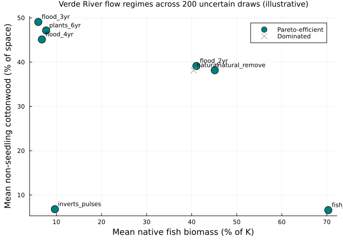
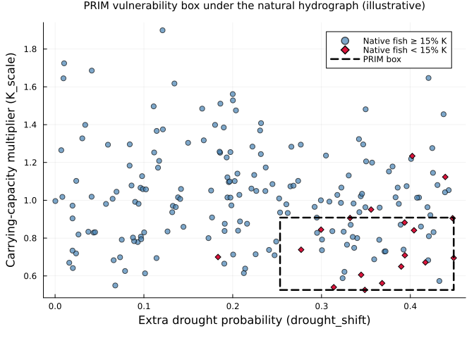

# Choosing a river flow regime across fish, trees and insects under uncertainty
Simon Frost

- [The question](#the-question)
- [Flow regimes and uncertain
  conditions](#flow-regimes-and-uncertain-conditions)
- [Running the fish community through
  `ManagedCommunity`](#running-the-fish-community-through-managedcommunity)
- [Multi-objective trade-offs and the Pareto
  front](#multi-objective-trade-offs-and-the-pareto-front)
- [Comparing decision rules on the river index and native
  fish](#comparing-decision-rules-on-the-river-index-and-native-fish)
- [Value of information and certainty-equivalent
  EVPI](#value-of-information-and-certainty-equivalent-evpi)
- [Scenario discovery: when does the natural regime fail native
  fish?](#scenario-discovery-when-does-the-natural-regime-fail-native-fish)
- [What is measured and what is
  assumed](#what-is-measured-and-what-is-assumed)
- [References](#references)

``` julia
ENV["GKSwstype"] = "100"
using MatrixCommunityModels
using DecisionAnalysis
using Printf, Random, Statistics
using Plots
```

## The question

Below a dam on a dryland river, managers can choose how often to release
spring floods, whether to allow drought years between them, and whether
to pair flow releases with mechanical removal of non-native predatory
fish. In [vignette
22](22_designed_flow_regimes.md), the four
flow regimes of Tonkin et al. (2021) revealed a sharp three-way
trade-off on the upper Verde River: an annual spring flood maximises
native fish biomass but replaces cottonwood with willow; a flood every
six years preceded by a drought maximises cottonwood but collapses
native fish; four small pulses a year favour winged aquatic
invertebrates while starving both fish and trees; and the natural regime
sits in the middle of all three.

That comparison held carrying capacity, future drought frequency and
riparian flood mortality fixed. In practice none of those is known
cleanly, and managers must weigh native fish against riparian cottonwood
and winged insects at the same time. Which flow regime lies on the
Pareto frontier? Which regime wins under expected utility, tail-risk
aversion, minimax regret, stochastic dominance or ambiguity over future
climate? What would it be worth to resolve uncertainty about carrying
capacity versus future drought frequency before committing to a flow
schedule? And under what conditions does the natural regime fail native
fish?

**What is published and what is illustrative.** The three ecological
community models (`verde_fish_model` of Rogosch et al. 2019,
`riparian_model` of Lytle et al. 2017 and `flow_invertebrates` of
McMullen et al. 2017 / Tonkin et al. 2021) and the four benchmark
regimes (`tonkin_scenario`) are the published models reproduced in
vignettes 2, 3 and 22. The intermediate flood frequencies, the
non-native removal option, the prior distributions over ecological and
hydrological uncertainty, and the decision utilities are illustrative.
No monetary cost appears anywhere: outcomes are measured in native fish
biomass (as a percentage of nominal carrying capacity `K = 47 660` g),
non-seedling cottonwood cover (% of riparian space) and mean
winged-invertebrate abundance (% of maximum carrying capacity).

## Flow regimes and uncertain conditions

We compare eight candidate management regimes over a 60-year horizon
(scoring years 11 to 60, after the ten-year transient used by Tonkin et
al. 2021), with the natural upper Verde River hydrograph (`:natural`) as
the baseline:

1.  `:natural` — the historical Paulden year-type sequence (baseline);
2.  `:fish_annual` — the fish prescription of Tonkin et al. (spring
    flood every year);
3.  `:flood_2yr` — a spring flood every second year (no imposed
    drought);
4.  `:flood_3yr` — a spring flood every third year, with a drought in
    the year before it;
5.  `:flood_4yr` — a spring flood every fourth year, with a drought in
    the year before it;
6.  `:plants_6yr` — the riparian prescription (spring flood every sixth
    year, drought before);
7.  `:inverts_pulses` — the invertebrate prescription (four 50 m³/s
    pulses a year, no large floods);
8.  `:natural_remove` — the natural hydrograph paired with annual
    removal of 30% of non-native smallmouth bass (`:MIDO`) and green
    sunfish (`:LECY`).

``` julia
const HORIZON = 60
const K_NOMINAL = 47660.0
const NATIVE_FISH = (:CACL, :GIRO, :CAIN)
const NONNATIVE_FISH = (:LECY, :MIDO, :CYLU, :AMNA)

nat_base = tonkin_scenario(:natural; years = HORIZON, invertebrate_years = 15)
fsh_base = tonkin_scenario(:fish; years = HORIZON, invertebrate_years = 15)
plt_base = tonkin_scenario(:plants; years = HORIZON, invertebrate_years = 15)
inv_base = tonkin_scenario(:invertebrates; years = HORIZON, invertebrate_years = 15)

function cyclic_envs(k::Int; drought_before::Bool = true, years::Int = HORIZON)
    flood = [mod(y, k) == 0 ? 1 : 0 for y in 1:years]
    drought = [drought_before && k > 1 && mod(y + 1, k) == 0 ? 1 : 0 for y in 1:years]
    fish = [(SP_highflood = flood[y], SU_highflood = 0, medflood = 0, drought = drought[y],
             nonevent = 1 - flood[y] - drought[y]) for y in 1:years]
    riparian = [(year = y, flood = Float64(flood[y]), drought = Float64(drought[y]),
                 nonflood = flood[y] + drought[y] == 1 ? 0.0 : 1.0,
                 cprop = 0.9, tprop = 0.4, decline = 1.0, tdecline = 1.0) for y in 1:years]
    return (; fish, riparian)
end

cyc2 = cyclic_envs(2; drought_before = false)
cyc3 = cyclic_envs(3; drought_before = true)
cyc4 = cyclic_envs(4; drought_before = true)

regime_fish_envs = Dict(
    :natural => nat_base.fish,
    :fish_annual => fsh_base.fish,
    :flood_2yr => cyc2.fish,
    :flood_3yr => cyc3.fish,
    :flood_4yr => cyc4.fish,
    :plants_6yr => plt_base.fish,
    :inverts_pulses => inv_base.fish,
    :natural_remove => nat_base.fish,
)
regime_rip_envs = Dict(
    :natural => nat_base.riparian,
    :fish_annual => fsh_base.riparian,
    :flood_2yr => cyc2.riparian,
    :flood_3yr => cyc3.riparian,
    :flood_4yr => cyc4.riparian,
    :plants_6yr => plt_base.riparian,
    :inverts_pulses => inv_base.riparian,
    :natural_remove => nat_base.riparian,
)
regime_labels = [:natural, :fish_annual, :flood_2yr, :flood_3yr, :flood_4yr,
                 :plants_6yr, :inverts_pulses, :natural_remove]
```

    8-element Vector{Symbol}:
     :natural
     :fish_annual
     :flood_2yr
     :flood_3yr
     :flood_4yr
     :plants_6yr
     :inverts_pulses
     :natural_remove

Three sources of uncertainty are drawn together across `N = 200`
parameter sets (all illustrative, apart from the initial adult fish
biomass draws which come from the negative binomial distributions
`TONKIN_FISH_INITIAL` of Tonkin et al. 2021):

- `K_scale`: fish carrying capacity multiplier (log-normal, median 1,
  roughly 0.6 to 1.7), capturing reach-scale productivity uncertainty;
- `drought_shift`: extra drying probability in `[0, 0.45]`, which
  converts that share of scheduled non-event years into drought years
  under climate warming;
- `cottonwood_S_scale`: multiplier in `[0.8, 1.2]` on stage-specific
  cottonwood flood mortality in `RIPARIAN_GUILDS`;
- `init_seed`: integer seed selecting one independent initial fish
  biomass vector from `tonkin_fish_start`.

``` julia
rng = Xoshiro(31)
N = 200
draws = (;
    K_scale = exp.(0.25 .* randn(rng, N)),
    drought_shift = 0.45 .* rand(rng, N),
    cottonwood_S_scale = 0.8 .+ 0.4 .* rand(rng, N),
    init_seed = collect(1:N),
)
(; K_scale = round.(quantile(draws.K_scale, [0.05, 0.5, 0.95]); digits = 2),
   drought_shift = round.(quantile(draws.drought_shift, [0.05, 0.5, 0.95]); digits = 2),
   cottonwood_S_scale = round.(quantile(draws.cottonwood_S_scale, [0.05, 0.5, 0.95]); digits = 2))
```

    (K_scale = [0.63, 0.99, 1.51], drought_shift = [0.02, 0.23, 0.42], cottonwood_S_scale = [0.83, 1.0, 1.19])

## Running the fish community through `ManagedCommunity`

`ManagedCommunity` wraps `verde_fish_model` with its uncertain carrying
capacity, initial biomass draw and climate-shifted drought years. Flow
regimes enter as `environment` interventions and non-native removal
enters as `remove = [:MIDO => 0.3, :LECY => 0.3]`. DecisionAnalysis.jl’s
`outcomes` driver evaluates every regime on every draw.

``` julia
function apply_drought_shift(envs, shift::Float64, seed::Int)
    shift <= 0.0 && return envs
    r = Xoshiro(10_000 + seed)
    return map(envs) do e
        if e.nonevent == 1 && rand(r) < shift
            (SP_highflood = 0, SU_highflood = 0, medflood = 0, drought = 1, nonevent = 0)
        else
            e
        end
    end
end

function build_fish(θ)
    vm = verde_fish_model(; K = K_NOMINAL * θ.K_scale)
    n0 = tonkin_fish_start(Xoshiro(Int(θ.init_seed)))
    envs = apply_drought_shift(nat_base.fish, θ.drought_shift, Int(θ.init_seed))
    return (community = vm.community, n0 = n0, envs = envs)
end

function fish_outcomes(run)
    tr = run.trajectory
    native_pct = mean(100 .* sum(tr[sp][11:end, 2] .+ tr[sp][11:end, 3] for sp in NATIVE_FISH) ./ K_NOMINAL)
    nonnative_pct = mean(100 .* sum(tr[sp][11:end, 2] .+ tr[sp][11:end, 3] for sp in NONNATIVE_FISH) ./ K_NOMINAL)
    native_share = native_pct / max(native_pct + nonnative_pct, 1e-12)
    collapsed = native_pct < 15.0 ? 1.0 : 0.0
    # Local linearisation at the final state under a non-event year (ResilienceCore)
    J = linearise(tr.community, tr.u[end, :],
                  (SP_highflood = 0, SU_highflood = 0, medflood = 0, drought = 0, nonevent = 1);
                  check = false)
    react = MatrixCommunityModels.ResilienceCore.reactivity(J)
    return (; native_fish = native_pct, nonnative_fish = nonnative_pct,
            native_share = 100 * native_share, collapsed, reactivity = react)
end

managed_fish = ManagedCommunity(build_fish;
    parameters = (K_scale = 1.0, drought_shift = 0.0, cottonwood_S_scale = 1.0, init_seed = 1),
    outcomes = fish_outcomes)

function env_action(regime::Symbol)
    base = regime_fish_envs[regime]
    return (; parameters = (; _regime = regime),
              environment = (t, env) -> begin
                  e = base[t]
                  # Keep any drought shift already realised on non-event years
                  e.nonevent == 1 && env.drought == 1 ?
                      (SP_highflood = 0, SU_highflood = 0, medflood = 0, drought = 1, nonevent = 0) : e
              end)
end

actions = [
    :natural => (;),
    :fish_annual => env_action(:fish_annual),
    :flood_2yr => env_action(:flood_2yr),
    :flood_3yr => env_action(:flood_3yr),
    :flood_4yr => env_action(:flood_4yr),
    :plants_6yr => env_action(:plants_6yr),
    :inverts_pulses => env_action(:inverts_pulses),
    :natural_remove => (; remove = [:MIDO => 0.3, :LECY => 0.3]),
]

fish_table = outcomes(managed_fish, actions, draws; replicates = 1, seed = 31)
run_counts(fish_table)
```

    (runs = 1600, ok = 1600, failed = 0, absent = 0)

For the riparian cottonwood and winged-invertebrate objectives on the
exact same 200 draws and regimes, we project `riparian_model` (scaling
cottonwood flood mortality by `cottonwood_S_scale` and applying the same
drought shifts) and `flow_invertebrates`:

``` julia
bugs = flow_invertebrates()
inv_scores = Dict{Symbol, Float64}()
for (reg, scen) in ((:natural, nat_base), (:fish_annual, fsh_base), (:plants_6yr, plt_base),
                    (:inverts_pulses, inv_base), (:natural_remove, nat_base))
    sol = project(bugs, scen.invertebrate_n0, scen.invertebrates)
    inv_scores[reg] = mean((sol[:mayfly][3652:end, 1] .+ sol[:dragonfly][3652:end, 1]) ./ 2)
end
for (reg, every) in ((:flood_2yr, 365 * 2), (:flood_3yr, 365 * 3), (:flood_4yr, 365 * 4))
    envs = invertebrate_flows(flood_pulses(every, 700 * 0.35, 365 * 15)...)
    sol = project(bugs, nat_base.invertebrate_n0, envs)
    inv_scores[reg] = mean((sol[:mayfly][3652:end, 1] .+ sol[:dragonfly][3652:end, 1]) ./ 2)
end

function apply_rip_drought(envs, shift::Float64, seed::Int)
    shift <= 0.0 && return envs
    r = Xoshiro(10_000 + seed)
    return map(envs) do e
        if e.flood == 0.0 && e.drought == 0.0 && rand(r) < shift
            merge(e, (drought = 1.0, nonflood = 0.0))
        else
            e
        end
    end
end

cottonwood_Q = zeros(length(regime_labels), N)
invert_Q = zeros(length(regime_labels), N)
for d in 1:N
    c_old = RIPARIAN_GUILDS.C
    c_new = merge(c_old, (S = clamp.(c_old.S .* draws.cottonwood_S_scale[d], 0.0, 0.999),))
    guilds_d = merge(RIPARIAN_GUILDS, (C = c_new,))
    rm = riparian_model(; guilds = guilds_d)
    for (ai, reg) in enumerate(regime_labels)
        renvs = apply_rip_drought(regime_rip_envs[reg], draws.drought_shift[d], draws.init_seed[d])
        sol = project(rm.community, nat_base.riparian_n0, renvs)
        cot = [100 * 350 * sum(sol[:C][k, s] / RIPARIAN_GUILDS.C.den[s] for s in 2:6) / rm.K
               for k in 11:(HORIZON + 1)]
        cottonwood_Q[ai, d] = mean(cot)
        invert_Q[ai, d] = inv_scores[reg]
    end
end

belief = SampleBelief(fish_table)
payoff_fish = payoff_table(fish_table, IndividualsUtility(:native_fish))
payoff_cot = PayoffTable(regime_labels, belief.states, cottonwood_Q)
payoff_inv = PayoffTable(regime_labels, belief.states, invert_Q)
# Equal-weight multi-taxon index (each target already on a 0–100 percentage scale)
payoff_river = PayoffTable(regime_labels, belief.states,
                           (Float64.(payoff_fish.Q) .+ cottonwood_Q .+ invert_Q) ./ 3)

@printf("%-16s %10s %10s %10s %10s %10s\n",
        "regime", "fish (%K)", "cotton(%)", "inverts", "mean-3", "collapse")
for (ai, reg) in enumerate(regime_labels)
    col_idx = findfirst(==(:collapsed), outcome_names(fish_table))
    @printf("%-16s %10.1f %10.1f %10.1f %10.1f %10.2f\n",
            reg, mean(Float64.(payoff_fish.Q[ai, :])), mean(cottonwood_Q[ai, :]),
            mean(invert_Q[ai, :]), mean(Float64.(payoff_river.Q[ai, :])),
            mean(fish_table.values[ai, :, 1, col_idx]))
end
```

    regime            fish (%K)  cotton(%)    inverts     mean-3   collapse
    natural                40.4       38.2       52.0       43.5       0.09
    fish_annual            70.3        6.6       46.2       41.0       0.00
    flood_2yr              41.1       39.1       43.4       41.2       0.09
    flood_3yr               6.0       49.1       41.2       32.1       0.95
    flood_4yr               6.8       45.1       41.2       31.0       0.93
    plants_6yr              7.7       47.2       41.2       32.0       0.86
    inverts_pulses          9.6        6.8       72.8       29.8       0.79
    natural_remove         45.1       38.2       52.0       45.1       0.04

## Multi-objective trade-offs and the Pareto front

Treating native fish, cottonwood and winged invertebrates as three
separate objectives in `DecisionAnalysis` immediately isolates the
Pareto-efficient regimes without choosing arbitrary weights first:

``` julia
objectives = (; native_fish = payoff_fish, cottonwood = payoff_cot, invertebrates = payoff_inv)
pf = decide(objectives, belief, ParetoFront())
pf.chosen
```

    7-element Vector{Symbol}:
     :fish_annual
     :flood_2yr
     :flood_3yr
     :flood_4yr
     :plants_6yr
     :inverts_pulses
     :natural_remove

``` julia
mean_fish = [mean(Float64.(payoff_fish.Q[ai, :])) for ai in eachindex(regime_labels)]
mean_cot = [mean(cottonwood_Q[ai, :]) for ai in eachindex(regime_labels)]
mean_inv = [mean(invert_Q[ai, :]) for ai in eachindex(regime_labels)]
is_pareto = [r in pf.chosen for r in regime_labels]

plt = scatter(mean_fish[is_pareto], mean_cot[is_pareto]; markersize = 8, color = :teal,
              label = "Pareto-efficient", xlabel = "Mean native fish biomass (% of K)",
              ylabel = "Mean non-seedling cottonwood (% of space)",
              title = "Verde River flow regimes across 200 uncertain draws (illustrative)",
              titlefontsize = 10, legend = :topright)
scatter!(plt, mean_fish[.!is_pareto], mean_cot[.!is_pareto]; markersize = 6, color = :gray60,
         marker = :xcross, label = "Dominated")
for (x, y, r) in zip(mean_fish, mean_cot, regime_labels)
    annotate!(plt, x + 0.8, y + 1.2, text(String(r), 8, :left))
end
plt
```



Notice how `:natural_remove` pushes the natural hydrograph upwards in
native fish biomass without sacrificing cottonwood or aquatic
invertebrates, while `:flood_2yr` and `:flood_3yr` trace intermediate
compromise points between the two extremes of Tonkin et al. (2021).

## Comparing decision rules on the river index and native fish

Next we compare five rules on both the three-taxon equal-weight index
(`prob_river`) and native fish alone (`prob_fish`), including
second-order stochastic dominance (`StochasticDominance(; order = 2)`)
and Klibanoff–Marinacci–Mukerji smooth ambiguity (`SmoothAmbiguity`)
across two climate priors (a wet-skewed prior weighting low
`drought_shift` draws and a dry-skewed prior weighting high
`drought_shift` draws):

``` julia
prob_river = DecisionProblem(payoff_river, belief; baseline = :natural)
prob_fish = DecisionProblem(payoff_fish, belief; baseline = :natural)

rules = [
    "MaxExpectedUtility" => MaxExpectedUtility(),
    "CVaR (worst 20%)" => DecisionRule(CVaR(0.2)),
    "MinimaxRegret" => MinimaxRegret(),
    "StochasticDominance (SSD)" => StochasticDominance(; order = 2),
]
@printf("%-28s %-28s %-28s\n", "rule", "three-taxon index", "native fish only")
for (label, rule) in rules
    c_r = join(string.(decide(prob_river, rule).chosen), ", ")
    c_f = join(string.(decide(prob_fish, rule).chosen), ", ")
    @printf("%-28s %-28s %-28s\n", label, c_r, c_f)
end
```

    rule                         three-taxon index            native fish only            
    MaxExpectedUtility           natural_remove               fish_annual                 
    CVaR (worst 20%)             natural_remove               fish_annual                 
    MinimaxRegret                fish_annual                  fish_annual                 
    StochasticDominance (SSD)    natural_remove               fish_annual                 

To evaluate ambiguity aversion over future hydrology, we build a
`CredalSet` from two weighted priors over the 200 draws — one
concentrating probability on low `drought_shift` (near-historical
climate) and one on high `drought_shift` (drier climate) — and compare
`GammaMaximin()` with `DecisionRule(SmoothAmbiguity(0.15))`:

``` julia
wet_w = [draws.drought_shift[d] < 0.225 ? 2.0 : 0.5 for d in 1:N]
dry_w = [draws.drought_shift[d] >= 0.225 ? 2.0 : 0.5 for d in 1:N]
wet_w ./= sum(wet_w)
dry_w ./= sum(dry_w)
credal = CredalSet(belief.states, [wet_w, dry_w])
prob_ambig = DecisionProblem(payoff_river, credal; baseline = :natural)
(gamma_maximin = decide(prob_ambig, GammaMaximin()).chosen,
 smooth_ambiguity = decide(prob_ambig, DecisionRule(SmoothAmbiguity(0.15))).chosen)
```

    (gamma_maximin = [:natural_remove], smooth_ambiguity = [:natural_remove])

## Value of information and certainty-equivalent EVPI

How much would it be worth (in three-taxon index points, or in native
fish `% K`) to know carrying capacity, future drought shift or
cottonwood flood mortality before setting the flow regime? We also
compute the certainty-equivalent EVPI (`ce_evpi`) for a risk-averse
manager (`ExponentialUtility(:river_index; risk_aversion = 0.05)`):

``` julia
evpi_river = evpi(prob_river, SampleAverage())
evpi_fish = evpi(prob_fish, SampleAverage())
ce_river = ce_evpi(prob_river, ExponentialUtility(:river_index; risk_aversion = 0.05))
focal = (:K_scale, :drought_shift, :cottonwood_S_scale)

@printf("%-22s %12s %12s\n", "uncertainty", "river index", "native fish")
for name in focal
    er = evppi(prob_river, name)
    ef = evppi(prob_fish, name)
    @printf("%-22s %6.2f ± %-4.2f %6.2f ± %-4.2f\n",
            name, Float64(er.value), er.standard_error, Float64(ef.value), ef.standard_error)
end
@printf("%-22s %6.2f ± %-4.2f %6.2f ± %-4.2f\n",
        "all (EVPI)", Float64(evpi_river.value), evpi_river.standard_error,
        Float64(evpi_fish.value), evpi_fish.standard_error)
@printf("%-22s %12.2f\n", "CE-EVPI (CARA 0.05)", Float64(ce_river.value))
```

    uncertainty             river index  native fish
    K_scale                  0.05 ± 0.10   0.00 ± 0.00
    drought_shift            0.00 ± 0.00   0.00 ± 0.00
    cottonwood_S_scale      -0.00 ± 0.00   0.00 ± 0.00
    all (EVPI)               0.82 ± 0.14   0.00 ± 0.00
    CE-EVPI (CARA 0.05)            0.83

## Scenario discovery: when does the natural regime fail native fish?

Under the baseline `:natural` hydrograph, native fish drop below 15% of
nominal carrying capacity in a subset of the 200 draws. Patient Rule
Induction Method (`prim_boxes`) finds the interpretable hyper-rectangle
in `(K_scale, drought_shift, cottonwood_S_scale)` space where collapse
is concentrated:

``` julia
nat_idx = findfirst(==(:natural), action_labels(fish_table))
col_idx = findfirst(==(:collapsed), outcome_names(fish_table))
nat_collapsed = vec(fish_table.values[nat_idx, :, 1, col_idx]) .> 0.5
prim = prim_boxes(belief, nat_collapsed; peel_alpha = 0.15, min_mass = 0.15)
top_box = argmax(b -> b.density, prim.frontier)
(base_collapse_rate = round(prim.base_rate; digits = 3),
 box_collapse_density = round(top_box.density; digits = 3),
 box_coverage = round(top_box.coverage; digits = 3),
 box_mass = round(top_box.mass; digits = 3),
 bounds = top_box.bounds)
```

    (base_collapse_rate = 0.09, box_collapse_density = 0.448, box_coverage = 0.722, box_mass = 0.145, bounds = Dict(:cottonwood_S_scale => (0.8001205902530144, 1.1995402632173442), :drought_shift => (0.2533088730035887, 0.44883520149788825), :init_seed => (45.0, 200.0), :K_scale => (0.5257601576346292, 0.9083381537350731)))

``` julia
plt = scatter(draws.drought_shift[.!nat_collapsed], draws.K_scale[.!nat_collapsed];
              color = :steelblue, alpha = 0.7, label = "Native fish ≥ 15% K",
              xlabel = "Extra drought probability (drought_shift)",
              ylabel = "Carrying-capacity multiplier (K_scale)",
              title = "PRIM vulnerability box under the natural hydrograph (illustrative)",
              titlefontsize = 10, legend = :topright)
scatter!(plt, draws.drought_shift[nat_collapsed], draws.K_scale[nat_collapsed];
         color = :crimson, marker = :diamond, label = "Native fish < 15% K")
if haskey(top_box.bounds, :drought_shift) && haskey(top_box.bounds, :K_scale)
    xlo, xhi = top_box.bounds[:drought_shift]
    ylo, yhi = top_box.bounds[:K_scale]
    plot!(plt, [xlo, xhi, xhi, xlo, xlo], [ylo, ylo, yhi, yhi, ylo];
          lw = 2.5, color = :black, ls = :dash, label = "PRIM box")
end
plt
```



## What is measured and what is assumed

| Item | Value | Source |
|:---|:---|:---|
| Verde River fish community (7 species, vital rates, year-type modifiers, `K = 47 660` g) | `verde_fish_model()` | Rogosch et al. 2019 (vignette 2) |
| Initial adult fish biomass draws | `TONKIN_FISH_INITIAL` (`tonkin_fish_start`) | Tonkin et al. 2021 (vignette 22) |
| Riparian plant guilds (5 guilds, 6 stages) | `riparian_model()`, `RIPARIAN_GUILDS` | Lytle et al. 2017 (vignette 3) |
| Aquatic invertebrates (mayfly, dragonfly, ostracod) | `flow_invertebrates()`, `FLOW_INVERTEBRATES` | McMullen et al. 2017 / Tonkin et al. 2021 (vignette 22) |
| Four benchmark regimes (`:natural`, `:fish_annual`, `:plants_6yr`, `:inverts_pulses`) | `tonkin_scenario` | Tonkin et al. 2021 |
| Intermediate flood cycles (`:flood_2yr`, `:flood_3yr`, `:flood_4yr`) and 30% non-native removal | `cyclic_envs`, `remove = [:MIDO => 0.3, :LECY => 0.3]` | illustrative |
| Prior on `K_scale`, `drought_shift`, `cottonwood_S_scale` (200 draws) | log-normal and uniform bounds | illustrative |
| Equal-weight three-taxon river index, 15% collapse threshold, CARA 0.05 and climate credal priors | `payoff_river`, `ExponentialUtility(:river_index; risk_aversion = 0.05)`, `CredalSet` | illustrative |

## References

Lytle, D. A., Merritt, D. M., Tonkin, J. D., Olden, J. D. & Reynolds, L.
V. (2017). Linking river flow regimes to riparian plant guilds: a
community-wide modeling approach. *Ecological Applications* 27,
1338–1350.

McMullen, L. E., De Leenheer, P., Tonkin, J. D. & Lytle, D. A. (2017).
High mortality and enhanced recovery: modelling the countervailing
effects of disturbance on population dynamics. *Ecology Letters* 20,
1566–1575.

Rogosch, J. S., Tonkin, J. D., Lytle, D. A., Merritt, D. M., Reynolds,
L. V. & Olden, J. D. (2019). Increasing drought favors nonnative fishes
in a dryland river: evidence from a multispecies demographic model.
*Ecosphere* 10, e02681.

Tonkin, J. D., Olden, J. D., Merritt, D. M., Reynolds, L. V., Rogosch,
J. S. & Lytle, D. A. (2021). Designing flow regimes to support entire
river ecosystems. *Frontiers in Ecology and the Environment* 19,
326–333. <https://doi.org/10.1002/fee.2348>.
