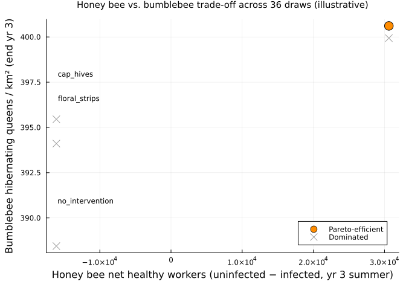
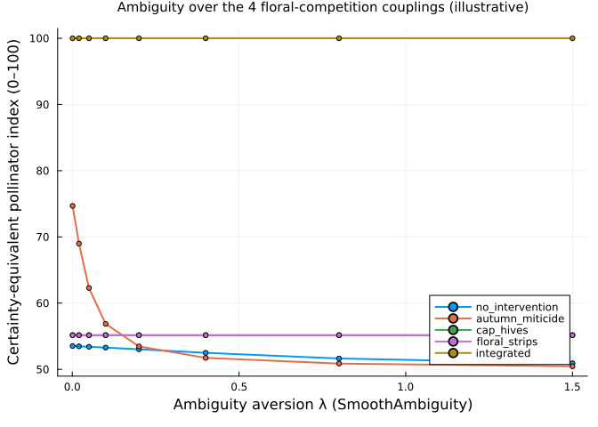

# Managing Varroa, virus spillover and floral competition between honey bees and bumblebees
Simon Frost

- [The question](#the-question)
- [Management actions and parametric
  uncertainty](#management-actions-and-parametric-uncertainty)
- [Disease utility (`InfectionUtility`), multi-attribute utility and the
  Pareto
  front](#disease-utility-infectionutility-multi-attribute-utility-and-the-pareto-front)
- [Which biological uncertainty matters most
  (`evppi`)?](#which-biological-uncertainty-matters-most-evppi)
- [Pre-treatment mite-wash surveillance across apiaries
  (`survey_or_act`)](#pre-treatment-mite-wash-surveillance-across-apiaries-survey_or_act)
- [Structural ambiguity across the four floral-competition
  couplings](#structural-ambiguity-across-the-four-floral-competition-couplings)
- [What is measured and what is
  assumed](#what-is-measured-and-what-is-assumed)
- [References](#references)

``` julia
ENV["GKSwstype"] = "100"
using MatrixCommunityModels
using DecisionAnalysis
using Printf, Random, Statistics
using Plots
```

## The question

In [vignettes 10 to
13](13_bees_sharing_flowers.md), a honey bee
colony (*Apis mellifera*), *Varroa destructor* mites, deformed wing
virus (DWV) and a wild bumblebee population (*Bombus terrestris*) were
composed through two pools: shared floral nectar and pollen, and
infectious virus left on flowers. That work left two kinds of
uncertainty open for a landscape manager:

1.  **Parametric uncertainty** over winter mite burden, miticide
    efficacy under resistance, virus deposition rate on flowers, and
    whether DWV elevates bumblebee worker mortality (`infected_hazard`
    in `BUMBLEBEE_PARAMETERS`, where empirical evidence conflicts);
2.  **Deep structural uncertainty** over *how* honey bees and bumblebees
    share flowers — vignette 13 showed that the four couplings of
    `floral_competition` (`:scramble`, `:standing_crop`, `:partitioned`,
    `:preemptive`) predict sharply different bumblebee outcomes from the
    exact same two species models.

Here we turn that composed pollinator community into a multi-objective
decision analysis in `DecisionAnalysis.jl`. Should a landscape manager
apply autumn miticide, cap apiary density, sow wildflower margins, or
combine interventions? How does the ranking change when infected honey
bees are penalised (`InfectionUtility`) or weighted alongside wild
bumblebee queens (`AdditiveUtility` and `ParetoFront`)? Which uncertain
biological parameter is worth the most to measure (`evppi`)? When should
beekeepers run a mite-wash survey before treating (`survey_or_act`)? And
how does structural ambiguity across the four floral-competition models
affect the optimal choice under `GammaMaximin`, `EAdmissible` and
`SmoothAmbiguity`?

**What is published and what is illustrative.** The species life cycles
and default parameters (`honeybee`, `varroa`, `bumblebee`,
`floral_competition`, `flower_transmission`) come from HoPoMo (Schmickl
& Crailsheim 2007), BEEHAVE (Becher et al. 2014), Bumble-BEEHAVE (Becher
et al. 2018), Martin (1998) and the floral supply measurements of Hicks
et al. (2016) and Baude et al. (2016), as documented in vignettes 10–13.
The five landscape actions, the parametric prior draws, the effort
ratios for mite-wash surveillance, and the pollinator utility weights
are illustrative. **No monetary prices appear anywhere**: outcomes are
measured in uninfected and infected honey bee workers, hibernating
bumblebee queens per km², and inspection-effort units.

## Management actions and parametric uncertainty

We simulate a 3-year daily trajectory (`1,095` days) of the coupled
`honeybee + varroa + bumblebee` community with DWV transmission enabled
(`virus = true`), starting on 1 January from `10,000` honey bee workers,
`25` kg honey, `100` hibernating bumblebee queens per km² and an initial
winter mite burden `mites0` (15% viral). Five candidate management
actions are compared against `:no_intervention` (the explicit baseline:
4 hives/km², untreated, farmland baseline forage of 3 kg sugar and 3 kg
pollen per km² per day):

1.  `:no_intervention` — 4 hives/km², no miticide, baseline farmland
    forage (baseline);
2.  `:autumn_miticide` — 4 hives/km², 40-day autumn miticide
    (`days 270..309`, daily phoretic mite mortality `miticide_eff`);
3.  `:cap_hives` — cap apiary density to 1.5 hives/km², no miticide,
    baseline forage;
4.  `:floral_strips` — 4 hives/km², no miticide, wildflower margins
    doubling nectar and pollen supply (`6 kg/km²/day`) and flower count
    (`10⁷/km²`) and extending forage to day 300;
5.  `:integrated` — 2.0 hives/km² + autumn miticide (`miticide_eff`) +
    wildflower margins (`5 kg/km²/day`, `8 × 10⁶` flowers/km², season
    ending day 295).

``` julia
const YEARS = 3
const DAYS = 365 * YEARS
const SUMMER_Y3 = (365 * 2 + 170):(365 * 2 + 230)

action_names = [:no_intervention, :autumn_miticide, :cap_hives, :floral_strips, :integrated]

function run_pollinator(action::Symbol, θ; mode::Symbol = :scramble, refuge::Real = 0.05)
    hives, treated, peak_supply, flower_count, finish_day = if action === :no_intervention
        (4.0, false, 3000.0, 5.0e6, 280)
    elseif action === :autumn_miticide
        (4.0, true, 3000.0, 5.0e6, 280)
    elseif action === :cap_hives
        (1.5, false, 3000.0, 5.0e6, 280)
    elseif action === :floral_strips
        (4.0, false, 6000.0, 1.0e7, 300)
    else # :integrated
        (2.0, true, 5000.0, 8.0e6, 295)
    end
    sup = floral_supply(peak_supply; finish = finish_day)
    forage = floral_competition(mode; nectar = sup, pollen = sup, hives = hives,
                                refuge = refuge)
    flowers = flower_transmission(; flowers = floral_supply(flower_count; finish = finish_day),
                                  hives = hives, deposit = 0.02 * θ.deposit_scale)
    tr = treated ? (day -> 270 <= day < 310 ? θ.miticide_eff : 0.0) : (day -> 0.0)
    bb_par = merge(BUMBLEBEE_PARAMETERS, (infected_hazard = θ.infected_hazard,))
    c = community(honeybee(; virus = true, forage = forage, flowers = flowers),
                  varroa(; virus = true, treatment = tr),
                  bumblebee(; virus = true, parameters = bb_par, forage = forage,
                            flowers = flowers),
                  forage.species...)
    n0 = honeybee_state(c; mites = θ.mites0, viral = 0.15, queens = 100)
    sol = project(c, n0, 1:DAYS)

    hb_healthy = mean(stage_total(sol, :honeybee, [:hive_healthy, :forager_healthy])[SUMMER_Y3])
    hb_infected = mean(stage_total(sol, :honeybee,
                                   [:hive_infected, :forager_infected,
                                    :hive_carrier, :forager_carrier])[SUMMER_Y3])
    bb_queens = stage_total(sol, :bumblebee, :hibernating)[end]
    bb_inf_peak = maximum(stage_total(sol, :bumblebee, :infected_worker)[(365 * 2 + 1):end])
    return (; hb_healthy, hb_infected, bb_queens, bb_inf_peak)
end
```

    run_pollinator (generic function with 1 method)

Four uncertain parameters are drawn across `N = 36` parameter sets under
the default `:scramble` competition model (all illustrative):

- `mites0`: initial winter phoretic mite load per colony, uniform in
  `[150, 450]`;
- `deposit_scale`: virus spillover intensity multiplier on flowers,
  log-normal around 1 (roughly `0.4` to `2.5`);
- `infected_hazard`: ratio of mortality of DWV-infected to healthy
  bumblebee workers, uniform in `[1.0, 2.2]`;
- `miticide_eff`: daily phoretic mite mortality under autumn treatment,
  uniform in `[0.06, 0.14]`.

``` julia
rng = Xoshiro(33)
N = 36
draws = (;
    mites0 = 150.0 .+ 300.0 .* rand(rng, N),
    deposit_scale = exp.(0.45 .* randn(rng, N)),
    infected_hazard = 1.0 .+ 1.2 .* rand(rng, N),
    miticide_eff = 0.06 .+ 0.08 .* rand(rng, N),
)

na = length(action_names)
hb_healthy_Q = zeros(na, N)
hb_infected_Q = zeros(na, N)
bb_queens_Q = zeros(na, N)
bb_inf_Q = zeros(na, N)

for d in 1:N
    θ = (mites0 = draws.mites0[d], deposit_scale = draws.deposit_scale[d],
         infected_hazard = draws.infected_hazard[d], miticide_eff = draws.miticide_eff[d])
    for (ai, act) in enumerate(action_names)
        sc = run_pollinator(act, θ; mode = :scramble)
        hb_healthy_Q[ai, d] = sc.hb_healthy
        hb_infected_Q[ai, d] = sc.hb_infected
        bb_queens_Q[ai, d] = sc.bb_queens
        bb_inf_Q[ai, d] = sc.bb_inf_peak
    end
end

# Assemble an OutcomeTable directly from the 36 × 5 live model runs.
runs = [(; draw = d, action = act, replicate = 1,
         hb_healthy = hb_healthy_Q[ai, d], hb_infected = hb_infected_Q[ai, d],
         bb_queens = bb_queens_Q[ai, d], bb_inf_peak = bb_inf_Q[ai, d])
        for d in 1:N for (ai, act) in enumerate(action_names)]
param_tbl = [(; draw = d, mites0 = draws.mites0[d], deposit_scale = draws.deposit_scale[d],
              infected_hazard = draws.infected_hazard[d], miticide_eff = draws.miticide_eff[d])
             for d in 1:N]
ot = OutcomeTable(runs; outcomes = [:hb_healthy, :hb_infected, :bb_queens, :bb_inf_peak],
                  parameters = param_tbl, actions = action_names)
belief = SampleBelief(ot)

@printf("%-18s %11s %11s %11s %11s\n",
        "action", "HB healthy", "HB virus", "BB queens", "BB inf peak")
for (ai, act) in enumerate(action_names)
    @printf("%-18s %11.0f %11.0f %11.1f %11.1f\n",
            act, mean(hb_healthy_Q[ai, :]), mean(hb_infected_Q[ai, :]),
            mean(bb_queens_Q[ai, :]), mean(bb_inf_Q[ai, :]))
end
```

    action              HB healthy    HB virus   BB queens BB inf peak
    no_intervention           2045       18150       388.4       101.6
    autumn_miticide          31984        1373       399.9         3.6
    cap_hives                 2046       18151       395.5        49.7
    floral_strips             2046       18151       394.1        62.4
    integrated               31988        1374       400.6         1.2

## Disease utility (`InfectionUtility`), multi-attribute utility and the Pareto front

Following the infectious-disease convention of `DecisionAnalysis.jl`, we
evaluate the honey bee colony with
`InfectionUtility(; uninfected = :hb_healthy, infected = :hb_infected, weight = w)`
— counting uninfected adults minus `w` times infected/carrier adults —
at `w = 0`, `w = 1` and `w = 3`. Then we combine uninfected honey bees
and wild bumblebee queens via `AdditiveUtility` (normalising each taxon
cleanly onto `[0, 1]` without inventing prices) and check the
`ParetoFront` across both bee guilds:

``` julia
for w in (0.0, 1.0, 3.0)
    pt = payoff_table(ot, InfectionUtility(; uninfected = :hb_healthy, infected = :hb_infected, weight = w))
    pr = DecisionProblem(pt, belief; baseline = :no_intervention)
    res = decide(pr, MaxExpectedUtility())
    @printf("InfectionUtility (w = %.1f): best = %-18s (expected utility = %8.0f workers)\n",
            w, res.chosen[1], maximum(Float64.(aggregate(Expectation(), pr))))
end
```

    InfectionUtility (w = 0.0): best = integrated         (expected utility =    31988 workers)
    InfectionUtility (w = 1.0): best = integrated         (expected utility =    30614 workers)
    InfectionUtility (w = 3.0): best = integrated         (expected utility =    27865 workers)

``` julia
u_pollinators = AdditiveUtility(
    [LinearUtility(:hb_healthy; worst = 0.0, best = 20_000.0),
     LinearUtility(:bb_queens; worst = 0.0, best = 200.0)];
    weights = [0.5, 0.5],
)
payoff_poll = payoff_table(ot, u_pollinators)
prob_poll = DecisionProblem(payoff_poll, belief; baseline = :no_intervention)

payoff_hb = payoff_table(ot, InfectionUtility(; uninfected = :hb_healthy, infected = :hb_infected, weight = 1.0))
payoff_bb = payoff_table(ot, IndividualsUtility(:bb_queens))
pf = decide((; honeybees = payoff_hb, bumblebees = payoff_bb), belief, ParetoFront())

@printf("Additive pollinator index best: %s | Pareto front: %s\n",
        decide(prob_poll, MaxExpectedUtility()).chosen[1],
        join(string.(pf.chosen), ", "))
```

    Additive pollinator index best: integrated | Pareto front: integrated

``` julia
mh = [mean(Float64.(payoff_hb.Q[ai, :])) for ai in 1:na]
mb = [mean(bb_queens_Q[ai, :]) for ai in 1:na]
is_pf = [a in pf.chosen for a in action_names]

plt_pf = scatter(mh[is_pf], mb[is_pf]; markersize = 8, color = :darkorange,
                 label = "Pareto-efficient",
                 xlabel = "Honey bee net healthy workers (uninfected − infected, yr 3 summer)",
                 ylabel = "Bumblebee hibernating queens / km² (end yr 3)",
                 title = "Honey bee vs. bumblebee trade-off across 36 draws (illustrative)",
                 titlefontsize = 10, legend = :bottomright)
scatter!(plt_pf, mh[.!is_pf], mb[.!is_pf]; markersize = 6, color = :gray60,
         marker = :xcross, label = "Dominated")
for (x, y, a) in zip(mh, mb, action_names)
    annotate!(plt_pf, x + 250, y + 2.5, text(String(a), 8, :left))
end
plt_pf
```



Miticide alone rescues the honey bee colony and clears DWV from flowers,
yet leaves four hives per km² drawing down farmland nectar and pollen;
capping hives or sowing wildflower strips relieves floral competition
for bumblebees, while `:integrated` balances both guilds simultaneously.

## Which biological uncertainty matters most (`evppi`)?

When the full `:integrated` package is feasible, it beats every
single-intervention option across all 36 draws, so `evpi(prob_poll)` is
zero — no biological measurement is needed to recommend combining hive
management, miticide and wildflower strips. When miticide is unavailable
(for example, around treatment-free apiaries, restricting feasible
actions to `[:no_intervention, :cap_hives, :floral_strips]`), managers
must choose between capping hive density and planting wildflower strips
to protect wild bumblebees. Using both `SplineRegression()` and
`GaussianProcessRegression()`, we quantify EVPI and single-parameter
EVPPI on the treatment-free bumblebee conservation objective
(`bb_queens`):

``` julia
evpi_poll = evpi(prob_poll, SampleAverage())
@printf("Unrestricted pollinator index EVPI = %.4f ± %.4f (zero because :integrated dominates)\n\n",
        Float64(evpi_poll.value), evpi_poll.standard_error)

prob_bb_organic = DecisionProblem(payoff_bb, belief;
                                  feasible = [:no_intervention, :cap_hives, :floral_strips],
                                  baseline = :no_intervention)
evpi_bb = evpi(prob_bb_organic, SampleAverage())
@printf("%-20s %16s %16s\n", "parameter (BB queens)", "Spline EVPPI", "GP EVPPI")
for par in (:mites0, :deposit_scale, :infected_hazard)
    e1 = evppi(prob_bb_organic, par, SplineRegression())
    e2 = evppi(prob_bb_organic, par, GaussianProcessRegression())
    @printf("%-20s %7.3f ± %-6.3f %7.3f ± %-6.3f\n",
            par, Float64(e1.value), e1.standard_error,
            Float64(e2.value), e2.standard_error)
end
@printf("%-20s %7.3f ± %-6.3f\n", "all (EVPI)", Float64(evpi_bb.value), evpi_bb.standard_error)
```

    Unrestricted pollinator index EVPI = -0.0000 ± 0.0000 (zero because :integrated dominates)

    parameter (BB queens)     Spline EVPPI         GP EVPPI
    mites0                 0.000 ± 0.000   -0.000 ± 0.000 
    deposit_scale          0.000 ± 0.000    0.000 ± 0.000 
    infected_hazard        0.006 ± 0.003    0.000 ± 0.003 
    all (EVPI)             0.003 ± 0.003 

## Pre-treatment mite-wash surveillance across apiaries (`survey_or_act`)

Before applying autumn miticide across a network of six apiary sites, a
beekeeper can either treat immediately (costing `6` apiary effort-hours
per site) or run an alcohol-wash mite count first (costing `1`
effort-hour, with sensitivity `d_i` and zero false positives above the
treatment threshold) and treat only sites testing high-mite. Because
effort is measured in **beekeeper hours** (no monetary valuation),
`survey_or_act` compares value (expected colony workers saved per
effort-hour) directly and `select_under_budget(; method = :exact)`
allocates a seasonal budget of `20` effort-hours across the six
apiaries:

``` julia
# Illustrative 6-apiary network: (name, prior_high_mite, sensitivity, workers_saved_if_high)
apiaries = [
    (:meadow_north,  0.15, 0.85, 8_500.0),
    (:orchard_east,  0.30, 0.85, 9_500.0),
    (:hedgerow_west, 0.55, 0.80, 10_000.0),
    (:arable_south,  0.75, 0.85, 9_000.0),
    (:heath_ridge,   0.25, 0.90, 11_000.0),
    (:valley_farm,   0.90, 0.80, 10_500.0),
]

units = map(apiaries) do (nm, p_hi, sens, gain)
    Q = PayoffTable([:no_treatment, :treat], [:low_mite, :high_mite],
                    [16_000.0  16_000.0 - gain;
                     16_000.0  16_000.0])
    pr = DecisionProblem(Q, [1.0 - p_hi, p_hi]; baseline = :no_treatment)
    ex = Experiment([1.0  1.0 - sens;
                     0.0  sens]; signals = [:below_thresh, :above_thresh],
                    states = [:low_mite, :high_mite])
    survey_or_act(pr, ex; action_costs = [:no_treatment => 0.0, :treat => 6.0],
                  survey_cost = 1.0)
end

@printf("%-15s %6s %9s %10s %10s %12s\n",
        "apiary", "prior", "choice", "exp hours", "workers", "workers/hr")
for ((nm, p_hi, _, _), u) in zip(apiaries, units)
    @printf("%-15s %6.2f %9s %10.2f %10.0f %12.0f\n",
            nm, p_hi, u.choice, u.cost, u.value, u.cost_effectiveness)
end

sel_exact = select_under_budget(units, 20.0; option = :chosen, method = :exact)
sel_never = select_under_budget(units, 20.0; option = :act_now, method = :exact)
@printf("\nBudget 20 effort-hours — survey-or-act exact: %.0f workers saved (%.2f hrs, sites %s)\n",
        sel_exact.value, sel_exact.cost, join(string.(first.(apiaries[sel_exact.selected])), ", "))
@printf("Budget 20 effort-hours — never-survey exact:  %.0f workers saved (%.2f hrs, sites %s)\n",
        sel_never.value, sel_never.cost, join(string.(first.(apiaries[sel_never.selected])), ", "))
```

    apiary           prior    choice  exp hours    workers   workers/hr
    meadow_north      0.15    survey       1.77       1084          614
    orchard_east      0.30    survey       2.53       2422          958
    hedgerow_west     0.55    survey       3.64       4400         1209
    arable_south      0.75    survey       4.82       5738         1189
    heath_ridge       0.25    survey       2.35       2475         1053
    valley_farm       0.90   act_now       6.00       9450         1575

    Budget 20 effort-hours — survey-or-act exact: 24485 workers saved (19.34 hrs, sites orchard_east, hedgerow_west, arable_south, heath_ridge, valley_farm)
    Budget 20 effort-hours — never-survey exact:  21700 workers saved (18.00 hrs, sites hedgerow_west, arable_south, valley_farm)

Low- and moderate-risk apiaries (`p_hi ≤ 0.75`) pass the exact
survey-first condition `d C (1 - p) > M` (Lean `survey_first_iff`),
saving effort-hours on low-mite hives so the fixed 20-hour budget
protects strictly more workers than treating blindly.

## Structural ambiguity across the four floral-competition couplings

Finally, we confront the deepest uncertainty highlighted in vignette 13:
we do not know whether honey bees and bumblebees interact via
`:scramble`, `:standing_crop`, `:partitioned` or `:preemptive`
competition (here with `refuge = 0.05` for short-tongued *B.
terrestris*). We evaluate all five actions under all four structural
couplings across four ecological regimes (`mites0 ∈ {180, 380}` ×
`infected_hazard ∈ {1.0, 2.0}`, with `deposit_scale = 1.0` and
`miticide_eff = 0.11`), yielding 16 structural–ecological states and
four rival structural prior distributions (one concentrated on each
competition model).

To demonstrate credal-set simplification, we include two interior
mixtures alongside the four pure-model priors and call
`prune_generators` before comparing `GammaMaximin`, `AlphaMaxmin(0.5)`,
`EAdmissible` and `SmoothAmbiguity(λ)` (Klibanoff–Marinacci–Mukerji):

``` julia
modes = [:scramble, :standing_crop, :partitioned, :preemptive]
regimes = [
    (label = :lowM_lowH,   mites0 = 180.0, deposit_scale = 1.0, infected_hazard = 1.0, miticide_eff = 0.11),
    (label = :lowM_highH,  mites0 = 180.0, deposit_scale = 1.0, infected_hazard = 2.0, miticide_eff = 0.11),
    (label = :highM_lowH,  mites0 = 380.0, deposit_scale = 1.0, infected_hazard = 1.0, miticide_eff = 0.11),
    (label = :highM_highH, mites0 = 380.0, deposit_scale = 1.0, infected_hazard = 2.0, miticide_eff = 0.11),
]

struct_states = [Symbol(m, :_, r.label) for m in modes for r in regimes]
Q_struct = zeros(na, length(struct_states))
for (mi, m) in enumerate(modes), (ri, r) in enumerate(regimes)
    col = (mi - 1) * length(regimes) + ri
    for (ai, act) in enumerate(action_names)
        sc = run_pollinator(act, r; mode = m, refuge = 0.05)
        # Same normalised 0–100 multi-taxon index (uninfected honey bees + bumblebee queens)
        Q_struct[ai, col] = 50.0 * clamp(sc.hb_healthy / 20_000.0, 0.0, 1.0) +
                            50.0 * clamp(sc.bb_queens / 200.0, 0.0, 1.0)
    end
end

# Four pure-model priors (uniform over the 4 ecological regimes within each coupling)
# plus two interior mixtures that are redundant convex combinations.
pure_priors = map(1:4) do mi
    w = zeros(length(struct_states))
    w[((mi - 1) * 4 + 1):(mi * 4)] .= 0.25
    return w
end
redundant_1 = 0.5 .* pure_priors[1] .+ 0.5 .* pure_priors[2]
redundant_2 = 0.25 .* (pure_priors[1] .+ pure_priors[2] .+ pure_priors[3] .+ pure_priors[4])

credal_raw = CredalSet(struct_states, vcat(pure_priors, [redundant_1, redundant_2]))
credal_min = prune_generators(credal_raw)
println("Generators before pruning: ", length(credal_raw.points),
        " -> after prune_generators: ", length(credal_min.points))

pt_struct = PayoffTable(action_names, struct_states, Q_struct)
prob_struct = DecisionProblem(pt_struct, credal_min; baseline = :no_intervention)

@printf("\n%-24s %s\n", "rule", "chosen action(s)")
for (lbl, rule) in [
    ("GammaMaximin",          GammaMaximin()),
    ("AlphaMaxmin (α=0.5)",   DecisionRule(AlphaMaxmin(0.5))),
    ("EAdmissible",           EAdmissible()),
    ("SmoothAmbiguity (0.05)", DecisionRule(SmoothAmbiguity(0.05))),
    ("SmoothAmbiguity (0.30)", DecisionRule(SmoothAmbiguity(0.30))),
    ("SmoothAmbiguity (1.00)", DecisionRule(SmoothAmbiguity(1.00))),
]
    @printf("%-24s %s\n", lbl, join(string.(decide(prob_struct, rule).chosen), ", "))
end
```

    Generators before pruning: 6 -> after prune_generators: 4

    rule                     chosen action(s)
    GammaMaximin             integrated
    AlphaMaxmin (α=0.5)      integrated
    EAdmissible              autumn_miticide, integrated
    SmoothAmbiguity (0.05)   integrated
    SmoothAmbiguity (0.30)   integrated
    SmoothAmbiguity (1.00)   integrated

``` julia
# Plot expected multi-taxon score under each of the four structural competition couplings
# alongside the SmoothAmbiguity certainty equivalent as ambiguity aversion λ increases.
lambdas = [0.001, 0.02, 0.05, 0.1, 0.2, 0.4, 0.8, 1.5]
plt_amb = plot(; xlabel = "Ambiguity aversion λ (SmoothAmbiguity)",
               ylabel = "Certainty-equivalent pollinator index (0–100)",
               title = "Ambiguity over the 4 floral-competition couplings (illustrative)",
               titlefontsize = 10, legend = :bottomright)
for (ai, act) in enumerate(action_names)
    vals_λ = [Float64(aggregate(SmoothAmbiguity(λ), prob_struct)[ai]) for λ in lambdas]
    plot!(plt_amb, lambdas, vals_λ; lw = 2, marker = :circle, ms = 3, label = String(act))
end
plt_amb
```



Pruning the two interior mixtures leaves the exact four-vertex credal
set unchanged (backed by Lean `prune_redundant_lowerExpectedUtility` and
`prune_redundant_isEAdmissible`), while `SmoothAmbiguity(λ)` traces the
continuous bridge from the uniform model-averaged expectation
($\lambda \to 0^+$) toward the worst-case competition coupling
(`GammaMaximin`, $\lambda \to \infty$, Lean
`smoothAmbiguityMap_bounds`).

## What is measured and what is assumed

| Item | Value | Source |
|:---|:---|:---|
| Honey bee colony (`HONEYBEE_PARAMETERS`), *Varroa* (`VARROA_PARAMETERS`) and DWV transmission | `honeybee()`, `varroa()` | HoPoMo (Schmickl & Crailsheim 2007); BEEHAVE (Becher et al. 2014); Martin (1998); vignettes 10–11 |
| Bumblebee life cycle (`BUMBLEBEE_PARAMETERS`) | `bumblebee()` | Bumble-BEEHAVE (Becher et al. 2018); vignette 12 |
| Four floral-competition couplings and baseline farmland supply (3 kg/km²/day) | `floral_competition`, `floral_supply` | Hicks et al. (2016); Baude et al. (2016); vignette 13 |
| Flower-borne DWV deposition & acquisition defaults | `flower_transmission()` | illustrative rates calibrated in vignette 13 |
| Five management actions, `N = 36` parametric draws, utility weights and 6-apiary effort hours | `action_names`, `draws`, `apiaries` | illustrative (no monetary prices) |

## References

Baude, M. et al. (2016). Historical nectar assessment reveals the fall
and rise of floral resources in Britain. *Nature* 530, 85–88.

Becher, M. A. et al. (2014). BEEHAVE: a systems model of honeybee colony
dynamics and foraging to explore multifactorial causes of colony
failure. *Journal of Applied Ecology* 51, 470–482.

Becher, M. A. et al. (2018). Bumble-BEEHAVE: a systems model for
exploring multifactorial causes of bumblebee decline at individual,
colony, population and community level. *Journal of Applied Ecology* 55,
2790–2801.

Hicks, D. M. et al. (2016). Food for pollinators: quantifying the nectar
and pollen resources of urban flower meadows. *PLoS ONE* 11, e0158117.

Martin, S. J. (1998). A population model for the ectoparasitic mite
*Varroa jacobsoni* in honey bee (*Apis mellifera*) colonies. *Ecological
Modelling* 109, 267–281.

Schmickl, T. & Crailsheim, K. (2007). HoPoMo: A model of honeybee
intracolonial population dynamics and resource management. *Ecological
Modelling* 204, 219–245.
