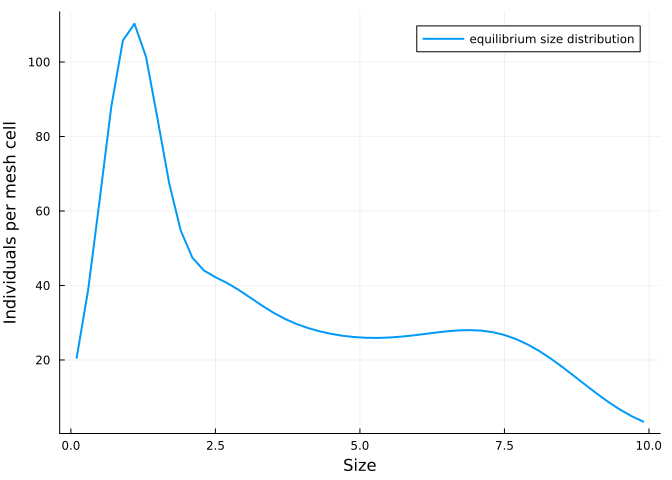
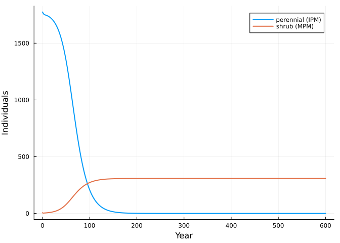
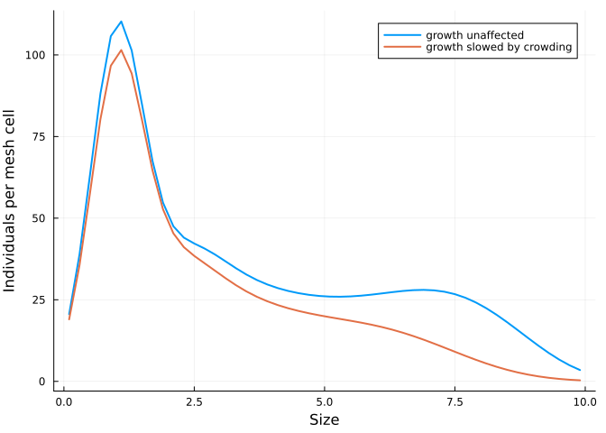

# Composing an integral projection model with a matrix model
Simon Frost

- [Beyond matrices](#beyond-matrices)
- [A stage with a continuous trait](#a-stage-with-a-continuous-trait)
- [Adding a stage-structured
  competitor](#adding-a-stage-structured-competitor)
- [Predicting the outcome without
  simulating](#predicting-the-outcome-without-simulating)
- [When a pool changes the shape of a
  kernel](#when-a-pool-changes-the-shape-of-a-kernel)
- [A stage without a trait](#a-stage-without-a-trait)
- [The mesh does not matter](#the-mesh-does-not-matter)
- [Reference](#reference)

``` julia
ENV["GKSwstype"] = "100"
using MatrixCommunityModels
using IntegralProjectionModels: PKernel, FKernel, LinearSurvival, NormalGrowth, FecundityRate
using Plots
```

## Beyond matrices

Lytle & Tonkin (2023) note that a matrix structure “is not strictly
required” for a community model: any population model with density
dependence could be linked through the same dependency assumption. An
integral projection model (IPM) describes a population structured by a
continuous trait such as size. Cut into mesh cells, the trait is a set
of stages like any other, so an IPM can be a box in the same wiring
diagram as a stage-structured species. It needs its kernels, and a
statement of how much of each pool an individual of each size occupies.

## A stage with a continuous trait

A `ContinuousStage` is a stage whose individuals differ in a trait: here
size, between 0 and 10, cut into 50 cells.

``` julia
plant = ContinuousStage(:plant, ContinuousDomain(0.0, 10.0, 50))
z = meshpoints(plant)                    # sizes at the middle of the cells
stage_names(plant)[1:3], z[1:3], step_size(plant)
```

    ([:plant1, :plant2, :plant3], [0.1, 0.30000000000000004, 0.5], 0.2)

The life cycle is written as before, as named transitions. Each
transition is now a *kernel*: a function giving the density of
individuals of size `y` next year per individual of size `x` this year.
Survival increases with size, growth is normally distributed around a
linear function of size, and seed production increases exponentially
with size.

``` julia
normal(y, mean, sd) = exp(-0.5 * ((y - mean) / sd)^2) / (sd * sqrt(2π))
survival(x) = 1 / (1 + exp(0.5 - 0.4x))
growth(y, x) = normal(y, 1.2 + 0.85x, 0.7)
seedlings(x) = 0.2 * exp(-1.0 + 0.5x)            # established seedlings per plant
seedling_size(y) = normal(y, 1.0, 0.5)

life = kernel_net(plant,
    :growing => (y, x) -> survival(x) * growth(y, x),
    :seeding => (y, x) -> seedlings(x) * seedling_size(y))
```

    ResponsiveProjectionNet(50 stages, 2 transitions, 0 responses)

`kernel_net` evaluates the kernels on the mesh and returns an ordinary
projection net with one stage per cell. Its state is the number of
individuals in each cell.

The kernels can also be those of IntegralProjectionModels.jl: a
`PKernel` of survival and growth and an `FKernel` of fecundity on the
stage’s mesh, which `kernel_net` discretises with that package’s own
`materialize`. The same vital rates built from its rate types give the
same net:

``` julia
P = PKernel(LinearSurvival(-0.5, 0.4), NormalGrowth(1.2, 0.85, 0.7), plant.domain)
F = FKernel(FecundityRate(-1.0, 0.5, 1.0, 0.5, 0.2), plant.domain)
ready_made = kernel_net(plant, :growing => P, :seeding => F)
maximum(abs, to_matrix(ready_made) - to_matrix(life))
```

    1.1102230246251565e-16

Kernels built elsewhere that arrive as matrices enter through
`matrix_net` instead.

Recruitment is limited by space, a response on the `seeding` transition,
and an individual of size `x` occupies `0.02 x²` units of space.
`trait_weights` writes a pool contribution as a function of the trait.

``` julia
K = 1000.0
crowding(ctx) = max(0.0, 1 - ctx.pool.space / K)
space_used(x) = 0.02x^2

perennial = species(:perennial, births(respond(life, :seeding => crowding), :seeding);
                    occupies = [:space => trait_weights(plant, space_used)])
```

    OpenCommunity(perennial; pools = space)

On its own the perennial grows to an equilibrium that fills about two
thirds of the space:

``` julia
n0 = zeros(50)
n0[z .< 2] .= 2.0
eq = equilibrium(perennial, n0, nothing)
(converged = eq.converged, individuals = sum(eq.n), space = pool_totals(perennial, eq.n, nothing).space)
```

    (converged = true, individuals = 1774.6585917775656, space = 676.7432286069879)

``` julia
plot(z, eq.n; xlabel = "Size", ylabel = "Individuals per mesh cell", label = "equilibrium size distribution", lw = 2)
```



## Adding a stage-structured competitor

The shrub is the three-stage matrix model of the introduction. The two
species are composed exactly as two matrix models would be. Because the
perennial has a continuous stage, `project` solves the community with
IntegralProjectionModels.jl, the shrub being a population of three
discrete classes.

``` julia
shrub_life = ValuedProjectionNet([:seedling, :juvenile, :adult],
    :establishing => [(:seedling => :juvenile) => 0.30], :maturing => [(:juvenile => :adult) => 0.50],
    :persisting => [(:adult => :adult) => 0.95], :seeding => [(:adult => :seedling) => 3.0])
shrub = species(:shrub, births(respond(shrub_life, :seeding => crowding), :seeding);
                occupies = [:space => [0.1, 1.0, 4.0]])

com = community(perennial, shrub)
sol = project(com, [eq.n; 5.0; 0.0; 1.0], fill(nothing, 600))
plot(sol.t, [abundance(sol, :perennial) abundance(sol, :shrub)];
     label = ["perennial (IPM)" "shrub (MPM)"], xlabel = "Year", ylabel = "Individuals", lw = 2)
```



The shrub invades the established perennial and slowly replaces it.

## Predicting the outcome without simulating

Each species alone settles at the level of crowding at which it just
replaces itself. The other species can invade if its growth rate at that
level of crowding exceeds one.

``` julia
seq = equilibrium(shrub, [5.0, 0.0, 1.0], nothing)
(shrub_into_perennial = invasion_growth_rate(shrub, perennial, eq.n, nothing),
 perennial_into_shrub = invasion_growth_rate(perennial, shrub, seq.n, nothing))
```

    (shrub_into_perennial = 1.0757099780692048, perennial_into_shrub = 0.9473116713958112)

The shrub can invade the perennial’s equilibrium but the perennial
cannot invade the shrub’s, which is the replacement seen in the
projection.

## When a pool changes the shape of a kernel

So far the pool only scales a kernel: crowding multiplies every entry of
`seeding` by the same number. Often a pool changes a vital rate inside
the kernel instead. Suppose plants grow more slowly as space fills, the
yearly increment halving when it is full. The growth kernel then has a
different shape at each level of crowding, and is marked `responsive`: a
function of the context that returns the kernel for that year.

``` julia
function shaded(cells)
    plant = ContinuousStage(:plant, 0.0, 10.0, cells)
    life = kernel_net(plant,
        :growing => responsive(ctx -> begin
            full = min(1.0, ctx.pool.space / K)
            (y, x) -> survival(x) * normal(y, 1.2 * (1 - 0.5 * full) + 0.85x, 0.7)
        end),
        :seeding => (y, x) -> seedlings(x) * seedling_size(y))
    sp = species(:perennial, births(respond(life, :seeding => crowding), :seeding);
                 occupies = [:space => trait_weights(plant, space_used)])
    return sp, meshpoints(plant)
end
slow, _ = shaded(50)
eq_slow = equilibrium(slow, n0, nothing)
(individuals = sum(eq_slow.n), space = pool_totals(slow, eq_slow.n, nothing).space,
 shrub_invasion_rate = invasion_growth_rate(shrub, slow, eq_slow.n, nothing))
```

    (individuals = 1359.4601953753481, space = 323.03428885487995, shrub_invasion_rate = 1.1718409976315898)

``` julia
plot(z, [eq.n eq_slow.n]; xlabel = "Size", ylabel = "Individuals per mesh cell",
     label = ["growth unaffected" "growth slowed by crowding"], lw = 2)
```



Plants now stay small, the population fills only a third of the space,
and the shrub invades faster.

## A stage without a trait

A species can mix the two kinds of stage. Give the perennial a seed
bank: a plant sheds seeds into it, a seed germinates with probability
0.2 a year and otherwise stays dormant with probability 0.5. The seed
bank is an ordinary stage, and the kernels to and from it are functions
of one size instead of two.

``` julia
banked = kernel_net([:seed, plant],
    :dormancy    => [(:seed => :seed) => 0.5],
    :germinating => [(:seed => :plant) => y -> 0.2 * seedling_size(y)],
    :growing     => [(:plant => :plant) => (y, x) -> survival(x) * growth(y, x)],
    :seeding     => [(:plant => :seed) => x -> exp(-1.0 + 0.5x)])
with_bank = species(:perennial, births(respond(banked, :germinating => crowding), :seeding);
                    occupies = [:space => trait_weights(plant, space_used)])
eq_bank = equilibrium(with_bank, [0.0; n0], nothing)
(stages = length(eq_bank.n), seeds = eq_bank.n[1], plants = sum(eq_bank.n[2:end]),
 space = pool_totals(with_bank, eq_bank.n, nothing).space)
```

    (stages = 51, seeds = 23360.778817930266, plants = 2198.505024356993, space = 838.3716143105611)

## The mesh does not matter

A pool total is an integral over the size distribution, so a finer mesh
changes the number of states but not the model. This holds for the
kernel that changes shape too.

``` julia
for cells in (50, 100, 200)
    sp, zz = shaded(cells)
    start = zeros(cells)
    start[zz .< 2] .= 20 / count(zz .< 2)
    e = equilibrium(sp, start, nothing)
    println("cells ", cells, ": individuals ", round(sum(e.n); digits = 1), ", space ",
            round(pool_totals(sp, e.n, nothing).space; digits = 1),
            ", shrub invasion rate ", round(invasion_growth_rate(shrub, sp, e.n, nothing); digits = 4))
end
```

    cells 50: individuals 1359.5, space 323.0, shrub invasion rate 1.1718
    cells 100: individuals 1358.5, space 322.9, shrub invasion rate 1.1719
    cells 200: individuals 1358.2, space 322.9, shrub invasion rate 1.1719

The [thistle
vignette](../14_thistles_and_weevil/14_thistles_and_weevil.md) uses the
same tools on a published IPM, in a community with two matrix models.

## Reference

Lytle, D. A. & Tonkin, J. D. (2023). Matrix community models for ecology
and evolution. *npj Biodiversity* 2, 26.
