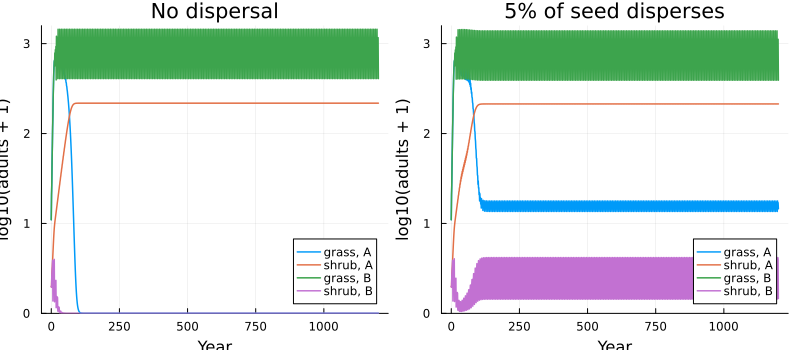
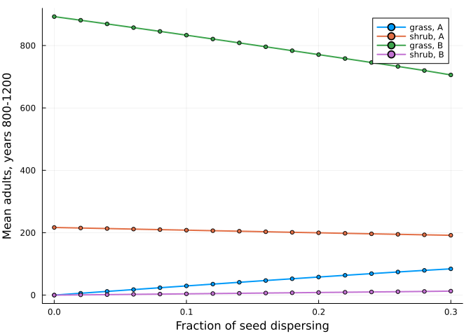

# A metacommunity by nested composition
Simon Frost

- [Why nest](#why-nest)
- [Species that export seed](#species-that-export-seed)
- [Two levels of wiring](#two-levels-of-wiring)
- [Isolated patches lose species; connected ones keep
  them](#isolated-patches-lose-species-connected-ones-keep-them)
- [Dispersal as a dial](#dispersal-as-a-dial)
- [Reference](#reference)

``` julia
ENV["GKSwstype"] = "100"
using MatrixCommunityModels
using Catlab: @relation
using Plots, Statistics
```

## Why nest

Lytle & Tonkin (2023) point out that an isolated matrix community model
tends to lose species, and that placing the habitat in a metacommunity
“deserves further attention”. Because a composed community is itself
something that can be composed, a metacommunity needs no new machinery:
patches are communities, and dispersal is one more kind of pool.

## Species that export seed

A grass and a shrub compete for space within a patch. Establishment of
seedlings is limited by the free space in that patch. A fraction `m` of
each species’ seed leaves the patch into a seed rain shared by all
patches; each of the two patches receives half of it. A species
therefore has two ports: its patch’s `space`, and its own seed rain.

Patch `B` burns periodically, which kills most shrubs and some grass.
The environment of each year says which patches burn. Each species is a
life-cycle net; the responses say that establishment needs free space
and that fire reduces survival; the seed rain arrives as an inflow.

``` julia
K = 1000.0

crowding(ctx) = max(0.0, 1 - ctx.pool.space / K)

function grass(patch; m)
    burns(ctx) = getfield(ctx.env, patch)
    life = ValuedProjectionNet([:seedling, :adult],
        :establishing => [(:seedling => :adult) => 0.30],
        :persisting => [(:adult => :adult) => 0.50],
        :seeding => [(:adult => :seedling) => 6.0 * (1 - m)])           # seed that stays in the patch
    plant = respond(life, :establishing => crowding, :persisting => ctx -> burns(ctx) ? 0.7 : 1.0)
    plant = inflow(plant, :seedling => ctx -> ctx.pool.grass_rain / 2)   # this patch's half of the seed rain
    species(Symbol(:grass_, patch), births(plant, :seeding);
            occupies = [:space => [:adult => 1.0], :grass_rain => [:adult => 6.0 * m]])
end

function shrub(patch; m)
    burns(ctx) = getfield(ctx.env, patch)
    life = ValuedProjectionNet([:seedling, :juvenile, :adult],
        :establishing => [(:seedling => :juvenile) => 0.30],
        :maturing => [(:juvenile => :adult) => 0.50],
        :persisting => [(:adult => :adult) => 0.95],
        :seeding => [(:adult => :seedling) => 3.0 * (1 - m)])
    plant = respond(life, :establishing => crowding, :maturing => ctx -> burns(ctx) ? 0.1 : 1.0,
                    :persisting => ctx -> burns(ctx) ? 0.10 / 0.95 : 1.0)
    plant = inflow(plant, :seedling => ctx -> ctx.pool.shrub_rain / 2)
    species(Symbol(:shrub_, patch), births(plant, :seeding);
            occupies = [:space => [:juvenile => 1.0, :adult => 4.0], :shrub_rain => [:adult => 3.0 * m]])
end
```

    shrub (generic function with 1 method)

## Two levels of wiring

Within a patch the two species share `space`, which stays inside the
patch, and each exposes its seed rain:

``` julia
patch_diagram = @relation (grass_rain, shrub_rain) begin
    grass(space, grass_rain)
    shrub(space, shrub_rain)
end
```

<div class="c-set">
<span class="c-set-summary">Catlab.WiringDiagrams.RelationDiagrams.UntypedUnnamedRelationDiagram{Symbol, Symbol} {Box:2, Port:4, OuterPort:2, Junction:3, Name:0, VarName:0}</span>

| Box |  name |
|----:|------:|
|   1 | grass |
|   2 | shrub |

| Port | box | junction |
|-----:|----:|---------:|
|    1 |   1 |        3 |
|    2 |   1 |        1 |
|    3 |   2 |        3 |
|    4 |   2 |        2 |

| OuterPort | outer_junction |
|----------:|---------------:|
|         1 |              1 |
|         2 |              2 |

| Junction |   variable |
|---------:|-----------:|
|        1 | grass_rain |
|        2 | shrub_rain |
|        3 |      space |

</div>

Between patches, the seed rains are joined:

``` julia
meta_diagram = @relation (grass_rain, shrub_rain) begin
    A(grass_rain, shrub_rain)
    B(grass_rain, shrub_rain)
end
```

<div class="c-set">
<span class="c-set-summary">Catlab.WiringDiagrams.RelationDiagrams.UntypedUnnamedRelationDiagram{Symbol, Symbol} {Box:2, Port:4, OuterPort:2, Junction:2, Name:0, VarName:0}</span>

| Box | name |
|----:|-----:|
|   1 |    A |
|   2 |    B |

| Port | box | junction |
|-----:|----:|---------:|
|    1 |   1 |        1 |
|    2 |   1 |        2 |
|    3 |   2 |        1 |
|    4 |   2 |        2 |

| OuterPort | outer_junction |
|----------:|---------------:|
|         1 |              1 |
|         2 |              2 |

| Junction |   variable |
|---------:|-----------:|
|        1 | grass_rain |
|        2 | shrub_rain |

</div>

``` julia
patch(p; m) = compose(patch_diagram, [grass(p; m), shrub(p; m)])
metacommunity(m) = compose(meta_diagram, [patch(:A; m), patch(:B; m)])
meta = metacommunity(0.05)
species_names(meta), pool_names(meta)
```

    ([:grass_A, :shrub_A, :grass_B, :shrub_B], [:grass_rain, :shrub_rain])

The `space` pools do not appear among the metacommunity’s pools: each
belongs to one patch and nothing outside can read it.

## Isolated patches lose species; connected ones keep them

Patch `B` burns every sixth year.

``` julia
envs = [(A = false, B = t % 6 == 0) for t in 1:1200]
n0 = [50.0, 10.0, 5.0, 0.0, 1.0, 50.0, 10.0, 5.0, 0.0, 1.0]

isolated = project(metacommunity(0.0), n0, envs)
connected = project(meta, n0, envs)

adults(sol) = [sol[:grass_A][:, 2] sol[:shrub_A][:, 3] sol[:grass_B][:, 2] sol[:shrub_B][:, 3]]
labels = ["grass, A" "shrub, A" "grass, B" "shrub, B"]
plot(plot(isolated.t, log10.(adults(isolated) .+ 1); label = labels, title = "No dispersal", lw = 1.5),
     plot(connected.t, log10.(adults(connected) .+ 1); label = labels, title = "5% of seed disperses", lw = 1.5);
     layout = (1, 2), xlabel = "Year", ylabel = "log10(adults + 1)", ylims = (0, 3.2), size = (800, 350),
     legend = :bottomright)
```



``` julia
late(sol) = round.(vec(mean(adults(sol)[801:end, :]; dims = 1)); digits = 1)
(isolated = late(isolated), connected = late(connected))
```

    (isolated = [0.0, 216.8, 892.7, 0.0], connected = [14.9, 212.5, 863.4, 2.1])

Without dispersal the shrub excludes the grass in the unburnt patch and
fire excludes the shrub in the burnt one. With 5% of seed dispersing,
each species is maintained in the patch where it would otherwise
disappear, by seed arriving from the patch where it thrives.

## Dispersal as a dial

``` julia
ms = 0.0:0.02:0.3
means = reduce(vcat, [late(project(metacommunity(m), n0, envs))' for m in ms])
plot(ms, means; label = labels, xlabel = "Fraction of seed dispersing", ylabel = "Mean adults, years 800-1200",
     lw = 2, marker = :circle, ms = 3)
```



## Reference

Lytle, D. A. & Tonkin, J. D. (2023). Matrix community models for ecology
and evolution. *npj Biodiversity* 2, 26.
