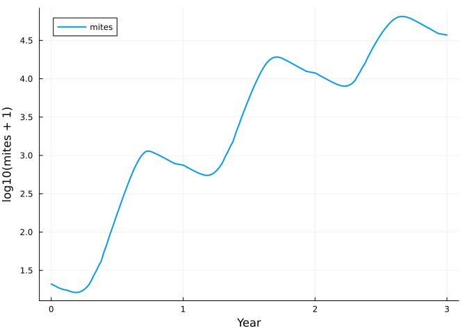
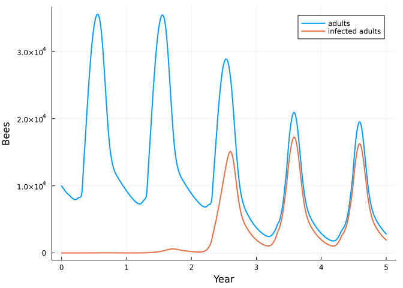
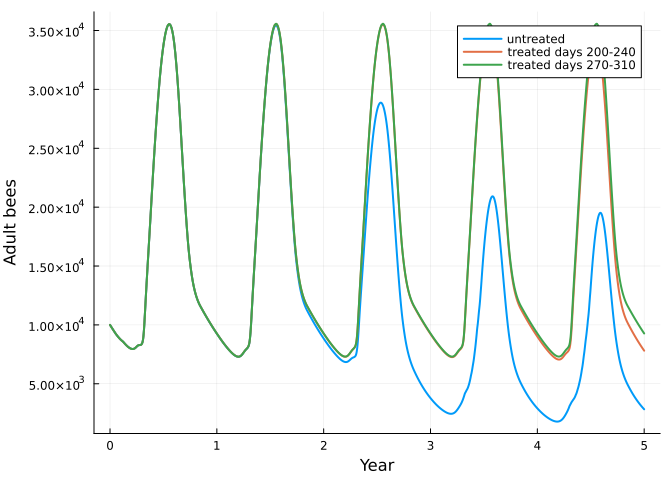

# Bees 2: Varroa mites and deformed wing virus
Simon Frost

- [Mites are a two-stage net](#mites-are-a-two-stage-net)
- [Bees and mites meet through
  pools](#bees-and-mites-meet-through-pools)
- [The virus is a stratum](#the-virus-is-a-stratum)
- [Treatment, and its timing](#treatment-and-its-timing)
- [What is provisional](#what-is-provisional)
- [References](#references)

``` julia
ENV["GKSwstype"] = "100"
using MatrixCommunityModels
using Plots
```

The [previous vignette](../10_honeybee_colony/10_honeybee_colony.md)
built a honey bee colony. This one adds the mite *Varroa destructor* as
a second species, and then deformed wing virus (DWV) as a second
*stratum* of both species.

## Mites are a two-stage net

A mite is either on an adult bee (`phoretic`) or in a capped brood cell,
where it stays for the 12 days until the bee emerges and then leaves
with its daughters.

``` julia
q = VARROA_PARAMETERS
mite_life = ValuedProjectionNet([:phoretic, :cell],
    :waiting   => [(:phoretic => :phoretic) => 1.0],
    :invading  => [(:phoretic => :cell) => 1.0],
    :leaving   => [(:cell => :phoretic) => 1 - q.emergence_loss],
    :daughters => [(:cell => :phoretic) => q.offspring * (1 - q.emergence_loss)])
stage_names(expand_stage(mite_life, :cell, 12))
```

    13-element Vector{Symbol}:
     :phoretic
     :cell1
     :cell2
     :cell3
     :cell4
     :cell5
     :cell6
     :cell7
     :cell8
     :cell9
     :cell10
     :cell11
     :cell12

`varroa()` is this net with three responses. The important one is
`invading`: the fraction of phoretic mites entering cells each day
depends on how many cells are being capped and how many adult bees there
are, `1 - exp(-0.56 × cells capped / grams of adult bees)` (Boot et
al. 1995; Calis et al. 1999).

## Bees and mites meet through pools

The mite never refers to the bee, or the bee to the mite. The bee
reports three numbers as pools, and the mite reads them.

``` julia
c = community(honeybee(), varroa())
pool_names(c)
```

    4-element Vector{Symbol}:
     :adult_bees
     :capping
     :emerging
     :phoretic

`capping` is the number of larvae about to be capped, `adult_bees` the
number of adults, `emerging` the number of pupae about to emerge, and
`phoretic` the number of mites on adults.

``` julia
sol = project(c, honeybee_state(c; mites = 20), 1:(365 * 3))
years = sol.t ./ 365
mites = abundance(sol, :varroa)
adults(s) = stage_total(s, :honeybee, [:hive, :forager])
plot(years, log10.(mites .+ 1); label = "mites", xlabel = "Year", ylabel = "log10(mites + 1)", lw = 2)
```



``` julia
(growth_per_day = round(log(mites[211] / mites[151]) / 60; digits = 4), fold_in_first_year = round(mites[366] / 20; digits = 1))
```

    (growth_per_day = 0.0193, fold_in_first_year = 16.6)

Martin (1998) reports 0.021 per day while there is brood and a 12-fold
increase a year; the proportion of mites lost at emergence was set to
bring the model close to that. Drone brood, which mites prefer and in
which they produce more daughters, is not modelled.

In this model mites alone do not harm the bees, following BEEHAVE, in
which all damage comes through viruses:

``` julia
alone = project(honeybee(), honeybee_state(honeybee()), 1:(365 * 3))
maximum(abs.(adults(sol) .- adults(alone)))
```

    0.0

## The virus is a stratum

DWV divides bees and mites into those without and with the virus. That
is a stratification of each life cycle, not a new model: every stage and
transition is replicated, and a *coupling* says which transitions can
cross from one stratum to the other.

``` julia
healthy_only = honeybee()
with_virus = honeybee(virus = true)
length(stage_names(healthy_only, :honeybee)), length(stage_names(with_virus, :honeybee))
```

    (24, 46)

``` julia
filter(t -> occursin("_to_", String(t)), transition_names(system(with_virus)[:honeybee]))
```

    4-element Vector{Symbol}:
     :capping_healthy_to_infected
     :foraging_healthy_to_infected
     :hive_life_healthy_to_infected
     :recruiting_healthy_to_infected

A larva crosses at capping, if a mite carrying the virus enters its
cell; adults could also cross by mouth (used in the last vignette). The
responses that differ for infected bees are attached to the transitions
of the infected stratum: a fifth of infected pupae die or emerge
deformed, and infected adults die three times as fast in the hive. Mites
are stratified the same way (`clean`, `viral`): a clean mite becomes
viral by sharing a cell with an infected pupa or by feeding on infected
adults, and stays viral.

``` julia
function colony(; treatment = day -> 0.0, years = 5)
    c = community(honeybee(virus = true), varroa(virus = true, treatment = treatment))
    project(c, honeybee_state(c; mites = 20, viral = 0.1), 1:(365 * years))
end
untreated = colony()
infected(s) = stage_total(s, :honeybee, [:hive_infected, :forager_infected])
plot(untreated.t ./ 365, [adults(untreated) infected(untreated)]; label = ["adults" "infected adults"],
     xlabel = "Year", ylabel = "Bees", lw = 2)
```



For two years little happens. In the third autumn, when mites are
numerous and brood is scarce, most of the bees that will form the winter
cluster are infected as pupae. They die early, and the colony goes into
each following winter with a few thousand bees.

``` julia
winters = 365 .* (1:5) .+ 1
[(year = y, adults = round(Int, adults(untreated)[w]), mites_per_100_bees = round(100 * stage_total(untreated, :varroa, :phoretic)[w] / adults(untreated)[w]; digits = 1),
  infected = round(infected(untreated)[w] / adults(untreated)[w]; digits = 2)) for (y, w) in enumerate(winters)]
```

    5-element Vector{@NamedTuple{year::Int64, adults::Int64, mites_per_100_bees::Float64, infected::Float64}}:
     (year = 1, adults = 9255, mites_per_100_bees = 3.6, infected = 0.0)
     (year = 2, adults = 8557, mites_per_100_bees = 64.9, infected = 0.04)
     (year = 3, adults = 3772, mites_per_100_bees = 706.9, infected = 0.52)
     (year = 4, adults = 3366, mites_per_100_bees = 758.2, infected = 0.56)
     (year = 5, adults = 3368, mites_per_100_bees = 738.2, infected = 0.56)

A colony of fewer than about 4,000 bees is usually taken not to survive
the winter (BEEHAVE; Kielmanowicz et al. 2015), so this colony is
effectively lost in its third or fourth winter. Field studies put the
autumn load of colonies that died at about 15 mites per 100 bees against
3 in survivors (Genersch et al. 2010).

## Treatment, and its timing

A treatment is an extra mortality of phoretic mites over a window of
days. Two windows of 40 days, each year:

``` julia
late = colony(treatment = day -> 270 <= day < 310 ? 0.115 : 0.0)
early = colony(treatment = day -> 200 <= day < 240 ? 0.115 : 0.0)
plot(untreated.t ./ 365, [adults(untreated) adults(early) adults(late)];
     label = ["untreated" "treated days 200-240" "treated days 270-310"], xlabel = "Year", ylabel = "Adult bees", lw = 2)
```



``` julia
[(treatment = name, winter_5_adults = round(Int, adults(s)[winters[5]]), mites = round(Int, abundance(s, :varroa)[winters[5]]))
 for (name, s) in (("none", untreated), ("days 200-240", early), ("days 270-310", late))]
```

    3-element Vector{@NamedTuple{treatment::String, winter_5_adults::Int64, mites::Int64}}:
     (treatment = "none", winter_5_adults = 3368, mites = 24870)
     (treatment = "days 200-240", winter_5_adults = 6049, mites = 5487)
     (treatment = "days 270-310", winter_5_adults = 9272, mites = 0)

Treating in October, when there is no brood for the mites to hide in,
removes nearly all of them and keeps the colony healthy. The same
treatment in late July and August kills only the mites on adults at the
time; those in cells survive it, and the population recovers enough to
cause damage within a few years. (Field advice is to treat before the
winter bees are reared; in this model the absence of brood matters more,
which may reflect its lack of drone brood and of mites arriving from
other colonies.)

## What is provisional

The mite and virus parameters are taken from Martin (1998, 2001) and
BEEHAVE as summarised in reviews; the primary papers were not available
when this was written, and only the mite growth rate was checked against
the original abstract. They are listed in `VARROA_PARAMETERS` and
`HONEYBEE_PARAMETERS`. The rate at which mites acquire virus from adult
bees, and the effect of several mites sharing a cell, are assumptions.

## References

Martin, S. J. (1998). *Ecological Modelling* 109, 267-281; (2001)
*Journal of Applied Ecology* 38, 1082-1093. Becher, M. A. et al. (2014).
*Journal of Applied Ecology* 51, 470-482. Genersch, E. et al. (2010).
*Apidologie* 41, 332-352.
