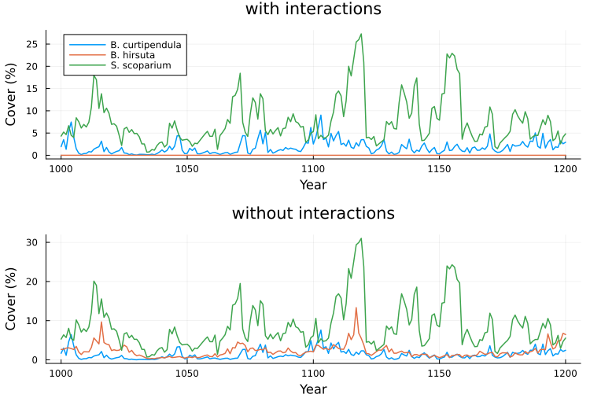

# Five grasslands: crowding, coexistence and synchrony
Simon Frost

- [Mapped quadrats at five sites](#mapped-quadrats-at-five-sites)
- [The Kansas prairie](#the-kansas-prairie)
- [The check against the authors’
  code](#the-check-against-the-authors-code)
- [The mean year: coexistence](#the-mean-year-coexistence)
- [Years that differ](#years-that-differ)
- [All five sites](#all-five-sites)
- [The comparison with the authors’ code and the
  papers](#the-comparison-with-the-authors-code-and-the-papers)
- [What is measured and what is
  assumed](#what-is-measured-and-what-is-assumed)
- [Where the model and its sources
  part](#where-the-model-and-its-sources-part)
- [Sources](#sources)
- [References](#references)

``` julia
ENV["GKSwstype"] = "100"
using MatrixCommunityModels
using LinearAlgebra, Printf, Random, Statistics
using Plots
BLAS.set_num_threads(1)
```

## Mapped quadrats at five sites

In the first half of the twentieth century every plant in sets of
permanent quadrats of one square metre was mapped each year at five
rangeland stations of the western United States. Chu & Adler (2015)
fitted multispecies integral projection models (IPMs) for the dominant
perennials of each site, and asked how strongly the species limit
themselves compared with one another. Tredennick et al. (2017) ran the
same models to ask why the species rise and fall together, or do not.

| Site | Community | Years mapped | Species |
|----|----|----|----|
| Arizona | Sonoran desert | 1915-1933 | *Bouteloua eriopoda*, *B. rothrockii* |
| Idaho | sagebrush steppe | 1926-1957 | *Artemisia tripartita*, *Hesperostipa comata*, *Poa secunda*, *Pseudoroegneria spicata* |
| Kansas | southern mixed prairie | 1932-1972 | *Bouteloua curtipendula*, *B. hirsuta*, *Schizachyrium scoparium* |
| Montana | northern mixed prairie | 1926-1957 | *Bouteloua gracilis*, *Hesperostipa comata*, *Pascopyrum smithii*, *Poa secunda* |
| New Mexico | Chihuahuan desert | 1915-1950 | *Bouteloua eriopoda*, *Sporobolus flexuosus* |

(Tredennick et al. 2017, Table 1.) The models of the five sites have the
form of the sagebrush steppe model of vignette 17, [Four perennials of
the sagebrush steppe](../17_sagebrush_steppe/17_sagebrush_steppe.md).
Genets are structured by the logarithm of their basal area. Their growth
and survival depend on how crowded they are by neighbours of each
species, and a species’ recruits on the cover of each species. Each year
of the data has its own effects. Only the parameters differ from site to
site. A site’s species are therefore `sagebrush_plant`s built with that
site’s parameters, `GRASSLAND_PARAMETERS`, and they meet through the
same cover pools:

``` julia
for (site, p) in pairs(GRASSLAND_PARAMETERS)
    years = length(first(p).recruitment.intercept_year)
    println(rpad(String(site), 10), join([string(k, " (", p[k].name, ", ", p[k].cells, " cells)") for k in keys(p)], ", "),
            "; ", years, " years of effects")
end
```

    arizona   boer (Bouteloua eriopoda, 50 cells), boro (Bouteloua rothrockii, 50 cells); 18 years of effects
    idaho     artr (Artemisia tripartita, 50 cells), heco (Hesperostipa comata, 75 cells), pose (Poa secunda, 50 cells), pssp (Pseudoroegneria spicata, 50 cells); 22 years of effects
    kansas    bocu (Bouteloua curtipendula, 75 cells), bohi (Bouteloua hirsuta, 50 cells), scsc (Schizachyrium scoparium, 75 cells); 34 years of effects
    montana   bogr (Bouteloua gracilis, 75 cells), heco (Hesperostipa comata, 50 cells), pasm (Pascopyrum smithii, 5 cells), pose (Poa secunda, 50 cells); 13 years of effects
    newmexico boer (Bouteloua eriopoda, 50 cells), spfl (Sporobolus flexuosus, 50 cells); 32 years of effects

The parameters were written out from the authors’ repository
(`data/grasslands`; see its `LICENSE.txt`). This vignette looks most
closely at Kansas, checks it against the authors’ simulation code run in
R (`test/reference/R/run_grassland_reference.R`), and then runs all five
sites.

## The Kansas prairie

Three grasses dominate the mapped quadrats at Hays, Kansas: side-oats
grama (*Bouteloua curtipendula*, `bocu`), hairy grama (*B. hirsuta*,
`bohi`) and little bluestem (*Schizachyrium scoparium*, `scsc`).

``` julia
kinds = (:bocu, :bohi, :scsc)
names = Dict(:bocu => "B. curtipendula", :bohi => "B. hirsuta", :scsc => "S. scoparium")
kansas = grassland_community(:kansas)
(species = species_names(kansas), pools = pool_names(kansas), states = length(kansas))
```

    (species = [:bocu, :bohi, :scsc], pools = [:bocu_cover, :bohi_cover, :scsc_cover], states = 200)

The interaction coefficients, effect of the column species on the row
species:

``` julia
function show_matrix(label, rows)
    println(label)
    println("          ", join(rpad.(String.(kinds), 10)))
    for (k, row) in zip(kinds, rows)
        println(rpad("  " * String(k), 10), join([@sprintf("%-10.4f", x) for x in row]))
    end
end
k = GRASSLAND_PARAMETERS.kansas
show_matrix("growth", [k[s].growth.crowding for s in kinds])
show_matrix("survival (logit scale)", [k[s].survival.crowding for s in kinds])
show_matrix("recruitment", [k[s].recruitment.crowding for s in kinds])
```

    growth
              bocu      bohi      scsc      
      bocu    -0.0017   0.0011    0.0010    
      bohi    0.0002    -0.0046   -0.0078   
      scsc    -0.0003   0.0007    -0.0124   
    survival (logit scale)
              bocu      bohi      scsc      
      bocu    -0.1084   0.0006    0.0010    
      bohi    0.0021    -0.0403   -0.0153   
      scsc    -0.0064   -0.0066   -0.0271   
    recruitment
              bocu      bohi      scsc      
      bocu    -1.1544   0.3410    0.0619    
      bohi    -0.0312   -0.8681   -0.0336   
      scsc    -0.0643   0.0041    -0.9611   

These are the values printed in Tredennick et al. (2017, Tables S11-S13)
to the four decimals given. Table S13, for recruitment, is printed the
other way round, with the species that has the effect in the rows; the
orientation used here is the one the authors’ code uses and the paper’s
text describes (the shrub of Idaho facilitates the grasses). In
recruitment and survival each species is limited more by itself than by
the others, in recruitment by far. In growth, hairy grama has a larger
coefficient for little bluestem than for itself; but the coefficients of
growth and survival multiply crowding measured on a spatial scale that
differs by neighbour species, so within a row they are not directly
comparable (see vignette 17). A few coefficients are positive. Chu &
Adler (2015, Appendix H) set positive coefficients to zero and refitted,
so their published values differ: for example $-1.3009$ against
$-1.1544$ for side-oats grama on itself in recruitment, and $-0.1201$
against $-0.0312$ for the effect of side-oats grama on hairy grama. The
model here is that of Tredennick et al. (2017).

## The check against the authors’ code

The reference script sources the authors’ own simulation routine
(`run_ipm_source.R`) with the Kansas parameters, and runs it for 30 mean
years and for 30 years of the authors’ sequence of drawn years, with and
without interspecific interactions. It also runs 500 mean years. The
mean year is the authors’ own constant environment: year effects set to
zero, recruitment at its mean intercept. All runs start, as theirs do,
at 0.001 genets per m² per unit of log area in every cell.

``` julia
reference(file) = [split(l, ",") for l in readlines(joinpath(pkgdir(MatrixCommunityModels), "test", "reference", file))[2:end]]
number(x) = parse(Float64, x)
cover(c, n) = [getproperty(pool_totals(c, n, nothing), Symbol(s, :_cover)) for s in kinds]
covers(c, sol) = reduce(vcat, permutedims(cover(c, row)) for row in eachrow(sol.u))
drawn_years = [parse(Int, r[2]) for r in reference("grassland_kansas_years.csv")]
start(c) = state_vector(c, (s => grassland_state(:kansas, s) for s in kinds)...)
runs = reference("grassland_kansas_runs.csv")
println("run                     largest relative difference in cover")
for (run, inter, drawn) in (("mean_30", true, false), ("mean_30_nointer", false, false), ("years_30", true, true),
                            ("years_30_nointer", false, true), ("mean_500", true, false), ("mean_500_nointer", false, false))
    c = grassland_community(:kansas; interactions = inter)
    rows = [r for r in runs if r[1] == run]
    T = length(rows) - 1
    sol = project(c, start(c), drawn ? drawn_years[2:(T + 1)] : fill(nothing, T))
    worst = maximum(maximum(abs.(cover(c, sol.u[parse(Int, r[2]) + 1, :]) ./ number.(r[3:5]) .- 1)) for r in rows)
    @printf("%-22s  %.1e\n", run, worst)
end
```

    run                     largest relative difference in cover
    mean_30                 8.9e-09
    mean_30_nointer         7.4e-09
    years_30                9.7e-09
    years_30_nointer        1.2e-08
    mean_500                1.5e-08
    mean_500_nointer        9.9e-08

The differences come from the crowding by conspecifics, which the
authors integrate with R’s `integrate` at its default tolerance (see
vignette 17).

## The mean year: coexistence

In the mean year the three grasses settle to an equilibrium. Each
species, when rare, should increase in the community of the other two if
the three coexist. The residents are run for 500 mean years and then
brought to equilibrium with `equilibrium`; the invader’s growth rate is
that of its frozen kernel there (`invasion_growth_rate`).

``` julia
function invasion(k; interactions = true)
    others = Tuple(x for x in kinds if x != k)
    resident = grassland_community(:kansas; kinds = others, interactions)
    n0 = state_vector(resident, (x => grassland_state(:kansas, x) for x in others)...)
    n = project(resident, n0, fill(nothing, 500)).u[end, :]
    eq = equilibrium(resident, n, nothing; tol = 1e-9, maxiter = 5000)
    eq.converged || @warn "residents without $k did not settle"
    return invasion_growth_rate(grassland_plant(:kansas, k; interactions), resident, eq.n, nothing)
end
together = project(kansas, start(kansas), fill(nothing, 500))
println("species            cover at year 500 (%)   growth rate when rare   without interactions")
for (j, s) in enumerate(kinds)
    @printf("%-17s  %20.4f   %21.4f   %20.4f\n", names[s], 100 * cover(kansas, together.u[end, :])[j], invasion(s),
            invasion(s; interactions = false))
end
```

    species            cover at year 500 (%)   growth rate when rare   without interactions
    B. curtipendula                  1.7180                  1.6060                 1.3830
    B. hirsuta                       0.4682                  1.0923                 1.2117
    S. scoparium                     5.3648                  1.4386                 1.4863

## Years that differ

Tredennick et al. (2017) ran each site for 2500 years, a year drawn at
random from those of the data for each step, discarded the first 500,
and measured the synchrony of the species’ yearly per capita growth
rates, $\log(C_{t+1}/C_t)$ for cover $C$. Synchrony (Loreau & de
Mazancourt 2008) is the variance of the summed growth rates divided by
the square of the sum of their standard deviations: 1 when the species
move in step, near 0 when they compensate one another. The years drawn
by the authors are kept in their repository, with the covers of their
last 2000 years, with and without interspecific interactions. The same
years are run here:

``` julia
saved = reference("grassland_kansas_saved.csv")
long = Dict{Bool, Matrix{Float64}}()
for (run, inter) in (("ENVINTER", true), ("ENVNOINTER", false))
    c = grassland_community(:kansas; interactions = inter)
    C = covers(c, project(c, start(c), drawn_years[2:2500]))
    long[inter] = C
    theirs = [(parse(Int, r[2]), number.(r[3:5])) for r in saved if r[1] == run]
    worst = maximum(maximum(abs.(C[year, :] ./ x .- 1)) for (year, x) in theirs)
    @printf("%-11s largest relative difference from the authors' saved covers, years 501 to 2500: %.1e\n", run, worst)
end
plot(; xlabel = "Year", ylabel = "Cover (%)", legend = :topleft, layout = (2, 1), size = (750, 520))
for (j, s) in enumerate(kinds)
    plot!(1000:1200, 100 .* long[true][1001:1201, j]; subplot = 1, color = j, lw = 1.5, label = names[s], title = "with interactions")
    plot!(1000:1200, 100 .* long[false][1001:1201, j]; subplot = 2, color = j, lw = 1.5, label = "", title = "without interactions")
end
plot!()
```

    ENVINTER    largest relative difference from the authors' saved covers, years 501 to 2500: 3.5e-07
    ENVNOINTER  largest relative difference from the authors' saved covers, years 501 to 2500: 2.9e-07



``` julia
growth_rates(C) = log.(C[2:end, :] ./ C[1:(end - 1), :])
function window_synchrony(C; windows = 100, length = 50, rng = Xoshiro(1))
    S = C[501:end, :]
    return mean(begin
        b = rand(rng, 1:(size(S, 1) - length))
        synchrony(growth_rates(S[b:(b + length), :]))
    end for _ in 1:windows)
end
for inter in (true, false)
    C = long[inter]
    @printf("%-22s synchrony of growth rates: %.3f over 2000 years, %.3f over 50-year windows; mean cover (%%) %s\n",
            inter ? "with interactions" : "without interactions", synchrony(growth_rates(C[501:end, :])), window_synchrony(C),
            join([@sprintf("%.3f", x) for x in 100 .* vec(mean(C[501:end, :]; dims = 1))], ", "))
end
```

    with interactions      synchrony of growth rates: 0.611 over 2000 years, 0.614 over 50-year windows; mean cover (%) 2.183, 0.034, 8.924
    without interactions   synchrony of growth rates: 0.618 over 2000 years, 0.619 over 50-year windows; mean cover (%) 1.557, 2.477, 10.010

The paper reports a simulated synchrony of 0.62 for Kansas without
interactions or demographic noise (Table S1, $\phi_{R,\mathcal{M}_E}$),
and an observed synchrony of 0.54 in the quadrats (Table 2). The windows
follow the authors’ script for the figures of the paper: 100 windows of
50 years at random, here drawn with `Xoshiro(1)`.

With interactions, hairy grama stays far rarer than without them, on
average a seventieth of its cover without interactions. In the mean year
it is the weakest invader (above), yet it still increases when rare.
Whether it increases when rare in drawn years is measured by the
long-run growth rate of a rare invader (`stochastic_invasion_rate`, the
geometric mean of its yearly growth). The residents start at their
mean-year equilibrium and run through the first 1000 of the authors’
years; the first 100 are left out.

``` julia
println("invader            growth rate when rare: mean year   drawn years")
for s in kinds
    others = Tuple(x for x in kinds if x != s)
    resident = grassland_community(:kansas; kinds = others)
    n0 = state_vector(resident, (x => grassland_state(:kansas, x) for x in others)...)
    n = equilibrium(resident, project(resident, n0, fill(nothing, 500)).u[end, :], nothing; tol = 1e-9, maxiter = 5000).n
    @printf("%-17s  %30.4f   %11.4f\n", names[s], invasion(s),
            stochastic_invasion_rate(grassland_plant(:kansas, s), resident, n, drawn_years[2:1001]; burnin = 100))
end
```

    invader            growth rate when rare: mean year   drawn years
    B. curtipendula                            1.6060        1.5974
    B. hirsuta                                 1.0923        0.9851
    S. scoparium                               1.4386        1.6291

Over these years the long-run growth rate of hairy grama when rare falls
just below one, although it is above one in the mean year: years that
differ work against it. The rate over 900 years is not a settled value,
though. In the authors’ own run with interactions the cover of hairy
grama falls to $10^{-14}$ of the ground by year 939, and climbs back to
0.8% by year 1646 (`grassland_kansas_saved.csv`). An IPM keeps a species
at any cover, however small, so it can recover from such a fall; mapped
quadrats would have lost it. Chu & Adler (2015) found every species able
to invade at every site; their fits are different (no positive
coefficients), and their invasion analysis was not read here.

Removing interactions changes synchrony little, as the paper found.

## All five sites

The same experiment at every site, without interspecific interactions
(the setting of Table S1 of the paper), with 2500 years drawn with
`Xoshiro(2017)` rather than the authors’ sequences, which are kept in
their repository but not copied here:

``` julia
published = Dict(:newmexico => 0.86, :arizona => 0.81, :kansas => 0.62, :montana => 0.50, :idaho => 0.42)
println("site        synchrony here   Tredennick et al. (2017), Table S1")
for site in (:newmexico, :arizona, :kansas, :montana, :idaho)
    ks = keys(GRASSLAND_PARAMETERS[site])
    years = length(first(GRASSLAND_PARAMETERS[site]).recruitment.intercept_year)
    c = grassland_community(site; interactions = false)
    n0 = state_vector(c, (s => grassland_state(site, s) for s in ks)...)
    sol = project(c, n0, rand(Xoshiro(2017), 1:years, 2499))
    C = reduce(vcat, permutedims([getproperty(pool_totals(c, row, nothing), Symbol(s, :_cover)) for s in ks]) for row in eachrow(sol.u))
    @printf("%-10s  %14.3f   %8.2f\n", site, synchrony(growth_rates(C[501:end, :])), published[site])
end
```

    site        synchrony here   Tredennick et al. (2017), Table S1
    newmexico            0.842       0.86
    arizona              0.820       0.81
    kansas               0.623       0.62
    montana              0.478       0.50
    idaho                0.411       0.42

The order of the sites, from the most synchronous deserts to the least
synchronous sagebrush steppe, is that of the paper.

## The comparison with the authors’ code and the papers

| Check | Agreement |
|----|----|
| Kansas interaction coefficients against Tredennick et al. (2017, Tables S11-S13), 27 values | equal to the four decimals printed |
| Kansas, 30 mean years and 30 drawn years, with and without interactions, against the authors’ code | relative difference in cover below 2e-8 |
| Kansas, 500 mean years, with and without interactions | relative difference in cover below 1e-7 |
| Each Kansas species invades the other two in the mean year | yes, growth rates 1.09 to 1.61 (1.21 to 1.49 without interactions) |
| Hairy grama invades in drawn years (900 of the authors’ years) | no, 0.985; not a settled value (see above) |
| Kansas, the authors’ saved 2000-year runs, with and without interactions | relative difference in cover below 4e-7 |
| Kansas synchrony of growth rates without interactions (Table S1: 0.62) | 0.62 |
| Order of the five sites by synchrony (Table S1) | the same |
| Interaction coefficients of Chu & Adler (2015, Appendix H) | differ: they set positive coefficients to zero and refitted |

## What is measured and what is assumed

| Quantity | Source |
|----|----|
| Growth, survival and recruitment, as functions of size, crowding and cover, with year effects | fitted by the authors to the mapped quadrats (Chu & Adler 2015; the fits of Tredennick et al. 2017) |
| Interaction coefficients | those fits, which keep positive coefficients |
| Spatial scale of crowding (`alpha`), by neighbour | the authors’ repository (`data/alpha_list_*.csv`) |
| Size of recruits | mean and variance of the log area of observed recruits, computed as the authors’ code does |
| Mesh: cells and largest genet, by species | the authors’ simulation script (“taken from Chu and Adler 2015”) |
| The mean year | the authors’ constant environment |
| Removal of interspecific interactions | as the authors do: off-diagonal coefficients set to zero |
| Sequences of drawn years | the authors’ for Kansas; `Xoshiro(2017)` for the comparison of sites |

## Where the model and its sources part

- The parameters are not those printed by Chu & Adler (2015): Tredennick
  et al. (2017) refitted the models keeping positive interactions, and
  their repository holds those fits. The Idaho set here is theirs too,
  and differs from that of IPMdoit used in vignette 17 (for example in
  the recruitment coefficients and in the mesh of the shrub).
- The paper’s synchrony values come from runs of individual-based models
  as well as IPMs; only the IPM runs (no demographic noise) are
  reproduced here.
- The data of Chu & Adler (2015) on Dryad (CC0) could not be downloaded:
  the file needs a login. The parameters were taken from the authors’
  GitHub repository, whose DESCRIPTION says “License: MIT” but which has
  no LICENSE file.
- The comparison of sites uses its own drawn years. Synchrony over 2000
  years varies little with the sequence, but the values for sites other
  than Kansas are not the authors’ runs.

## Sources

Read in full: the R code of the authors’ repository that builds and runs
the IPMs (the formatting of parameters, the kernel and vital-rate
functions, the crowding subroutines, `run_ipm_simulations.R`,
`run_ipm_source.R`, and the synchrony functions and the script of the
figures), and the supporting information of Tredennick et al. (2017),
from the authors’ copy in the repository (Tables S1 to S17). Tredennick
et al. (2017) was read in part, from its open text in PubMed Central
(abstract, methods, results, discussion, Tables 1 and 2). Of Chu & Adler
(2015), Appendix H (on Ecological Archives) and the abstract were read;
the paper is behind the publisher’s paywall.

## References

Chu, C. & Adler, P. B. (2015). Large niche differences emerge at the
recruitment stage to stabilize grassland coexistence. *Ecological
Monographs* 85, 373-392. <https://doi.org/10.1890/14-1741.1>

Chu, C. & Adler, P. B. (2015). Data from: Large niche differences emerge
at the recruitment stage to stabilize grassland coexistence. Dryad
(CC0). <https://doi.org/10.5061/dryad.37n6f>

Loreau, M. & de Mazancourt, C. (2008). Species synchrony and its
drivers: neutral and nonneutral community dynamics in fluctuating
environments. *The American Naturalist* 172, E48-E66.

Tredennick, A. T., de Mazancourt, C., Loreau, M. & Adler, P. B. (2017).
Environmental responses, not species interactions, determine synchrony
of dominant species in semiarid grasslands. *Ecology* 98, 971-981.
<https://doi.org/10.1002/ecy.1757>

Tredennick, A. T. (2017). community_synchrony: code and data for
Tredennick et al. (2017), commit d01b584. GitHub.
<https://github.com/atredennick/community_synchrony>
