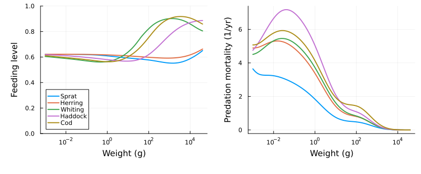
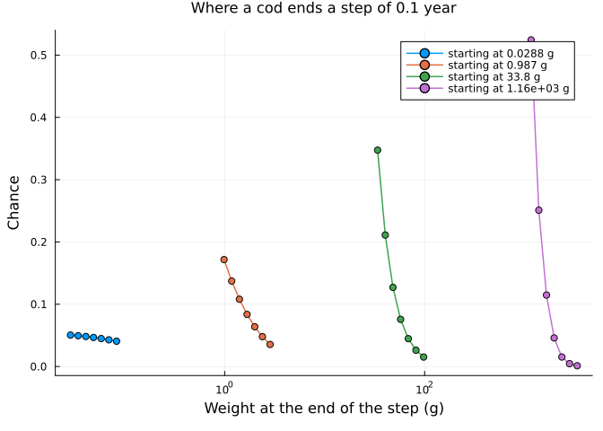
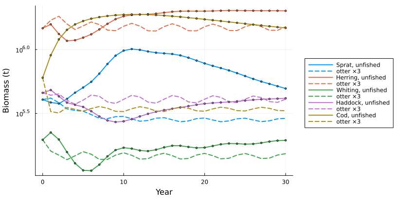
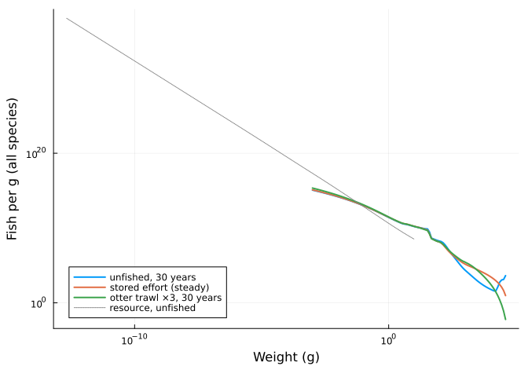

# A size-spectrum fish community: the mizer model as projection nets
Simon Frost

- [Fish by weight, eating by size](#fish-by-weight-eating-by-size)
- [What a fish does in a year](#what-a-fish-does-in-a-year)
- [mizer’s step as a projection
  matrix](#mizers-step-as-a-projection-matrix)
- [Pools with a value for each predator
  class](#pools-with-a-value-for-each-predator-class)
- [Comparison with mizer](#comparison-with-mizer)
  - [Runs](#runs)
- [Fishing and the size spectrum](#fishing-and-the-size-spectrum)
- [What cannot be written this way, and what was
  not](#what-cannot-be-written-this-way-and-what-was-not)
- [Comparison with LeMans](#comparison-with-lemans)
- [What is measured and what is
  assumed](#what-is-measured-and-what-is-assumed)
- [Where this model and its sources
  part](#where-this-model-and-its-sources-part)
- [Sources read](#sources-read)
- [References](#references)

``` julia
ENV["GKSwstype"] = "100"
using MatrixCommunityModels
using LinearAlgebra, Printf
using Plots
BLAS.set_num_threads(1)
```

## Fish by weight, eating by size

In a size-spectrum model every fish is described by its species and its
weight, and what it eats is set by size: a predator eats prey about a
hundredth of its weight, whatever their species, as far as an
interaction matrix allows. How fast a fish grows depends on how much it
finds to eat, and how fast it dies on how many larger fish are hunting.
The R package mizer (Scott, Blanchard & Andersen 2014) solves such
models for many species and a background resource of plankton, and ships
a North Sea model of 12 species (`NS_params`, after Blanchard et
al. 2014).

This vignette writes that model as projection nets, one per species and
one for the resource, joined by pools, and checks it against mizer 3.4.0
run in R on its own data (`test/reference/R/run_mizer_reference.R`). The
equations, defaults and the order of operations were read from mizer’s R
and C++ source. The [LeMans
vignette](../18_north_sea_lemans/18_north_sea_lemans.md) built another
North Sea model in which fish are counted by length; the two are
compared at the end.

``` julia
p = mizer_parameters()
d = MIZER_NORTH_SEA
println("species   w_max (g)   w_mat (g)   β (PPMR)   σ    R_max (1/yr)   fleet")
for (i, sp) in enumerate(p.species)
    @printf("%-8s %10.1f  %10.1f  %9.0f  %4.1f  %12.3g   %s\n", d.names[i], d.w_max[i], d.w_mat[i], d.beta[i],
            d.sigma[i], d.R_max[i], d.gear[i])
end
@printf("fish classes %d (%.3g g to %.4g g), all classes %d (from %.3g g), time step %.1f year\n",
        length(p.w), p.w[1], p.w[end], length(p.w_full), p.w_full[1], p.dt)
```

    species   w_max (g)   w_mat (g)   β (PPMR)   σ    R_max (1/yr)   fleet
    Sprat          33.0        13.0      51076   0.8      7.38e+11   industrial
    Sandeel        36.0         4.0     398849   1.9       4.1e+11   industrial
    N.pout        100.0        23.0         22   1.5      1.05e+13   industrial
    Herring       334.0        99.0     280540   3.2      1.11e+12   pelagic
    Dab           324.0        21.0        191   1.9      1.12e+10   beam
    Whiting      1192.0        75.0         22   1.5      5.48e+11   otter
    Sole          866.0        78.0        381   1.9      3.87e+10   beam
    Gurnard       668.0        39.0        283   1.8      1.65e+12   otter
    Plaice       2976.0       105.0        113   1.6      4.08e+14   beam
    Haddock      4316.5       165.0        558   2.1      1.84e+12   otter
    Cod         39851.3      1606.0         66   1.3      8.26e+09   otter
    Saithe      39658.6      1076.0         40   1.1      1.12e+11   otter
    fish classes 100 (0.001 g to 3.985e+04 g), all classes 226 (from 2.12e-13 g), time step 0.1 year

Weight classes are equally spaced in log weight: 100 for the fish, from
the egg weight of 1 mg to the largest asymptotic weight (cod and saithe,
40 kg), and 126 more below them that only the resource occupies. Every
species uses all 100 fish classes; fish do not grow beyond their maximum
weight because there all their surplus energy goes into reproduction.

## What a fish does in a year

mizer follows the number density $N_i(w)$ of each species by weight with
the McKendrick–von Foerster equation
$$\frac{\partial N_i}{\partial t} + \frac{\partial (g_i N_i)}{\partial w} = -\mu_i N_i,$$
with eggs entering at the smallest weight. The rates come from feeding:

- **encounter**: $E_i(w) = \gamma_i w^{q} \sum_{w_p} \phi_i(w/w_p)\, w_p
  \big(\theta_{i,R} N_R(w_p) + \sum_j \theta_{ij} N_j(w_p)\big)\,\Delta w_p$,
  with $\phi_i(r) = \exp(-(\ln r - \ln\beta_i)^2/(2\sigma_i^2))$ the
  preference for prey a factor $r$ smaller, and $\theta$ the interaction
  matrix;
- **feeding level** $f = E/(E + h w^n)$, a Holling type II response, and
  energy for growth and reproduction $e = \alpha f h w^n - k_s w^p$;
- **reproduction** gets a share $\psi(w)$ of $e$, which rises from zero
  below maturity to one at the maximum weight; **growth** is
  $g = (1 - \psi) e$, or zero if $e < 0$;
- **mortality** $\mu = \mu_p + \mu_b + F$: predation, a constant
  external mortality, and fishing by a fleet with knife-edge
  selectivity;
- **eggs**:
  $R_{di} = 0.5\,\epsilon \sum \psi e N \Delta w / w_\text{egg}$ a year,
  reduced to $R_{dd} = R_{di}/(1 + R_{di}/R_\text{max})$
  (Beverton–Holt).

Predation mortality is the other side of encounter: each predator eats
the prey of each class in proportion to $\phi$, and the part of its
encounter it does not eat when satiated spares the prey,
$$\mu_{p,j}(w_p) = \sum_i \theta_{ij} \sum_w \phi_i(w/w_p)\,(1 - f_i(w))\,\gamma_i w^q N_i(w)\,\Delta w.$$

``` julia
c = mizer_community(p)
n0 = state_vector(c, mizer_state(p)...)
stored = (effort = d.effort,)
R = mizer_rates(p, c, n0, stored)
shown = (:sprat, :herring, :whiting, :haddock, :cod)
labels = Dict(zip(p.species, d.names))
a = plot(; xscale = :log10, xlabel = "Weight (g)", ylabel = "Feeding level", legend = :bottomleft, ylims = (0, 1))
b = plot(; xscale = :log10, xlabel = "Weight (g)", ylabel = "Predation mortality (1/yr)", legend = false)
for sp in shown
    plot!(a, p.w, R[sp].feeding_level; lw = 2, label = labels[sp])
    plot!(b, p.w, R[sp].pred_mort; lw = 2)
end
plot(a, b; layout = (1, 2), size = (820, 340), bottom_margin = 5Plots.mm, left_margin = 5Plots.mm)
```



These are the feeding level and the predation mortality of five species
at the stored state, read from the two pools described below.

## mizer’s step as a projection matrix

mizer’s default scheme (`method = "euler"`) computes every rate from the
state at the start of a step of 0.1 year and then takes one *implicit*
upwind step for the fish:
$$\Big(1 + \frac{g_j \Delta t}{\Delta w_j} + \mu_j \Delta t\Big) n'_j - \frac{g_{j-1}\Delta t}{\Delta w_j}\, n'_{j-1} = n_j,$$
with the eggs $R_{dd} \Delta t/\Delta w_1$ added in the first class. The
system is lower bidiagonal, and mizer solves it by forward substitution.
With the rates held fixed, its solution is a matrix applied to the
state. In numbers per class, $N_j = n_j \Delta w_j$, a fish of class $k$
ends the step in class $j \ge k$ with chance
$$T_{jk} = \frac{1}{b_k} \prod_{m=k+1}^{j} \frac{g_{m-1} \Delta t}{\Delta w_{m-1}\, b_m},
\qquad b_m = 1 + \frac{g_m \Delta t}{\Delta w_m} + \mu_m \Delta t.$$ An
implicit step lets a fish pass through several classes in one step, each
with a geometric chance, which is why it stays stable with long steps.
So mizer’s step is exactly a projection matrix whose entries depend on
the state through the rates. That is what a responsive projection net
is, and `mizer_fish` writes each species as one:

``` julia
life = ValuedProjectionNet(cells,
    :staying  => [(c => c) => 1.0 for c in cells],
    :growing  => [(cells[k] => cells[j]) => 1.0 for k in 1:m for j in (k + 1):m],
    :spawning => [(cells[k] => cells[j]) => 1.0 for k in spawners for j in 1:m])
net = births(respond(life,
    :staying  => ctx -> step(ctx).T,     # the matrix T, from the rates of this step
    :growing  => ctx -> step(ctx).T,
    :spawning => eggs), :spawning)       # T[j, 1] dt times each spawner's share of R_dd
```

A response can return a whole matrix laid out like the net’s projection
matrix; each transition reads it at its own entries. The eggs enter the
first class and die and grow in the step they are laid, as in mizer, so
`spawning` reaches every class, in proportion to `T[j, 1]`.

``` julia
cod = R[:cod]
T = MatrixCommunityModels._mizer_step_matrix(p, cod.e_growth, cod.mort)
classes = [20, 40, 60, 80]
plot(; xscale = :log10, xlabel = "Weight at the end of the step (g)", ylabel = "Chance", legend = :topright,
     title = "Where a cod ends a step of 0.1 year", titlefontsize = 11)
for k in classes
    plot!(p.w[k:min(k + 6, 100)], T[k:min(k + 6, 100), k]; marker = :circle, lw = 1.5,
          label = @sprintf("starting at %.3g g", p.w[k]))
end
plot!()
```



The resource is a component of its own, `mizer_resource`, with one stage
per class and mizer’s semichemostat: with its growth rate $r$, capacity
$c$ and mortality $\mu$ held fixed over the step, a share
$e^{-(r+\mu)\Delta t}$ remains and
$r c \Delta w (1 - e^{-(r+\mu)\Delta t})/(r + \mu)$ is added, the exact
solution mizer uses, written as a transition and an inflow.

## Pools with a value for each predator class

The encounter and predation sums are what the species share. mizer
computes both with fast Fourier transforms, which are circular
convolutions over the classes; here they are written out as sums (the
same arithmetic, without the transforms), behind two pools with one
value for each of the 1200 predator classes (12 species × 100 classes):

- `prey`: the prey biomass each predator class meets,
  $\sum_{w_p} \phi_i(w/w_p)\, w_p\, \theta N(w_p)$, to which every
  species and the resource contribute;
- `consumers`: the search volume of the predators of each class,
  $\gamma_i w^q N_i(w)$, each species contributing its own.

From these every species finds its encounter and feeding level, and
every species and the resource find how fast they are eaten. No species
refers to another.

``` julia
pools = pool_totals(c, n0, stored)
(species = species_names(c), pools = pool_names(c), values_per_pool = length(pools.prey), states = length(c))
```

    (species = [:sprat, :sandeel, :n_pout, :herring, :dab, :whiting, :sole, :gurnard, :plaice, :haddock, :cod, :saithe, :resource], pools = [:prey, :consumers], values_per_pool = 1200, states = 1426)

## Comparison with mizer

``` julia
ref_dir = joinpath(pkgdir(MatrixCommunityModels), "test", "reference")
table(f) = (ls = [split(l, ",") for l in readlines(joinpath(ref_dir, f))]; (String.(ls[1]), ls[2:end]))
number(x) = parse(Float64, x)
relative(a, b) = b == 0 ? abs(a) : abs(a / b - 1)
named = Dict(zip(d.names, p.species))
h, rates = table("mizer_rates.csv")
rate_gap = Dict(name => maximum(relative(getfield(R[named[r[1]]], Symbol(name))[parse(Int, r[2])],
                                         number(r[findfirst(==(name), h)])) for r in rates)
                for name in ("encounter", "feeding_level", "e_growth", "e_repro", "mort"))
_, repro = table("mizer_reproduction.csv")
rdd_gap = maximum(relative(R[named[r[1]]].rdd, number(r[3])) for r in repro)
one_step = project(c, n0, [stored])
_, step = table("mizer_step.csv")
step_gap = maximum(relative(one_step[named[r[1]]][2, parse(Int, r[2])] / p.dw[parse(Int, r[2])], number(r[3])) for r in step)
for (k, v) in sort(collect(rate_gap))
    @printf("%-14s at the stored state: %.1e\n", k, v)
end
@printf("R_dd: %.1e; numbers after one step: %.1e\n", rdd_gap, step_gap)
```

    e_growth       at the stored state: 3.8e-14
    e_repro        at the stored state: 3.5e-14
    encounter      at the stored state: 2.9e-14
    feeding_level  at the stored state: 1.3e-14
    mort           at the stored state: 2.3e-14
    R_dd: 9.0e-15; numbers after one step: 1.8e-14

Every rate at the stored state, and the numbers in every class after one
step, agree with mizer to rounding. Predation mortality agrees to within
1e-12 of its largest value (`test/test_mizer.jl`); in the largest
classes, which almost nothing eats, mizer’s Fourier transforms leave
rounding noise where the sums here give zero or noise of their own, so a
relative comparison there is meaningless.

### Runs

mizer documents the stored state as the steady state under the stored
effort (pelagic fleet 1, beam and otter trawls 0.5, industrial 0). From
it, the community was run in R for 20 years at that effort, 30 years
without fishing, and 30 years with the otter trawl at three times its
effort; and `findSteadyState()` was run at the stored effort and without
fishing. That function projects with the full dynamics, step by step,
until the state settles: after 1.5 years at the stored effort (it is
already close) and after 55.5 years without fishing. The same runs here:

``` julia
_, runs = table("mizer_runs.csv")
otter = merge(d.effort, (otter = 1.5,))
cases = Dict("stored_effort" => (20, d.effort), "unfished" => (30, (;)), "otter_1.5" => (30, otter))
sols = Dict(name => project(c, n0, mizer_environment(years; effort)) for (name, (years, effort)) in cases)
function run_gap(name)
    B = mizer_biomass(p, sols[name])
    maximum(relative(B[10 * parse(Int, r[2]) + 1, findfirst(==(named[r[3]]), p.species)], number(r[4]))
            for r in runs if r[1] == name)
end
_, steady = table("mizer_steady.csv")
_, states = table("mizer_states.csv")
function state_gap(run, n)
    worst = 0.0
    for r in states
        r[1] == run || continue
        sp = r[2] == "Resource" ? :resource : named[r[2]]
        j = parse(Int, r[3])
        width = sp === :resource ? p.dw_full[j] : p.dw[j]
        theirs = number(r[4]) * width
        theirs > 1e-6 * maximum(n[c.layout[sp]]) || continue     # classes that hold something
        worst = max(worst, relative(n[c.layout[sp]][j], theirs))
    end
    return worst
end
settled = Dict(r[1] => round(Int, 10 * number(r[2])) for r in steady)
steady_sols = Dict(case => project(c, n0, mizer_environment(settled[case] / 10; effort = case == "unfished" ? (;) : d.effort))
                   for case in keys(settled))
for name in ("stored_effort", "unfished", "otter_1.5")
    @printf("%-14s %3d years, yearly biomass of every species: %.1e; final state: %.1e\n", name, cases[name][1],
            run_gap(name), state_gap(name, sols[name].u[end, :]))
end
for case in ("stored_effort", "unfished")
    @printf("findSteadyState, %-14s (%3d steps): state %.1e\n", case, settled[case],
            state_gap("steady_" * case, steady_sols[case].u[end, :]))
end
```

    stored_effort   20 years, yearly biomass of every species: 6.0e-14; final state: 1.0e-13
    unfished        30 years, yearly biomass of every species: 2.7e-13; final state: 1.9e-12
    otter_1.5       30 years, yearly biomass of every species: 2.5e-13; final state: 3.8e-13
    findSteadyState, stored_effort  ( 15 steps): state 7.2e-14
    findSteadyState, unfished       (555 steps): state 1.4e-12

The biomass of every species in every year, and the numbers in every
class at the end of each run and at both steady states, agree with mizer
to 2e-12 or better.

``` julia
years = 0:30
B0 = mizer_biomass(p, sols["unfished"]) ./ 1e6
Bo = mizer_biomass(p, sols["otter_1.5"]) ./ 1e6
plot(; xlabel = "Year", ylabel = "Biomass (t)", yscale = :log10, legend = :outerright, size = (820, 420))
for (k, sp) in enumerate(shown)
    i = findfirst(==(sp), p.species)
    plot!(years, B0[1:10:end, i]; color = k, lw = 2, label = "$(labels[sp]), unfished")
    plot!(years, Bo[1:10:end, i]; color = k, lw = 2, ls = :dash, label = "otter ×3")
    r = [x for x in runs if x[1] == "unfished" && x[3] == d.names[i]]
    scatter!(parse.(Int, getindex.(r, 2)), number.(getindex.(r, 4)) ./ 1e6; color = k, ms = 2, label = "")
end
plot!()
```



The lines are this package, the points mizer (unfished). The table below
compares the species at the end of the runs.

## Fishing and the size spectrum

``` julia
spectrum(n) = [sum(n[c.layout[sp]][j] for sp in p.species) / p.dw[j] for j in 1:100]
plot(p.w, spectrum(sols["unfished"].u[end, :]); xscale = :log10, yscale = :log10, lw = 2, label = "unfished, 30 years",
     xlabel = "Weight (g)", ylabel = "Fish per g (all species)", legend = :bottomleft)
plot!(p.w, spectrum(n0); lw = 2, label = "stored effort (steady)")
plot!(p.w, spectrum(sols["otter_1.5"].u[end, :]); lw = 2, label = "otter trawl ×3, 30 years")
resource = sols["unfished"][:resource][end, :] ./ p.dw_full
plot!(p.w_full[resource .> 0], resource[resource .> 0]; color = :grey, ls = :dot, label = "resource, unfished")
```



The fish spectrum (all species together) continues the resource spectrum
to larger weights. The three runs differ most among the large fish,
which the trawls select.

``` julia
final(sol) = mizer_biomass(p, sol)[end, :]          # biomass of each species at the end of a run
rel_otter = final(sols["otter_1.5"]) ./ final(sols["unfished"])
rel_stored = final(steady_sols["stored_effort"]) ./ final(steady_sols["unfished"])
println("species   stored effort / unfished (steady)   otter ×3 / unfished (30 years)")
for (i, sp) in enumerate(p.species)
    @printf("%-8s %20.3f %30.3f\n", d.names[i], rel_stored[i], rel_otter[i])
end
```

    species   stored effort / unfished (steady)   otter ×3 / unfished (30 years)
    Sprat                   1.290                          0.584
    Sandeel                 1.003                          0.767
    N.pout                  0.961                          0.937
    Herring                 0.776                          0.751
    Dab                     0.622                          0.436
    Whiting                 0.904                          0.786
    Sole                    0.811                          0.636
    Gurnard                 0.604                          0.068
    Plaice                  0.831                          1.515
    Haddock                 1.016                          0.985
    Cod                     0.497                          0.225
    Saithe                  0.816                          0.627

At the steady state of the stored effort cod has half its unfished
biomass, and sprat 29% more than unfished, presumably because there are
fewer of its predators. After 30 years with the otter trawl at three
times its effort, gurnard is at 7% and cod at 22% of the unfished
biomass, while plaice, which the otter trawl does not catch, has half as
much again.

## What cannot be written this way, and what was not

Every operation of mizer’s default scheme is written above: the rates
from the state at the start of the step, the exact resource step, and
the implicit upwind step as a matrix. mizer 3.4.0 also offers
second-order methods (`method = "predictor_corrector"` or `"tr_bdf2"`),
which first take a provisional step, recompute the rates at its end and
then step again with the averaged rates, and an optional flux limiter. A
projection net evaluates its responses once per step at the state at its
start, so these would need two sub-steps per step with the provisional
state passed between them; they were not written, and `NS_params` does
not use them. Diffusion in weight, also optional and off here, makes the
system tridiagonal; its solution is again a matrix, so it could be
written in the same way.

## Comparison with LeMans

Both models describe the North Sea fish community by species and size,
link the species only through predation by size, and need pools with a
value for each predator size class (250 classes in LeMans, 1200 here).
They differ in what drives growth and in how the step is taken:

- **Growth.** In LeMans fish grow as von Bertalanffy says, whatever they
  eat; a predator’s ration is what that growth requires, and predation
  only kills prey. In mizer growth is the energy a fish has left after
  metabolism and reproduction, so it falls when food is short: more
  predators mean slower growth of the predators as well as more deaths
  of the prey.
- **Food.** LeMans adds a constant amount of food outside the model;
  mizer has a resource spectrum that is eaten down and grows back.
- **Size.** LeMans counts fish by length in 32 classes of equal width;
  mizer by weight in 100 classes of equal width in log weight, so that a
  predator-prey mass ratio is a shift by a fixed number of classes and
  the sums are convolutions.
- **The step.** LeMans takes an explicit step: survivors of exp(−Z),
  then a fixed share of each class moves up one class, so a fish never
  crosses more than one class a step. mizer takes an implicit step, in
  which a fish can cross several classes; written as a projection matrix
  it is lower triangular rather than bidiagonal.
- **Recruitment and fishing.** LeMans has hockey-stick recruitment once
  a year and logistic selectivity in length; mizer Beverton–Holt
  recruitment every step and knife-edge selectivity in weight.

With the otter trawl alone LeMans gave a few per cent more of every
species the trawl does not catch. The run here is not the same
experiment (the other fleets keep fishing, and it is compared with no
fishing at all), and in it plaice gains while most species lose.

## What is measured and what is assumed

| Quantity | Source |
|----|----|
| Maximum and maturation weights, von Bertalanffy $k$ | `NS_params` (Blanchard et al. 2014), from North Sea data; not checked against the originals here |
| Predator-prey mass ratio $\beta$ and width $\sigma$ by species | `NS_params`, from diet data as far as mizer’s documentation says |
| Interaction matrix $\theta$ | `NS_params` (`inter`), from survey overlap (Blanchard et al. 2014) |
| $R_\text{max}$ and the resource capacity $\kappa$ | calibrated by Blanchard et al. (2014) |
| $\gamma$, $h$, $k_s$, $z_0$ by species | derived by mizer from the species’ size and $k$, and stored with `NS_params` |
| $\alpha = 0.6$, exponents $n = 2/3$, $p = 0.7$, $q = 0.8$, $\epsilon$ | mizer defaults stored with `NS_params` |
| Fleets, knife-edge weights, catchability 1 | `NS_params` |
| Efforts (stored: pelagic 1, beam and otter 0.5; otter ×3; none) | stored with `NS_params`, or chosen for illustration |

## Where this model and its sources part

- The model is mizer 3.4.0’s, as `NS_params` holds it; Blanchard et
  al. (2014) was read only in its abstract, and Scott et al. (2014) does
  not describe the numerical scheme, which was read from the source.
- The sums that mizer evaluates by Fourier transforms are evaluated
  directly, as the same circular convolutions; only rounding differs.
  mizer does not pad its transforms, so the convolution wraps round: a
  predator also “meets” prey up to 99 classes *heavier* than itself,
  weighted by its kernel at a predator/prey mass ratio near $10^{9.75}$
  or more. For most species that weight is below 1e-13 of the kernel’s
  peak, but for sandeel it is 3e-6 and for herring, whose kernel is wide
  ($\sigma = 3.2$), 8e-3. The sums here keep these terms, so as to
  reproduce mizer; whether they were intended is not known, and their
  effect on the results was not measured.
- `findSteadyState()` is reproduced by projecting for the number of
  steps it took. The deprecated `steady()` instead holds reproduction
  and the resource fixed while it projects, then changes $R_\text{max}$
  or $\epsilon$ and the resource rate so that the final state is a
  steady state of the changed model. That is a calibration of the
  parameters, not a run of the model, and is not reproduced.
- The North Sea data are mizer’s and are distributed under the GPL-3,
  like those of LeMaRns; they are in `data/mizer` with a notice
  (`data/mizer/LICENSE.txt`). The rest of this package is MIT.

## Sources read

The R and C++ source of mizer 3.4.0 (CRAN tarball) was read where it
bears on this model: `project`, `project_simple`,
`project_n_no_diffusion` and `inner_project_loop` (C++), the transport
coefficients, the rate functions (`mizerEncounter`, `mizerFeedingLevel`,
`mizerEReproAndGrowth`, `mizerERepro`, `mizerEGrowth`, `mizerPredRate`,
`mizerPredMort`, `mizerFMort`, `mizerMort`, `mizerRDI`,
`BevertonHoltRDD`, `mizerResourceMort`), `resource_semichemostat`,
`setPredKernel` and the lognormal kernel, the grid set-up of
`emptyParams`, the maturity and reproduction set-up of
`setReproduction`, the selectivity functions, `findSteadyState`,
`project_until_settled` and `tune_steady_project`, and the documentation
of its data sets. Scott, Blanchard & Andersen (2014) was read in full
with its supplement. Blanchard et al. (2014) was read only in its
abstract (the publisher refused the full text).

## References

Blanchard, J. L., Andersen, K. H., Scott, F., Hintzen, N. T., Piet, G. &
Jennings, S. (2014). Evaluating targets and trade-offs among fisheries
and conservation objectives using a multispecies size spectrum model.
*Journal of Applied Ecology* 51, 612-622.
<https://doi.org/10.1111/1365-2664.12238>

Delius, G. W., Scott, F., Blanchard, J. L., Andersen, K. H., Southwell,
R. et al. (2026). mizer: Dynamic Multi-Species Size Spectrum Modelling.
R package version 3.4.0, GPL-3.
<https://CRAN.R-project.org/package=mizer>

Scott, F., Blanchard, J. L. & Andersen, K. H. (2014). mizer: an R
package for multispecies, trait-based and community size spectrum
ecological modelling. *Methods in Ecology and Evolution* 5, 1121-1125.
<https://doi.org/10.1111/2041-210X.12256>
